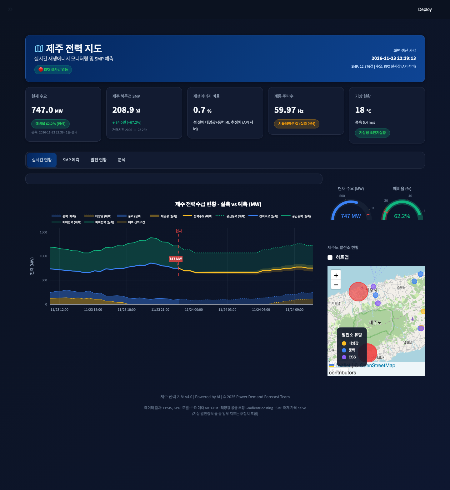
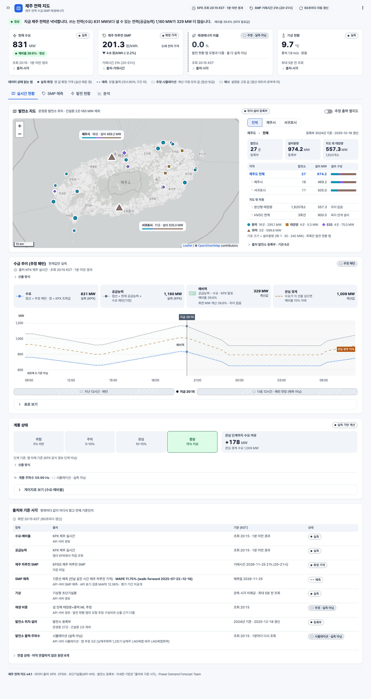
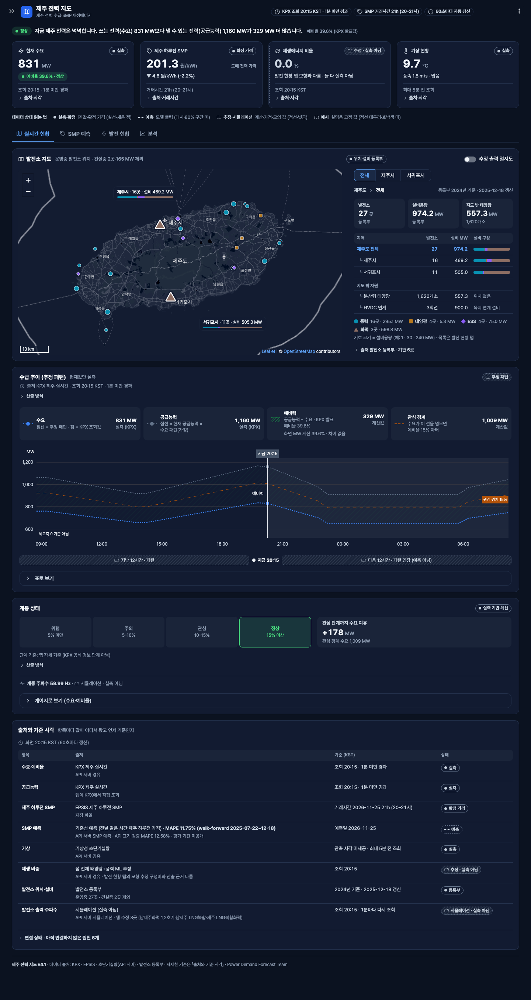
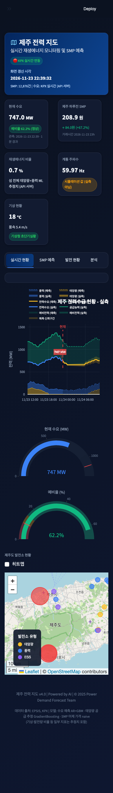
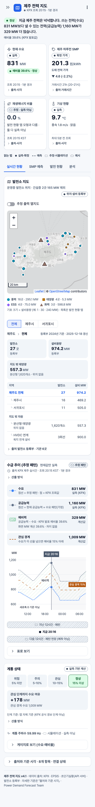
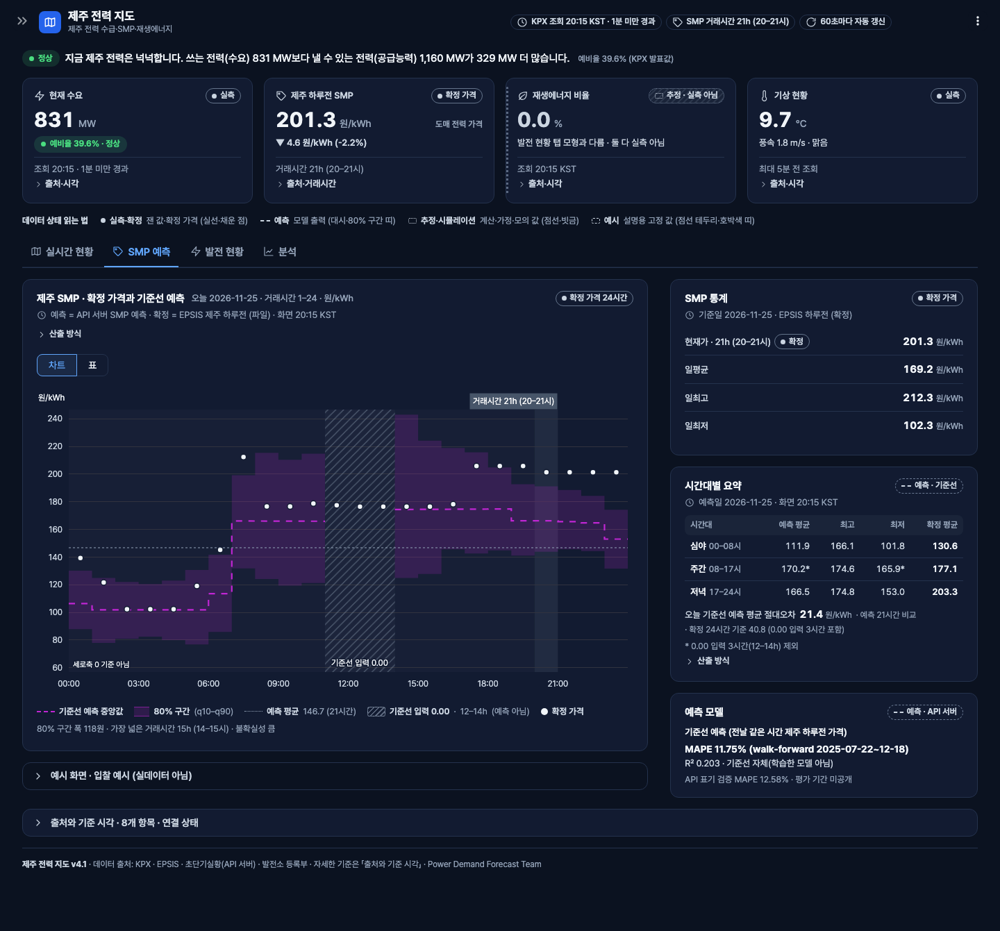

# 제주 전력 지도 대시보드 UI 개편 — 전후 비교 보고서

- 작성: 2026-11-24 13:20 KST에 3차 평가 기준으로 처음 쓰고, 21:15 무렵(5차), 2026-11-25 07:30 무렵(7차), 16:10 무렵(9차), 21:45 무렵(10차·최종), 22:35 무렵(10b 화면 배치 재평가), 2026-11-26 04:20 무렵(공개 주소 확인) 다시 썼다 · 범위: `src/dashboard/app_v4.py`, `.streamlit/config.toml` (워크트리 `.claude/worktrees/dashboard-top1`, 브랜치 `ui/dashboard-top1`, 2026-11-25 5.2절 8의 사용자 결정대로 main에 fast-forward 병합(`15b49880`·`df9f9fe5`)하고 운영에 반영·푸시했다)
- 개편 전: 기준 커밋 `9166104c`(운영 MAIN과 같은 앱). 화면·대비는 2026-11-23 22:39\~22:43 KST 운영 화면(8504) 캡처, 성능·터치는 같은 코드를 띄운 dev 8514에서 측정
- 개편 후: 커밋 `b84f9be3`(10차·최종 평가 대상)과 그 위 마무리 한 줄 수정 `778a3974`(운영 반영본, 10b 화면 배치 재평가 대상). 스크린샷(2.3절)과 대비(2.2절)는 10차 캡처다. 2026-11-25 dev 8514(운영 알림 차단)에서 찍었고 자료 시각은 20:15\~20:17 KST다. 2.1절 표와 4.1절의 예시 숫자는 9차 평가 대상 `16f7d655`를 평가자 4명이 14:18\~15:30 무렵 잰 값이다(F11·F12가 바꾼 것은 4.6절). 보고서를 쓰며 다시 확인한 결과는 6.3절
- 설계 명세: `docs/2026-11-23-dashboard-ui-top1-design.md`(이하 "명세"). 3차 평가 뒤 11장(개정 D1\~D14, 4.3절), 5차 평가 뒤 12장(개정 E1\~E16, 4.4절), 7차 평가 뒤 13장(개정 H1\~H13, 4.5절), 9차 평가 뒤 14장(개정 J1\~J13, 4.6절)이 더해졌다. 이 보고서는 앱 코드를 바꾸지 않았다. 9차 평가 뒤 F11·F12가 14장을 구현했고, 지금 코드 = 10차 평가 대상이다
- 숫자는 모두 저장된 측정 출력과 평가자 판정 원문에서 옮겼다(부록 A). 반올림은 원본 출력 그대로이거나 한 번만 했다

---

## 0. 먼저 알아 둘 낱말

| 낱말 | 뜻 |
|---|---|
| 루브릭 R1\~R8 | 화면 품질 채점표 8항목, 10점 만점(명세 1.2절). 앵커: 5 = 흔한 Streamlit 데모, 7 = 탄탄한 상용 SaaS, 8.7 = 60Hertz 수준, 9.2 = Electricity Maps 수준 |
| 합격선 | 각 항목 8.0 이상 **그리고** 평균 8.5 이상 |
| 관문 G1\~G20 | 숫자로 재는 합격 조건(명세 9.2절): 회귀 테스트, 넘침, 대비, 터치 스크롤, 성능 등 |
| 빈 띠 (PAR-13) | 카드 안에 글자도 그림도 없이 60px 넘게 비는 띠. 3차부터 평가자 관문이다(명세 D10). 8·9차 레이아웃·접근성 관문 실패가 모두 이것이다 |
| TOP1 | UI 품질 점수 1위 기준(국내 60Hertz 8.7, 글로벌 Electricity Maps 9.2). **시장 점유율 1위가 아니다** |
| 4상태 | 실측·확정 / 예측 / 추정·시뮬레이션 / 예시. 숫자 옆 칩으로 "이 값이 어디서 왔는지"를 알린다 |
| 평가자 | 구현과 분리된 심사 4종: 동등성(경쟁사 화면과 비교), 멘토(비도메인 시선), 레이아웃·접근성, 무결성(데이터 로직·성능). R1\~R8을 모두 채점하는 것은 동등성·멘토 둘이고, 3장의 항목별 평균은 이 두 점수의 평균이다. 레이아웃·접근성(R5·R6·R7)과 무결성(R4·R8)은 일부 항목만 따로 매긴다(3.2절) |
| D1\~D14 | 3차 평가 뒤 명세 11장에 더한 개정 결정 14개. 화면 구조·문구·표시 계층만 바꾼다(4.3절) |
| E1\~E16 | 5차 평가 뒤 명세 12장에 더한 개정 결정 16개. 표시 계층만 바꾼다. 11장과 부딪히면 12장을 따른다(4.4절) |
| H1\~H13 | 7차 평가 뒤 명세 13장에 더한 개정 결정 13개. 표시 계층만 바꾼다. 11·12장과 부딪히면 13장을 따른다(4.5절) |
| J1\~J13 | 9차 평가 뒤 명세 14장에 더한 개정 결정 13개. 표시 계층만 바꾼다. 11\~13장과 부딪히면 14장을 따른다(4.6절). J12는 하지 않았다 |
| F1\~F12 | 3차 평가 뒤 고친 단계 이름. 단계마다 커밋 하나다(부록 B). F8·F9는 명세 13장을, F10은 8차 결함을, F11·F12는 명세 14장을 고쳤다 |
| P1\~P11 | 데이터 연결·데이터 로직·코드 구조를 바꾸므로 사용자 승인이 필요한 후속 항목(5.1절). 이번에 만들지 않았다 |
| 육지 SMP 대체 | 제주 SMP가 0원이거나 비어 있는 거래시간에 앱이 육지 SMP 값을 대신 넣는 기존 데이터 로직. 화면은 이 값을 '확정 가격'과 구분해 '대체값'으로 표시한다(D1) |
| 기준선 0.00 입력 | SMP 기준선 예측은 전날 같은 시간 제주 가격을 그대로 쓴다. 전날 제주 값이 0.00이면 다음 날 그 시간 예측도 0원이 된다. 화면은 이 시간을 회색 빗금 열과 '기준선 입력 0.00 (예측 아님)'으로 밝히고(H3\~H5, 4.5절), 평균·오차 머리 숫자에서는 뺀다(J3, 4.6절) |

---

## 1. 한 줄 결론

**TOP1 합격선을 모두 충족했다.** 루브릭과 무결성은 10차 평가로, 화면 배치는 마무리 수정 뒤의 독립 재평가(10b)로 확인했다.

- 루브릭(10차, `b84f9be3`): 동등성·멘토 두 평가자 평균이 8.57로 합격선 8.5를 넘었고, R1\~R8 여덟 항목이 모두 8.0 이상이다(가장 낮은 R8 실현성 8.05).
- 무결성 관문(10차): 27개 항목 모두 통과했다.
- 화면 배치 관문: 10차에서는 22개 중 1개(PAR-13 상호작용)가 떨어졌다. 휴대폰 폭 360px에서 '게이지로 보기 (수요·예비율)'를 펼치면 카드 안에 67\~68px 빈 띠가 생겼다(기준 60px 이하). 개편 전부터 있던 결함으로, 9차까지의 점검이 접는 칸 테두리 때문에 이 칸을 건너뛰어 10차에 처음 잡혔다.
- 마무리 수정 `778a3974`(CSS 한 줄: 640px 이하에서 게이지 두 열의 행 간격 0) 뒤, 앞선 판단을 모르는 독립 평가자가 화면 배치 관문을 다시 평가했다(10b, 2026-11-25). 바뀐 줄이 닿을 수 있는 항목을 모두 다시 쟀다. 펼침 하나씩 472상태(360\~430px와 대조군 768·1440px × 두 테마), 넘침·깨진 글자·게이지 크기·터치, G1\~G3를 포함한다. 22개 항목 모두 통과했고 360px 빈 띠는 49px다. 다시 재지 않은 항목은 바뀐 줄이 닿지 않는 이유를 항목마다 적고 10차 결과를 이어 썼다(6.3절).
- 10차와 10b 사이의 코드 차이는 CSS 한 줄뿐이라 루브릭·무결성은 10차 값을 그대로 쓴다. 10b에서 G1\~G3를 다시 돌려 모두 통과했다.
- 11차 전체 평가는 사용자가 2026-11-25에 1\~2시간 안에 마무리하자고 정해 하지 않았다. 개선된 화면은 병합해 운영에 반영했다. 남은 결함은 5.3절에 있다(10차 22건 중 높음 0건, 10b가 새로 적은 낮음 1건·참고 1건).
- 수준으로 말하면 평균 8.57은 루브릭 기준점 '탄탄한 상용 SaaS'(7)보다 높고 60Hertz(8.7)보다 조금 낮다. 합격선(8.5)은 넘었지만 이 보고서는 '60Hertz 수준'이라고 하지 않는다.

---

## 2. 전후 비교

### 2.1 요약 표

| 항목 | 개편 전 | 개편 후 (9차 평가) | 관문 |
|---|---|---|---|
| 대비 미달 글자 (탭 4개) | 다크 1440: 12 / 9 / 9 / 9건. 라이트 화면은 없었음 | 다크 1440·390 모두 0건. 라이트의 도구 표시 2 / 1 / 0 / 0건은 오탐(2.2절) | G5 통과 |
| 가로 넘침 | 문서 넘침 0px. 단 390px '일간 요약' 카드 내용 202px가 148px 칸에서 잘림(N1) | 360\~1920px 8개 폭 × 두 테마 × 탭 4 = 64장, 1181·1200px을 더한 10개 폭 × 두 테마 × 탭 4 × 기본·모두 펼침 = 160상태 모두 0px. 페이지 스크롤 칸(`stMain`) 자체의 가로 스크롤도 0px(6차 회귀를 고친 뒤 7\~9차 모두 0, 4.4절) | G4 통과 |
| 넘친 요소(offender) | 장마다 2건. Plotly 측정용 숨은 SVG(-10000px)라 실제 넘침은 아님 | 0건(1차 수정 때 도구가 측정용 SVG를 건너뛰게 고침) | — |
| 화면의 'undefined' | SMP 차트 제목 자리에 'undefined'(1440·390). 당시 도구는 첫 화면·마지막 탭만 봐서 0으로 셈 | 탭마다 보이는 글자·SVG 글자를 검사해 0, Plotly 제목 요소(`.gtitle`) 0 | G4 통과 |
| 빈 막대 | 높이 34px 빈 카드: 1440 실시간 951px·SMP 845px·발전 418px와 845px, 390 358px | 0개(160상태) | G16 통과 |
| 카드 안 빈 띠 (60px 넘음) | 재지 않음(3차에 관문이 생김) | 기본·모두 펼친 상태 128개는 0. 단 KPI '출처·시각'을 하나만 펼치면 같은 행 닫힌 칸에 51\~97px(9차 불합격). F11 뒤 최대 18px(J1, 4.6절) | PAR-13 9차 불합격 |
| 테마 | 다크 전용 CSS 위에 라이트 Streamlit 테마: 흰 선택 상자·흰 툴팁·흰 0선, 전환 없음 | 라이트·다크 둘 다(기본 = 시스템 설정). ⋮ → Settings로 바꾸면 다시 실행 없이 0.15\~0.61초 안에 모두 바뀜(지도 타일 색·흐림 포함) | G9 통과(2초 안) |
| KPI 높이 | 5장. 1440 174/165/164/152/180px(최대 28px 차), 390 168/143/142/148/157px(26px 차) + 홀로 남는 카드 | 4장. 11개 폭 × 두 테마 모든 행 편차 0px(1440 180.7px, 390 214.6px), 홀로 남는 카드 0 | G8 통과 |
| 게이지 | 1440 플롯 폭 148px, 눈금 '1000'·'60' 잘림 | 기본 화면에서는 접힌 칸 '게이지로 보기 (수요·예비율)' 안(D2). 펼치면 10개 폭에서 그림 폭 268\~340px, 그림 밖 글자 0 | G17 통과 |
| 지도 | 1440 312×350px(화면에서 가장 작은 요소), 밝은 OSM 그대로, 고정 범례가 기호 2개를 가림, 화력 3곳 범례 없음, 출처 글자 16px·2줄 | 지도 879×502px(1440, 인스펙터 높이에 맞춤)·332×340px(390) + 지역 인스펙터, 테마별 타일 색(다크 남색 바다, 라이트 641px 이상 흐림 .8), 3px 후광을 두른 모양·크기 기호 27곳, 화력 포함 범례, 출처 12px·한 줄(16.8px), 모든 폭에 축척 막대. 다른 탭에서 시작한 다시 실행 뒤에도 기본 시점(30/30) | G18 통과 |
| 모바일 스와이프 (390) | 차트·지도 위를 쓸면 페이지가 0px 움직임 | 차트·게이지·지도·표 14곳 모두 205\~342px | G7 통과 |
| 출처 표기 | '실측 vs 예측' 제목 아래 합성 곡선을 '(실측)'으로 표기, 다시 실행할 때마다 곡선 모양이 바뀜, 조회 시각을 '관측'으로 표기, 예시 입찰 카드(낙찰 확률 85%)를 실제 카드처럼 노출 | 데이터 카드마다 4상태 칩 1개 + 출처 줄 + 기준 시각(KST)·경과. 곡선은 '추정 패턴'(난수 없음), 예시는 접힌 칸 + '실데이터 아님', 출처와 기준 시각 표 8항목 + 접힌 '연결 상태'(아직 연결하지 않은 원천 6개). 육지 대체값·'기준선 입력 0.00'(빗금 열)·서로 다른 추정 네 값을 숨기지 않고 밝힘(D1·D6·E3·H3\~H5) | G20 통과 |
| 이모지 (화면 계층) | 41개 | 0개(화면 밖 알림 본문 8개는 명세대로 제외) | G15 통과 |
| 정적 계약 `ui_guard.py` | 13/29 | 29/29 | G2 통과 |
| 첫 로드 전송량 (390px) | 무제한 3,557 KB · 요청 66개, 4G 근사 3,497 KB · 64개 | 4G 근사 3,535 KB · 요청 99개(완전한 실행 3회 모두 같음) | G11 ① 개정 예산(3,664 KB 이하) 통과. **원래 예산 3,418 KB는 넘음**(4.3절) |
| 준비 시간 | 무제한 3.9초, 4G 근사 5.5초(각 1회) | 4G 근사 5.5·5.9·5.6초(서버 데이터 캐시가 데워진 첫 로드) | G11 ② 통과(개정 정의). 캐시가 빗나간 실행은 알려진 한계(P10) |
| 자동 갱신·수신량 | 자동 갱신 없음(전체 실행 1회 WebSocket 210 KB) | 60초 자동 갱신(fragment 4개), 10분 관찰 중 임의 60초 창 최대 113.6 KB | G11 ③ 통과(예산 126 KB) |
| Deploy 버튼·문서 언어 | Deploy 보임, `<html lang="en">` | 숨김(`toolbarMode = "viewer"`), `lang="ko"` | — |
| 회귀 테스트 | 35 passed | 35 passed(테스트 파일 수정 0) | G1 통과 |

- 이 표의 개편 후 열은 9차 평가 대상(`16f7d655`)을 평가자가 잰 값이다. F11·F12 뒤(`b84f9be3`) 달라진 것은 이렇다. 빌드 측정에서 접는 칸을 하나씩 연 490상태와 기본·모두 펼친 128상태 모두 60px 넘는 빈 띠가 0이다(4.6절). 10차 캡처(1440·1024·390 × 두 테마)는 첫 화면 문서·`stMain` 넘침 0, 탭 24장 문서 넘침·넘친 요소 0, 스크롤 상태 4장 `stMain`·문서 넘침 0, 깨진 글자·콘솔 오류 0이다. 다크 지도 타일은 641px 이상에서 밝기 .85를 더했다(J13). 1440 실시간 현황 페이지는 2,789 → 2,709px로 짧아졌다(글자 줄임, J2). 10차 평가자가 잰 관문은 3.1절 10차 행에 있다.
- 준비 시간의 개편 전·후 측정이 같은 서버 예열 상태였다는 보장은 없다. 판정은 4G 근사 값으로만 한다.
- 첫 로드 전송량의 호스트별 몫은 7차에 쟀다(4G 근사 대표 실행 3,529 KB: 앱 서버 3,021 KB — Streamlit JS·Plotly 약 2.4 MB, Material Symbols 428 KB, Streamlit `index.html`이 미리 받는 Source Sans 167 KB 포함(빌드 기록 S6) — jsDelivr 432 KB(Pretendard 글꼴 조각), OSM 타일 46 KB, jQuery 30 KB). 9차는 합계만 쟀고 7차 대표 실행보다 6 KB 크다. 기준선의 jsDelivr는 131\~147 KB였다. 화면에 한글 글자 종류가 늘면서 받는 글꼴 조각이 늘었다(4.3절). 요청이 67\~69개뿐인 덜 끝난 실행(9차 무제한 실행 3회)은 세지 않는다(명세 11.4절).
- 캐시가 빗나간 실행: 3차 무결성 7.3·7.3·7.5초, 4차 빌드 7.7초(75초 동안 접속 없음 뒤), 새로 띄운 서버의 첫 실행 8.6초, 7차 무결성 7.0·9.0초(Streamlit 'Running…' 스피너와 함께 글꼴·JS가 약 90 KB 더 옴). 9차는 데워진 실행만 쟀다.

### 2.2 탭별 대비 미달 (WCAG AA, 미달 / 검사한 글자 수)

| 탭 | 개편 전 다크 1440 | 개편 후 다크 1440 | 다크 390 | 라이트 1440 | 라이트 390 |
|---|---|---|---|---|---|
| 실시간 현황 | 12 / 87 | 0 / 326 | 0 / 307 | 2* / 326 | 2* / 307 |
| SMP 예측 | 9 / 96 | 0 / 283 | 0 / 268 | 1* / 283 | 1* / 268 |
| 발전 현황 | 9 / 82 | 0 / 250 | 0 / 238 | 0 / 250 | 0 / 238 |
| 분석 | 9 / 92 | 0 / 296 | 0 / 282 | 0 / 296 | 0 / 282 |

- 개편 후 값은 10차 캡처(커밋 `b84f9be3`, 자료 2026-11-25 20:15\~20:16 KST) 기준이다. 미달 수는 9차 캡처와 같고, 검사한 글자 수는 9차(1440 328/275/253/295)와 조금 다르다.
- 개편 전 미달 예: 사이드바 열기 아이콘 1.14:1, 차트의 'undefined' 1.28:1, 발전소 표 머리 1.28:1, 카드 메타 글자 3.6:1, 차트 눈금·푸터 3.93:1(일반 글자 기준 4.5:1).
- `*` 라이트 표시는 모두 Plotly 칩 3종('지금 20:16'·'관심 경계 15%'·'거래시간 21h (20–21시)')이다. 칩은 자기 바탕 상자를 칠하는데 `contrast.py`가 차트 배경과 비교해 1.0으로 센 오탐이다. 9차 평가자 셋(동등성·멘토·레이아웃·접근성)이 칩 바탕으로 다시 재어 흰 글자/#475569 7.58:1, 흰 글자/#B45309 5.02:1로 통과를 확인했다(명세 G5 제외 ③). 레이아웃·접근성 평가자가 Plotly 주석을 모두 픽셀로 잰 최저값도 5.02:1이다. 10차 캡처에서도 '거래시간 21h' 칩(바탕 #475569)의 흰 글자는 픽셀로 7.58:1이다.
- 모든 접힌 칸과 사이드바를 연 상태에서도 다크 미달은 0건이고, 라이트는 같은 칩뿐이었다(9차 레이아웃·접근성). F12 빌드 점검(`contrast.py --tabs`, 1440·390 × 두 테마)도 앱이 칠하는 글자 미달이 0이다.

### 2.3 개편 전후 화면

개편 전 · 다크 1440 · 실시간 현황 (2026-11-23 22:39 KST, 운영 8504). 맨 위 Deploy 버튼, 높이 150px 히어로(제목·화면 갱신 시각·SMP 건수), 높이가 제각각인 KPI 5장, 차트 위 빈 둥근 막대, 범례 11개짜리 '실측 vs 예측' 차트(앱이 만든 곡선을 '실측'으로 표기), 숫자가 잘린 게이지 2개, 오른쪽 좁은 열의 밝은 지도(고정 범례가 기호를 가림)다.



개편 후 · 라이트 1440 · 실시간 현황 (10차 캡처, 자료 2026-11-25 20:15 KST). 앱 바 → 상태 문장 → KPI 4장 → 읽는 법 띠 → 탭 → 발전소 지도(지도 + 지역 인스펙터) → 수급 추이 (추정 패턴) → 계통 상태 → 출처와 기준 시각 → 푸터 순서다. KPI마다 메타 한 줄('조회 20:15 · 1분 미만 경과')과 닫힌 '출처·시각'이 있다. 이 캡처는 모두 닫힌 상태이고, 하나를 펼쳐도 같은 줄 닫힌 칸은 늘지 않는다(J1). 재생에너지 비율 0.0%(API ML 추정) 아래 덧말 '발전 현황 탭 모형과 다름 · 둘 다 실측 아님'은 한 줄이다(J4). 기상 메타는 '최대 5분 전 조회'다(J7). 수급 차트 'MW'는 맨 위 눈금 '1,200' 위에 떨어져 있고(H2), 예비력 칸에는 '화면 MW 계산 39.6% · 차이 없음'이 있다(F10). 출처 카드의 접힌 줄은 '연결 상태 · 아직 연결하지 않은 원천 6개'만 쓰고, 푸터은 한 줄이다(J2). 페이지 높이는 9차 캡처 2,789px보다 짧은 2,709px다.



개편 후 · 다크 1440 · 실시간 현황 (자료 20:15 KST). 같은 화면이고 테마만 다르다. 다크 지도 타일은 카드와 같은 남색 바다에 섬이 바다보다 밝고(E10), 641px 이상에서는 밝기 .85를 더해 기호가 지명보다 먼저 보이게 했다(J13: 기호 대 둘레 타일 명암 3.62 → 3.96:1). 그래도 9차 동등성이 짚은 바탕 잡음은 남았다. 제주시 화력 ▲ 옆에 공항 ✈가 있고, 바다를 여객선 점선이 가로지른다(근본 해결은 지명 없는 타일 P4).



개편 전 · 다크 390 · 실시간 현황 (2026-11-23 22:39 KST). 히어로와 KPI 5장(마지막 1장은 홀로 남음)이 첫 화면을 다 쓰고, 차트 제목이 범례 위에 겹친다.



개편 후 · 라이트 390 · 실시간 현황 (자료 20:15 KST). 한 열로 쌓이고 앱 바는 칩 줄 없이 한 단(제목 아래 'KPX 조회 20:15 · 1분 미만 경과')이다. KPI는 2×2이고 카드마다 '출처·시각' 접힘이 있으며, SMP KPI는 값 아래 줄에 '도매 전력 가격'을 쓴다(H7). 재생 KPI 덧말은 '발전 현황 탭 모형과 다름 ·' / '둘 다 실측 아님' 두 줄이고, '아님'이 홀로 넘어가지 않는다(J4). 지도는 640px 이하라 타일을 .65로 흐렸다(H11). 수급 차트 'MW'는 '1,200' 위에 떨어져 있다. 출처 표는 '출처와 기준 시각 · 8개 항목 · 연결 상태' 접힌 칸이고, 푸터은 세 줄로 감싼다. 페이지 높이는 9차 3,444px보다 짧은 3,304px다.



개편 후 · 다크 1440 · SMP 예측 (자료 20:15 KST). 카드 머리는 제목 줄과 출처·시각 한 줄뿐이고, 갱신 주기와 하루전 시장 설명은 닫힌 '산출 방식' 안에 있다(J2). 대시 계단 = 기준선 예측 중앙값, 보라 띠 = 80% 구간, 가는 점선 = 예측 평균 146.7(예측 21시간), 흰 점 = 오늘 확정 가격(EPSIS 제주 하루전) 24시간, 세로 음영 = 지금 거래시간 21h (20–21시)다. 거래시간 12h·13h·14h는 기준선 입력(전날 같은 시간 EPSIS 제주 값)이 0.00이라 예측이 0원이 된 시간이다. 이 시간은 회색 빗금 열과 이름표 '기준선 입력 0.00'으로 그리고 계단과 띠를 끊는다(H4). 세로축 위에 단위 '원/kWh', 왼쪽 아래에 '세로축 0 기준 아님'이 있다(J10). 범례는 '기준선 입력 0.00 · 12–14h (예측 아님)'과 '예측 평균 146.7 (21시간)'이고, 그 아래 메모 줄 '80% 구간 폭 118원 · 가장 넓은 거래시간 15h (14–15시) · 불확실성 큼'이 몇 시 띠인지 말한다(J5). 오른쪽 시간대별 요약의 머리 숫자는 '오늘 기준선 예측 평균 절대오차 21.4 원/kWh · 예측 21시간 비교'이고, 이어서 회색 '확정 24시간 기준 40.8 (0.00 입력 3시간 포함)'을 남긴다(1440 오른쪽 열에서는 둘째 줄로 넘어감, J3). 주간 행은 '170.2* · 174.6 · 165.9*', 각주는 '* 0.00 입력 3시간(12–14h) 제외' 한 줄이다. 9차 화면의 굵은 40.8·평균선 128.4·주간 113.5*/0.0*가 이렇게 바뀌었다(이유는 4.6절).



---

## 3. 평가 라운드 기록

### 3.1 점수 (항목별 평균 = 동등성·멘토 두 평가자 평균, 굵은 글씨 = 8.0 미만)

| 라운드 (평가 커밋) | R1 시각 | R2 위계 | R3 차트 | R4 출처 | R5 테마 | R6 반응형 | R7 접근성 | R8 실현성 | 평균 | 루브릭 | 관문 | 결함 수 |
|---|---|---|---|---|---|---|---|---|---|---|---|---|
| 1차 (`97becda6`) | **7.85** | 8.0 | 8.05 | 8.45 | 8.4 | 8.1 | **7.65** | 8.25 | 8.09 | 불합격 | 불합격 | 52 |
| 2차 (`07678d41`) | 8.15 | 8.0 | 8.1 | 8.45 | 8.55 | 8.05 | 8.4 | 8.25 | 8.24 | 불합격 | 불합격 | 39 |
| 3차 (`53b7f015`) | 8.1 | **7.7** | **7.9** | 8.45 | 8.65 | 8.2 | 8.25 | 8.2 | 8.18 | 불합격 | 불합격 | 38 |
| 4차 (`c188f83d`) | 8.35 | 8.3 | 8.25 | 8.65 | 8.65 | 8.4 | 8.4 | 8.25 | 8.41 | 불합격 | 불합격 | 30 |
| 5차 (`920fc47d`) | 8.2 | 8.2 | 8.3 | 8.6 | 8.65 | 8.45 | 8.5 | 8.15 | 8.38 | 불합격 | 불합격 | 27 |
| 6차 (`0ed5a3d4`) | 8.2 | 8.3 | 8.1 | 8.5 | 8.65 | **7.85** | 8.5 | 8.1 | 8.28 | 불합격 | 불합격 | 26 |
| 7차 (`48d37d5e`) | 8.3 | 8.35 | 8.35 | 8.75 | 8.6 | 8.45 | 8.55 | 8.0 | 8.42 | 불합격 | 통과 | 37 |
| 8차 (`cd5c478d`) | 8.45 | 8.4 | 8.5 | 8.8 | 8.7 | 8.6 | 8.6 | 8.0 | 8.51 | 통과 | 불합격 | 22 |
| 9차 (`16f7d655`) | 8.4 | 8.4 | 8.5 | 8.85 | 8.7 | 8.6 | 8.5 | 8.0 | 8.49 | 불합격 | 불합격 | 19 |
| 10차 (`b84f9be3`) | 8.55 | 8.5 | 8.6 | 8.9 | 8.75 | 8.7 | 8.55 | 8.05 | 8.57 | 통과 | 불합격 | 22 |
| 10b (`778a3974`, 화면 배치 관문만 독립 재평가) | — | — | — | — | — | — | — | — | — | (10차 값) | 통과 | 6 |
| 합격선 | 8.0 | 8.0 | 8.0 | 8.0 | 8.0 | 8.0 | 8.0 | 8.0 | 8.5 | | | |

- 4·5·7·9차 루브릭 불합격은 평균(8.41·8.38·8.42·8.49 < 8.5) 때문이다. 항목 하한은 네 라운드 모두 넘었다. 6차는 R6 반응형(7.85)도 8.0 아래였다. 8차는 루브릭을 처음 통과했다(평균 8.51).
- '관문' 열은 레이아웃·접근성과 무결성 평가자의 관문이다(둘 다 모두 통과해야 '통과'). 1\~9차 중에는 7차만 통과했다. 동등성·멘토가 채점 안에 둔 관문(루브릭, 7차 MAP-STATE·MW 겹침 등)은 3.3절에 따로 적는다.
- 결함 수는 네 평가자가 적은 결함의 합이다. 같은 문제를 둘 이상이 적으면 따로 센다. 6차 26건은 major 2 · medium 4 · minor 5 · low 15, 7차 37건은 major 1 · medium 2 · minor 7 · low 27(멘토 low 18건), 8차 22건은 major 1 · minor 2 · low 19, 9차 19건은 medium 2 · low 17이다.

### 3.2 평가자별 점수 (3\~9차 원 점수)

| 라운드 | 평가자 | R1 | R2 | R3 | R4 | R5 | R6 | R7 | R8 | 평균 |
|---|---|---|---|---|---|---|---|---|---|---|
| 3차 | 동등성 | **7.9** | **7.9** | 8.0 | 8.4 | 8.6 | 8.1 | 8.2 | 8.1 | 8.15 |
| 3차 | 멘토 | 8.3 | **7.5** | **7.8** | 8.5 | 8.7 | 8.3 | 8.3 | 8.3 | 8.21 |
| 3차 | 레이아웃·접근성 | | | | | 8.4 | 8.6 | **7.8** | | |
| 3차 | 무결성 | | | | **7.5** | | | | 8.5 | |
| 4차 | 동등성 | 8.3 | 8.3 | 8.3 | 8.8 | 8.6 | 8.5 | 8.5 | 8.2 | 8.44 |
| 4차 | 멘토 | 8.4 | 8.3 | 8.2 | 8.5 | 8.7 | 8.3 | 8.3 | 8.3 | 8.375 |
| 4차 | 레이아웃·접근성 | | | | | 8.8 | 8.7 | 8.1 | | |
| 4차 | 무결성 | | | | 8.8 | | | | 8.6 | |
| 5차 | 동등성 | 8.1 | 8.1 | 8.3 | 8.6 | 8.6 | 8.5 | 8.6 | 8.0 | 8.35 |
| 5차 | 멘토 | 8.3 | 8.3 | 8.3 | 8.6 | 8.7 | 8.4 | 8.4 | 8.3 | 8.41 |
| 5차 | 레이아웃·접근성 | | | | | 8.7 | **7.9** | 8.6 | | |
| 5차 | 무결성 | | | | 8.8 | | | | 8.6 | |
| 6차 | 동등성 | 8.2 | 8.2 | 8.2 | 8.5 | 8.6 | **7.9** | 8.6 | 8.1 | 8.29 |
| 6차 | 멘토 | 8.2 | 8.4 | 8.0 | 8.5 | 8.7 | **7.8** | 8.4 | 8.1 | 8.26 |
| 6차 | 레이아웃·접근성 | | | | | 8.7 | 8.2 | 8.6 | | |
| 6차 | 무결성 | | | | 8.7 | | | | 8.4 | |
| 7차 | 동등성 | 8.3 | 8.4 | 8.5 | 8.9 | 8.6 | 8.6 | 8.6 | 8.0 | 8.49 |
| 7차 | 멘토 | 8.3 | 8.3 | 8.2 | 8.6 | 8.6 | 8.3 | 8.5 | 8.0 | 8.35 |
| 7차 | 레이아웃·접근성 | | | | | 8.7 | 8.5 | 8.6 | | |
| 7차 | 무결성 | | | | 8.8 | | | | 8.3 | |
| 8차 | 동등성 | 8.4 | 8.4 | 8.5 | 8.9 | 8.7 | 8.6 | 8.6 | 8.0 | 8.51 |
| 8차 | 멘토 | 8.5 | 8.4 | 8.5 | 8.7 | 8.7 | 8.6 | 8.6 | 8.0 | 8.50 |
| 8차 | 레이아웃·접근성 | | | | | 8.7 | 8.3 | 8.7 | | |
| 8차 | 무결성 | | | | 8.9 | | | | 8.2 | |
| 9차 | 동등성 | 8.4 | 8.4 | 8.5 | 9.0 | 8.7 | 8.6 | 8.5 | 8.0 | 8.51 |
| 9차 | 멘토 | 8.4 | 8.4 | 8.5 | 8.7 | 8.7 | 8.6 | 8.5 | 8.0 | 8.475 |
| 9차 | 레이아웃·접근성 | | | | | 8.8 | 8.4 | 8.7 | | |
| 9차 | 무결성 | | | | 8.8 | | | | 8.2 | |

- 빈칸 = 그 평가자가 매기지 않는 항목. 평균 열은 평가자가 원문에 적은 값 그대로다(7차 동등성은 67.9 ÷ 8 = 8.4875를 8.49로, 9차 멘토는 67.8 ÷ 8 = 8.475로 적음). 9차 동등성은 원문에 평균이 없어 68.1 ÷ 8 = 8.5125를 8.51로 적었다. 1·2차 평가자별 원 점수는 파일로 남아 있지 않다.
- 일부 항목만 매기는 두 평가자의 점수는 3.1절 평균에 들어가지 않는다(1\~9차 같은 규칙). 그래서 5차 레이아웃·접근성 R6 7.9는 3.1절 R6 8.45에 반영되지 않았다.

### 3.3 라운드별 불합격 관문

| 라운드 | 평가자 | 불합격 관문 |
|---|---|---|
| 1차 | 동등성 | R7 키보드 초점 표시, R1 상태 줄 균형, R1 카드 아래 여백, R1 한글 낱말 단위 줄바꿈, R6 390px KPI 값 정렬, G12 루브릭, 점수 근거, 경쟁사 동등성 |
| 1차 | 멘토 | 키보드 초점, 한글 줄바꿈, 5초 메시지(SMP·발전 현황·분석 탭), 루브릭 합격 |
| 1차 | 레이아웃·접근성 | G4x(글자가 카드 밖으로 나가지 않음), KBD(키보드 초점) |
| 1차 | 무결성 | G11 ① 첫 로드 전송량 ≤ 3,418 KB |
| 2차 | 동등성 | 평균 8.5 이상 |
| 2차 | 멘토 | 발전 현황 5초 메시지, 모바일 숨은 내용 없음, R2 8.0 이상(7.8), R6 8.0 이상(7.8), 항목별 8.0, 평균 8.5 |
| 2차 | 레이아웃·접근성 | KBD |
| 2차 | 무결성 | G11 |
| 3차 | 동등성 | PAR-1 항목별 8.0, PAR-2 평균 8.5, PAR-8 60Hertz 지도 무대 동등, PAR-12 스크롤 상태 겹침 0, PAR-13 카드 안 60px 넘는 빈 띠 0, PAR-14 범위 안 수정만으로 합격 가능 |
| 3차 | 멘토 | 탭별 5초 메시지, 탭 사이 숫자 일치, R2 8.0 이상, R3 8.0 이상, 평균 8.5 |
| 3차 | 레이아웃·접근성 | KBD |
| 3차 | 무결성 | G11, DIFF-REVIEW |
| 4차 | 동등성 | PAR-RUBRIC: 항목은 모두 8.0 이상이지만 평균 8.44 |
| 4차 | 멘토 | 개발 어휘·미완성 인상 없음('(승인 항목 P3)'·'README …'·파일 경로·'(demand_only)'·'(/smp-forecast)'가 화면에 있었고, 스크롤하면 »·⋮만 남은 60px 빈 띠), 상호작용 상태 정직(390 SMP 툴팁 25곳 중 19곳에서 육지 대체값과 이웃 시간 확정 가격이 한 상자에 함께 보임), 평균 8.5(8.375) |
| 4차 | 레이아웃·접근성 | PAR-12(390에서 스크롤 16\~36px 사이 » 버튼이 흐려지는 앱 바 칩 위에 겹침), KBD(스크롤한 뒤 불투명 헤더 밑에 키보드 초점이 숨음, 표 캔버스 초점이 안 보임, 지도 팝업이 열린 채 밀려남) |
| 4차 | 무결성 | 없음(G11은 개정 예산으로 통과) |
| 5차 | 동등성 | PAR-RUBRIC-MEAN(평균 8.35), PAR-D10-EMPTY-BAND(1440 인스펙터 안 120px 빈 띠, 열지도를 켜면 약 170px), PAR-LEGEND-BALANCE(수급 범례 '예비력' 칸 7줄, 네 칸 모두 135px), PAR-INTEGRITY-POPUP(지도 팝업의 설비 초과 출력과 이용률 100% 모순) |
| 5차 | 멘토 | 숨은 보기의 추정값 일치('지금 풍력·재생'이 네 가지 값), 첫 화면에 비좁거나 덜 끝난 곳 없음(예비력 칸 6줄, 인스펙터 125px 빈 칸, 390 숫자·단위 끊김, 390 지명 겹침), 평균 8.5(8.41) |
| 5차 | 레이아웃·접근성 | PAR-13(1181\~1300px에서 범례 칸 글자 열이 10\~35px로 좁아져 빈 띠 83\~101px, 예비율 차이 문구가 붙으면 260\~304px) |
| 5차 | 무결성 | 없음 |
| 6차 | 동등성 | RUBRIC(평균 8.29, R6 7.9), F10-OVERFLOW-360-1920(768px에서 페이지 스크롤 칸이 옆으로 17px 밀림. 문서 넘침(docOverflow)은 0이라 도구의 기본 판정 값에는 안 잡힘) |
| 6차 | 멘토 | F10 가로 넘침 0(721\~784px에서 64 → 1px), E8 숫자·날짜 묶음 끊김 0(721\~834px 출처 표에서 '('와 ')'가 홀로 줄을 차지), 루브릭(평균 8.26, R6 7.8) |
| 6차 | 레이아웃·접근성 | G4(768px 페이지 스크롤 칸 785 vs 768px, 두 테마), E8(390px 시간대별 발전량 산출 방식 '(6–' / '18시)' 끊김 + 768px 외톨이 괄호) |
| 6차 | 무결성 | 없음 |
| 7차 | 동등성 | RUBRIC(평균 8.49, 모든 R 8.0 이상), MAP-STATE(새 검사: 발전 현황 → '추정 출력 보기' → 실시간 현황이면 9번 중 4번 지도가 줌 8로 열리고 다음 실행까지 그대로) |
| 7차 | 멘토 | MEN-CHART-TEXT-COLLISION(수급 차트 'MW'와 맨 위 눈금 '1,600' 겹침, 1440·390 두 테마), MEN-RUBRIC(평균 8.35) |
| 7차 | 레이아웃·접근성 | 없음(15개 모두 통과) |
| 7차 | 무결성 | 없음(18개 모두 통과) |
| 8차 | 동등성 | 없음(7개 모두 통과. RUBRIC은 평균 8.51로 평가자 표현 '좁은 합격') |
| 8차 | 멘토 | 없음(10개 모두 통과. 평균 8.50으로 평가자 표현 '기준선에 딱 걸린 합격') |
| 8차 | 레이아웃·접근성 | PAR-13(발전 현황 '모형 추정 보기'에서 시간대별 카드를 '표'로 바꾸면 1280px 이상에서 도넛 카드가 1,048px로 늘어 빈 띠 111px, 산출 방식을 펴면 1,110px·106\~108px. 1280·1366·1440·1920px, 두 테마) |
| 8차 | 무결성 | 없음(22개 모두 통과) |
| 9차 | 동등성 | 없음(9개 모두 통과, 평균 8.51) |
| 9차 | 멘토 | MEN-RUBRIC(평균 8.475, 모든 R 8.0 이상) |
| 9차 | 레이아웃·접근성 | PAR-13 상호작용(KPI '출처·시각'을 하나만 펼치면 같은 행 닫힌 칸에 빈 띠: 1181·1200·1280px 70px, 1440·1920px 67px, 641px 63px, 768·1024px 51\~55px, 360·390px 76\~97px, 두 테마 같음. 기본·모두 펼친 상태 128개는 통과) |
| 9차 | 무결성 | 없음(22개 모두 통과) |

- 10차 관문 결과는 3.1절 10차 행과 5.3절에 있다.

### 3.4 라운드 사이에 고친 것

- **1차 → 2차 (커밋 `07678d41`)**: 탭·본문·헤더 버튼·토글·표 도구 막대의 키보드 초점 테두리와 "지도 건너뛰기" 링크, 상태 줄 격자(게이지 7 : 계통 상태·주파수 5), 한글 `keep-all`, 카드 아래 여백, 390px KPI 칩 줄바꿈, 인스펙터 넘침, 지도 기본 줌 10, SMP 차트 높이 440px와 구간 가장자리, SMP '변동 없음' 표기, 게이지 천 단위 눈금, 사이드바 경보 이력을 경보가 난 같은 실행에서 반영, SMP 모델 카드의 MAPE 설명, 발전 현황 범례·"모형 한계" 문장, 분석 탭 섹션 머리.
- **2차 → 3차 (커밋 `53b7f015`)**: 세그먼트·선택 상자·펼침·대화상자·사이드바 닫기 버튼의 초점, 발전 현황 탭 머리 문장(모두 시뮬레이션·세 화면 계산 방식이 다름), 등록부 요약 합계, 빗금 진하기 절반, 수급 세로축('0 기준 아님')·예비력 이름표, 시간 띠 조회 시각, SMP 평균선 라벨 상자와 두 MAPE 숫자 설명, 분석 탭 낱말 풀이, 출처 표 접기(641px 이상 실시간 탭에서만 펼침), 등록부 표 열 정리·발전소 열 고정, 641\~1180px 인스펙터 한 단·SMP 통계 타일, 다크 지도 타일 톤 재조정, 지역 선택 시 맞춤 확대·흐림, `live_generation` fragment 삭제(G11 ③ 여유 확보).
- **3차 → 4차 (명세 11장 D1\~D14, 커밋 `2c75fb40`·`fbfa938c`·`c188f83d`)**: 3차 결과를 받아 오케스트레이터가 명세에 11장을 더했고, 빌더 셋이 차례로 구현했다. F1(`2c75fb40`): 제주 SMP 대체값 표기(D1), 스크롤 헤더(D9), 지도 확대 상한·화력 기호(D11), 키보드·화면 읽기 요약(D12), 출처 표 어휘(D13), G11 절감 시도와 예산 개정 측정(D14). F2(`fbfa938c`): 계통 상태 카드 하나(D2), 수급 추이 (추정 패턴)(D3), 발전 현황 사실 먼저(D4), 칩 1개·산출 방식·연결 상태(D5), 읽는 법 중립 잉크(D8), 빈 띠(D10). F3(`c188f83d`): SMP 확정 가격 겹치기·정확도 표기 통일(D6), 분석 탭 수요 벤치마크 차트(D7). 자세한 내용은 4.3절.
- **4차 → 5차 (커밋 `920fc47d`)**: 붙은 앱 바(스크롤해도 제목·조회 시각·칩이 위에 남고 불투명 60px 빈 띠를 없앰, 640px 이하 한 줄), 키보드(앱 바 밑에 완전히 숨는 초점 3곳 → 0, 표 초점 고리, 다른 기호로 초점이 가면 지도 팝업 닫힘, 탭 아이콘을 CSS 꾸밈으로 그려 화면 읽기에서 'map icon' 제거), 등록부 표(설비 막대 열, 설비 큰 순, 901px 이상은 고정 열 없이 이름을 본문 잉크로), 수급 추이(지난 12시간에 곱하던 ±2% 난수 제거, 툴팁 순서 = 그림 위아래 순서), SMP(확정·대체 점을 한 계열로 그려 390 툴팁에 섞이지 않게 19/25 → 0/25, 머리 칩 1개, 시간대별 요약에 확정 평균과 오늘 기준선 예측 평균 절대오차), 거래시간 표기 '17h (16–17시)' 통일, KPI 변화량을 화면에 보인 두 값의 차로, 예비율 'KPX 발표값' 표기와 계산값 차이 문구, 'KPX 조회' 되풀이 줄임, 분석 탭 개발 어휘 제거와 시간대별 AR 기준선 추가, 출처 표 칩 정리, 390 표 모서리 검은 점 제거.
- **5차 → 6차 (명세 12장 E1\~E16, 커밋 `818a6994`·`a8dbcc5e`·`0ed5a3d4`)**: 5차 결과를 받아 오케스트레이터가 명세에 12장을 더했고, 빌더 셋이 차례로 구현했다. F4(`818a6994`): 예비력 칸·상태 문장(E1), 신선도 '1분 미만'(E5), 실시간 현황·출처 카드 숫자 묶기(E8), 연결 상태 접기(E15). F5(`a8dbcc5e`): 팝업 설비 초과 문구(E2), 인스펙터 빈 띠(E6), 휴대폰 팝업(E7), 다크 지도 색(E10), 기호 후광(E11), 지도 카드 머리(E12), 열지도 안전 장치(E13). F6(`0ed5a3d4`): 추정 네 값 리본(E3), SMP 문구(E4), SMP·분석 숫자 묶기(E8), 추정 출력 표 두 벌(E9), 지금 시각 막대(E14), 분석 탭 차이 한 줄(E16)과 마지막 전체 점검. 자세한 내용은 4.4절.
- **6차 → 7차 (커밋 `48d37d5e`, F7)**: 출처 표 721\~833px 넘침(긴 묶음 둘을 쪼개고 괄호를 묶음 안으로), SMP 기준선 0.00 입력 표시(그 칸을 세로축 계산에서 빼고 ▼ 표지·각주·평균 절대오차 '빼면 20.0'), 641\~1180px 앱 바 칩 한 줄, KPI·인스펙터 꼬리 묶기, 예비력 차이 문장을 칸 아래 한 줄로(원인 문장은 '산출 방식'으로), 마우스로 지도를 눌렀을 때 지도 전체 고리 없앰, 팝업이 열린 동안 축척 막대 숨김, 접는 칸 아이콘 이름이 화면 읽기에 읽히던 것 제거, SMP 입찰 예시를 두 열 아래로·표 열 순서, 갱신 주기 문구, 추정 리본 시각, 재생 비율 KPI 덧말. 작업 중 찾은 KPX 실패 상태의 360px 앱 바 넘침(10px)도 고쳤다(4.4절).
- **7차 → 8차 (명세 13장 H1\~H13, 커밋 `6d63e34f`·`cd5c478d`)**: 7차 결과를 받아 오케스트레이터가 명세에 13장을 더했고, 빌더 둘이 차례로 구현했다. F8(`6d63e34f`): 숨은 탭 지도 다시 맞춤(H1), 'MW' 단위 글자 자리(H2), 재생 KPI 덧말(H6), SMP 풀이(H7), 인스펙터 셋째 칸(H10 첫째), 빗금·기호 후광·타일 흐림(H11), 글자·72ch·낱말 풀이 목록(H12), 수급 표 시각·지도 팝업 Esc(H13 일부). F9(`cd5c478d`): SMP 0.00 입력 판정 한 곳(H3)·빗금 열(H4)·표·툴팁·요약 표기(H5), SMP 통계 칸·두 열 끝·띠 주석 자리(H8), 휴대폰 표 두 곳·360 요약 표(H9), 분석 탭 walk-forward 두 토막(H10 둘째), '모형 추정 보기' 두 카드 머리·MAPE 선 모양(H13 나머지)과 마지막 전체 점검. 자세한 내용은 4.5절.
- **8차 → 9차 (커밋 `16f7d655`, F10)**: 도넛 카드 늘림을 시간대별 카드가 차트일 때만(PAR-13), KPI 메타를 모든 폭에서 한 줄 + 펼침, 390 KPI 첫 행 한 줄, SMP 띠 주석이 거래시간 표지와 겹치면 메모 줄로, 예비력 칸 '화면 MW 계산' 줄 늘 보이기, 라이트 지도 타일 흐림 .8, 표 안내 줄 여백, 재생 KPI 덧말 조건 넓힘, 태양광 범위 문구, 기상 문구, 수급 툴팁 시각, 푸터 묶음, 낱말 풀이 두 항목, 모든 시간이 0.00 입력일 때의 세로축. 숨은 탭 지도 탐침을 `$T/probe_mapstate.py`로 더했다. 자세한 내용은 4.5절.
- **9차 → 10차 (명세 14장 J1\~J13, 커밋 `0791880c`·`b84f9be3`)**: 9차 결과를 받아 오케스트레이터가 명세에 14장을 더했고, 빌더 둘이 차례로 구현했다. F11(`0791880c`): KPI 펼침 형제 칸 높이(J1), 글자 양 — 푸터 한 줄·카드 머리 둘째 설명을 '산출 방식'으로·분석 탭 용어 풀이 접기·세 번 넘게 나오는 단서 정리(J2-1·2·5·6, 탭 0·2·3), 외톨이 줄(J4), 기상 글자(J7), 수급 표 시각 규칙(J9), 화력 팝업 순서(J11), 다크 타일(J13). F12(`b84f9be3`): SMP 머리 숫자(J3), 띠 메모 시간(J5), 툴팁 머리(J6), 표 숫자 열(J8), 세로축 단위(J10), SMP 탭 글자 양(J2-2·3·4·6)과 마지막 전체 점검. J12는 하지 않았다. 자세한 내용은 4.6절.
- **10차 뒤 (마무리, `778a3974`)**: 10차 화면 배치 관문에서 떨어진 한 항목(360px 게이지 펼침 빈 띠 67\~68px)을 평가자 제안대로 CSS 한 줄로 고쳤다. 평가자 탐침으로 360 49 · 375 45 · 390 42px(두 테마)이고 641px 이상은 그대로다. 고친 뒤 화면 배치 관문만 독립 평가자가 다시 평가했다(10b, 통과).

### 3.5 흐름 읽기

- 평균은 8.09 → 8.24 → 8.18 → 8.41 → 8.38 → 8.28 → 8.42 → 8.51 → 8.49다. 가장 크게 오른 것은 명세 11장 개정이 들어간 3차 → 4차(+0.23)와 6차 결함을 고친 6차 → 7차(+0.14)다. 명세 13장이 들어간 7차 → 8차는 +0.09로, 8차 8.51이 1\~9차 중 가장 높고 그때까지 루브릭을 넘은 유일한 라운드다. 9차 8.49는 그보다 0.02 낮다. 3차 → 4차에 R2 정보 위계는 7.7 → 8.3, R3 차트는 7.9 → 8.25로 올라 1\~3차에서 가장 높던 값(R2 8.0, R3 8.1)보다 높아졌다.
- 3차 평가 원문(`DEFECTS_r3.json`)을 보면 R2·R3가 내려간 이유는 같은 숫자의 5번 반복(772 MW·102.3%), 시뮬레이션 주파수의 큰 숫자, 지도 다음으로 큰 요소가 추정 패턴 곡선인 점, 수요 예측이 화면 어디에도 없는 점, 발전 현황 탭이 시뮬레이션부터 보이는 점, 설명 없는 넓은 SMP 띠, 무작위 막대 차트였다. 동등성 R1에는 스크롤한 헤더 버튼 겹침, 카드 안 70\~106px 빈 띠, 12px 회색 단서 글자 벽이 꼽혔다. 3차 보고서에 적은 추측(정직성 문장이 늘어 읽을거리가 많아졌다)은 '글자 벽' 부분만 맞았다. D2\~D7은 이 지적을 겨냥했다.
- 4차 → 5차는 −0.03이다. 동등성 R1·R2가 8.3 → 8.1, R8이 8.2 → 8.0으로 내렸고 R7은 8.5 → 8.6으로 올랐다. 5차 결함 일부는 4차 수정에서 생겼다. 4차 멘토가 짚은 '예비력 549 ÷ 수요 856 = 64.1%인데 화면은 64.3%' 어긋남을 밝히려고 넣은 문구(4차 멘토가 제안한 꼴)가 범례 '예비력' 칸을 7줄로 늘렸고(PAR-LEGEND-BALANCE·PAR-13), 인스펙터 오른쪽 아래 빈 칸을 메우려고 출처 펼침을 바닥으로 내린 것이 빈 칸을 가운데로 옮겼다(PAR-D10).
- 5차 → 6차는 −0.10이다. 명세 12장(E1\~E16)으로 5차 결함 대부분을 고쳤지만, 그중 E8(숫자·날짜 묶기)이 721\~833px 출처 표를 카드보다 넓게 만들어 768px에서 페이지가 옆으로 밀렸다(두 채점 평가자 R6 7.9·7.8). 또 날짜가 11-25로 바뀌자 SMP 기준선이 전날(11-24) 12\~14시 제주 0.00을 그대로 옮겨, 0원 계단과 −200 안팎까지 늘어난 세로축이 나타났다(코드 회귀가 아니라 자료 상태). 앞의 것은 4차 → 5차와 같은 꼴(고친 것이 다른 결함을 만듦)의 되풀이다(4.4절).
- 6차 → 7차는 +0.14다. R6 반응형이 7.85 → 8.45, R4 출처가 8.5 → 8.75, R3 차트가 8.1 → 8.35로 올랐고, R8 실현성은 8.1 → 8.0으로 내렸다.
- 7차 → 8차는 +0.09다. R1 시각 8.3 → 8.45, R3 차트 8.35 → 8.5, R6 반응형 8.45 → 8.6, R5 테마 8.6 → 8.7이 올랐다. 7차 불합격 관문 둘(지도 시점, MW 겹침)이 풀렸고, 8차 멘토는 7차 멘토 결함 20건 중 15건이 고쳐졌다고 적었다. 대신 F9의 도넛 카드 늘리기가 레이아웃 관문을 떨어뜨렸다(4.5절).
- 8차 → 9차는 −0.02다. 멘토 R1 8.5 → 8.4, 멘토·동등성 R7 8.6 → 8.5가 내리고, 동등성 R4가 8.9 → 9.0으로 올랐다. 9차 멘토는 7차 멘토 결함 대부분이 고쳐졌다고 적으면서도, 글자 밀도(1440 보이는 글자가 8차보다 늘어남)와 '아님' 줄바꿈을 R1·R2의 걸림돌로 들었다. 레이아웃 관문은 F10이 KPI 메타를 접으면서 드러난 빈 띠로 다시 떨어졌다(4.5절).
- 9차 → 10차: F11·F12는 9차 불합격 둘(KPI 펼침 빈 띠, 멘토 루브릭의 글자 양·'아님' 줄)과 SMP 머리 숫자를 겨냥했다(4.6절). 빌드 측정으로는 닫힌 형제 칸 빈 띠 최대 18px, 탭마다 보이는 글자 12.6\~20.0% 감소, 외톨이 줄 0이다. 10차 점수는 3.1절 10차 행에 있다.
- R7 접근성은 7.65 → 8.4 → 8.25 → 8.4 → 8.5 → 8.5 → 8.55 → 8.6 → 8.5이고, 키보드 관문(KBD)은 5차에 처음 통과한 뒤 9차까지 다섯 라운드 연속 통과했다. R5 테마는 3\~6차 8.65, 7차 8.6, 8·9차 8.7이다. 결함 수는 52 → 39 → 38 → 30 → 27 → 26 → 37 → 22 → 19다(7차는 멘토 low 18건).
- R8 실현성은 8.25 → 8.25 → 8.2 → 8.25 → 8.15 → 8.1 → 8.0 → 8.0 → 8.0으로 내려와 바닥에 머문다. 평가자들은 파일이 3,114줄에서 6,903줄로 늘고 CSS가 Streamlit 1.52.1 화면 구조(DOM)에 묶인 것을 이유로 들었다. 명세 13장은 개정의 순증가를 +100줄로 묶었고(실제 +92), 14장은 +10줄로 묶었다(실제 −4, 마무리 한 줄 포함, 지금 6,899줄). 구조 분리는 승인 항목 P11로 두었다(5.1절). 9차 멘토 계산대로 R8이 8.0이면 다른 일곱 항목의 평균이 8.57 이상이어야 평균 8.5를 넘는다.
- 3차 동등성 심사는 "범위 안 수정만으로는 평균 약 8.3, 8.5에는 P2·P3·P7·P4 같은 승인 항목과 게이지 계약 개정이 함께 필요하다"고 내다봤다(PAR-14). 4\~9차는 범위 안 수정만으로 8.41·8.38·8.28·8.42·8.51·8.49까지 왔다. 9차까지는 8.5 경계선에 닿았지만 그 위에 머물지 못했다.

11차 평가는 2026-11-25 사용자가 1\~2시간 안에 마무리하자고 정해 하지 않았고, 10차가 마지막 전체 평가다. 마무리 수정(`778a3974`) 뒤에는 화면 배치 관문만 독립 평가자가 다시 평가했고(10b) 통과했다(1장·6.3절).

---

## 4. 무엇이 바뀌었나

### 4.1 화면별 (지금 코드 = 10차 평가 대상 `b84f9be3` + 마무리 한 줄 `778a3974`)

예시 숫자는 9차 캡처(2026-11-25 14:19\~14:20 KST) 값이고, F11·F12가 바꾼 글자는 10차 캡처(20:15 KST) 글자다. 괄호 속 D·E·F·H·J 번호는 그 화면을 만든 개정(4.3·4.4·4.5·4.6절)이다.

**공통 머리 (모든 탭)**
- 높이 150px 히어로를 한 줄 앱 바로 바꿨다. 제목·부제 + 수신 칩("KPX 조회 14:19 KST · 1분 미만 경과") + SMP 거래시간 칩("SMP 거래시간 15h (14–15시)") + 자동 갱신 칩. 스크롤해도 화면 위에 붙어 있다. 641\~1180px에서는 칩을 줄여 한 줄에 둔다(KPX 칩에서 '조회'·'KST'를 빼고 900px 이하 자동 갱신 칩, 720px 이하 SMP 칩을 숨김, F7). 640px 이하에서는 칩 줄을 숨기고 제목 아래에 "KPX 조회 HH:MM · N분 경과"만 둔다. 60초가 안 된 경과는 '1분 미만 경과'로 쓴다(E5).
- 경보 배너는 예비율 15% 미만일 때만 나온다. 경보 기록·발송은 전체 실행 경로에서만 해서 60초 자동 갱신이 경보를 중복 기록하지 않는다(G10 9차: 180초 동안 새 이력은 첫 전체 실행의 1건, 뒤이은 fragment 9회 0건, Slack·메일 로그 0).
- 상태 문장: "지금 제주 전력은 넉넉합니다. 쓰는 전력(수요) 739 MW보다 낼 수 있는 전력(공급능력) 1,343 MW가 604 MW 더 많습니다." 뒤에는 "예비율 81.7% (KPX 발표값)"만 붙인다. 화면 MW로 다시 계산한 예비율은 수급 범례 '예비력' 칸 아래 한 줄에 늘 둔다('화면 MW 계산 81.7% · 차이 없음', 0.1%p 이상 다르면 'Y%p 차이'). 8차까지는 차이가 있을 때만 나와 60초마다 카드 아래가 21\~22px 오르내렸다(F10). 원인(반올림만으로 약 0.5%p까지, 더 크면 조회 시점 차이 등)은 '산출 방식'에 둔다(E1·F7).
- KPI 4장(현재 수요·제주 하루전 SMP·재생에너지 비율·기상 현황). 시뮬레이션 값인 계통 주파수는 계통 상태 카드의 회색 한 줄로 내렸다. 카드마다 4상태 칩 1개, 짧은 메타 한 줄, '출처·시각' 펼침을 둔다. 641px 이상에서 펼쳐 두던 메타 둘째 줄은 F10부터 모든 폭에서 펼침 안에 있다(D5·F10). 하나를 펼쳐도 같은 줄의 닫힌 칸은 늘지 않는다(J1). SMP 변화량의 '전 거래시간 대비'도 펼침 안으로 옮겼다(J2). 지금 거래시간 SMP가 육지 대체값이면 칩이 "육지 SMP 대체 · 제주 값 0.00"(추정)으로 바뀐다(D1). SMP KPI에는 '도매 전력 가격' 풀이가 붙는다(641px 이상 값 줄 오른쪽 끝, 640px 이하 값 아래 줄, H7). 재생에너지 비율 덧말은 API ML 값이 0.5% 미만이면서 모형 풍력이 0보다 크거나, 모형의 태양광+풍력 비중과 10%p 이상 다르면 '발전 현황 탭 모형과 다름 · 둘 다 실측 아님'으로 바뀐다(H6·F10, '크게'는 J4에서 뺌. 9차: KPI 27.2%, 도넛 45.9%). 기상 메타는 '최대 5분 전 조회'다(F10·J7).
- "데이터 상태 읽는 법" 띠: 4상태 견본을 중립 잉크로 한 줄에 보인다(D8). 탭 아이콘은 CSS로 그린 꾸밈이다(이모지 아님, 화면 읽기에는 탭 이름만 읽힘).

**실시간 현황**
- 발전소 지도: 지도 8/12 + 지역 인스펙터 4/12. 카드 머리는 '운영중 발전소 위치 · 건설중 2곳·165 MW 제외'만 쓴다(E12). 인스펙터는 등록부 사실만 보인다(운영중 27곳·974.2 MW, 제주시 16·서귀포시 11, 지도 밖 태양광 557.3 MW·분산형 1,620개소, HVDC 3회선 900 MW). 1181px 이상에서는 셋째 통계 칸 아랫줄을 '1,620개소'만 두고(H10), 유형 범례도 인스펙터 안(출처 펼침 위)에 두며, 지도 높이를 인스펙터에 맞춘다(1440 502px, E6). 지역을 고르면 그 지역에 맞춰 확대하고(z10 타일 안, D11) 나머지 기호를 흐리게 한다.
- 다른 탭에서 시작한 다시 실행이 숨은 탭에 지도를 새로 만들면, 지도 칸이 240px 이상으로 보일 때 기본 범위(지역을 골랐으면 그 지역)로 다시 맞춘다. 사용자가 끌거나 키를 쓰면 다시 맞추지 않는다(H1).
- 기호는 풍력 ●·태양광 ■·ESS ◆·화력 ▲(최소 14px, 흰 테두리, D11)에 바탕색 3px 후광을 둘렀고(E11·H11), 크기는 설비용량이다. 다크 타일은 SVG 색 행렬로 바다를 카드와 같은 남색, 섬을 바다보다 밝게 칠하고(E10), 641px 이상에서는 밝기 .85를 더한다(J13). 라이트 타일은 641px 이상에서 .8로, 640px 이하는 두 테마 모두 .65로 흐린다(H11·F10). 팝업은 등록부 사실(유형·설비·운영사·위치·상태)을 먼저 둔다. 화력의 추정 출력은 맨 아래 흐린 한 줄이고, 설비를 넘으면 '추정 출력: 발전 현황 탭 · 모형 한계로 설비 초과'로 쓴다(J11). 풍력·태양광·ESS는 추정 두 줄을 사실 뒤에 둔다. 등록부 표는 '>100% · 모형 한계' 규칙 그대로다(E2). 팝업이 열린 동안 확대 버튼과 축척 막대를 숨긴다(E7·F7). Enter로 연 팝업은 Esc로 닫히고 초점이 그 기호로 돌아간다(H13). 추정 출력 열지도는 토글로 켜고 '추정' 칩을 붙인다(지도 크기가 0이면 그리지 않는 안전 장치, E13). 모든 폭에 축척 막대가 있다.
- 수급 추이 (추정 패턴) 카드(D3): 부제 "현재값만 실측"(지난·다음 12시간은 차트 아래 시간 띠가 말함, J2), 칩 '추정 패턴' 1개, '산출 방식' 펼침 → 범례 겸 표 4칸(수요·공급능력·예비력·관심 경계) → 차트 280px → 시간 띠 → 표로 보기. 차트는 공급능력·수요 점선 = 앱 내장 일간 패턴, 현재 점 = KPX 조회값, 예비력 빗금(라이트는 12%로 진하게, H11), 관심 경계선과 오른쪽 끝 '관심 경계 15%', '지금 HH:MM' 선과 미래 음영, '세로축 0 기준 아님'이다. 단위 'MW'는 맨 위 눈금보다 8px 위에 있다(H2). 툴팁 머리는 'MM-DD HH시대'이고(F10), 표로 보기도 그림과 같은 서식으로 'MM-DD HH시대'를 쓰며 지금 행만 분까지 쓴다(J9·H13). 고정 시각 열은 96px다. 지난 12시간에 난수 흔들림이 없다(12.0절 승인).
- 계통 상태 카드(D2): 단계 사다리(위험·주의·관심·정상) + "관심 단계까지 수요 여유 +429 MW" + 각주 "단계 기준: 앱 자체 기준 (KPX 공식 경보 단계 아님)" + 산출 방식 + 계통 주파수 회색 한 줄(시뮬레이션 · 실측 아님) + 접힌 칸 '게이지로 보기 (수요·예비율)'.
- 출처와 기준 시각: 8항목 표(출처 열 = 기관·데이터 이름, 경로·주기는 회색 둘째 줄, D13) + 접힌 '연결 상태' 한 줄 요약('아직 연결하지 않은 원천 6개', 원천 이름은 펼친 목록에만, J2. 펼치면 6칸, 배지는 '미연결' 하나, E15·H12). 641px 이상에서 실시간 탭을 볼 때는 펼친 카드이고, 다른 탭과 640px 이하에서는 접힌 칸이다.

**SMP 예측**
- 차트(D6): 제목 '제주 SMP · 확정 가격과 기준선 예측', 칩 '확정 가격 24시간'이다. 하루전 시장 설명('하루전 시장이라 오늘 가격은 어제 확정 · …', E4)과 갱신 주기는 F12부터 카드 '산출 방식'의 첫 줄·끝 줄이다(J2). 세로축에 단위 '원/kWh'를 쓰고, 축이 0에서 시작하지 않으면 '세로축 0 기준 아님'을 쓴다(J10). 대시 계단 = 기준선 예측 중앙값, 띠 = 80% 구간(모델 예측일 때만), 점선 = 예측 평균(0.00 입력 시간을 뺀 예측 시간만, J3), 채운 점 = 오늘 EPSIS 제주 하루전 확정 가격, 속 빈 점 = 육지 SMP 대체(제주 값 0.00), 지금 거래시간 음영. 범례는 차트 밖에 둔다.
- 기준선 입력(전날 같은 시간 제주 값)이 0.00(또는 결측)이고 그린 중앙값도 0인 시간은 도우미 하나가 정한다. 차트·표·툴팁·각주·산출 방식·화면 읽기가 모두 그 결과를 쓴다(H3). 그 시간은 중앙값 계단과 띠를 끊고, 칸 전체 높이의 회색 빗금 열과 이름표 '기준선 입력 0.00'으로 그린다. 범례 빗금 견본은 '기준선 입력 0.00 · 12–14h (예측 아님)'이다(H4·J2). 육지 대체 각주도 범례 속 빈 점 항목으로 합쳤다(J2). 7차까지 쓰던 축 밖 ▼ 표지는 지웠다.
- 가장 넓은 띠에는 '80% 구간 폭 N원 · 불확실성 큼'을 단다(띠 폭이 그날 중앙값의 2배 이상일 때만). 메모 줄에서는 '80% 구간 폭 118원 · 가장 넓은 거래시간 15h (14–15시) · 불확실성 큼'처럼 시간을 넣는다(J5). 주석은 그림 영역 위에 두고(H8), 놓을 자리가 모두 거래시간 표지와 겹치면 그림 안에 그리지 않고 범례 아래 메모 줄로 옮긴다(그림 높이는 F12부터 468px, 메모 줄이 보이는 때 442px). 640px 이하에서는 늘 메모 줄이다.
- 표 보기: 641px 이상은 거래시간 · 구간 · 예측 중앙값 · 확정 가격 · q10 · q90이고, 640px 이하는 '구간' 없이 거래시간 칸을 '06h · 05–06시' 꼴로 합친 표다(H9). 숫자 열은 숫자 자료형이라 오른쪽 정렬이다. 없는 확정 가격은 '—', 0.00 입력 시간의 중앙값·q10·q90 칸은 표시만 '— (입력 0.00)'이고 값은 모형 출력이다(J8). 툴팁 머리는 '거래시간 20h (19–20시)' 꼴이고(J6), 0.00 입력 칸 툴팁은 원래 모형 값을 세 줄로 한 번 밝힌다('기준선 입력 0.00 · 예측 아님' / '모형 출력 중앙값 0.0' / '80% 구간 −117.0–67.7', H5·J6).
- 오른쪽 열은 SMP 통계 → 시간대별 요약 → 예측 모델 카드 순서다. 같은 순서를 출처 표·분석 탭에도 쓴다(D6).
  - SMP 통계: 현재가가 확정이면 거래시간 토막 뒤에 '확정' 칩을 단다. 이름은 '현재가 · 21h (20–21시)'다(J2). 641\~1180px 칸 모양에서는 값 아래끝을 한 줄로 맞춘다(H8). 일 통계에 육지 대체가 섞이면 머리 칩 '일 통계 일부 대체 · N시간'을 달고, 두 날짜가 다를 때만 날짜 각주를 단다(E4).
  - 시간대별 요약: 예측 평균·최고·최저·확정 평균이다. 0.00 입력 시간을 뺀 값이고, 값이 달라진 칸에만 '*'를 단다(10차 캡처 주간 170.2* · 174.6 · 165.9*). 표 아래에 '오늘 기준선 예측 평균 절대오차 21.4 원/kWh · 예측 21시간 비교'와 회색 '확정 24시간 기준 40.8 (0.00 입력 3시간 포함)', 각주 '* 0.00 입력 3시간(12–14h) 제외' 한 줄, 닫힌 '산출 방식'이 있다(J3·J2).
  - 예측 모델 카드: 굵게 "MAPE 11.75% (walk-forward 2025-07-22\~12-18)"·"R² 0.203 · 기준선 자체(학습한 모델 아님)", 회색 "API 표기 검증 MAPE 12.58% · 평가 기간 미공개"다. API 값이라 날마다 바뀔 수 있다. 1181\~1279px에서는 굵은 MAPE 줄을 13px로 둔다(F12).
  - 평균선 범례는 '예측 평균 146.7 (21시간)'이다(J3).
- 입찰 예시는 "예시 화면 · 입찰 예시 (실데이터 아님)" 접힌 칸이다. 1181px 이상에서는 왼쪽 열 차트 아래에 두어 두 열 끝 차이가 −11\~+12px이고(H8, F12 측정), 1180px 이하는 차트 → 통계 → 요약 → 모델 → 예시 순서 그대로다. 단위 '원'을 '원/kWh'로 바로잡고 'undefined'를 없앴다.

**발전 현황 (D4, 사실 먼저)**
- 탭 머리 한 줄: "발전소 위치·설비용량은 등록부 값입니다. 발전 출력은 실측 연동 전이라 시뮬레이션 추정입니다 (아래 '모형 추정 보기')."
- 발전소 등록부 카드가 맨 위: '유형별 설비용량 (등록부)' 막대(화력 598.8 · 풍력 295.1 · ESS 75.0 · 태양광 5.3 MW), 유형 필터, 표(발전소 · 설비 막대 · 유형 · 지역, 설비 큰 순). 추정 출력·이용률은 '추정 출력 보기' 토글(기본 끔) 뒤에 있고, 설비를 넘는 행은 '>100% · 모형 한계'로 쓴다. 표 메타의 추정 합계 옆에는 '(도넛과 계산 방식 다름)'을 붙인다(E3). 900px 이하에서만 이름 열을 고정하고 가로 스크롤 안내를 둔다(E9). 640px 이하에서 토글을 켜면 '발전소 · 추정 MW · 이용률 · 설비 · 유형 · 지역' 순서 표로 바꿔 추정 값이 첫 화면에 보인다(H9).
- 도넛(전력 공급 구성)과 시간대별 발전량은 접힌 칸 '모형 추정 보기 · 실측 아님' 안에 있다. 맨 위 리본이 같은 화면의 '지금 풍력·재생' 추정 네 값(KPI 재생 비율(API ML) · 도넛 풍력 · 시간대별 막대의 지금 시각 풍력 · 표 풍력 합계)과 태양광 범위('도넛 ≈N MW (섬 전체), 막대 최대 ≈4.2 MW (등록부 설비만)', F10)를 나란히 보이고 '서로 다른 모형 · 모두 실측 아님 · 화면 HH:MM 기준 (새로 고칠 때 다시 계산)'으로 끝난다(E3·F7). 두 카드 모두 칩이 제목 줄에 있다(H13). 1280px 이상에서는 시간대별 카드가 차트를 보일 때만 도넛 카드를 늘려 두 카드 끝을 맞춘다(F10). 시간대별 발전량 칩은 '시뮬레이션 · 무작위 가정'이고, 지금 시각 막대도 채운 채 점선 테두리만 더한다(E14).

**분석 (D7)**
- 머리: "실시간 예측 곡선은 준비 중입니다(연결 승인 대기). 아래는 과거 검증 결과입니다". 바로 아래 닫힌 접는 칸 '용어 풀이 · MAPE·R²·walk-forward 등 8개'(MAPE·R²·KPX 오차율·AR + GBM·holdout·walk-forward·naive·API 신뢰도, H12·F10·J2).
- 모델 성능 카드(테스트가 고정한 문구 그대로) + 칩 '벤치마크 검증값' + 산출 방식. SMP 칸의 'walk-forward' · '2025-07-22\~12-18'은 두 토막이라 641\~720px에서도 회색 칸 안에 든다(H10).
- 카드 '수요 예측 월별 오차 (MAPE) · 2025년 실측 8,760시간 · 학습에 안 쓴 기간': AR + GBM(지금 운영 모델) 4.67% · R² 0.929, 시간대별 AR(가장 강한 단순 기준선) 4.78% · 0.925, LSTM(이전 운영 모델) 5.22% · 0.910, 직전값 유지 6.16% · 0.876. 선 모양은 AR + GBM 강조 실선, 시간대별 AR 대시점, LSTM 대시, 직전값 유지 점선이다(H13). 원천은 저장 출력 `docs/benchmark-2026-11-06/compare_default_2025_out.json`이고, 각주에 "KPX 제주 전력거래량(시간별, MWh) 기준 · 실시간 화면의 계통수요(MW)와 대상이 다름"을 쓴다. 범례 겸 표 아래에 'AR + GBM − 시간대별 AR: 12개월 모두 −0.01\~−0.20%p'(표에 보인 값끼리 뺀 값, E16). 표로 보기 13행(1\~12월 + 전체).
- 예시 화면 3종(XAI·리스크·일간 요약)은 접힌 칸 + "실데이터 아님" 리본.

**사이드바·푸터**
- 사이드바는 기본 접힘이다. 보기(자동 갱신 토글, 테마 바꾸는 법과 1.52.1 제약 — D13에서 푸터에서 옮김), 경보 이력 최근 7일(저장소에 들어 있는 예시 기록 5건은 빼고 그 사실을 밝힘).
- 관리자 도구(알림 테스트·경보 이력 초기화)는 환경변수 `POWERDEMAND_DASHBOARD_ADMIN=1`일 때만 보이고, 초기화는 확인 대화상자를 거친다.
- 푸터: 한 줄 '제주 전력 지도 v4.1 · 데이터 출처: KPX · EPSIS · 초단기실황(API 서버) · 발전소 등록부 · 자세한 기준은 「출처와 기준 시각」 · Power Demand Forecast Team'(J2). 모델 줄은 분석 탭 모델 카드가, '추정·시뮬레이션은 화면에 표시'는 읽는 법 띠가 말한다. 1440에서 한 줄, 390에서 세 줄이다.

**모든 화면 공통 기반**
- 디자인 토큰 한 벌을 라이트·다크 값과 함께 둔다(CSS `light-dark()`). 글꼴 Pretendard, 숫자 `tabular-nums`, 한글 `keep-all`. 각주·카드 아래 줄·낱말 풀이는 최대 72ch다(H12. 푸터 규칙은 J2에서 지움).
- 계열 색 한 벌(`SERIES`): 지도·차트·범례·칩이 같은 색을 쓰고, 빨강은 경보에만, 파랑은 수요 계열에만 쓴다(D8). 다크의 추정 빗금은 알파 .22 → .14로 옅게 했다(H11).
- 차트 공통(`_chart_base`): 제목·모드바·Plotly 범례 없음, 끌기·확대 끔(손가락 스크롤 보장), 통합 툴팁. 차트마다 화면 읽기용 요약 한 줄(D12).
- 키보드 초점 테두리, 지도 건너뛰기 링크, 움직임 줄이기 설정 존중. 지도 칸 테두리 고리는 키보드로 들어올 때만 보인다(F7). 접는 칸(expander) 아이콘은 Streamlit 아이콘 대신 CSS 쐐기라 화면 읽기에 'table_view' 같은 아이콘 이름이 읽히지 않는다(F7). 9차 키보드 점검에서 실시간 현황 탭의 Tab 정류장은 51곳(KPI 펼침 요약 4곳 포함)이다. F12 점검에서 SMP 탭 정류장은 6 → 7곳(요약 '산출 방식'), 분석 탭은 1곳(용어 풀이) 늘었다.
- 숫자+단위·날짜 범위는 줄바꿈 없는 묶음으로 둔다(E8). 긴 묶음은 두 토막으로 나눠 좁은 칸을 넘지 않게 했다(F7·H10).
- 60초 자동 갱신(fragment 4개: 머리·수급·출처 60초, SMP 300초). 사이드바에서 끌 수 있다.

### 4.2 경쟁사 패턴 대응표

| 출처 | 패턴 | 우리 화면의 자리 (코드) | 상태 |
|---|---|---|---|
| 60Hertz | 지도 무대 + 지역 인스펙터 | 실시간 현황 `map_stage` (`create_jeju_map`, `_html_inspector`, `_render_map_focus`) | 구현. 7차 MAP-STATE(숨은 탭 다시 그리기 뒤 줌 8)는 H1로 고침(8·9차 30/30). 9차 동등성: OSM 바탕(공항 ✈·여객선 점선·지명)이 60Hertz보다 시끄럽고(P4), 1440에서 지역·열지도·출처 토글마다 지도 높이가 502\~637px로 바뀜(J12 하지 않음). J13으로 641px 이상 다크 타일을 더 흐림. 5차 동등성: 정적 등록부 지도라 60Hertz보다 낮음(레이어 L2 필요) |
| 60Hertz | 같은 높이 KPI | 공통 머리 `kpi_row` 4장 | 구현(G8 편차 0px). 9차: '출처·시각'을 하나만 펼치면 같은 행 닫힌 칸에 빈 띠(PAR-13 불합격) → J1로 닫힌 칸은 늘지 않음(빌드 측정 최대 18px) |
| 60Hertz | 기준 시각·마지막 수신 표기 | 붙은 앱 바 수신 칩, KPI·카드 메타 "조회 HH:MM KST · N분 경과" | 구현. 관측 시각은 P1 승인 필요 |
| 60Hertz | 라이트·다크 제품군 | `.streamlit/config.toml` `[theme.light]`·`[theme.dark]`, `PD_CSS_TOKENS` | 구현. 선택 저장은 1.52.1 제약(P5) |
| 인코어드 | 실측·계획·예측을 한 축에 | SMP: 확정 가격 점 + 기준선 예측 + 80% 구간(`create_smp_chart`, D6), 0.00 입력 시간은 빗금 열(H4). 수급: 과거 = 추정 패턴, 현재 = KPX 조회값, 미래 = 패턴 연장 | SMP 구현. 수급은 부분(실측 이력 P2·운영 예측 곡선 P3 승인 필요) |
| 인코어드 | 현재 시각 밴드 | 수급 '지금 HH:MM' 선 + 미래 음영, SMP '거래시간 HHh (HH–HH시)' 음영, 발전 막대 '지금 HH시' 상자 | 구현 |
| 인코어드 | 임계선 오른쪽 끝 라벨 | 수급 차트 '관심 경계 15%'. SMP 예측 평균 이름은 확정 가격 점을 가려 차트 밖 범례로 옮김 | 구현 |
| 인코어드 | 예측 구간 | SMP 80% 구간 띠(모델 예측일 때만, 0.00 입력 시간은 띠 없음) | 구현 |
| Electricity Maps | 추정값 빗금 | 예비력 면, 도넛 조각, 발전 막대, 추정 칩 견본, SMP 0.00 입력 열 | 구현 |
| Electricity Maps | "preliminary" 칩 | 4상태 칩 `_html_chip` + 읽는 법 띠 `_html_legend_strip`, 카드마다 칩 1개(D5) | 구현 |
| Electricity Maps | 카드별 Source 줄 | 카드 머리 출처 줄 + 출처와 기준 시각 표(`live_sources`, `_html_data_status`) + 연결 상태(`_html_connection_status`) | 구현. 9차 동등성: 카드 머리 메타가 2\~3줄이라 60Hertz·EM보다 말이 많음 → J2로 카드 머리 = 제목 줄 + 출처·시각 한 줄 |
| Electricity Maps | 과거 실선 · 현재 · 미래 점선 | 수급 차트는 실측 이력이 없어 과거도 점선(추정)으로 정직하게 그리고 시간 띠로 밝힘 | 부분. P2 뒤 과거 실선 |
| Open Electricity | 범례 겸 표 | `_html_supply_legend`, `_html_mix_table`, `_html_timeline_legend`, `_html_smp_legend`, `_html_bench_legend` | 구현. 5차의 '예비력' 칸 7줄 접힘은 E1·F7로 없앰(9차 1181\~1300px 칸 90px) |
| Open Electricity | 발전소 지도 | 모양·크기 기호 `_html_marker` | 구현 |
| GridStatus | KPI 카드 · 통합 툴팁 · tabular-nums | `kpi_row`, `_chart_base`(`hovermode="x unified"`), CSS `tabular-nums` | 구현 |
| KPX(국내 공공) | 표·차트 전환 | SMP·시간대별 발전량 차트·표 전환, 차트마다 "표로 보기" | 구현 |

### 4.3 3차 평가 뒤 개정 (명세 11장 D1\~D14)

3차 평가 결과(루브릭 평균 8.18, R2 7.7·R3 7.9가 8.0 미만, 관문 KBD·G11·DIFF-REVIEW·PAR-12·PAR-13 불합격)와 평가자 결함 목록(`DEFECTS_r3.json`)을 받아, 명세 작성자인 오케스트레이터가 명세에 11장 '3차 평가 뒤 개정'(2026-11-24)을 더했다. 이 장이 앞 장과 충돌하면 이 장을 따른다.

- **누가 승인했나.** 14개 결정은 모두 화면 구조·문구·표시 계층 판단이라 이번 작업 범위(UI/UX) 안으로 보고 오케스트레이터가 승인했다. 사용자 승인이 필요한 데이터 변경은 들어 있지 않다.
- **바꾸지 않은 것.** 회귀 테스트 35개, 데이터 함수 로직(logic_guard 검토 대상 0), 승인 항목 P1\~P8과 새 P9·P10. 앞 장의 [계약] 글자를 바꾸는 경우에도 테스트가 실제로 찾는 문자열·이름·할당은 그대로 남겼다. 새로 허용한 이름은 `load_demand_benchmark`와 표현 접두어 도우미뿐이다.

| # | 화면에서 바뀐 것 | 왜 (3차 평가가 짚은 것) | 커밋 |
|---|---|---|---|
| D1 | 제주 SMP가 0원·결측이라 육지 값으로 바뀐 거래시간은 KPI 칩 '육지 SMP 대체 · 제주 값 0.00'(추정), 출처 줄 '육지 SMP로 대체 (EPSIS 제주 하루전 0.00 · 확정 가격 아님)', SMP 통계·출처 표에 '일 통계에 육지 SMP로 대체한 N시간 포함'. 값(데이터 로직)은 그대로 | 육지 값을 '확정 가격'이라 부르고 있었다(3차 무결성 추가 점검 3건 실패, DIFF-REVIEW) | `2c75fb40` |
| D2 | 상태 줄을 '계통 상태' 카드 하나로: 단계 사다리 + 관심 단계까지 수요 여유(MW) + 'KPX 공식 경보 단계 아님' 각주 + 계통 주파수 회색 한 줄. 게이지 2개는 접힌 칸으로 | 같은 숫자 5번 반복, 게이지가 새 정보를 주지 않음, 뜻 없는 빨간 눈금, 빈 띠(R2) | `fbfa938c` |
| D3 | 제목 '수급 추이 (추정 패턴)', 부제 '현재값만 실측', 차트 높이 360 → 280px, 현재선 옆 숫자 주석 삭제('지금 HH:MM' pill만) | 탭에서 지도 다음으로 큰 요소가 추정 패턴 곡선인데 실측은 점 2개뿐(R2·R3) | `fbfa938c` |
| D4 | 발전 현황 탭: 등록부 카드가 맨 위(유형별 설비용량 막대 + 사실 열), 추정 출력·이용률은 토글 뒤, 도넛·시간대별 막대는 접힌 칸 '모형 추정 보기 · 실측 아님' | 시뮬레이션이 위, 사실이 아래였고 세 합계가 서로 안 맞았다(R2·R4, 멘토 5초 메시지) | `fbfa938c` |
| D5 | 카드마다 상태 칩 1개·출처 줄 1개, 2차 설명은 '산출 방식' 펼침, 흩어진 '아직 연결 전' 문장은 출처 카드 '연결 상태' 6칸으로, 1024px 이상 메타 13px, 390 KPI 메타 한 줄 + 펼침 | 12px 회색 단서 글자 벽(R1·R2) | `fbfa938c` |
| D6 | SMP 차트에 오늘 확정 가격(채운 점)과 육지 대체 시간(속 빈 점)을 예측과 한 축에, 칩 '확정 가격 N시간', 표 보기 확정 가격 열, 세로축 상한과 '80% 구간 폭 N원' 주석, 정확도 표기 통일(굵게 walk-forward 11.75%, 회색 API 12.66%), 1181px 이상 카드 늘림 삭제 | 확정된 날을 예측만 그렸고 확정 가격은 1점뿐, 설명 없는 넓은 띠, 탭마다 다른 MAPE(R3·R2, 멘토 숫자 일치) | `c188f83d` |
| D7 | 분석 탭에 '수요 예측 월별 오차 (MAPE)' 차트(저장 출력에서 읽음, 모델 카드 4.67%·0.929와 같은 값), 머리 문장과 푸터 모델 줄을 '아직 화면에 연결 전'이 드러나게 | 분석 탭에 차트가 없고 제품의 수요 예측 역량이 어디에도 안 보였다(R2·R3) | `c188f83d` |
| D8 | 읽는 법 견본을 중립 잉크로, 파랑은 수요 계열에만, SMP 확정 점은 실측 잉크 | 파란 대시 견본이 파란 점선 수요와 헷갈림(R3) | `fbfa938c` |
| D9 | 스크롤하면 헤더에 불투명 바탕·아래 선. 4차 결함(»·⋮만 남은 60px 빈 띠, 키보드 초점 가림) 뒤 '붙은 앱 바'로 바꿈 | 스크롤하면 »·⋮가 지도·탭 글자 위에 겹침(PAR-12) | `2c75fb40` → `920fc47d` |
| D10 | 모든 탭·폭에서 카드 안 60px 넘는 빈 띠 0(D2·D4·D6으로 대부분 해결) | SMP 106px·도넛 99px·주파수 70px 빈 띠(PAR-13) | `fbfa938c`·`c188f83d`. 5차에 인스펙터·범례 칸 빈 띠로 다시 불합격, E1·E6 뒤 6·7차 통과 |
| D11 | 지역 확대를 z10 타일 안(10.25)으로 제한, 화력 기호 최소 14px + 흰 테두리, 390에서도 축척 막대 | 확대하면 OSM 산 모양 ▲가 화력 ▲처럼 보임 | `2c75fb40` |
| D12 | 다크 지도 확대 버튼·팝업 × 색과 초점 고리, ⋮ 메뉴·Settings 선택 고리, 767px 이하 사이드바가 열리면 본문 가림, 390 표 3개 첫 열 고정 + 안내, 차트마다 화면 읽기 요약 | KBD 불합격(⋮ 메뉴 초점 안 보임, 다크 확대 버튼 1:1 등, R7) | `2c75fb40`(+ `920fc47d`) |
| D13 | 앱 바 칩 뜻 서게(좁은 폭은 '60초 갱신'·'SMP 12–13시' 꼴), 출처 표 출처 열은 기관·데이터 이름 + 경로는 회색 둘째 줄, 테마 안내를 푸터에서 사이드바로, 등록부 열 사실 → 추정 | 화면에 경로·캐시 같은 개발 어휘 | `2c75fb40` |
| D14 | G11 예산 개정(아래) | G11 ① 불합격 | `2c75fb40`(측정) |

**G11 성능 예산 개정 (D14)과 측정 근거**

- 원래 예산(명세 9.2절): ① 첫 로드 ≤ 3,418 KB(기준선 3,557 KB보다 약 4% 작게) ② 4G 근사 준비 ≤ 6.0초 ③ 임의 60초 창 WebSocket 수신 ≤ 126 KB.
- 3차 측정(무결성): ① 3,543\~3,653 KB로 모두 초과. 호스트별로 jsDelivr(Pretendard 글꼴 조각)는 기준선 131\~147 KB에서 466 KB로 늘었고, 앱 서버 몫은 3,304\~3,394 KB에서 3,021\~3,111 KB로 줄었다. 외부 호스트 2곳(cdnjs·bootstrapcdn)은 없앴다. ② 데이터 캐시가 데워진 첫 로드 5.3\~5.7초(통과), 캐시가 식은 첫 실행 7.3\~7.5초(초과). ③ 85.8 KB(통과).
- 개정 내용(명세 11.4절): ① 싼 절감을 먼저 해 보고, 그래도 넘으면 예산을 '기준선 +3% (≤ 3,664 KB)'로 바꾼다. 재측정은 3회, 완전한 실행(요청 93개 이상)만 센다. ② 서버 데이터 캐시가 데워진 첫 로드로 정의하고, 식은 첫 실행은 알려진 한계로 기록한다(줄이려면 P10 승인). ③ 그대로.
- 싼 절감 결과(빌드 기록 F1): 지도 iframe 안 시스템 글꼴 → 0 KB(iframe의 글꼴 요청이 바깥 화면 캐시로 처리돼 절감이 없어 되돌림). 쓰지 않는 Leaflet 자원 → 없음(leaflet.js 36.1 KB·leaflet.css 3.2 KB 모두 쓰임, jQuery 30 KB는 folium 팝업이 씀). 글자 하나 때문에 받던 글꼴 조각 1개 제거(−21 KB, 안내 문구 '옆으로' → '가로로').
- 5차 측정(무결성): ① 4G 근사 완전 실행 3회 모두 3,529 KB(요청 99개: 앱 서버 3,021 · jsDelivr 432 · OSM 46 · jQuery 30). 개정 예산보다 135 KB 작고, 원래 예산보다 111 KB 크고, 기준선 3,557 KB보다 28 KB 작다. ② 5.6·5.5·5.5초. ③ 20분 관찰 중 최대 103.0 KB. 정시를 낀 60초 창은 SMP 그림이 캐시 없이 다시 와서 빌드 측정 122.3 KB였다(그 판은 지금보다 실행마다 약 1 KB 무거움). 무결성 평가자는 이 경우 예산과의 여유가 4\~5 KB뿐이라고 적었다.
- 7차 측정(무결성): ① 완전한 실행 6회 3,509·3,515·3,529·3,535·3,573·3,599 KB(모두 개정 예산 안). ② 4G 근사 14회 중 12회 5.4\~5.6초, 2회는 7.0·9.0초(Streamlit 'Running…' 스피너가 뜬 캐시 빗나감, P10 한계). ③ 10분 관찰 중 최대 112.1 KB(SMP 300초 fragment가 겹친 창).
- 판단의 뜻: 화면 품질(한글 글꼴 조각) 때문에 글꼴 몫이 늘었고, 앱 수정만으로 줄일 몫은 거의 다 줄였다. 그래서 목표를 '기준선보다 작게'에서 '기준선 수준(+3% 이내)'으로 바꿨다. 예산을 측정에 맞춘 결정이므로, 원래 예산 기준으로는 지금도 불합격이라는 점을 함께 적는다.

**명세와 다르게 만든 것 (빌드 기록. 명세와 코드가 다르면 코드 사실을 따름)**

- D11 확대 상한 10.25(명세 '≤ 10.4'): 줌 단위가 0.25라 10.4는 10.5로 올림되고, 10.5는 z11 타일(산 모양 ▲)을 받는다. 대신 지역 맞춤 확대 폭이 +0.25로 작다(지역은 흐림으로 드러낸다).
- D4·D13 등록부 열 순서 발전소 · 설비 · 유형 · 지역(명세: 발전소·유형·지역·설비): 390px 표 칸(약 334px)에 이름·설비·유형이 들어가 가장 중요한 등록부 숫자가 첫 화면에 남게 했다.
- D4 이용률은 막대 대신 글자('≈62%', '>100% · 모형 한계'): 1.52.1 `ProgressColumn`은 행마다 막대·글자를 섞을 수 없다.
- D6 세로축 위 끝에 확정 최댓값·평균 + 6% 여유를 더했고, 폭 주석은 띠 폭이 그날 중앙값의 2배 이상일 때만 단다(모두 좁은 날 '불확실성 큼'은 틀린 말). 예측 평균 이름표는 확정 점을 가려 차트 밖 범례로 옮겼다.
- D14 지도 iframe 시스템 글꼴은 해 보고 되돌렸다(절감 0 KB).
- **오케스트레이터 확인이 필요하다고 빌더가 적은 것 2건(5차 대상 빌드)**: ① 명세 6.2절 N4(지난 12시간에 5분 시드 ±2% 흔들림)를 지웠다. 가정 곡선이 실측처럼 보이지 않게 하려는 것으로, 4차 멘토가 권한 안이다. N4의 목적(같은 입력이면 같은 그림)은 난수가 없으니 그대로 지켜진다(5차 무결성 G20 ② 통과). ② D7 글자를 바꿨다: 머리 문장 '(승인 항목 P3)' → '(연결 승인 대기)', 넷째 계열 '시간대별 AR' 추가(`load_demand_benchmark`가 같은 파일의 `hourly_ar`도 읽음), 파일 경로를 각주에서 '산출 방식'으로. 운영 MAIN 대비 G3는 통과(새 이름)지만, 직전 커밋 대비로는 logic_guard가 이 함수를 바뀐 로직으로 잡는다. 두 건 모두 5차 평가 뒤 명세 12.0절에서 승인됐다(4.4절).

### 4.4 5차 평가 뒤 개정 (명세 12장 E1\~E16)과 6차 평가 뒤 수정 (F7)

5차 평가 결과(루브릭 평균 8.38, 관문 48개 중 8개 불합격, 결함 27건 — 평가자 원문 `DEFECTS_r5.json`)를 받아 오케스트레이터가 명세에 12장 '5차 평가 뒤 개정'(2026-11-24)을 더했다. 이 장이 앞 장(11장 포함)과 부딪히면 이 장을 따른다.

- **누가 승인했나.** 16개 결정은 모두 표시 계층(CSS·문구·배치) 판단이라 이번 작업 범위 안으로 보고 오케스트레이터가 승인했다. 사용자 승인이 필요한 데이터 변경은 들어 있지 않다.
- **바꾸지 않은 것.** 회귀 테스트 35개, 데이터 함수 로직(logic_guard 검토 대상 0), 승인 항목 P1\~P10과 새 P11. 새 이름은 표현 접두어만 썼다(F4\~F7에서 106 → 111개, 명세 12.6절). 쓰지 않게 된 CSS·문구는 같은 커밋에서 지웠다.
- **12.0 확인 2건 — 승인.** 4.3절 끝에 '오케스트레이터 확인 필요'로 적은 두 가지다. ① 수급 추이 차트의 지난 12시간 난수 흔들림 제거(4차 수정): 같은 시각에 같은 그림이 나오고, 실측값·경보 판정에는 영향이 없다(5차 무결성 G20). ② 분석 탭 문구('(연결 승인 대기)')와 시간대별 AR 계열 추가(D7 확장): 가장 강한 단순 기준선과 정직하게 비교하려는 것이고, 값은 저장 출력과 한 번 반올림으로 같다(5차 무결성 D7).
- **12.4 하지 않은 것.** 수급 차트 높이를 220px로 줄이기(D3의 280px 유지), '791 MW' 반복 중 범례 겸 표(차트 범례라 유지), R8 구조 분리(새 승인 항목 P11).

| # | 화면에서 바뀐 것 | 왜 (5차 평가가 짚은 것) | 커밋 |
|---|---|---|---|
| E1 | 예비력 칸 값 아래 작은 글자는 '계산값'만, 'KPX 발표 예비율 N%'는 설명 줄로. 차이 문장은 범례 칸에 한 번만 두고(상태 문장 꼬리는 '예비율 N% (KPX 발표값)'만) 원인을 단정하지 않음. 1181·1200px 범례 행 255·238px → 85px | 예비력 칸 7줄, 1181\~1300px 낱자 끊김·빈 띠 83\~101px(PAR-LEGEND-BALANCE·PAR-13), 차이 원인을 '조회 시점'으로 단정(무결성) | `818a6994` (+ `48d37d5e`) |
| E2 | 팝업과 등록부 표가 같은 도우미로 출력·이용률을 씀. 설비 초과면 '≈275 MW (설비 초과 · 모형 한계)'·'>100% · 모형 한계'. 값은 그대로 | 팝업이 '설비 240.0 MW · ≈275.2 MW · 이용률 100.0%'를 함께 보임(PAR-INTEGRITY-POPUP) | `a8dbcc5e` |
| E3 | '모형 추정 보기' 리본에 같은 화면의 '지금 풍력·재생' 네 값 + '서로 다른 모형 · 모두 실측 아님'. 타임라인 칩 '시뮬레이션 · 무작위 가정', 추정 표 합계 옆 '(도넛과 계산 방식 다름)' | 숨은 보기를 열면 네 값이 설명 없이 다름(멘토 관문) | `0ed5a3d4` |
| E4 | SMP 카드 제목 아래 '하루전 시장이라 오늘 가격은 어제 확정 · …' 한 줄, 현재가 '확정' 칩, 머리 칩 '일 통계 일부 대체 · N시간', 두 날짜가 다를 때만 날짜 각주, 가장 넓은 띠가 대체 시간이면 '같은 시간 EPSIS 제주 0.00 (육지 대체)', 640px 이하 메모 줄 | 넓은 띠와 대체 시간을 잇지 않음, 하루전 시장 설명이 접힌 칸에만 있음, 통계 칩이 진짜 확정 가격까지 덮음(멘토·동등성) | `0ed5a3d4` |
| E5 | 60초 미만은 '1분 미만 경과', SMP 카드 갱신 문구 분리(F7에서 'SMP 예측 5분마다 · EPSIS 파일은 1시간마다 다시 읽음'으로 바로잡음) | 1분이 안 된 것도 '1분 경과', 5분·60초 갱신 차이를 설명하지 않음(멘토) | `818a6994` (+ `48d37d5e`) |
| E6 | 인스펙터 아래로 미는 규칙 삭제, 1181px 이상 유형 범례를 인스펙터 안으로, 지도 높이를 인스펙터에 맞춤(최소 480px), 기본 줌 상한 10. 인스펙터 빈 띠 125·167px → 19px 이하 | 인스펙터 'HVDC 연계'와 출처 사이 빈 칸 120\~125px, 열지도를 켜면 약 170px(PAR-D10) | `a8dbcc5e` |
| E7 | 지도 이동 범위 넓힘, 480px 이하 팝업 폭 제한, 팝업이 열린 동안 확대 버튼 숨김(F7에서 축척 막대도), 팝업이 열리면 같은 기호 툴팁 닫기. 360\~430px 잘린 팝업 25\~27/27 → 0/27 | 휴대폰 폭에서 팝업 윗부분(이름·×)이 잘림(레이아웃 medium), 팝업과 툴팁이 함께 뜸 | `a8dbcc5e` (+ `48d37d5e`) |
| E8 | 숫자+단위·날짜 범위를 줄바꿈 없는 묶음으로(상태 문장 MW, 표 메타 MW, 평균 절대오차 'N 원/kWh', walk-forward 기간 등) | 390px '791 / MW보다', 360·768·1200px '2025-07-22\~12-' / '18)'(멘토·레이아웃) | `818a6994`·`0ed5a3d4` (+ `48d37d5e`, 아래 회귀) |
| E9 | '추정 출력 보기' 표도 기본 표처럼 두 벌(901px 이상 고정 열 없음) | 1440에서 그 표만 이름 열이 흐린 고정 열(멘토) | `0ed5a3d4` |
| E10 | 다크 타일을 CSS 필터 대신 SVG 색 행렬로. 1440 바다 색차(ΔE) 17.4 → 0.99, 섬이 바다보다 밝음, 지명 대비 최저 4.99:1 | 다크 바다가 무채 회색이라 남색 카드에서 뜨고 섬이 바다보다 어두움(동등성·멘토) | `a8dbcc5e` |
| E11 | 기호에 바탕색 2px 후광, 640px 이하 타일 흐림(.75) | 지명이 기호 밑을 지나 잘려 읽힘(동등성·멘토) | `a8dbcc5e` |
| E12 | 지도 카드 머리는 '운영중 발전소 위치 · 건설중 2곳·165 MW 제외'만 | '27곳·974.2 MW'가 머리·인스펙터·표에 세 번(동등성) | `a8dbcc5e` |
| E13 | 열지도가 크기 0인 지도에 그리지 않게 함. 켬 → 다른 탭 → 창 크기 변경 10회 예외 0 | 숨은 탭에서 창 크기를 바꾸면 페이지 예외(4회 중 1회, 멘토) | `a8dbcc5e` |
| E14 | 지금 시각 막대도 채우고 점선 테두리만 더함 | 지금 시각 막대만 빈 점선 상자라 '값 없음'처럼 읽힘(동등성) | `0ed5a3d4` |
| E15 | '연결 상태' 6칸을 접고 한 줄 요약만. 출처 카드 1440 높이 741 → 621px | 홈 탭이 '미연결' 카드 6장으로 끝나 할 일 목록처럼 보임(멘토) | `818a6994` |
| E16 | 분석 탭 범례 아래 'AR + GBM − 시간대별 AR: 12개월 모두 −0.01\~−0.20%p' | 두 선이 0.01\~0.20%p 차이로 겹쳐 '12개월 모두 낮음'이 안 보임(멘토) | `0ed5a3d4` |

**명세와 다르게 만든 것 (빌드 기록 F4\~F7. 명세와 코드가 다르면 코드 사실을 따름)**

- E1: 차이 문장 예시에서 'KPX 발표값과'를 뺐다(바로 앞 설명 줄이 'KPX 발표 예비율 N%'라 되풀이). F7에서는 원인 낱말도 칸에서 빼고 '산출 방식' 고정 줄로 옮겼다(1181px에서 차이 문장 때문에 칸이 5줄이 되어서).
- E4: 띠 주석 자리를 띠 위에서 띠 안 빈 반쪽으로 옮겼다(띠 위 자리가 확정 점 3개를 가렸다). '같은 시간' 꼬리는 명세대로 차트 날짜의 대체 시간에만 붙였다. 그래서 다음 날 기준선의 0.00 입력은 6차 결함으로 남았다.
- E5: '1분 미만'을 '1분 미만 경과'로 썼다(다른 상태의 'N분 경과'와 같은 꼴).
- E6: 범례를 인스펙터로 옮기면서 지도 열 범례는 보이지 않게만 남겼다(화면 읽기 순서와 '지도 건너뛰기' 도착점을 지키려고).
- E7: 확대 버튼 숨김을 480px 이하가 아니라 모든 폭에 적용했다(1440에서도 서쪽 팝업 4곳을 컨트롤이 덮었다). 그래서 팝업이 열린 동안 마우스로 확대하려면 팝업을 닫아야 한다.
- E8: 'walk-forward 2025-07-22\~12-18' 한 묶음은 F7에서 두 묶음('(walk-forward' · '2025-07-22\~12-18)')이 됐다(아래 6차 회귀).
- E10: '필터를 남색 쪽으로 당긴다'는 CSS 필터로 맞출 수 없어(약 40만 조합 중 '바다 남색 · 섬이 바다보다 밝음 · 지명 4.5:1'을 함께 맞춘 것 0개) SVG 색 행렬로 했다. 부작용으로 도로가 전보다 밝은 선이 되고 작은 초지는 바다색에 가깝게 어둡다.
- F7 접는 칸 아이콘: 명세 3.8절의 `icon=":material/…:"` 대신 CSS 쐐기를 쓴다(1.52.1이 아이콘 이름을 화면 읽기에 노출, 5.4절).

**6차 평가 뒤 수정 (F7, `48d37d5e`)**

6차 평가(루브릭 평균 8.28, 관문 52개 중 7개 불합격, 결함 26건)를 받아 빌더가 표시 계층만 고쳤다. 명세에 새 장을 더하지 않고 오케스트레이터가 결함 목록(중복을 묶어 24건)을 넘겼다.

| 6차 결함 (평가자) | 바꾼 것 | 측정 |
|---|---|---|
| 출처 표가 721\~833px에서 카드 밖으로 나가 페이지가 옆으로 밀림, 외톨이 괄호(동등성 major, 멘토·레이아웃 관문) | 긴 묶음 둘을 쪼개고 괄호를 묶음 안으로 | 721\~900px 표 = 카드 안쪽 폭, 가로 스크롤 0, 외톨이 괄호 0, 표 높이 608 → 518\~589px |
| SMP 기준선 0.00 입력(동등성 major, 멘토·무결성 medium) | 그 칸을 세로축·가장 넓은 띠 계산에서 빼고 ▼ 표지, 각주·범례·산출 방식·요약에 입력 사실, 평균 절대오차에 '(빼면 20.0)'. 데이터는 그대로 | 세로축 −206\~247 → 57\~247, 확정 가격이 그림 높이의 24% → 58%. 0.00 입력이 없는 날은 그림이 F6과 같음 |
| 641\~900px 앱 바 칩 두 줄(동등성 minor) | KPX 칩 줄임, 900px 이하 갱신 칩·720px 이하 SMP 칩 숨김 | 641\~1180px 한 줄·48px |
| 예비력 칸 차이 문장 5줄(동등성 low) | 칸 아래 한 줄, 원인은 '산출 방식'으로. 대체값 상태 설명은 '점 = 추정값' | 1181·1200px 행 119 → 90px, 대체값 상태 102 → 85px |
| 마우스로 지도를 누르면 지도 전체에 초점 고리(동등성 minor) | 키보드로 들어올 때만 고리 | 마우스 클릭 뒤 가장자리 = 타일 색 |
| 360px 팝업 마지막 줄을 축척 막대가 덮음(동등성 minor) | 팝업이 열린 동안 축척 막대 숨김 | 27/27 팝업과 겹친 컨트롤 0 |
| 접는 칸 아이콘 이름이 화면 읽기에 읽힘('table_view 표로 보기', 멘토 low) | 아이콘을 CSS 쐐기로 | 화면 읽기 요약에 한국어 제목만 |
| KPI·인스펙터 꼬리 홀로 줄, SMP 두 열 끝 약 100px 차, 고정 첫 열 흐림(동등성·멘토 low) | 꼬리 묶기·인스펙터 이름 줄이기, 입찰 예시를 두 열 아래로 | 두 열 끝 차 98\~142 → 42\~86px(목표 24px 못 맞춤). 고정 첫 열은 못 고침(5.2절) |

**6·7차 실패 가운데 이전 수정이 만든 것**

- **6차: 그렇다.** 관문 실패 7개 중 루브릭 둘을 뺀 다섯이 같은 뿌리다(동등성 F10, 멘토 F10·E8, 레이아웃 G4·E8). 5차 결함(날짜 끊김)을 고치려고 E8로 출처 표 SMP 행의 'walk-forward 2025-07-22\~12-18'을 줄바꿈 없는 한 묶음으로 만들었는데(F4 `818a6994`), 그 뒤 4칸 표가 더 줄어들 수 없는 폭이 736px가 됐다. 721\~833px에서 표가 카드 밖으로 나가 페이지 스크롤 칸이 옆으로 밀렸고(768px 17px), 괄호는 묶음 밖에 남아 '('와 ')'가 홀로 줄을 차지했다. 날짜 끊김이 넘침과 괄호 끊김으로 옮겨 간 것이다. 루브릭 둘도 이 넘침으로 R6이 7.9·7.8로 내려간 것이 컸다(멘토 원문). 측정은 빌드 때 이미 있었다: F6 마지막 점검(`f6/g4last`)도 768px에서 stMain 넘침 17px를 기록했지만, 판정에는 문서 넘침(0)만 썼다. 레이아웃 E8 실패 중 390px '(6–' / '18시)'는 회귀가 아니라 E8이 닿지 않은 곳이다.
- **6차의 SMP 0원 계단은 이전 수정 탓이 아니다.** 날짜가 11-25로 바뀌며 기준선이 전날(11-24) 12\~14시 제주 0.00을 옮긴 자료 상태다. F6 빌더가 '남은 것' 1번으로 이미 적었다(명세 E4가 차트 날짜의 대체 시간만 다뤄서).
- **7차: 관문 실패 중 이전 수정 탓으로 확인된 것은 없다.** 루브릭 둘을 뺀 두 관문을 보면, MEN-CHART-TEXT-COLLISION('MW'·'1,600' 겹침)은 이전 수정 탓이 아니다. 수급 차트 함수(`create_realtime_power_chart`)는 5차 평가 커밋(`920fc47d`) 뒤 바뀌지 않았고, 'MW' 단위 글자는 5단계(`6470a533`)부터 같은 자리에 있다. 세로축 위 끝이 눈금에 걸리는 자료에서만 보인다(7차 보고서를 쓰며 본 07:16 자료에서는 맨 위 눈금이 1,400이라 겹치지 않았다). 8차 앞 F8이 H2로 고쳤다.
- **MAP-STATE(지도가 줌 8로 열림)는 이전 수정 탓이 아니었다(8차 앞 F8에서 확인).** 7차 보고서 때는 원인을 확인하지 못했다. F8이 재현으로 원인을 찾았다. 데이터 함수 `get_jeju_power_plants`(기준 코드 그대로, 60초 캐시)는 캐시가 바뀔 때마다 발전소 추정 출력을 무작위로 다시 나눈다. 그러면 지도 팝업 글자가 바뀌고, streamlit_folium은 지도 JS가 바뀌면 iframe을 새로 만든다. 그 실행이 다른 탭에서 시작되면 숨은(0×0) 칸에서 지도를 맞춰 줌 8이 된다. 이 경로에 F1\~F7 수정은 끼어 있지 않다. 고친 방법은 4.5절 H1이다.
- **관문은 아니지만 7차 결함 셋은 F6·F7 수정이 결함을 옮긴 것이다.** ① SMP 0.00 입력 칸을 세로축 계산에서 빼자 그 칸의 중앙값 계단이 축 아래로 사라져 '정오 예측이 비었다'로 읽힌다. 범례 ▼도 띠 끝만 말한다(멘토 medium, 무결성 low). ② 인스펙터 셋째 칸 이름을 줄였지만 1181\~1220px에서 아랫줄이 '분산형 / 1,620개소 · / 위치 없음'으로 접혀 줄이 약 116px가 됐다(동등성 low). ③ F6이 분석 탭 모델 카드에 넣은 'walk-forward 2025-07-22\~12-18' 한 묶음이 641\~700px에서 회색 칸을 2\~21px 넘는다(레이아웃 minor, F7은 출처 표·SMP 쪽 묶음만 쪼갬). 셋 모두 13장에서 고쳤다(H4·H10, 4.5절).
- **교훈.** 고친 자리만 재면 결함이 옮겨 간 것을 못 본다. F7은 641\~900px 20px 간격을 포함한 25개 폭에서 stMain 가로 스크롤까지 쟀고, 7차에서 넘침 관문이 다시 통과했다.

### 4.5 7차 평가 뒤 개정 (명세 13장 H1\~H13)과 8차 평가 뒤 수정 (F10)

7차 평가 결과(루브릭 평균 8.42, 관문 56개 중 4개 불합격, 결함 37건 — 평가자 원문 `DEFECTS_r7.json`)를 받아 오케스트레이터가 명세에 13장 '7차 평가 뒤 개정'(2026-11-25)을 더했다. 이 장이 앞 장(11·12장 포함)과 부딪히면 이 장을 따른다. 빌더 둘이 차례로 구현했다(F8 `6d63e34f`, F9 `cd5c478d`). 8차 결함은 명세에 새 장을 더하지 않고 F10(`16f7d655`)이 고쳤다.

- **누가 승인했나.** 13개 결정은 모두 표시 계층(CSS·문구·배치·그림 그리기) 판단이라 이번 작업 범위 안으로 보고 오케스트레이터가 승인했다. 데이터 값과 데이터 함수는 바꾸지 않는다.
- **바꾸지 않은 것.** 회귀 테스트 35개, 데이터 함수 로직(logic_guard 검토 대상 0), 승인 항목 P1\~P11, 13.6절 항목(5.2절). F8\~F10은 새 최상위 이름을 하나도 더하지 않았다.
- **줄 수 상한(13.7절).** R8이 바닥(8.0)이라 이번 개정의 순증가를 +100줄 이하로 묶었다. F8 +29 · F9 +52 · F10 +11 = +92줄(6,811 → 6,903). 바뀐 규칙 때문에 쓰지 않게 된 ▼ 표지 코드, 쓰는 곳 없는 표시 키, KPI 펼침 CSS 9줄은 같은 커밋에서 지웠다.

| # | 화면에서 바뀐 것 | 왜 (7차 평가가 짚은 것) | 커밋 |
|---|---|---|---|
| H1 | 숨은 탭에서 지도가 새로 만들어지면 맞춤을 미루고, 지도 칸이 240px 이상으로 보이면 `invalidateSize()` 뒤 기본 범위(지역을 골랐으면 그 지역)로 다시 맞춘다. 끌거나 키를 쓰면 그만둔다. 1440 라이트·1440 다크·1024 다크 각 10/10 기본 시점(고치기 전 0/3, 모두 줌 8) | MAP-STATE: 다른 탭에서 시작한 다시 실행 뒤 9번 중 4번 줌 8로 열림(동등성 major, 관문 불합격) | `6d63e34f` |
| H2 | 수급·시간대별 발전량 차트의 'MW'를 8px 위로. 맨 위 눈금이 축 끝인 자료에서 잉크 간격 0 → 8px(5개 폭 × 두 테마 × 차트 2 = 20/20), 그림 영역·차트 높이 그대로 | 'MW'가 맨 위 눈금 '1,600'에 붙어 한 덩어리로 읽힘(멘토 관문 불합격, 동등성 minor) | `6d63e34f` |
| H3 | '기준선 입력 0.00' 시간 판정을 도우미 하나로(전날 원본 0.00·결측 + 그린 중앙값 0). 차트·표·툴팁·요약·각주·산출 방식·화면 읽기·평균 절대오차가 그 결과만 쓴다. '육지 SMP로 대체' 괄호는 실제로 바뀐 시간에만 | 공시가 그린 값을 보지 않고, 육지도 0이라 바꾸지 않은 시간까지 '대체'라고 씀(무결성 low 2건) | `cd5c478d` |
| H4 | 그 시간은 중앙값 계단과 띠를 끊고, 칸 전체 높이 회색 빗금 열 + 이름표 '기준선 입력 0.00' 한 번. 범례 '기준선 입력 0.00 (예측 아님)', ▼ 삭제 | 중앙값 0.0이 축 아래로 사라져 '정오 예측이 비었다'로 읽히고, ▼는 띠 끝만 말함(멘토 medium, 무결성 low) | `cd5c478d` |
| H5 | 표 '— (입력 0.00)', 툴팁 '기준선 입력 0.00 · 예측 아님 (모형 출력 …)', 시간대별 요약 '113.5*'·'0.0*' + 각주, 평균선 범례 '(0.00 입력 3시간 포함)'. 값은 그대로 | q10 −158.0 등이 음수 가격 예측처럼 읽히고, '최저 0.0'·'예측 평균 128.4'에 표시가 없음(멘토·동등성 low) | `cd5c478d` |
| H6 | 재생 비율 KPI 덧말 '발전 현황 탭 모형과 크게 다름 · 둘 다 실측 아님'. F10이 조건을 넓힘(모형과 10%p 이상 차이도) | KPI 0.0%가 같은 화면 도넛 풍력 약 20%와 모순으로 읽힘(멘토 medium, 동등성 minor) | `6d63e34f` (+ `16f7d655`) |
| H7 | SMP KPI에 '도매 전력 가격' 풀이(641px 이상 값 줄 오른쪽 끝, 640px 이하 값 아래 줄) | 첫 화면 'SMP'에 풀이가 없음(멘토 low) | `6d63e34f` |
| H8 | 통계 칸 값 아래끝을 한 줄로(768px 44 → 0px, 1024px 26 → 0px), '확정' 칩을 거래시간 토막 뒤로. 입찰 예시를 1181px 이상 왼쪽 열 차트 아래로(두 열 끝 차 42\~67px → 9차 −9\~+12px). 가장 넓은 띠 주석을 그림 영역 위로 | 통계 칸 값 44·26px 어긋남, 두 열 끝 46·67px 차, 띠 주석이 띠와 겹치고 툴팁 세로선이 글자를 지남(멘토 low, 동등성 minor) | `cd5c478d` |
| H9 | 640px 이하 SMP 표는 '구간' 없이 '06h · 05–06시'로 합쳐 390에서 확정 가격까지 가로 스크롤 없이 보임. 등록부 '추정 출력 보기'는 '발전소 · 추정 MW · 이용률 …' 순서 표. 360 시간대별 요약 넘침 9.9 → 0px | 390 '확정 가격' 열이 반쯤 잘림, 추정 열이 화면 밖, 360 요약 표 9\~10px 넘침(멘토·레이아웃 low) | `cd5c478d` |
| H10 | 1181px 이상 인스펙터 셋째 칸 아랫줄은 '1,620개소'만(통계 줄 99\~117 → 82px, 빈 띠 0). 분석 탭 'walk-forward' · '2025-07-22\~12-18' 두 토막(641\~720px 넘침 21 → 0px) | F7이 옮긴 줄바꿈(줄 약 116px), F6 묶음이 641\~700px 회색 칸을 넘음(동등성 low, 레이아웃 minor) | `6d63e34f`·`cd5c478d` |
| H11 | 다크 추정 빗금 알파 .22 → .14(KPI 추정 띠는 .82), 라이트 예비력 빗금 8 → 12%, 기호 후광 2 → 3px, 640px 이하 타일 흐림 .75 → .65 | 다크 빗금이 아른거림, 라이트 예비력 빗금이 거의 안 보임, 지명이 기호에 가림(동등성·멘토 minor/low) | `6d63e34f` |
| H12 | '최대 5분 캐시' → '최대 5분 전 값', '미연동' → '미연결', 각주·푸터·낱말 풀이 최대 72ch, 분석 탭 낱말 풀이를 머리 문장 아래 목록으로 | 개발 어휘 '캐시', 같은 뜻 두 낱말, 165자·149자 한 줄(멘토 low) | `6d63e34f` (+ `16f7d655`) |
| H13 | 수급 '표로 보기' 패턴 행 정시·지금 행만 분, 지도 팝업 Esc로 닫고 초점을 기호로, '모형 추정 보기' 두 카드 칩을 제목 줄에(1440 끝 차 0px), 월별 MAPE 선 모양 넷 구별 | 표 시각이 정밀 측정처럼 보임, Enter로 연 팝업이 Esc로 안 닫힘, 두 카드 머리·끝 약 50px 다름, 회색 계열 셋 비슷(멘토·레이아웃·동등성 low) | `6d63e34f`·`cd5c478d` |

**명세와 다르게 만든 것 (빌드 기록 F8\~F10. 명세와 코드가 다르면 코드 사실을 따름)**

- H1: 명세는 '보이고 240px 이상이 되는 첫 순간에 한 번 맞춘다'였다. 보이는 첫 프레임의 iframe 폭이 기본 300px라 한 번만 맞추면 줌 8.75로 남았다(첫 수정판 실패). 그래서 크기가 바뀔 때마다 다시 맞추고, 300ms 그대로면 그만둔다. '사용자가 움직였으면 맞추지 않는다'는 Leaflet 확대 이벤트(프로그램 맞춤에도 뜸) 대신 누르기·키 입력으로 판정한다.
- H5: '*'는 0.00 칸을 빼면 값이 바뀌는 칸에만 단다. 주간 최고 174.6처럼 0.00 칸이 바꾸지 않는 값에 달면 각주가 틀린 말이 된다.
- H6: 덧말에 숫자 N(모형 추정 ≈N%)을 넣지 않았다. KPI는 60초 fragment가, 리본은 전체 실행이 그려 같은 실행 값이 아니고, 리본 값은 비율이 아니라 풍력 MW다.
- H7: 풀이 줄을 값 위에 더하면 같은 행 KPI 값 자리가 어긋난다. 그래서 641px 이상은 값 줄 오른쪽 끝(높이 그대로), 640px 이하는 값 아래 한 줄로 했다.
- H8: 통계 칸 '2px 이하'는 641\~1180px 칸 모양에서 맞췄다. 1181px 이상은 이름 | 값 목록 모양이라 행마다 기준선을 맞췄다(5.2절). 띠 주석은 카드색 바탕 대신 그림 영역 위로 옮겼다. 툴팁 세로선이 가장 위층이라 바탕으로는 글자를 지나는 것을 막을 수 없다.
- H9: 좁은 SMP 표의 중앙값 머리에서 단위를 뺐고(카드 부제에 있음), 좁은 등록부 표의 추정 출력은 막대 대신 숫자('추정 MW')로 했다. 막대를 두면 390px 표 칸(332px)을 넘었다.
- H10: 명세 예시 '1,620개소 · 위치 없음'도 1181\~1440px 칸에서 두 줄이라 개소 수만 둔다(분산형·위치 없음은 바로 아래 인스펙터 표에 있음).
- H11: 다크 KPI 추정 띠는 명세 비율대로 낮추면 카드 면과 2.31:1(3:1 미만)이라 알파 .82에서 멈췄다. 라이트 예비력 빗금은 수요 점선 대비(부록 A-2) 때문에 12%까지만 진하게 해 범례 견본 농도에는 못 미친다.
- H12: 72ch는 CSS의 ch('0' 폭)라 1440에서 약 536px이다. 기상 글자는 F10이 '최대 5분 전 조회'로 다시 바꿨다(5.2절).
- H13: 두 카드 끝을 맞추려고 1280px 이상에서 도넛 카드를 행 높이로 늘리고, 늘어난 몫을 구성 표 행 간격이 받게 했다. 이것이 8차 레이아웃 관문 실패의 원인이 됐다(아래).

**8차 평가 뒤 수정 (F10, `16f7d655`)**

8차 평가(루브릭 평균 8.51, 관문 58개 중 1개 불합격, 결함 22건)를 받아 빌더가 표시 계층만 고쳤다. 명세에 새 장을 더하지 않고 오케스트레이터가 결함 목록을 넘겼다. 순증가는 +11줄이다.

| 8차 결함 (평가자) | 바꾼 것 | 측정 |
|---|---|---|
| 시간대별 카드를 '표'로 바꾸면 도넛 카드가 1,048px로 늘어 빈 띠 111px(레이아웃 major, 관문 불합격) | 1280px 이상 도넛 카드 늘림을 시간대별 카드가 차트를 보일 때만(중첩 규칙 하나) | 표 보기 1,048 → 378px, 빈 띠 111 → 36\~53px. 차트 보기 두 카드 끝 차 0 그대로 |
| KPI마다 회색 메타 두 줄(동등성 minor, 멘토 low) | 모든 폭에서 짧은 한 줄 + '출처·시각' 펼침. 641px 이상에서 펼쳐 두던 CSS 9줄 삭제 | 641px 이상 KPI 4\~6px 늘어남, Tab 정류장 4곳 늘어남. 9차 PAR-13 상호작용 실패의 원인(아래) |
| 390 KPI 첫 행 '현재 수요' 칸 빈 띠 45\~48px(동등성 low) | 640px 이하 SMP 변화량을 한 줄로 | 첫 행 235.4 → 214.6px |
| 390·360 SMP 카드 위 빈 띠 50px(레이아웃 low) | 띠 주석 자리가 모두 거래시간 표지와 겹치면 그림 안 대신 범례 아래 메모 줄(모든 폭), 그림 440 → 414px | 빈 띠 50 → 28px, 두 열 끝 차 −9\~+12px |
| '화면 MW 계산' 줄이 60초마다 생겼다 없어져 카드 아래가 21\~22px 오르내림(동등성·멘토 low) | 측정 예비율이면 늘 보이고 차이가 없으면 '차이 없음' | 1440 실시간 탭 높이 두 테마 모두 2,789px |
| 지명이 기호에 가림(동등성 minor, 멘토 low) | 라이트 641px 이상 타일 흐림 .8(다크는 지명 대비 기준 때문에 그대로) | 완화만. 근본은 P4 |
| 표 도구 막대가 안내 줄 '(… 열은 고정)'을 덮음(동등성 low) | 640px 이하 안내 줄 오른쪽 여백 | 390·360 겹침 0 |
| 재생 KPI 덧말이 API 0.5% 미만일 때만 나옴, 도넛 태양광 ≈217 MW와 막대 '최대 4.2 MW'가 모순처럼 보임(멘토 low) | 덧말 조건에 '모형과 10%p 이상 차이'를 더함, 리본·범례에 '섬 전체'·'등록부 설비만' 범위 | 9차: KPI 27.2%, 도넛 45.9%에서 덧말 표시 |
| 기상 '최대 5분 전 값'이 코드 사실과 다름, 각주가 결측 원본도 '0.00'이라 씀, 모든 시간이 0.00 입력이면 축 −196\~174(무결성 low) | '최대 5분 전 조회'·'앱이 5분마다 다시 읽음 (기상청 매시 관측)', 각주에 원본 글자, 그때는 확정 가격만으로 축 | 축 106.2\~145.2, 화면 읽기 '예측 칸 없음' |
| 툴팁 분 단위, 푸터 괄호·이름 안 끊김, 낱말 풀이에 없는 'KPX 오차율'·'AR + GBM'(멘토 low) | 툴팁 머리 'MM-DD HH시대', 푸터 토막 묶음, 낱말 풀이 두 항목 | 푸터는 72ch 유지(평가자 요청 96ch는 H12와 부딪침) |

- **F10이 하지 않은 것.** 구성 표를 자연 높이로 두고 가운데 맞추기(실행 중 시험에서 빈 띠 74·91px라 D10 초과), SMP 머리 숫자·툴팁 줄이기(H5 개정 필요), 푸터 96ch(H12와 부딪침). 셋 다 5.2절에 남은 결정으로 적었다. 그중 SMP 머리 숫자·툴팁과 푸터는 14장 J3·J6·J2-1이 정했다(4.6절).

**8·9차 실패 가운데 이전 수정이 만든 것**

- **8차: 그렇다.** 관문 실패 하나(레이아웃 PAR-13)는 F9가 만들었다. F9는 H13('모형 추정 보기' 두 카드 끝 차이 24px 이하)을 맞추려고 1280px 이상에서 도넛 카드를 늘 행 높이로 늘렸다. 옆 시간대별 카드를 '표'로 바꾸면 행이 1,048px가 되고, 도넛 카드도 따라 늘어 빈 띠 111px가 생겼다. F9는 두 카드 끝을 차트 보기(기본)에서만 쟀다. 관문은 넘었지만 8차 결함 둘도 바로 앞 수정이 만들었다. 390·360 SMP 카드 위 빈 띠 50px는 F9 H8의 '한 줄 위' 여백이, 390 KPI 첫 행 빈 띠 45\~48px는 F8 H7의 풀이 줄이 만들었다. F10이 셋을 모두 고쳤다.
- **9차: 관문 실패 둘 다 일부 그렇다.**
  - 레이아웃 PAR-13(KPI 펼침 하나): F10이 8차 지적(KPI마다 회색 메타 두 줄)을 고치려고 641px 이상에서 늘 펼쳐 두던 메타 둘째 줄을 접었다. 그 뒤로는 데스크톱에서도 '출처·시각'을 하나 펼치면, 같은 높이 사슬 때문에 같은 행 닫힌 칸이 함께 늘고 메타 줄이 아래로 밀려 51\~70px 빈 띠가 생긴다. 360·390px의 76\~97px는 D5(F2 `fbfa938c`)부터 있던 동작이다. 빈 띠 점검이 기본 상태와 모두 펼친 상태만 재서 9차에 처음 잡혔다(레이아웃 평가자 원문).
  - 멘토 MEN-RUBRIC(8.475)은 한 결함 때문이 아니다. 멘토가 든 이유 가운데 일부는 F10에서 생겼다. ① F8이 쓰고 F10이 조건을 넓힌 재생 KPI 덧말이 9차 자료에서 나타나, 1181\~1239px에서 '…둘 다 실측' / '아님'으로 접히고, 그 폭의 KPI 네 장이 1240px 이상(181px)보다 17px 높은 198px가 됐다. ② 띠 주석을 메모 줄로만 옮기면서 그 폭이 몇 시 띠인지가 빠졌다. ③ 1440 보이는 글자가 8차보다 탭마다 70\~164자 늘었다. F10이 8차 지적에 답하며 더한 글자(리본 태양광 범위, 낱말 풀이 두 항목, 늘 보이는 '화면 MW 계산 … 차이 없음' 줄)가 들어 있지만, 글자별 몫은 따로 재지 않았다. 나머지 큰 이유(SMP 머리 숫자가 '예측 아님' 시간을 셈)는 H5 명세 결정이다.
  - 관문은 아니지만 F10이 만든 9차 결함이 하나 더 있다. 수급 툴팁 머리를 'MM-DD HH시대'로 바꾸면서, 정시로 반올림하는 '표로 보기' 시각과 매시 15\~29분에는 한 시간 어긋나게 됐다(무결성 low, 값은 같음).
- **7차 MAP-STATE는 이전 수정 탓이 아니었다.** 경로는 4.4절에 적었다(기존 데이터 함수의 60초 캐시 무작위 배분 + 숨은 탭 iframe).
- **교훈.** 5·6차와 같은 꼴(고친 것이 다른 결함을 만듦)이 8·9차에도 되풀이됐다. 이번에는 넘침이 아니라 빈 띠였고, 원인은 '고친 자리의 기본 상태'만 잰 것이다. F9는 차트 보기에서, F10은 모두 닫은 상태와 모두 펼친 상태에서 쟀다. 다음 수정은 같은 행·이웃 카드가 바뀌는 상태(이웃 표 보기, 하나만 펼침)까지 잰다.

### 4.6 9차 평가 뒤 개정 (명세 14장 J1\~J13)과 F11·F12

9차 평가 결과(루브릭 평균 8.49, 관문 60개 중 2개 불합격 — 멘토 MEN-RUBRIC과 레이아웃·접근성 PAR-13 상호작용, 결함 19건 — 평가자 원문 `DEFECTS_r9.json`)를 받아 오케스트레이터가 명세에 14장 '9차 평가 뒤 개정'(2026-11-25)을 더했다. 이 장이 11\~13장과 부딪히면 이 장을 따른다. 빌더 둘이 차례로 구현했다(F11 `0791880c` 16:20\~18:05 KST, F12 `b84f9be3` 18:07\~20:15 KST).

- **누가 승인했나.** 13개 결정은 모두 표시 계층(CSS·문구·배치·그림 그리기) 판단이라 오케스트레이터가 승인했다. 데이터 값과 데이터 함수는 바꾸지 않는다.
- **바꾸지 않은 것.** 회귀 테스트 35개, 데이터 함수 로직(logic_guard 검토 대상 0), 승인 항목 P1\~P11, 13.6·14.6절 항목. 새 최상위 이름은 표현 도우미 `_fmt_trade_hours` 하나이고, 이 가지에서 만든 표현 도우미 `_fmt_smp_foot`을 지웠다.
- **줄 수 상한(14.7절).** 순증가 +10줄 이하, 목표 0줄 이하. F11 0줄(+76/−76) · F12 −5줄(+175/−180) = −5줄(6,903 → 6,898). `:has(`는 J1에만 더했고(글자 수 49 → 53, 4곳 이하 규칙 안), `data-testid`는 189 → 191, `!important`는 63 그대로다. 새 `data-testid` 값은 없다.
- 표의 '왜' 칸 괄호는 9차 평가자와 `DEFECTS_r9.json`의 결함 번호(평가자별 순서)·심각도다. '검증' 칸은 빌드 기록(R13-F11·R14-F12 절)의 측정이다.

| # | 화면에서 바뀐 것 | 왜 (9차 평가가 짚은 것) | 커밋 | 검증 (빌드 기록) |
|---|---|---|---|---|
| J1 | KPI '출처·시각'을 하나 펼치면 같은 줄(1181px 이상은 한 줄, 1180px 이하는 2×2의 그 행)의 닫힌 칸은 늘지 않고 제 높이로 남는다 | 하나만 펼치면 같은 행 닫힌 칸에 빈 띠 51\~97px(레이아웃 L1 medium, PAR-13 상호작용 불합격) | `0791880c` | 닫힌 형제 칸 빈 띠 97 → 최대 **18px**(목표 40px 이하, 10개 폭 × 두 테마, 실제 클릭·탭). 다른 2×2 행·모두 닫음·모두 펼침 편차 0 |
| J2 | 같은 단서는 한 화면에 한 번. 푸터 한 줄, 카드 머리는 제목 + 출처·시각 한 줄, 둘째 설명·갱신 주기는 '산출 방식'으로, SMP 메모 둘째 줄은 범례 견본으로, 분석 탭 낱말 풀이는 닫힌 '용어 풀이'로(지운 정보 없음) | 보이는 글자의 69\~78%가 작은 회색, 1440 글자가 8차보다 늘어남(멘토 D1 medium). 카드 머리 2\~3줄, 카드 앞 낱말 풀이 약 170px(동등성 D9·D3 low) | `0791880c`(탭 0·2·3) · `b84f9be3`(탭 1) | 보이는 글자 12.6\~20.0% 감소, 8칸 모두 목표 안(아래 표). 작은 회색 비율 3\~7%p 내려감 |
| J3 | SMP 평균 절대오차 머리 숫자는 예측 시간만: '**21.4** 원/kWh · 예측 21시간 비교'. 같은 줄 회색 '확정 24시간 기준 40.8 (0.00 입력 3시간 포함)'. 평균선 '예측 평균 146.7 (21시간)', 주간 '170.2* · 174.6 · 165.9*' | 차트가 '예측 아님'으로 그린 시간을 굵은 40.8·평균선 128.4·주간 113.5*/0.0*가 예측으로 셈(멘토 D2·동등성 D6 low). 0.00 입력이 6시간 이상이면 평균선이 축 아래로 빠짐(무결성 I1 low) | `b84f9be3` | 픽스처 10개 × 11검사 **110/110**. 머리 숫자·회색 전체값·평균선·별표·각주·화면 읽기 글이 맞고, 적힌 시간 수 = 계산한 칸 수. 평균선은 모두 축 안 |
| J4 | 부정 구절을 줄바꿈 없는 묶음으로('둘 다 실측 아님', '학습한 모델 아님', '점 = KPX 조회값', '예비율 15% 아래' 등). 재생 KPI 덧말은 '크게'를 빼 '발전 현황 탭 모형과 다름 · 둘 다 실측 아님' | '…둘 다 실측' / '아님'처럼 부정어만 다음 줄로 넘어가 뜻이 뒤집힘. 그 줄 때문에 1181\~1239px KPI가 181 → 198px(멘토 D3·동등성 D2 low) | `0791880c`(+ `b84f9be3` 탭 1) | 외톨이 줄 **0건**(1181·1200·1280·1440·1440 사이드바 열림 × 두 테마 × 탭 4). KPI 높이 모두 180.7px |
| J5 | SMP 메모 줄에 시간: '80% 구간 폭 118원 · 가장 넓은 거래시간 15h (14–15시) · 불확실성 큼' | 메모 줄이 몇 시 띠인지 말하지 않음(멘토 D4 low) | `b84f9be3` | 시간 토막은 줄바꿈 없음. 토막 끊김 0(5폭 × 두 테마 × 탭 4) |
| J6 | SMP 툴팁 머리 '거래시간 20h (19–20시)', 계열 이름 뒤 'h' 뺌, 0.00 입력 칸 툴팁은 세 줄 | 툴팁 '10:00부터 1시간'·'예측 중앙값 11h'가 표·이름표의 '거래시간 15h (14–15시)'와 다른 꼴(동등성 D4 low) | `b84f9be3` | 1440·390·360 × 두 테마 × 6자리 잘림 **0/36**(고치기 전 390·360의 0.00 입력 칸 88\~118px 잘림) |
| J7 | 기상 글자를 KPI·펼침·출처 표 모두 '최대 5분 전 조회'로 | H12 '최대 5분 전 값'은 코드 사실과 다름(8차 무결성). 9차 무결성이 F10 글자가 맞음을 확인해 14장이 받아들임 | `0791880c` | 펼침 2곳·출처 표 1곳 글자를 맞춤 |
| J8 | SMP 표 q10·q50·q90·확정 가격 열을 숫자 열로(오른쪽 정렬). 없는 확정 가격 '—', 0.00 입력 칸은 표시만 '— (입력 0.00)' | 숫자가 글자 열이라 왼쪽 정렬로 들쭉날쭉, 수급·MAPE 표와 다름(멘토 D5 low) | `b84f9be3` | 실제 '표' 클릭, 1440·390 × 두 테마: 숫자 열 오른쪽 정렬, 390 첫 화면에 '예측 중앙값'·'확정 가격', 가로 넘침 0 |
| J9 | 수급 '표로 보기' 시각을 툴팁과 같은 규칙·서식('MM-DD HH시대')으로, 지금 행만 분까지. 고정 시각 열 폭 96px | 지금 행 '11-25 14:35'가 열 끝까지 차 잘린 듯(멘토 D6 low). 툴팁과 표의 시각이 매시 15\~29분에 한 시간 어긋남(무결성 I2 low) | `0791880c` | 분 :07·:20·:37·:50 등 10개 시각에서 어긋남 **0**. 지금 행 오른쪽 여백 0\~2 → 16\~17px |
| J10 | SMP 세로축 단위 '원/kWh'(수급 'MW'와 같은 자리·꼴), 축이 0에서 시작하지 않으면 왼쪽 아래 '세로축 0 기준 아님' | 두 주요 차트의 축 표기가 다름(동등성 D5 low) | `b84f9be3` | 단위와 맨 위 눈금 간격 19\~20px, 축 끝이 눈금에 걸린 픽스처 6\~7px(기준 4px 이상, 5폭 × 두 테마) |
| J11 | 지도 팝업은 등록부 사실(유형·설비·운영사·위치·상태) 먼저. 화력 추정 출력은 맨 아래 흐린 한 줄 '추정 출력: 발전 현황 탭 · 모형 한계로 설비 초과' | 가장 큰 기호(화력 3곳)의 첫 클릭이 사실 사이의 설비 초과 추정을 보임(동등성 D8 low) | `0791880c` | 팝업 위 잘림 0, × 지도 안 27/27(14회 × 기호 27), Esc 닫힘·초점 복귀 40/40 |
| J12 | 하지 않음(14장의 선택 항목) | 1181px 이상 지도 높이가 토글마다 502\~637px로 바뀌어 아래 카드가 최대 약 135px 움직임(동등성 D7 low) | — | 8px 안으로 묶으면 1181px 기본 상태에 약 58px 빈칸(아래) |
| J13 | 641px 이상 다크 타일에 밝기 .85를 더함(라이트 .8·640px 이하 .65·후광 3px 그대로) | OSM 바탕(공항 ✈·여객선 점선·지명)이 기호와 다툼(동등성 D1 low) | `0791880c` | 기호 대 둘레 타일 명암 3.62 → 3.96:1, 가장 밝은 지명 7.65 → 5.90:1(4.5:1 이상 유지) |

**탭별 보이는 글자 수 (J2 수용, 라이트, 9차 멘토 탐침 `probe_text9.py`, 그림 글자 제외)**

| 탭 | 1440: 9차 → F12 (목표) | 390: 9차 → F12 (목표) |
|---|---|---|
| 실시간 현황 | 1,601 → 1,399 (1,440 이하) | 1,414 → 1,220 (1,272 이하) |
| SMP 예측 | 1,714 → 1,389 (1,542 이하) | 1,586 → 1,269 (1,427 이하) |
| 발전 현황 | 1,014 → 844 (912 이하) | 912 → 750 (820 이하) |
| 분석 | 1,941 → 1,579 (1,746 이하) | 1,813 → 1,459 (1,631 이하) |

- 목표는 '9차보다 10% 이상 적게'다(14.1절). F11만 들어간 때 SMP 탭은 1440 1,560자·390 1,440자로 목표 밖이었고, F12가 SMP 탭 글자를 옮겨 맞췄다.
- 작은 회색(13px 이하이면서 진한 잉크가 아닌 글자) 비율은 1440 78/72/72/73 → 75/67/67/67%, 390 74/70/69/71 → 70/63/63/64%로 내려갔다. 그래도 여전히 63\~75%다.
- 10차 캡처(자료 20:15 KST)는 1440 네 탭이 F12 측정과 같고, 390은 1,214 · 1,265 · 746 · 1,455자다.

**SMP 머리 숫자가 바뀐 이유 (쉬운 말로).** SMP 탭 '시간대별 요약' 아래 굵은 숫자는 '전날 가격을 그대로 오늘 예측으로 쓴 단순 기준선이 오늘 실제 가격과 평균 몇 원 틀렸나'다. 9차까지 이 숫자는 40.8원이었고, 하루 24시간을 모두 셌다. 그런데 그중 세 시간(거래시간 12h·13h·14h)은 전날 제주 가격이 0.00으로 기록돼 '예측'도 0원이 된 시간이다. 차트와 표는 이 세 시간을 빗금으로 칠하고 '예측 아님'이라고 쓴다. 굵은 숫자만 그 세 시간을 예측으로 세어, 0원과 실제 가격의 차이가 통째로 오차에 들어갔다. 그래서 한 화면 안에서 말이 엇갈렸고(9차 멘토·동등성·무결성), 비전문가는 40.8을 이 기준선의 실력으로 읽게 된다. 이제 굵은 숫자는 실제로 예측한 21시간만 센 21.4원이고, 바로 옆에 '예측 21시간 비교'라고 몇 시간을 셌는지 쓴다. 24시간을 모두 센 40.8원은 같은 문장 끝에 회색으로 남겨 숨기지 않는다. 같은 규칙으로 점선 평균은 128.4 → 146.7원(21시간), 주간 예측 평균은 113.5* → 170.2*원, 주간 최저는 0.0* → 165.9*원이 됐다. 데이터와 계산식은 그대로이고, '예측 아님' 시간을 평균에 넣을지(표시 규칙)만 바뀌었다. 0.00 입력이 없는 날은 숫자가 전과 같다.

**명세와 다르게 만든 것 (빌드 기록 F11·F12. 명세와 코드가 다르면 코드 사실을 따름)**

- J1: 9차 평가자가 실행 중 주입으로 시험한 CSS(`:has(` 6곳) 대신, 같은 측정값을 내는 `:has(` 4곳 + 기존 열 선택자로 만들었다(14.1절이 허용한 '선택자를 늘리지 않는 다른 방법').
- J2: SMP KPI 변화량의 '전 거래시간 대비'를 모든 폭에서 펼침 안으로 옮겼다. 18h 자료에서 이 줄이 1181·1200px에서 두 줄이 되어 KPI 네 칸이 다시 198px가 됐기 때문이다. 펼침에 '화살표는 전 거래시간 대비'가 있다. 출처 카드 머리 '(60초마다 갱신)'은 두었다. 이 카드에는 '산출 방식'이 없고, 그 줄이 카드의 시각 줄이다.
- J4: 재생 KPI 덧말에서 '크게'를 뺐다. 1181px 덧말 칸(233.3px)에 글자가 238.2px라 묶기만으로는 두 줄이 남았다. H6 글자가 바뀐 것이다.
- J3·J5: 명세 예 '(15h · 14–15시, 가장 넓음)' 대신 앱의 거래시간 꼴로 '가장 넓은 거래시간 15h (14–15시)'라고 썼다(괄호 안 괄호를 피함). 거래시간 목록은 도우미 하나(`_fmt_trade_hours`)가 쓴다. 세 시간 이상 이어지면 '12–14h', 두 시간 이하는 '12h·13h'이고, 범례·각주·산출 방식·통계 메모·화면 읽기 글 9곳이 같은 꼴이다. 회색 전체값·'*' 각주의 입력 글자는 원본 글자(예 '0.00·결측')를 쓴다(F10 결정).
- J6: plotly.js 3.1(1.52.1 번들)의 툴팁 머리 틀은 x 값만 읽어 '+1시'를 계산할 수 없다. 그래서 점 시각의 초 자리에 거래시간을 넣어 머리를 만든다(점 위치 차이 24초 이하, 1440에서 0.23px). 0.00 입력 칸 툴팁은 한 줄 상자(약 420px)가 390·360px에서 그림 왼쪽 밖으로 88\~118px 잘려 세 줄로 나눴다(H5부터 있던 문제).
- J8: 1.52.1은 결측 칸에 Styler `na_rep` 대신 'None'을 그려 `st.dataframe(placeholder="—")`를 썼다. 0.00 입력 칸 값은 모형 출력(0.0·−117.0·67.7)이라 열 정렬을 누르면 그 값 순서다(5.3절).
- J9: H13의 정시 이름 'HH시' 대신 툴팁과 같은 'HH시대'를 쓴다(J9가 H13을 고침. 규칙 하나·서식 한 곳).
- J10: 자동 여백에서 단위 글자가 잘려 왼쪽 여백을 46px로 고정했다(그림 영역 7px 좁아짐). 두 주석은 새 선택자 없이 기존 두 규칙을 받게 했다.
- J11의 부수 효과: 열지도를 끈 상태의 팝업에서 60초마다 바뀌던 화력 무작위 배분 값이 빠져, 그 값 때문에 지도 iframe이 다시 만들어지는 일은 없어졌다(열지도를 끈 MAP-STATE 시도 중 다시 마운트 F11 0/30, F12 7/30). 그래서 `$T/probe_mapstate.py`만으로는 H1 경로를 늘 지나지 않아, 열지도를 켠 사본으로도 쟀다(아래 관문, 5.1절 P6).

**J12(지도 칸 높이 흔들림)를 하지 않은 이유.** 1181px 이상에서 지도 높이는 인스펙터 높이를 따른다. F11이 HEAD에서 잰 값(라이트)은 1440 기본 502.2px → 열지도 528.2(+26) · 지역 515.9(+13.7) · 둘 다 541.9(+39.7) · 출처 펼침 637.4px, 1181px 기본 502.2px → 528.2 · 534.7(+32.5) · 560.7(+58.5)px이다. 원인이 둘(인스펙터 범례의 열지도 칩 줄, 폭마다 2\~3줄이 되는 지역 통계 칸 글자)이라, 8px 안으로 묶으려면 두 자리를 늘 비워 두거나 폭마다 최소 높이를 줘야 한다. 그러면 1181px 기본 상태에 약 58px 빈칸이 늘 생긴다(J12의 빈 띠 상한 60px 바로 아래). 줄도 늘고 지도 시점(MAP-STATE)도 다시 확인해야 한다. 14장은 J12를 '선택, 위험하면 하지 않고 기록만'으로 정했고 이 개정의 줄 목표는 0줄 이하였다. 그래서 하지 않고 기록만 했다.

**관문 (F12 마지막 점검, dev 8514 재시작 뒤)**

- G1 **35 passed**(테스트 수정 0) · G2 ui_guard **29/29** · G3 `changed_logic_REVIEW: []`·`removed: []`(새 이름 111개 = F11의 111 − `_fmt_smp_foot` + `_fmt_trade_hours`).
- PAR-13: 접는 칸·expander·토글·분할 버튼을 하나씩 실제로 눌러 바꾼 490상태(탭 4개, 1181·1280·1440·1024·768·390·360px × 두 테마)에서 60px 넘는 빈 띠 0(최대 53px, 시간대별 발전량 '표' 보기, F10·F11과 같음). 모두 닫음·모두 펼침 128상태도 0(최대 41px).
- 훑기(G4·G8·G16\~G19·N1) 실패 0, 토막 끊김 0, 상자 밖 글자 0/152, G4 64장(8폭 × 두 테마 × 탭 4) 넘침·깨진 글자·콘솔 0.
- G5 앱이 칠하는 글자 미달 0(남은 것은 2.2절 칩 오탐 3종). G7 390 터치 14곳 모두 205px 이상. G9 테마 전환 0.15\~0.94초, 다시 실행 0.
- MAP-STATE 30/30 기본 시점(1440 라이트·1440 다크·1024 다크 × 10회, 그중 다시 마운트 7회), 열지도를 켠 사본 15/15(숨은 탭 다시 마운트 15/15). 팝업 E7 27/27, Esc 40/40.
- 키보드 깃발은 9차와 같다(5.3절). `data/alerts/alert_history.json`은 바뀌지 않았다.

**9차 결함 가운데 F11·F12가 손대지 않은 것.** 지도 높이 흔들림(동등성 D7, J12 안 함), 코드 구조(멘토 D7, R8 — P11), 지도 바탕 잡음의 근본 해결(동등성 D1 — J13은 완화, 근본은 P4).

**F11·F12 안에서 생기고 고친 회귀.** J2로 SMP 탭 왼쪽 카드가 약 60px 줄어 두 열 끝 차가 1181·1200px −77px, 1366px 이상 −39px로 벌어졌다(H8 회귀). F12가 SMP 그림을 440 → 468px(메모 줄이 보이는 때 442px)로 키우고, 통계 카드 현재가 이름에서 '거래시간'을 빼고(1181\~1279px 줄바꿈 −20px), 1181\~1279px에서만 모델 카드 굵은 MAPE 줄을 13px로 해 −11\~+12px(기준 ±24px)로 되돌렸다. 오늘 자료로 맞춘 값이라 다른 날은 다시 재야 한다(5.3절).

**교훈.** F11·F12는 8·9차 교훈(같은 행·이웃 카드가 바뀌는 상태까지 잰다)을 따랐다. KPI는 실제 클릭·탭으로 하나씩 열었고, 접는 칸을 하나씩 바꾼 상태를 쟀다. 이 점검이 F11 안에서 SMP KPI 줄바꿈(198px 재발)과 '아래' 외톨이 줄을, F12 안에서 두 열 끝 회귀와 390·360 툴팁 잘림을 잡았다. 10차 결과는 3.1절 10차 행과 5.3절에 있다.

---

## 5. 남은 한계와 승인이 필요한 후속 항목

### 5.1 승인이 필요한 항목 (명세 10장·11.5절·12.5절, 이번에 만들지 않음)

| # | 항목 | 지금 화면 | 승인·작업 뒤 효과 |
|---|---|---|---|
| P1 [승인 필요] | KPX 관측 시각 | KPI 펼침 "관측 시각 미제공 · 조회 HH:MM KST", 연결 상태 '관측 시각 · 원천 미제공'. 8차 동등성: R4가 9.2(Electricity Maps)보다 낮은 이유 중 하나 | 크롤러 `timestamp_extracted` + API `observed_at` 추가 뒤 "관측 HH:MM KST", 수신 맥박, 신선도 색 |
| P2 | 시간별 실측 이력 | 수급 곡선 왼쪽 = '지난 12시간 · 패턴'(추정), 연결 상태 '시간별 실측 이력 · 미연결' | API가 KPX 5분 값을 쌓아 주면 왼쪽이 실선(실측) |
| P3 | 운영 예측 곡선 | 오른쪽 = '다음 12시간 · 패턴 연장 (예측 아님)', 분석 탭 "실시간 예측 곡선은 준비 중입니다(연결 승인 대기)". 8·9차 멘토: 첫 화면 큰 차트가 손으로 정한 패턴이라 첫 화면의 실데이터 가치가 KPI 4개와 상태 문장에 몰림 | 대시보드가 API ar_gbm 예측을 읽으면 미래 12시간이 대시 + 구간 |
| P4 | CARTO 저채도 타일 | OSM + 테마별 타일 색(다크 SVG 색 행렬, E10), 기호 후광 3px(H11), 타일 흐림(라이트 641px 이상 .8, 다크 641px 이상 .85, 640px 이하 .65, H11·F10·J13). 9차 동등성: 공항 ✈가 제주시 화력 ▲ 옆, '▲귀포시', 다크 여객선 점선 — 60Hertz 바탕보다 시끄러움. 라이트 640px 이하 지명 대비 최저 2.73:1(흐림 의도, F8) | 키 발급(비상업 월 5M·상업 월 1M 타일 요청 무료) 뒤 지명 없는 저채도 지도 |
| P5 | Streamlit 1.55+ 업그레이드 | 1.52.1 고정(5.4절 제약) | 테마 선택 저장·메뉴 테마 선택기, 1.62+ 테마별 차트 색, G11 재측정 |
| P6 | 회귀 테스트 추가 | 정직성 표기는 빌드·평가 검사 스크립트로만 확인. 8차 동등성 지도 탐침을 F10이 `$T/probe_mapstate.py`로 더했다. F11(J11) 뒤로는 열지도를 끈 상태에서 숨은 탭 다시 마운트가 드물어(F11 0/30, F12 7/30) 이 탐침만으로는 H1 경로를 늘 지나지 않는다. 그래서 열지도를 켠 사본(`scratchpad/build/f11/probes/probe_mapstate_heat.py`, 저장소에 없음)으로도 쟀다(15/15). 7·8차 무결성 검사 도구는 H4·H5·F10이 일부러 바꾼 글자를 실패로 낸다(F9 때 14건, F10 때 4건) | 출처 칩 분기·"추정 패턴" 문구·시드 경보 제외·SMP 대체 표기·0.00 입력 판정(H3)·팝업과 표의 이용률 규칙·숨은 탭 지도 시점(열지도를 켠 경로 포함)·J3 머리 숫자 규칙 테스트. 검사 도구를 지금 글자에 맞춰 `tools/`로 옮겨 CI에. P11보다 먼저 한다(명세 12.5절) |
| P7 | 재생·발전 추정 일치 | KPI 재생 비율(API ML)과 '모형 추정 보기'의 도넛·시간대별 막대·표가 서로 다른 모형. 리본에 네 값과 태양광 범위를 나란히 밝히고(E3·F10), 두 모형이 크게 다르면 KPI 덧말이 알린다(H6·F10). 9차: KPI 27.2%, 도넛 태양광+풍력 45.9% | 도넛·막대·표를 KPI와 같은 원천으로. 숨은 보기 추정값 불일치의 근본 해결 |
| P8 | API 전국 대체 경로 | 제주 크롤러 실패 시 API가 보낸 전국 예비율을 "전국 예비율 (제주 값 아님)"으로 밝히고 단계 판정 안 함 | API 데이터 변경으로 대체 경로 값 자체를 바로잡음 |
| P9 | 제주 SMP 0원 처리 | `get_smp_data`가 0원·결측 거래시간을 육지 SMP로 바꾸고, 화면은 '육지 SMP 대체 · 제주 값 0.00'·속 빈 점·'확정 가격 아님'으로 밝힌다(D1·D6). 최근 30일 중 11일, 모두 12\~14시(3차 무결성). 다음 날 기준선은 이 0.00을 옮겨 예측이 0원이 되고, 화면은 빗금 열·'— (입력 0.00)'·'*'로 밝히고 머리 숫자에서는 뺀다(H3\~H5·J3). 표에서 그 칸은 모형 출력 값으로 정렬된다(J8) | 0원을 실제 가격으로 볼지, 기준선 입력으로 쓸지 결정. 먼저 EPSIS 원본에서 같은 날짜·시간의 제주 SMP를 확인 |
| P10 | 데이터 캐시 미리 데우기 | 캐시가 빗나간 첫 방문은 4G 근사 7.0\~9.0초(7차, G11 ② 6.0초 초과, 알려진 한계) | 백그라운드 KPX 조회(새 주기 호출이라 승인 필요)로 첫 방문도 데워진 상태 |
| P11 | `app_v4.py` 구조 분리 (R8) | 한 파일 6,899줄(기준 3,114줄). 13장 개정 +92줄(상한 +100), 14장 개정과 마무리 수정 −4줄(상한 +10). 1.52.1 화면 구조에 묶인 줄: `:has(` 39 → 47 → 50줄, `data-testid` 122 → 133 → 134줄, `!important` 44 → 45 → 45줄(7차 → 9차 → 10차 평가 대상, 그 글자가 든 줄 수). R8은 8.25 → 8.0(8·9차 동등성·멘토 8.0, 무결성 8.2). 9차 멘토: R8이 8.0이면 나머지 일곱 항목이 평균 8.57 이상이어야 평균 8.5 | CSS(`PD_CSS_*`)를 정적 파일로, `_fmt_`·`_html_` 도우미를 `src/dashboard/ui/`로 나누고 두 검사 도구를 새 구조에 맞춤. P6을 먼저(명세 12.5절) |
| L1 | 지도 지역 이동 | 2차 수정에서 구현(지역 선택 → 맞춤 확대 + 다른 지역 흐림, 다시 마운트 없음). D11로 확대 상한 z10 | — |
| L2 | 지도 레이어 | 없음 | 일사량·바람 타일 레이어로 60Hertz 지도 레이어 수준 |

### 5.2 결정이 난 것과 남은 결정

1. **G11 ① 첫 로드 예산 — 결정됨(D14).** '기준선 +3% (≤ 3,664 KB)'. 5차 3,529 KB, 7차 3,509\~3,599 KB, 9차 3,535 KB로 통과했다. 원래 예산(3,418 KB) 기준으로는 지금도 불합격이다(4.3절).
2. **제주 SMP 0원의 '확정 가격' 표기 — 표시는 고침(D1·D6·F7·H3\~H5·J3), 데이터 처리는 P9로 남음.** 육지 대체값을 '확정 가격'이라고 부르지 않고, 다음 날 기준선이 그 0.00을 입력으로 쓴 시간도 빗금 열과 '예측 아님'으로 밝힌다(9차 무결성 D1·H3·H4/H5 관문 통과: 0원·결측·육지도 0인 픽스처와 실제 파일). 추측이지만 태양광이 가장 많은 한낮에만 몰려 있어 실제 0원 가격일 수 있다. 0원을 실제 가격으로 볼지는 EPSIS 원본 확인 뒤 사용자가 정한다.
3. **오케스트레이터 확인 2건 — 결정됨(명세 12.0절 승인).** N4 난수 흔들림 제거, D7 글자·계열 변경(4.4절).
4. **명세 13.6절·14.6절 '하지 않는다' — 결정됨.** 14.6절은 P1\~P11과 13.6절 항목을 이번에도 하지 않는다고 다시 정했다. 아래 셋은 10차 평가 대상에도 그대로다. 9차 평가자는 이것들을 결함으로 다시 적지 않았다.
   - 고정 첫 열 흐림(수급·타임라인·SMP·벤치마크 표 4개, 라이트 4.69:1·다크 6.30:1): 1.52.1 한계(5.4절)와 G11 ③ 여유(9차 최대 113.6 KB, 예산 126 KB) 때문. 등록부 표처럼 두 벌로 두면 60초마다 다시 오는 수급 표가 두 번 간다.
   - 수요 게이지의 빨간 1,080 MW 눈금과 예비율 게이지 축(0부터 값×1.1까지라 막대가 늘 약 91% 자리): 명세 6.4절·T7 계약. 접힌 칸 안이라 기본 화면에는 안 보인다.
   - ⋮ → Settings 대화상자의 초점 고리(다크에서 #2563EB 3.31:1): Streamlit 포털이라 앱이 고칠 수 없다(5.4절).
5. **9차 뒤 명세 14장이 정한 것 — 결정됨(4.6절).**
   - SMP 머리 숫자(H5 개정): 0.00 입력 시간을 머리 숫자·평균선·요약에서 빼고, 모든 시간 값은 같은 줄 회색으로 남긴다(J3, F12).
   - 기상 글자: F10의 '최대 5분 전 조회'를 받아들인다(J7). 값은 기상청 매시 관측이라 40\~115분 전일 수 있다(8차 무결성, `api/realtime_api.py`).
   - 푸터 길이(72ch·96ch): J2-1로 푸터이 한 줄이 되어 따로 정하지 않는다(14.6절).
6. **명세 개정 후보로 남은 것 (오케스트레이터 결정 필요).**
   - H8 통계 칸 '값 아래끝 2px 이하': 641\~1180px 칸 모양에서만 맞췄다(768·1024 차 0). 1181px 이상은 이름 | 값 목록 모양이라 행마다 기준선을 맞췄다(F9, 명세 해석 확인 필요).
   - 명세와 다르게 만든 것을 명세에 반영할지: E8 'walk-forward …' 두 묶음, 명세 3.8절 접는 칸 아이콘 → CSS 쐐기(4.4절), H1 다시 맞춤 방식·H6 숫자 생략·H7 자리·H10 글자·H11 알파(4.5절), J1 선택자 방식·J4 '크게' 뺌(H6 글자)·J5 글자 꼴·J6 툴팁 머리 방식·J8 빈 칸 표시·J9 'HH시대'(H13 정시 이름을 고침)·J10 왼쪽 여백 46px(4.6절).
   - J12 지도 칸 높이: 하지 않았다(4.6절). 다시 하려면 1181px 기본 상태의 약 58px 빈칸을 받아들일지, 인스펙터 최소 높이 + 안쪽 스크롤로 갈지 정해야 한다.
   - 3차 보고서에서 넘어온 것: 기상 'unknown' 출처 칸(지금은 가장 가까운 '실측 아님' 칸 + 사유 줄), 출처 판정 ⑦ 문구(명세 7.2절).
   - SMP: 확정이 끝난 날에 다음 날(D+1) 예측을 기본으로 보이기(평가자 제안). 데이터 변경이라 승인 목록 밖이며 결정이 필요하다.
7. **운영에 반영하기 전에 알아 둘 것.** 60초 자동 갱신 때문에 탭을 열어 두면 KPX 조회가 1분에 한 번씩 계속된다(모든 호출이 60초 캐시를 같이 써서 1분에 최대 1번, 5차 무결성 변경 검토). 명세가 승인한 동작이고 사이드바에서 끌 수 있다. 13장 개정은 R8 줄 수 상한 +100줄 가운데 +92줄을 썼고, 14장 개정은 9차 멘토 권고(+10줄 이하)대로 −5줄이다.
8. **마무리 결정 (사용자, 2026-11-25).** 사용자가 1\~2시간 안에 마무리하자고 해 10차를 마지막 평가로 했고, 11차 평가는 하지 않는다. 10차가 합격선에 못 미쳐도 개선된 UI를 병합·배포하고, 남은 격차는 이 보고서(1장·5.3절)에 그대로 밝힌다. 단, 무결성 관문이 숫자 표시 오류를 찾은 경우는 예외다.

### 5.3 10차(최종) 평가가 남긴 결함 (10차 뒤 수정 라운드 없음, 마무리 한 줄 수정과 10b 화면 배치 재평가만)

10차 평가자 넷이 적은 결함은 22건이다(중간 4건, 낮음 17건, 참고 1건, 높음 0건). 겹치는 것을 합쳐 아래 20개 항목으로 적는다. 관문을 떨어뜨린 것은 1번 하나다.

**관문 불합격 (화면 배치, 마무리 단계에서 고침)**

1. 360px에서 '게이지로 보기 (수요·예비율)'를 펼치면 계통 상태 카드 안에 67\~68px 빈 띠가 생긴다(375px 63, 390px 59\~60, 기준 60 이하). 첫 게이지 아래 빈 여백 33px과 세로로 쌓인 두 열의 행 간격 32px가 겹친 것이다. 마무리 커밋 `778a3974`에서 640px 이하 행 간격을 0으로 두어 360 49 · 375 45 · 390 42px(두 테마)가 됐다. 이어서 화면 배치 관문만 독립 평가자가 다시 평가했고(10b) 통과했다.

**중간**

2. (화면 배치) 사이드바를 연 채 1181\~1320px에서 몇 카드가 넘친다. SMP 탭 1181px에서 시간대별 요약 표(338px)가 269px 카드에 들어가 '확정 평균' 열이 잘리고, `stMain`이 옆으로 36px 밀린다(1240px 16, 1280px 3). SMP KPI 덧말 '도매 전력 가격'은 '도매 전력 가'로 잘린다. 관문 화면(G4)은 사이드바를 닫은 상태라 관문 불합격은 아니다. 고칠 길은 `.pd-kpi__value` 줄바꿈 허용과 요약 표를 가로 스크롤 상자로 감싸기다. 근본 해결은 화면 폭 대신 본문 폭을 기준으로 하는 규칙(`@container`)이다.
3. (무결성) SMP 표의 'CSV로 내려받기'는 화면에 '— (입력 0.00)'으로 보이는 12\~14h 칸을 모형 원값(예: −117)으로 내보낸다. J8이 숫자 열을 숫자형으로 두고 보이는 글자만 Styler로 바꾼 결과다. 지금까지 운영 화면은 이 원값을 화면에서도 그대로 보여 줬으므로 개편으로 나빠진 것은 아니다. 근본 해결은 P9(0.00 입력 데이터 수정) 또는 내보내는 칸 비우기다.
4. (멘토) 작은 회색 글자가 여전히 많다. J2로 보이는 글자는 13\~20% 줄고 작은 회색 비율도 3\~7%p 내려갔지만, 보이는 글자의 62\~75%가 13px 이하 회색이다.

**낮음**

5. (멘토·동등성) 같은 시각의 재생에너지 숫자가 보는 곳마다 다르다. KPI는 0.0%(API 모형)인데 도넛의 풍력은 약 130MW(16%)다. 화면은 '서로 다른 모형 · 모두 실측 아님'이라고 밝힌다.
6. (멘토) J2로 SMP 카드의 도움말 두 개(미래 시간이 벌써 '확정'인 이유, 하루 판정)가 닫힌 '산출 방식' 안으로 들어갔다.
7. (멘토) KPI '제주 하루전 SMP'의 '▼ 4.6 원/kWh (-2.2%)'는 비교 기준이 보이지 않는다('전 거래시간 대비'는 닫힌 칸 안).
8. (멘토) 0.00 입력 구간만 '12–14h'로 쓰고 시계 범위가 없다. 다른 곳은 '거래시간 21h (20–21시)'처럼 쓴다.
9. (멘토·화면 배치) SMP 요약의 오차 줄이 넘어가면 다음 줄이 '·'로 시작해 글머리표처럼 읽힌다(360\~1440px, 1024 제외). 1280px에서는 범례 마지막 항목이 혼자 한 줄에 남는다.
10. (멘토) R8: 순증가는 줄었지만 `:has(` 49 → 53, `data-testid` 189 → 191로 Streamlit 화면 구조에 묶인 줄이 다시 늘었다.
11. (동등성) KPI 조회 시각을 카드마다 다르게 쓴다('조회 20:15 · 1분 미만 경과', '조회 20:15 KST', '최대 5분 전 조회').
12. (동등성) SMP 툴팁의 '예측 중앙값'·'80% 구간' 줄에 계열 기호가 없고, 구간 줄은 ' : … 원/kWh' 꼴이 아니다.
13. (동등성) 분석 탭 모델 성능 카드 제목이 769\~1180px에서 '가격)'만 둘째 줄로 넘어간다. 같은 기준 모형을 두 이름으로 쓴다.
14. (동등성) 음수 부호가 ASCII '-'(KPI 변화량)와 '−'(U+2212, 나머지)로 섞여 있다.
15. (동등성) 수급 추이 범례의 예비력 칸이 KPX 값과 화면 계산이 같을 때도 셋째 줄 '화면 MW 계산 39.6% · 차이 없음'을 써서 행 높이 90px를 정한다.
16. (동등성) 지도 바탕(OSM) 글자가 발전소 기호와 겹친다('▲귀포시', 공항 ✈, 여객선 점선). 근본 해결은 P4(글자 없는 타일)다.
17. (무결성) 재생에너지 KPI 보조 문구가 명세 13.3절 H6의 '크게 다름'에서 '다름'으로 줄었다(F11, KPI 높이 목표 때문). 명세를 고칠지 결정이 필요하다.
18. (화면 배치) 360px에서 수급 차트 '지금' 툴팁이 327px로 넓어져 왼쪽이 29px 잘린다(375px 14px). 머리 '11-25 20시대'가 '5 20시대'로 보인다.
19. (화면 배치) 열어 둔 KPI '출처' 칸에서 기상 글이 '관측)' 한 낱말 줄로 끝나고(641·1280px), SMP 글이 '화살표는 전 / 거래시간 대비'로 끊긴다(390·641·1181·1280px).

**참고 (앱 코드 밖)**

20. (화면 배치) 21:15 무렵 개발 서버가 SMP 파일(`data/smp/smp_real_epsis.csv`)을 수집기가 쓰는 도중에 읽어 'SMP 지연 · 1023일 전 가격'(2024-02-06 값)을 보였다. 파일 자체는 그날 1\~24시가 정상이다. 수집기가 임시 파일에 쓴 뒤 바꿔 넣거나(`os.replace`), 마지막 날짜가 어제보다 오래된 표를 버리면 막을 수 있다. 데이터 로직이라 이번 범위 밖이다.

**10b 재평가가 새로 적은 것**

21. (낮음) '게이지로 보기'를 연 412·430px에서 수요 게이지의 읽는 법 줄이 '… 축 끝의 90% (운영 기준' / '아님)'으로 끊긴다(390·768px은 '(운영' / '기준 아님)'). 첫 줄만 읽으면 빨간 눈금이 운영 기준처럼 읽힐 수 있다(14.3절 J4가 막으려던 위험). J4 관문은 1181px 이상·접힌 상태만 보므로 관문 불합격은 아니고, `b84f9be3`에도 있던 것이다. 고칠 길은 '(운영 기준 아님)'을 `_html_nowrap`으로 묶는 것이다(줄 수 그대로).
22. (참고, 평가 도구) 10차 `one10.py`는 expander 안의 빈 띠를 라이트 테마에서 작게 읽는다. 바탕색을 요약 줄 픽셀에서 가져오기 때문이다(360px의 실제 49px를 11\~12px로 읽음). 그래서 10b의 라이트 게이지 값은 `gaugegap10.py`와 `deadband10b.py`로 쟀다. 다음 평가에서는 expander 본문마다 자기 왼쪽 여백 픽셀을 바탕으로 잰다.

- 9차 결함 19건이 F11·F12에서 어떻게 됐는지는 4.6절 표에 있다. 9차 결함 가운데 F11·F12가 손대지 않은 것은 지도 높이 흔들림(J12), 코드 구조(R8, P11), 지도 바탕 잡음의 근본 해결(P4)이다.
- 평가자가 결함으로 적지 않았지만 빌더가 알고 남긴 것:
  - SMP 표 정렬: 0.00 입력 칸은 '— (입력 0.00)'으로 보이지만 값은 모형 출력(0.0·−117.0·67.7)이라, 열 정렬을 누르면 그 값 순서다. P9(0원 처리 결정) 전까지 그대로다(F12 판단 5).
  - 시간대별 요약 '산출 방식'은 카드 `st.html` 안이라, 5분 fragment가 머리 시각을 바꾸면 펼친 칸이 닫힌다. KPI '출처·시각'과 같은 기존 동작이다. 따로 칸을 두면 두 열 끝(H8)이 다시 벌어진다(F12 판단 7).
  - 키보드 탐침 깃발(화살표 탭 전환 정류장의 LOWDIFF0·NO_INDICATOR, 앱 바 아래 `stMain`)은 9차와 같다(F12).
  - 두 열 끝(H8)은 오늘 자료(0.00 입력 3시간·메모 줄)로 맞췄다(−11\~+12px, 기준 ±24px). 범례·메모 줄 수가 자료에 따라 바뀌므로 다른 날은 다시 재야 한다.
  - J12(지도 칸 높이)는 하지 않았다(4.6절).
  - F9·F10에서 넘어온 것: 1181\~1279px의 '모형 추정 보기' 두 카드는 위아래로 쌓는 폭이라 끝 차이 123px(F9), 640px 이하 등록부 추정 표의 이름 열 136px라 긴 이름 일부가 말줄임이고 360px에서는 이용률 열이 약 30px 밀림(F9), 구성 표 행 간격 77px(1280px 이상 차트 보기, F10 판단 1). 13.6절 셋은 5.2절에 있다.

### 5.4 Streamlit 1.52.1 제약

- 테마 선택이 저장되지 않는다. 새로 고치면 "Use system setting"으로 돌아가고, 메뉴 밖 테마 토글도 없다(1.55+, P5). 사이드바 '보기'에 바꾸는 법과 이 제약을 적어 두었다.
- viewer 모드의 Settings에 "Run on save"가 보인다(1.54에서 수정). 공개 사용자가 켜도 서버 파일이 바뀌지 않으면 효과는 없다.
- 다크 테마 primary 버튼은 흰 글자 + `#60A5FA`라 2.54:1로 AA 미달이다. 이 앱은 primary 버튼을 쓰지 않는다.
- 테마별 차트 계열 색은 1.62+ 기능이다. 지금은 두 테마가 계열 색 한 벌을 같이 쓴다. 분석 탭 벤치마크 차트는 테마를 바꿔도 다시 그리지 않아 두 테마 모두에서 3:1 이상인 고정 색을 골랐다.
- Plotly 자리표시자 색(`'#000036'`·`'#000037'`·`'#000038'`)은 그림을 처음 그릴 때만 바뀐다. 글자·SMP 점·발전 막대·빗금은 CSS로 덮었지만, 수급 차트의 현재선·미래 음영은 테마를 바꾼 뒤 다음 자동 갱신(최대 60초)까지 이전 테마 회색으로 남는다(빌드 기록 S4, G9 점검 항목에 그래픽 선은 없음). 또 plotly.py가 계열 `uid`를 브라우저로 넘기지 않아 CSS를 계열 이름으로 걸 수 없다. SMP 확정·대체 점은 점 테두리 굵기(1.5px·2px)로 골라 칠한다(빌드 기록 F3).
- Plotly 통합 툴팁 머리는 x축 형식 하나만 쓴다. 그래서 시각을 반올림할 수 없어 수급 차트는 'MM-DD HH시대'(내림)를 쓰고, 표로 보기도 그림의 같은 서식을 읽어 같은 규칙을 쓴다(J9, 어긋남 0). SMP 툴팁 머리(`xaxis.unifiedhovertitle`, plotly.js 3.1)도 x 값만 읽어 '+1시'를 계산할 수 없어, 점 시각의 초 자리에 거래시간을 넣어 '거래시간 20h (19–20시)'를 만든다(J6, 점 위치 차이 24초 이하). 띠 채우기(`tonexty`)는 빈 값에서 끊기지 않아, 0.00 입력 시간의 띠는 위·아래 끝을 중앙값으로 둬 면을 0으로 만든다(H4).
- `st.dataframe`은 캔버스라 CSS로 글자색을 바꿀 수 없다. 고정 열은 불투명도 0.6으로 그려져 라이트 4.69:1·다크 6.30:1로 표에서 가장 흐리다. 그래서 등록부 표는 901px 이상에서 고정 열 없는 표를 따로 둔다(E9). 수급·타임라인·SMP·벤치마크 표 4개는 모든 폭에서 첫 열을 고정해 같은 화면 안에서 표 모양이 다르다(13.6절, 5.2절). 숫자와 글자가 섞인 열은 글자 열이 돼 숫자가 왼쪽 정렬된다. 그래서 SMP 표는 숫자 열에 pandas Styler 표시값('— (입력 0.00)')을 쓴다(J8). 1.52.1은 결측 칸에 Styler `na_rep` 대신 'None'을 그려 `placeholder="—"`를 쓰고, `column_config`의 숫자 형식은 Styler 표시값을 덮어 숫자 열에는 형식을 주지 않는다. 열 정렬은 표시값이 아니라 값 순서다. 휴대폰 폭의 SMP 표와 등록부 추정 표는 같은 표를 두 벌 그리고 CSS로 하나만 보인다(H9). `ProgressColumn`은 행마다 막대와 글자를 섞을 수 없다. `width='stretch'`는 남는 폭을 모든 열에 똑같이 나누고, 자동 열 폭은 앞쪽 행만 잰다. key가 요소 클래스로 나오지 않아 키 컨테이너로 감쌌다.
- `st.expander`에 `icon=":material/…:"`를 주면 아이콘 이름이 화면 읽기에서 숨겨지지 않은 글자로 나와 '표로 보기'가 'table_view 표로 보기'로 읽힌다. 아이콘을 빼도 펼침 표시 'keyboard_arrow_right' 글자를 그리므로 CSS로 숨기고 쐐기를 그렸다(F7, 6차 멘토).
- ⋮ → Settings 대화상자는 `.stApp` 밖(포털)에 그려져 `color-scheme`을 물려받지 못한다. 그래서 `light-dark()`가 라이트 값을 골라 다크 테마에서도 초점 고리가 #2563EB(대화상자 바탕 대비 3.31:1)다(13.6절). Esc로 Settings를 닫으면 초점이 ⋮가 아니라 »로 간다(Streamlit 동작).
- 페이지를 스크롤하는 것은 문서가 아니라 `stMain` 칸이다(가로도 `overflow-x:auto`로 스크롤된다). 그래서 문서 넘침(docOverflow)이 0이어도 `stMain`만 옆으로 밀릴 수 있다. 6차 회귀가 이 틈으로 빌드 점검을 빠져나갔다(4.4절). 7차부터 `stMain` 넘침을 따로 잰다.
- streamlit_folium 0.25.3은 지도 JS(팝업 글자 포함)가 바뀌면 iframe을 새로 만든다. 발전소 추정 출력이 60초 캐시마다 무작위로 다시 나뉘어 iframe이 자주 새로 만들어졌다. F11(J11)부터 열지도를 끈 상태의 팝업에는 이 값이 없어 그 경로로는 새로 만들어지지 않고, 열지도를 켜면 여전히 새로 만들어진다(F11 측정 15/15). 숨은 탭에서 만들어지면 칸 크기가 0이고, 처음 보이는 프레임의 폭은 기본 300px이다. 앱은 지도 칸이 240px 이상으로 보일 때 크기가 바뀔 때마다 다시 맞추고, 300ms 그대로면 멈춘다(H1, F8 실측).
- Streamlit `index.html`이 Source Sans 167 KB를 미리 받는다. 앱에서 끌 수 없어 G11 ①에 그대로 더해진다. Streamlit `index.css`가 SourceCodeVF(약 89 KB)를 더 받는 실행도 섞인다(빌드 기록 F1·F3의 3,619\~3,653 KB 실행). 캐시가 빗나가 'Running…' 스피너가 뜨는 실행은 글꼴·JS가 약 90 KB 더 오고 준비 시간이 7.0\~9.0초가 된다(7차 무결성).
- 콘솔에 'Invalid color passed for widgetBackgroundColor … in theme.sidebar: ""' 경고가 불러올 때마다 나온다(오류가 아니라 경고, 5\~9차 같음).
- 같은 주기 fragment가 겹치면 낡은 요소가 지워지지 않는 동작이 있어, 모든 fragment의 데이터 읽기를 `st.empty()` 칸 안에서 하는 우회를 썼다(빌드 기록 S4·S5·F1).
- `::details-content`(Chrome 131+, Safari 18.4+)는 이제 출처 표 펼침에만 쓴다(KPI 메타는 F10부터 모든 폭에서 펼침). 다른 브라우저에서는 접힌 칸 그대로다.
- 카드 `st.html` 안의 펼친 칸(KPI '출처·시각', SMP 시간대별 요약 '산출 방식')은 그 fragment가 다시 그려지면 닫힌다(머리 60초, SMP 5분, F12 판단 7).
- 붙은 앱 바는 Streamlit 칸 두 겹을 `display:contents`로 풀어 만든다(`920fc47d`부터). `:has()`를 모르는 브라우저는 »·⋮를 불투명 pill로 그리는 대체 경로를 쓴다.
- 업그레이드할 때 다시 볼 것: 자리표시자 색, `stHeader` 60px 기하, `:has()` 행 선택자, `data-baseweb` 탭 선택자, KPI 같은 높이 사슬과 펼침(`.pd-more`), 탭 `:first-of-type`과 탭 아이콘 `::before` 마스크, 표 도구 막대 `-2.65rem`, 표 모서리·고정 열, 휴대폰 표 두 벌 CSS(`smp_tables`·`plants_phone`), 앱 바 `display:contents`, 접는 칸 아이콘 글자 숨김(`stIconMaterial`·`stExpanderIcon`), Settings 포털의 초점 고리, streamlit_folium `feature_group` 실행과 지도 다시 맞춤 스크립트(`window.__pdHome`·ResizeObserver). J1의 KPI 행 `:has(.pd-more[open])` 규칙, Plotly 주석 `fill-opacity: 0` 앞부분 맞춤 선택자(J10), SMP 툴팁 머리의 초 자리 표기(J6), `st.dataframe(placeholder=…)`와 Styler(J8), 고정 시각 열 `TextColumn(pinned=True, width=96)`(J9)도 본다. 명세 9.4절 E1·E2·E4·E7과 `$T/probe_mapstate.py`(열지도를 켠 사본 포함)를 다시 돌린다.

### 5.5 권고 순서

- Priority High: 10차가 남긴 결함(5.3절) 가운데 표시 계층으로 고칠 것을 고른다. 11차 평가가 없으므로 고칠 때는 같은 점검을 직접 돌린다. 하나씩 펼친 상태(PAR-13 상호작용)·외톨이 줄·탭별 글자 수·`stMain` 넘침을 1181·1200·1280·1440·1024·768·390·360px, 두 테마에서 숫자로 잰다(4.5·4.6절 교훈). 병합·배포는 5.2절 8의 사용자 결정을 따른다.
- Priority High: P9(제주 SMP 0원과 다음 날 기준선 0.00 입력) 결정. EPSIS 원본 확인부터 한다. 정해지면 SMP 표 0.00 입력 칸 정렬(5.3절)도 함께 풀린다.
- Priority Medium: P6 회귀 테스트(숨은 탭 지도 시점 — 열지도를 켠 경로 포함, J3 머리 숫자 규칙, 0.00 입력 판정, 무결성 검사 도구를 지금 글자에 맞춤)와 그다음 P11 구조 분리. R8이 8.0에 묶여 있는 한 다른 일곱 항목이 평균 8.57 이상이어야 8.5를 넘는다(9차 멘토). P7(재생·발전 추정 일치), P1·P2·P3 승인 여부(8·9차 멘토와 5차 동등성이 60Hertz보다 낮은 이유로 든 '첫 화면 핵심 시계열이 추정 패턴'과 묶임).
- Priority Low: H8 두 열 끝을 다른 날 자료로 다시 재기, J12(지도 칸 높이, 5.2절), P4(CARTO 키), P5(Streamlit 업그레이드), P10(캐시 미리 데우기), L2(지도 레이어).

---

## 6. 재현 방법

### 6.1 dev 서버 (운영 알림 차단 필수)

워크트리 `.env`는 운영 `.env`의 심볼릭 링크이고 Slack·메일 경보가 켜져 있다. `load_dotenv`는 이미 있는 환경변수를 덮지 않으므로 아래처럼 실행 환경에 알림 끄기 값을 직접 넣어서만 띄운다. 운영 포트 8504는 쓰지 않는다. (이번 세션에서는 같은 일을 하는 `dev_server.sh`를 썼다. 세션 임시 폴더에 있어 세션이 끝나면 사라지므로 아래 명령이 원본이다.)

```bash
cd .claude/worktrees/dashboard-top1   # 저장소 루트에서 워크트리로
# 파이썬은 저장소 루트의 .venv(워크트리에서 세 단계 위)
env SLACK_ALERTS_ENABLED=false EMAIL_ALERTS_ENABLED=false \
    SLACK_WEBHOOK_URL= SMTP_PASSWORD= SMTP_USER= ALERT_RECIPIENT_EMAILS= \
    PROTOCOL_BUFFERS_PYTHON_IMPLEMENTATION=python \
    ../../../.venv/bin/python -m streamlit run src/dashboard/app_v4.py \
    --server.port 8514 --server.address 127.0.0.1 --server.headless true
# 관리자 도구를 볼 때만 앞에 POWERDEMAND_DASHBOARD_ADMIN=1 을 더한다(.env에는 넣지 않는다)
# 측정이 끝나면 data/alerts/alert_history.json이 바뀌었는지 확인하고, 바뀌었으면 git checkout으로 되돌린다
```

### 6.2 관문 명령

```bash
cd .claude/worktrees/dashboard-top1   # 저장소 루트에서 워크트리로
PY=../../../.venv/bin/python   # 저장소 루트의 .venv
T=docs/2026-11-23-dashboard-ui-top1

# G1 회귀 테스트: 35 passed (추적 중인 .pyc를 건드리지 않게 바이트코드·캐시 쓰기를 끈다)
$PY -B -m pytest tests/test_v4_*.py -q -p no:cacheprovider
git status --short tests src   # .pyc가 바뀌었으면: git checkout -- tests/__pycache__ src/features/__pycache__

# G2 정적 계약: 29/29 PASS
$PY -I $T/ui_guard.py --app src/dashboard/app_v4.py

# G3 데이터 로직: changed_logic_REVIEW: [], removed: []
$PY -I $T/logic_guard.py --before ../../../src/dashboard/app_v4.py --after src/dashboard/app_v4.py   # before = 메인 체크아웃의 운영 파일

# G4·G6 넘침·깨진 글자·콘솔 (dev 서버를 띄운 뒤, 결과는 새 임시 폴더에)
#   docOverflow만 보지 말고 overflow.containerOverflow의 stMain 값도 0인지 본다(6차 회귀, 4.4절)
OUT="$(mktemp -d)"
for s in light dark; do
  $PY $T/shoot.py --url http://127.0.0.1:8514/ --out $OUT --label after_$s \
      --widths 360,390,430,768,1024,1280,1440,1920 --scheme $s --tabs > $OUT/shoot_$s.json
done

# G5 대비 (라이트의 Plotly 칩 표시는 2.2절 오탐)
for s in light dark; do for w in 1440 390; do
  $PY $T/contrast.py --url http://127.0.0.1:8514/ --scheme $s --width $w --tabs > $OUT/contrast_${s}_$w.json
done; done

# G11 ①② 첫 로드(390px, 무제한 1회 + 4G 근사 1회, 8514 고정). 개정 판정(명세 11.4절):
#   ① 완전한 실행(요청 93개 이상) 3회 모두 3,664 KB 이하 ② 데이터 캐시가 데워진 첫 로드 4G 근사 6.0초 이하
for i in 1 2 3; do $PY $T/probe_perf.py > $OUT/perf_$i.json; done

# MAP-STATE (H1 수용: 다른 탭에서 시작한 다시 실행 뒤 지도 시점. 시도마다 62초 캐시 넘김을 기다림)
#   기준: 줌 10, 중심 33.375·126.549 ±0.01. 9차 평가는 1440 라이트·1440 다크·1024 다크 각 10회
#   F11 뒤 숨은 탭 다시 마운트(H1 경로)는 열지도를 켠 사본 scratchpad/build/f11/probes/probe_mapstate_heat.py로 본다
for trig in plant inspsrc smp type; do
  $PY $T/probe_mapstate.py light 1440 3 $OUT/mapstate_$trig.json $trig
done

# G14 저장소 전체 테스트 (3차 무결성 평가와 같은 조건: 알림 끔, 닫힌 프록시로 외부 호출 차단,
#     실제 외부 HTTP를 부르는 scripts/test_air_crawler.py 제외)
env PYTHONDONTWRITEBYTECODE=1 SLACK_ALERTS_ENABLED=false EMAIL_ALERTS_ENABLED=false SLACK_WEBHOOK_URL= SMTP_PASSWORD= \
    HTTP_PROXY=http://127.0.0.1:9 HTTPS_PROXY=http://127.0.0.1:9 http_proxy=http://127.0.0.1:9 \
    https_proxy=http://127.0.0.1:9 ALL_PROXY=http://127.0.0.1:9 NO_PROXY=localhost,127.0.0.1,::1 no_proxy=localhost,127.0.0.1,::1 \
    $PY -m pytest -q -p no:cacheprovider --ignore=scripts/test_air_crawler.py
```

- G14는 워크트리에서 `tests/test_jeju_crawler.py::…::test_get_data_dir` 1건이 실패한다. 저장소 폴더 이름이 `power-demand-forecast`라고 가정하는 테스트라 워크트리 폴더(`dashboard-top1`)에서만 실패한다. 9차 무결성: 같은 이름 폴더 사본 두 벌(기준 커밋·개편 후)에서 루트 실행(scripts 제외) 모두 2,268 passed · 3 skipped, `tests/`만 모두 2,258 passed · 3 skipped. 워크트리 루트는 1 failed · 2,267 passed · 3 skipped다. 5\~7차의 `tests/` 결과(워크트리 1 failed · 2,257 passed, 사본 2,258 passed)와 같은 꼴이다.
- G7(터치 14곳)·G8·G16\~G19(DOM 계측)·KBD·PAR-12·PAR-13은 평가자가 세션 임시 폴더에 둔 스크립트로 쟀다(부록 A). 워크트리의 `$T/probe_touch.py`는 메인 차트·지도 2곳만 잰다. PAR-13 점검(`deadband8.py`)은 기본 상태와 모두 펼친 상태만 잰다. KPI를 하나만 펼친 상태는 9차 `kpiopen9.py`로, F11·F12는 `kpiclick_all.py`(KPI 넷을 실제 클릭·탭)와 `oneatatime12.py`(접는 칸 하나씩, 490상태)로 쟀다(4.6절).

### 6.3 보고서를 쓰며 다시 확인한 결과 (처음 2026-11-25 20:58 KST. 뒤에 `778a3974` 재확인·10b 재평가·2026-11-26 공개 주소 확인을 앞에 더했다. 보고서 작업은 코드를 바꾸지 않음)

- 마무리 수정 `778a3974` 뒤(2026-11-25 21:40 KST) 다시 돌렸다. G1 `35 passed`, G2 `29/29 PASS`, G3 `changed_logic_REVIEW: []`·`removed: []`, 16f7d655 이후 순증가 −4줄이다. 게이지 빈 띠는 평가자 탐침 `gaugegap10.py`로 두 테마 8개 폭을 다시 쟀다: 360 49 · 375 45 · 390 42 · 412 37 · 430 32 · 641 54 · 1024 29 · 1440 29px(증거 `scratchpad/final/gaugefix_verify/`).
- 10b 독립 재평가(2026-11-25 21:51\~22:32 KST, 화면 배치 관문만, 대상 코드 = `778a3974`): 바뀐 범위를 diff와 실제 CSS로 확인했다(640px 이하에서 게이지 두 열 블록 하나에만 맞음). 펼침 하나씩 472상태(360·375·390·412·430·768·1440px × 두 테마)에서 60px 초과 0, `stMain`·문서 넘침 0이다. 게이지 빈 띠는 360 49 · 375 45 · 390 42 · 412 37 · 430 32px이고 641px 이상은 10차와 같다. 기본·모두 펼침 112상태도 60px 초과 0이다. G4(360·390·430 × 두 테마) 넘침·깨진 글자·콘솔 0, G6·G7·G8·G16·G17·G18·G19 통과, G1 `35 passed` · G2 `29/29` · G3 `[]`/`[]`(기준 `9166104c`), 14.7 순증가 −4줄이다. 다시 재지 않은 항목(G5·G9·PAR-12·E7·E8·MAP-STATE·H2·H9/H10·J4·KBD 등)은 이유와 함께 10차 결과를 이어 썼다. 증거: `scratchpad/eval/round10b/layout/`.
- 공개 주소 확인(2026-11-26 04:13\~04:15 KST): 공개 주소 :8443이 HTTP 200과 상태 검사 `ok`를 돌려줬다. 라이트·다크 × 1440·390px에서 새 화면이 7\~11.5초 안에 그려졌다(문서·`stMain` 넘침 0, 오류 화면 0, 콘솔 오류 0, 탭 4·차트 7·지도 1). 2026-11-25 21:45\~22:33에는 응답하지 않았다. 2026-11-25 밤과 2026-11-26 04:13에 PATH의 `tailscale` CLI(1.96.4)는 'NeedsLogin'을 보고했다(출력은 저장하지 않음). 04:13에는 그런데도 공개 주소가 응답했고, 04:44에는 같은 CLI가 'Running'을 보고했다. 실제 Tailscale은 1.104.7이라 버전이 다르지만 그것만으로 이 차이를 설명할 수 없어 원인은 확인하지 못했다. 그래서 공개 주소는 주소에 직접 요청해 확인한다. `shoot.py`는 로컬이 아닌 주소를 거부하므로, 불러오기만 하는 읽기 전용 스크립트로 쟀다. 증거: `scratchpad/final/public_verify/`.
- 대상은 HEAD `b84f9be3`(= 10차 평가 대상)이다. 작업 트리의 변경은 추적되지 않는 `docs/`·`.omc/`뿐이다. 10차 평가가 dev 8514를 쓰는 중이라 dev 서버를 다시 띄우지 않았고, 화면을 쓰는 검사(G4·G5 등)와 G1도 다시 돌리지 않았다.
- 정적 검사만 다시 돌렸다. G2 `29/29 PASS`. G3 `changed_logic_REVIEW: []`·`removed: []`. 바뀐 이름은 `main`과 `create_*` 6개다. 새 이름 111개 중 100개는 표현 접두어(`_fmt_`·`_html_`·`_chart_`·`_css`·`_render`)이고, 나머지 11개는 `PD_CSS_*` 5개(대문자 상수에 CSS)·명세 5.1-5 예외 5개(`SERIES`·`BOUNDARY_COLOR`·`ALERT_RED`·`PD_ICONS`·`_MapThemeSync`)·11.6절이 허용한 `load_demand_benchmark`다. 9차 때와 수가 같다(F12가 `_fmt_smp_foot`을 지우고 `_fmt_trade_hours`를 더함).
- G1·G4·G5·MAP-STATE의 마지막 결과는 F12 빌드 기록(4.6절 관문)과 10차 캡처(2.1·2.2절)다.
- 개편 후 스크린샷 4장은 10차 캡처(`r10_*`)를 그대로 복사했다(308\~631 KB, KB = 1,024 B. 1.5 MB보다 작아 줄이지 않음, `cmp`로 원본과 같음 확인). 바꾸기 전 4장(9차 캡처)은 `scratchpad/eval/round9/r9_*.png`에 있다. 보고서의 그림 링크 6개는 모두 저장소 안 파일을 가리킨다.

---

## 부록 A. 근거 파일

세션 임시 폴더(아래 `scratchpad/`)의 파일은 세션이 끝나면 사라진다. 사라진 뒤에는 6장 명령으로 다시 만든다.

개편 전 (기준선)
- `scratchpad/baseline/contrast_before_dark.json` — 탭별 대비 12/9/9/9
- `scratchpad/baseline/summary_before_dark.json` — 넘침·offender
- `scratchpad/baseline/before_dark_1440_tab0.png` (같은 폴더에 1440·390 × 탭 4 PNG 8장. 그중 실시간 현황 2장은 저장소에도 복사)
- `scratchpad/critic_tools/probe_perf.json` — 첫 로드 무제한 3,557 KB·4G 근사 3,497 KB, WebSocket 210 KB
- `scratchpad/critic_tools/probe_touch.json` — 390 스와이프 0px
- `scratchpad/research/code_audit.md` — 부록 A 계측값(KPI 높이, 빈 막대, 게이지, 지도, 'undefined', lang)

개편 후 (10차·최종 평가, 커밋 `b84f9be3`)
- `scratchpad/eval/round10/INDEX.md` — 10차 캡처 목록·넘침·대비·글자 수 요약(코드 변경 없이 찍음)
- `scratchpad/eval/round10/contrast_light_1440.json` (같은 폴더에 `contrast_{light,dark}_{1440,390}.json`, `shoot_{light,dark}.json`, `scrolled.json`, `text10.json`, `r10_*.png`)
- `scratchpad/eval/round10/{integrity,layout_a11y,mentor,parity}/` — 10차 평가자 작업 폴더
- `scratchpad/final/tmp/g2_ui_guard.txt`, `scratchpad/final/tmp/g3_logic_guard.txt` — 6.3절 정적 검사 재확인

9차 평가 뒤 개정 F11·F12 (커밋 `0791880c`·`b84f9be3`)
- `scratchpad/eval/round9/DEFECTS_r9.json` — 9차 평가자 결함 원문(명세 14장의 근거)
- `scratchpad/build/BUILD_LOG.md`의 R13-F11·R14-F12 절 — 바꾼 것·명세와 다른 점·관문
- `scratchpad/build/f11/` — J1 `probes/kpiclick_all.py`, 하나씩 펼침 `probes/oneatatime.py`, 외톨이 `probes/orphan.py`, 수급 표 `probes/probe_supply_labels_f11.py`·`probes/supplytable.py`, 타일 `probes/tilecontrast.py`, 열지도를 켠 MAP-STATE 사본 `probes/probe_mapstate_heat.py`
- `scratchpad/build/f12/` — J3 픽스처 `probes/j3_fixtures.py`, 툴팁 `probes/smphover.py`, 단위 간격 `probes/unitgap2.py`, 표 `probes/smptable.py`, 두 열 끝 `probes/twocol.py`, 하나씩 펼침 490상태 `probes/oneatatime12.py`, 이름 목록 `logic_guard_main_final.json`

9차 평가 (커밋 `16f7d655`)
- `scratchpad/report_r9/j11_eval_parity_r9.json`, `j12_eval_mentor_r9.json`, `j13_eval_layout_a11y_r9.json`, `j10_eval_integrity_r9.json` — 9차 평가자 판정 원문(점수·관문·결함). 워크플로 기록(journal, wf_3e81bb11-684)에서 그대로 뽑아 저장
- `scratchpad/eval/round9/INDEX.md` — 탭 24장 + 스크롤 4장 목록·넘침·대비 요약
- `scratchpad/eval/round9/contrast_light_1440.json` (같은 폴더에 `contrast_{light,dark}_{1440,390}.json`, `shoot_{light,dark}.json`, `r9_*.png`)
- `scratchpad/eval/round9/integrity/g1_pytest.txt`, `g2_ui_guard.txt`, `g3_logic_guard_main.txt`(같은 폴더) — G1·G2·G3
- `scratchpad/eval/round9/integrity/g11/perf8514_1.json` (같은 폴더에 `perf8514_2.json`·`perf8514_3.json`, `ws_window.out`) — G11 ①②③
- `scratchpad/eval/round9/integrity/g10/g10.json` — 경보 부작용
- `scratchpad/eval/round9/integrity/g14/WT_pytest_root.txt` (같은 폴더에 `B_pytest_*.txt`, `H_pytest_*.txt`) — 저장소 테스트
- `scratchpad/eval/round9/integrity/checks_r9_run3.json`, `edge_mean_r9.json`, `probe_supply_labels2_r9.json` — 정직성 검사, 평균선 축 밖, 툴팁과 표 시각 결함
- `scratchpad/eval/round9/layout_a11y/g4/`, `scratchpad/eval/round9/layout_a11y/sweep/` — 64장 넘침·깨진 글자·콘솔, 160상태 훑기
- `scratchpad/eval/round9/layout_a11y/kpiopen/kpiopen_dark_1440_1.png`, `kpiopen_light_390_1.png`(탐침 `scratchpad/eval/round9/layout_a11y/kpiopen9.py`) — PAR-13 상호작용(KPI 펼침 하나)
- `scratchpad/eval/round9/layout_a11y/mapstate8.py` 결과와 `scratchpad/eval/round9/parity/ms/` — MAP-STATE 30/30
- `scratchpad/eval/round9/mentor/text9.json` (8차 `scratchpad/eval/round8/mentor/text8.json`과 비교) — 글자 밀도
- `scratchpad/eval/round9/mentor/orphan_light.json`, `c_kpi1181.png` — '아님' 홀로 줄
- `scratchpad/eval/round9/mentor/c_l1440_t1_right.png` — SMP 머리 숫자

8차 평가 (커밋 `cd5c478d`)
- `scratchpad/report_r9/j05_eval_parity_r8.json`, `j06_eval_mentor_r8.json`, `j07_eval_layout_a11y_r8.json`, `j04_eval_integrity_r8.json` — 8차 평가자 판정 원문
- `scratchpad/eval/round8/INDEX.md` — 8차 캡처 목록·요약
- `scratchpad/eval/round8/layout_a11y/mix/mixstretch_light.json` (같은 폴더에 다크), `scratchpad/eval/round8/layout_a11y/deadbandv/deadband8v_light.json`, `scratchpad/eval/round8/layout_a11y/mix/mix_light_1440_table.png` — PAR-13(도넛 카드)

7차 평가 (커밋 `48d37d5e`)
- `scratchpad/report_r7/j13_eval_parity_r7.json`, `j11_eval_mentor_r7.json`, `j12_eval_integrity_r7.json`, `j14_eval_layout_a11y_r7.json` — 7차 평가자 판정 원문(점수·관문·결함). 워크플로 기록(journal)에서 그대로 뽑아 저장
- `scratchpad/eval/round7/INDEX.md` — 전체 24장 + 스크롤 4장 목록·넘침·대비 요약
- `scratchpad/eval/round7/contrast_light_1440.json` (같은 폴더에 `contrast_{light,dark}_{1440,390}.json`, `shoot_{light,dark}.json`, `r7_*.png`)
- `scratchpad/eval/round7/integrity/g1_pytest.txt`, `g2_ui_guard.txt`, `g3_logic_guard.txt`(같은 폴더) — G1·G2·G3
- `scratchpad/eval/round7/integrity/g11/perf8514_1.json` (같은 폴더에 `perf8514_2~5.json`, `more_*.json`, `cold_*.json`, `ws_window.json`) — G11 ①②③
- `scratchpad/eval/round7/integrity/g10/g10.json` — 경보 부작용
- `scratchpad/eval/round7/integrity/g14/WT_pytest.txt` (같은 폴더에 `H_pytest.txt`, `B_pytest.txt`) — 저장소 테스트
- `scratchpad/eval/round7/integrity/checks_r7_run3.json` — 191/193(실패 2건은 새로 찾은 0.00 입력 공시 결함을 확인한 검사)
- `scratchpad/eval/round7/layout_a11y/g4/summary_g4_light.json` (같은 폴더에 `summary_g4_dark.json`) — 64장 넘침·깨진 글자·콘솔
- `scratchpad/eval/round7/layout_a11y/sweep/`, `scratchpad/eval/round7/layout_a11y/mid/` — G8·G16\~G19, 펼친 상태 88개, 사이 폭 208상태
- `scratchpad/eval/round7/layout_a11y/touch/touch7_light.json` (같은 폴더에 다크) — G7 14곳
- `scratchpad/eval/round7/layout_a11y/g9/g9_7_light.json` (같은 폴더에 다크) — 테마 전환
- `scratchpad/eval/round7/layout_a11y/` 아래 `hdr/`·`kbd/`·`deadband/`·`insp/`·`legend/`·`popup/`·`tokens/` — PAR-12, KBD, PAR-13, 인스펙터 띠, 범례 행, 팝업 27개, 숫자·날짜 끊김
- `scratchpad/eval/round7/layout_a11y/crops/model_641.png` — 분석 탭 모델 카드 묶음 넘침(641px)
- `scratchpad/eval/round7/parity/probe_mapzoom4.py`, `scratchpad/eval/round7/parity/tm/tm2_e_back_tab0_light_1440.png`, `scratchpad/eval/round7/parity/tm/s9_dark_1024.png` — MAP-STATE
- `scratchpad/eval/round7/mentor/crops/axis_mw_zoom.png`, `scratchpad/eval/round7/mentor/crops/axis_mw_zoom_390.png` — MW·1,600 겹침
- `scratchpad/eval/round7/mentor/open/txt_light_1440_t2_toggle.txt` — 추정 네 값과 재생 비율 KPI

6차 평가 (커밋 `0ed5a3d4`)
- `scratchpad/report_r7/j07_eval_parity_r6.json`, `j06_eval_mentor_r6.json`, `j05_eval_integrity_r6.json`, `j08_eval_layout_a11y_r6.json` — 6차 평가자 판정 원문. `scratchpad/report_r7/j09_fix_r6.json` — F7 빌더 결과 요약
- `scratchpad/eval/round6/INDEX.md` — 6차 캡처 목록·요약
- `scratchpad/eval/round6/mentor/sweep_overflow6.json`, `scratchpad/eval/round6/mentor/x768_dark_src_scrolledRight.png`, `scratchpad/eval/round6/layout_a11y/srcspill/srcspill6_light.json`, `scratchpad/eval/round6/layout_a11y/srcspill/hscroll_light_721_wheel.png` — 721\~833px 출처 표 넘침
- `scratchpad/build/f6/g4last/light.json` (같은 폴더에 `dark.json`) — F6 빌드 점검이 768px `stMain` 넘침 17px를 이미 기록한 원본

3\~5차 평가 (참고)
- `scratchpad/eval/round3/DEFECTS_r3.json` — 3차 평가자 판정 원문(점수·불합격 관문·결함)
- `scratchpad/report_r5/judge_13_mentor.json`, `judge_14_integrity.json`, `judge_15_parity.json`, `judge_16_layout_a11y.json` — 4차 평가자 판정 원문
- `scratchpad/report_r5/judge_25_parity.json`, `judge_26_mentor.json`, `judge_27_integrity.json`, `judge_28_layout_a11y.json`, `scratchpad/eval/round5/DEFECTS_r5.json` — 5차 평가자 판정 원문(명세 12장의 근거)
- `scratchpad/eval/round3/INDEX.md`, `scratchpad/eval/round4/INDEX.md`, `scratchpad/eval/round5/INDEX.md` — 3\~5차 캡처 목록·요약

빌드·보고서 확인
- `scratchpad/build/BUILD_LOG.md` — 단계별 변경·명세와 다른 점·관문 결과(R4-F1\~R4-F3·R5 절이 명세 11장과 4차 반영, R6-F4·R7-F5·R8-F6 절이 명세 12장, R9-F7 절이 6차 반영, R10-F8·R11-F9 절이 명세 13장, R12-F10 절이 8차 반영, R13-F11·R14-F12 절이 명세 14장)
- `scratchpad/report_r9/j01_build_F8.json`, `j02_build_F9.json`, `j08_fix_r8.md` — F8\~F10 빌더 결과 요약. 검증 증거는 `scratchpad/build/f8/`, `scratchpad/build/f9/`, `scratchpad/build/f10/`
- `scratchpad/report_r9/` — 9차 보고서 때의 재확인(`g1_pytest.txt`, `g2_ui_guard.txt`, `g3_logic_guard.txt`, `shots/` 16장과 몽타주, `probe/map_size.json`, `crops/`), 갱신 전 보고서 사본 `report_before_update.md`, 바꾸기 전 개편 후 스크린샷 `prev_after/`
- `scratchpad/report_r7/` — 7차 보고서 때의 재확인과 6·7차 판정 원문(`j01~j14_*.json`)

이 저장소에 남는 것
- 스크린샷 6장: `docs/2026-11-23-dashboard-ui-top1/screenshots/` — `after_*` 4장(10차 캡처 `r10_*`를 그대로 복사), `before_*` 2장(기준선 캡처를 그대로 복사)
- 검증 도구: `docs/2026-11-23-dashboard-ui-top1/` (`ui_guard.py`, `logic_guard.py`, `shoot.py`, `contrast.py`, `probe_perf.py`, `probe_touch.py`, `probe_mapstate.py` 등)

## 부록 B. 커밋 (`ui/dashboard-top1`, 기준 `9166104c` 위 22개, 이 보고서를 넣는 문서 커밋 제외)

| 커밋 | 내용 |
|---|---|
| `10bca503` | 0단계 실험과 1단계 기반: 테마 설정·토큰 CSS·아이콘 |
| `e3ec6c03` | 2단계 머리·KPI: 앱 바·경보 배너·상태 문장·KPI 4장·읽는 법 띠 |
| `7cda923f` | 3·4단계 차트 공통·지도 무대 |
| `6470a533` | 5단계 수급 추이·게이지·상태 줄 |
| `0262d1fc` | 6단계 SMP·발전·분석 탭 |
| `97becda6` | 7·8단계 사이드바·출처 표·푸터·다듬기 (1차 평가 대상) |
| `07678d41` | 1차 평가 반영 (2차 평가 대상) |
| `53b7f015` | 2차 평가 반영 (3차 평가 대상) |
| `2c75fb40` | 3차 평가 뒤 개정 F1: SMP 대체값 표기·스크롤 헤더·지도 줌 상한·키보드 고리·출처 표 어휘·G11 (D1·D9·D11·D12·D13·D14) |
| `fbfa938c` | 개정 F2: 상태 줄 한 카드·수급 추이 (추정 패턴)·발전 현황 사실 먼저·산출 방식·연결 상태·읽는 법 중립 (D2·D3·D4·D5·D8·D10) |
| `c188f83d` | 개정 F3: SMP 확정 가격 겹치기·정확도 표기 통일·분석 탭 수요 벤치마크 차트 (D6·D7, 4차 평가 대상) |
| `920fc47d` | 4차 평가 반영: 붙은 앱 바·키보드 초점·등록부 막대 표·수급 난수 제거·SMP 툴팁 한 점·분석 탭 어휘 (5차 평가 대상) |
| `818a6994` | 5차 평가 뒤 개정 F4: 예비력 칸·상태 문장 꼬리·신선도 1분 미만·숫자 단위 묶기·연결 상태 접기 (E1·E5·E8·E15) |
| `a8dbcc5e` | 개정 F5: 지도 인스펙터 빈 띠·팝업·다크 색조·기호 후광·열지도 안전 장치·카드 머리 (E2·E6·E7·E10\~E13) |
| `0ed5a3d4` | 개정 F6: SMP 부제 문장·통계 칩·띠 주석 메모 줄·추정 네 값 리본·추정 표 두 벌·지금 막대·벤치마크 차이 줄·마지막 점검 (E3·E4·E8·E9·E14·E16, 6차 평가 대상) |
| `48d37d5e` | 6차 평가 반영 F7: 출처 표 넘침·SMP 기준선 0원 입력·앱 바 한 줄·예비력 차이 줄·지도 고리·expander 아이콘 (7차 평가 대상) |
| `6d63e34f` | 7차 평가 뒤 개정 F8: 숨은 탭 지도 다시 맞춤·MW 단위 간격·재생 KPI 덧말·SMP 풀이·인스펙터 셋째 칸·빗금·글자·수급 표 시각·팝업 Esc (H1·H2·H6·H7·H10 첫째·H11·H12·H13 일부) |
| `cd5c478d` | 개정 F9: SMP 0.00 입력 판정·빗금 열·표 칸·요약 별표·통계 칸·두 열 끝·띠 주석 위·휴대폰 표 두 곳·모형 추정 두 카드·MAPE 선 모양 (H3·H4·H5·H8·H9·H10 둘째·H13 나머지, 8차 평가 대상) |
| `16f7d655` | 8차 평가 뒤 개정 F10: 도넛 카드 늘림 조건(PAR-13)·KPI 메타 한 줄·SMP 띠 주석 메모 줄·예비력 계산 줄 고정·지도 타일 흐림·표 안내 여백·작은 문구 (9차 평가 대상) |
| `0791880c` | 9차 평가 뒤 개정 F11: KPI 펼침 형제 칸 높이·글자 양(푸터 한 줄·카드 머리·용어 풀이 접기)·외톨이 줄·기상 글자·수급 표 시각 규칙·화력 팝업·다크 타일 (J1·J2-1·2·5·6·J4·J7·J9·J11·J13, 순증가 0줄) |
| `b84f9be3` | 개정 F12: SMP 머리 숫자(예측 아님 시간 뺌)·표 숫자 열·툴팁 머리·세로축 단위·띠 메모 시간·SMP 탭 글자 양 (J3·J5·J6·J8·J10·J2-2·3·4·6, 순증가 −5줄, 10차 평가 대상) |
| `778a3974` | 10차 뒤 마무리: 휴대폰 폭(640px 이하) 게이지 펼침 빈 띠(PAR-13) CSS 한 줄 (360px 67→49px, 순증가 +1줄, 10b 화면 배치 독립 재평가 통과, 현재) |

두 파일(`src/dashboard/app_v4.py`, `.streamlit/config.toml`)에서 5,376줄 추가, 1,542줄 삭제(기준 `9166104c` 대비). 7차 → 9차 평가 커밋 사이에 `app_v4.py`만 385줄 추가, 293줄 삭제 = +92줄(F8 +29 · F9 +52 · F10 +11), 9차 평가 커밋 뒤로 252줄 추가, 256줄 삭제 = −4줄(F11 0 · F12 −5 · 마무리 +1)이다. `app_v4.py`는 3,114줄에서 6,899줄이 됐다. `config.toml`은 `10bca503` 뒤로 바뀌지 않았다.
