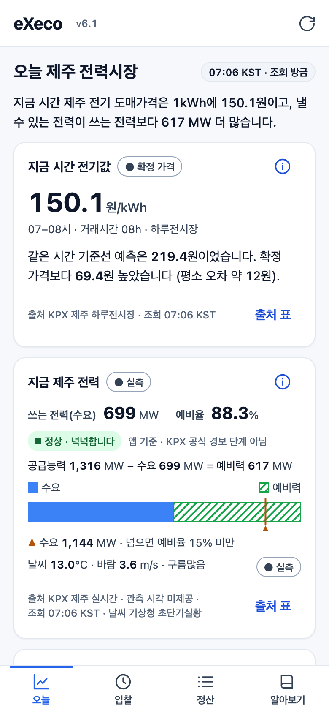
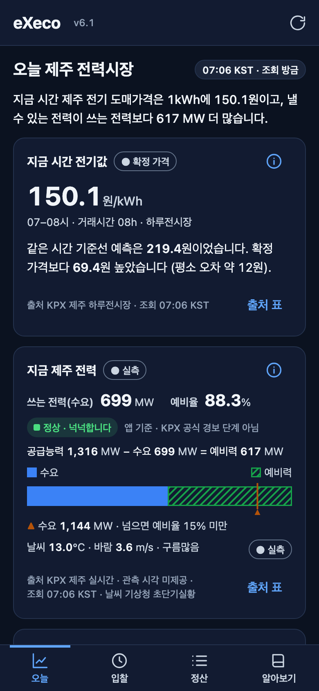
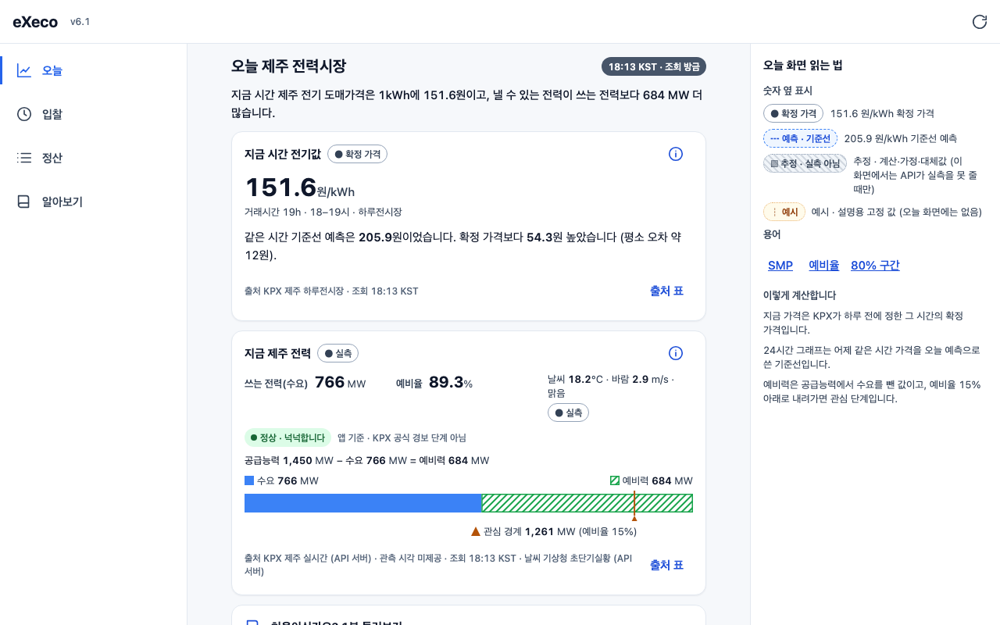

# 모바일 웹앱(`/mobile/`) UI 개편 — 빌드·평가 결과 보고서 (round 1 평가 반영)

- 작성: 2026-11-26 17:47 KST 빌드 마지막 단계 F12에서 처음 쓰고, 19:30 무렵 round 1 평가 결과를 더했다(1절, 4.1절, 5.4절. 이 작업은 앱 코드를 바꾸지 않았다) · 범위: `mobile/` (워크트리 `.claude/worktrees/mobile-top1`, 브랜치 `ui/mobile-top1`, 기준 커밋 `f2fbb5a2`)
- 상태: 빌드 단계 F0\~F12와 round 1 평가(렌즈 4개)를 마쳤다. **round 1은 합격선을 넘었지만 턱걸이다**: 가장 낮은 R1이 꼭 8.0, 평균 8.53이고, 멘토 렌즈는 자기 관문 하나(MEN-COPY)에서 떨어졌으며, M9는 묶음에 따라 갈렸다(1.1절). 수정 라운드는 돌지 않아 결함 54건이 열려 있다. 운영 반영(P1)과 푸시·병합(P11)은 하지 않았다. 운영은 개편 전 번들을 그대로 서빙한다
- 개편 전: 기준 커밋 `f2fbb5a2`. 이 커밋의 웹 export는 운영이 서빙하는 번들과 바이트가 같다(`AppEntry-71e4dcb6…`, sha256 `1f73e2ff…`, F0에서 확인). 숫자는 round 0 평가(2026-11-26 새벽, 평균 4.34)와, 같은 측정 도구로 개편 전 앱을 다시 잰 기준선(`baseline-v2`, 08:06\~08:08 KST)에서 옮겼다
- 개편 후: 앱 코드는 커밋 `748fb466`(F11)이다. F12와 이 보고서 커밋은 문서만 바꿨다. 번들 `AppEntry-2ab8b161e1b28a0e282a34fe894e384d.js` 624,723 B, sha256 `8c65b3ad619f647141f786806735529c68246009a5a7533ec86d5bfecdfe79c8`. 게이트 측정(round1-pre)은 이 번들을 dev preview :10104(운영 `public_server.py` 사본, 같은 `/mobile/` 경로와 API 허용 목록)에 띄워 17:07\~17:46 KST에 했다. round 1은 HEAD `794dc4e1`을 다시 export한 같은 번들(sha256 같음, `diff -rq` 같음)을 17:52\~18:30 KST에 다시 쟀고(캡처), 렌즈 4개가 18:32\~19:14 KST에 판정했다
- 설계 명세: `docs/2026-11-26-mobile-ui-top1-design.md`(이하 "명세"). 숫자는 모두 저장된 측정 출력에서 옮겼고, 점수·관문·결함은 렌즈별 판정 원문에서 옮겼다(부록 A). 반올림은 한 번만 했다

---

## 0. 먼저 알아 둘 낱말

| 낱말 | 뜻 |
|---|---|
| R1\~R8 | 화면 품질 채점표 8항목(시각, 첫 화면, 차트, 신뢰·출처, 테마, 모바일 사용성, 접근성, 구현), 10점 만점. 기준 제품은 Electricity Maps 앱(약 9.1)이다 |
| 합격선 | R1\~R8 모두 8.0 이상, 평균 8.5 이상, 그리고 게이트 M1\~M9·I1\~I5 **전부** 통과(명세 1.1절). 워크플로는 항목 점수를 R1\~R8을 모두 매긴 두 렌즈(parity·mentor)의 평균으로, 게이트 통과를 layout_a11y·integrity 렌즈의 판정으로 셌다(1.2절) |
| 렌즈 | 평가자 한 명이 보는 관점. parity(경쟁 제품과 견줌, R1\~R8), mentor(비전문가 멘토 겸 모바일 UX, R1\~R8), layout_a11y(배치·접근성 게이트 M1\~M9, R5\~R7만), integrity(정직성 게이트 I1\~I5, R4·R8만). 라운드마다 새로 시작하고 앱 코드는 고치지 않는다 |
| M1\~M9 | 숫자로 재는 배치·접근성 게이트(명세 1.2절): 가로 넘침, 누름 대상 44 px, 글자 12 px, 대비, 의미 구조, 콘솔·요청, 막대 가림, 상태와 복구, 첫 로드 |
| I1\~I5 | 정직성 게이트(명세 1.3절): 지어낸 값, 출처와 시각, 값·단위·표기, 테스트, 정확도 수치 |
| 4상태 칩 | 숫자 옆 표시. ● 실측·확정, ┅ 예측, ▨ 추정, ┆ 예시. 글자·테두리 모양·기호가 함께 같은 뜻을 전한다(색만으로 전하지 않는다) |
| 기준선 예측 | 어제 같은 시각의 제주 가격을 오늘 예측으로 쓰는 방법이다. 지금 SMP 서빙 방식이며, 문서화된 정확도는 MAE 11.97원/kWh · MAPE 11.75% · R² 0.203(walk-forward 2025-07-22\~12-18)이다 |
| round 0 | 개편 전 앱 평가. 평균 4.34(R1 4.75 · R2 5 · R3 3.5 · R4 4.5 · R5 3.5 · R6 5.25 · R7 3.5 · R8 4.75), 평가자 4명 모두 불합격 |
| round1-pre | F12가 round 1 평가 직전에 같은 측정 도구로 돌린 전체 측정이다. **점수가 아니라 게이트 측정**이다 |
| round 1 | F12 뒤 첫 평가. 같은 번들을 같은 실행기로 다시 잰 캡처와 렌즈 4개의 판정이다. 이 보고서의 점수는 모두 round 1 것이다 |
| F0\~F12 | 빌드 단계. 단계마다 빌더 1명, 커밋 하나(부록 B) |
| P1\~P11 | 사용자 승인이 필요한 항목(명세 14절, 이 보고서 5.1절). 승인 전에는 만들지 않았다 |
| content 시각 | M9에서 오늘 화면 가격 카드(`today-hero`)가 "불러오는 중"을 벗어난 시각. 스켈레톤은 content가 아니다 |

---

## 1. 결론과 round 1 평가

### 1.1 결론

1. 명세의 빌드 단계 F0\~F12를 모두 마쳤다. 공개 모바일 웹앱은 탭 4개(오늘·입찰·정산·알아보기)와 화면마다 주소를 갖고, 라이트·다크와 320\~1280 px에서 같은 구조로 보인다. 모든 숫자는 상태 칩·출처·KST 시각을 가진 카드 안에 있고, 지어낸 값은 `src/data/examples.ts`에서만 나와 ┆예시┆로 보인다
2. **round 1은 합격선(모든 R 8.0 이상 · 평균 8.5 이상 · 배치/접근성과 정직성 게이트 통과)을 넘었다. 다만 턱걸이다.** 항목 평균은 R1 8.0 · R2 8.6 · R3 8.2 · R4 9.0 · R5 9.0 · R6 8.4 · R7 8.75 · R8 8.3, 평균 8.53(명세 1.1절대로 소수 첫째 자리에서 한 번 반올림하면 8.5)이다. layout_a11y 렌즈가 M1\~M9, integrity 렌즈가 I1\~I5를 모두 통과로 판정했다(1.2·1.3절). 넘은 폭은 작다
   - R1은 꼭 8.0이다. 멘토 렌즈는 R1을 7.9로 매겼다(parity 8.1). 평균은 선보다 0.03 높고, 기준 제품 Electricity Maps 앱(약 9.1)보다 0.6쯤 낮으며, 명세 15절의 예상(평균 8.6)에도 못 미쳤다
   - 멘토 렌즈는 스스로 불합격이다. 문구 관문 MEN-COPY가 떨어졌다. 가장 무거운 사유는 둘러보기 2/5 제목 "내일 값은 어제 값으로 짐작합니다"가 본문·용어 사전("어제 같은 시간 가격을 오늘 값으로")과 반대라는 것이고, 이 제목은 명세 4.4절에 그대로 적혀 있다(1.3절). MEN-COPY는 합격선의 게이트(M1\~M9·I1\~I5)가 아니어서 판정을 바꾸지 않았다
   - M9는 통과 판정이지만 여유가 없다. 평가자가 잰 두 묶음 6회는 모두 6.0초 이하였고 가장 느린 회차가 5,969 ms(여유 31 ms)였다. 같은 라운드 캡처에서 있는 그대로 잰 첫 회는 6,129 ms로 기준을 넘었다(round1-pre에서는 6,631 ms). 서버의 하루전 가격 캐시가 비어 있을 때 들어오는 첫 방문자는 6.0초를 넘길 수 있다(1.4절)
3. 같은 번들을 같은 실행기로 잰 게이트 측정은 round1-pre와 round 1 캡처 모두 M1\~M8·I1\~I5 실패 기록 0이다(1,876기록, axe 936회, 보조 점검 284건, 키보드 8경로·폭, 시간대 3개, 3절). 두 번의 하니스 표 집계는 한 줄도 다르지 않았다. layout_a11y 렌즈는 여기에 6폭 × 2테마에서 동작 2,118개를 하나씩 새 세션으로 더 훑었다
4. 결함은 54건이다(높음 4 · 중간 18 · 낮음 32, 렌즈 사이 겹침 포함, 5.4절). round 1이 합격 조건을 넘었기 때문에 워크플로는 수정 라운드(F13…)를 돌리지 않았고, 고친 것은 없다. 앱 코드는 F11 `748fb466` 그대로다(1.5절). 측정 도구의 빈틈도 드러났다: B5(가격 원리 펼치기)는 펼친 카드를 한 번도 캡처하지 않았고, I3 기계 검사는 화면 값 13개만 비교한다. 두 렌즈가 따로 확인해 판정은 그대로다(1.3절)
5. 실제 휴대폰(iPhone Safari, VoiceOver·TalkBack)과 200% 글자 크기는 확인하지 않았다. 모든 측정은 Chromium(Playwright)이다
6. 운영 반영·푸시·병합은 하지 않았다. 다음은 P1(운영 배포) 승인이다(5.1절). 명세 13절의 배포 조건은 평가자 판정으로 채웠고, 평가한 export의 sha256(`8c65b3ad…fe79c8`)도 기록했다. 다만 M9는 같은 라운드 안에서도 묶음에 따라 갈렸다. 승인 없이 고칠 수 있는 높음 결함(둘러보기 2/5 제목, 입찰 성향을 바꾸면 초점이 사라짐, 휴대폰 폭 표)을 배포 전에 수정 단계 하나로 고치고 다시 잴지도 함께 정하면 된다(5.4절)

### 1.2 라운드별 점수 (렌즈별 원 점수와 항목 평균)

항목 평균은 워크플로 규칙대로 R1\~R8을 모두 매긴 두 렌즈(parity·mentor)의 평균이다(round 0도 같은 규칙). layout_a11y(R5\~R7)와 integrity(R4·R8)의 부분 점수는 표에 적었지만 평균에 넣지 않았다. round 1에서 넣어도 R5 9.1 · R6 8.6 · R7 8.67 · R8 8.37, 평균 8.57로 판정은 같다. 굵은 글씨는 round 1에서 8.0 미만인 값이다.

| 렌즈 | 라운드 | R1 시각 | R2 첫 화면 | R3 차트 | R4 신뢰 | R5 테마 | R6 사용성 | R7 접근성 | R8 구현 | 렌즈 평균 | 렌즈 판정 |
|---|---|---|---|---|---|---|---|---|---|---|---|
| parity | 0 | 5 | 5.5 | 4 | 4.5 | 3.5 | 5.5 | 3.5 | 4.5 | 4.5 | 불합격 |
| parity | 1 | 8.1 | 8.8 | 8.3 | 9.3 | 9.2 | 8.6 | 9.0 | 8.6 | 8.74 | 통과 |
| mentor | 0 | 4.5 | 4.5 | 3 | 4.5 | 3.5 | 5 | 3.5 | 5 | 4.19 | 불합격 |
| mentor | 1 | **7.9** | 8.4 | 8.1 | 8.7 | 8.8 | 8.2 | 8.5 | 8.0 | 8.33 | **불합격**(MEN-COPY) |
| layout_a11y | 0 | — | — | — | — | 4 | 5.5 | 4 | — | — | 불합격 |
| layout_a11y | 1 | — | — | — | — | 9.3 | 9.0 | 8.5 | — | — | 통과 |
| integrity | 0 | — | — | — | 4.5 | — | — | — | 5 | — | 불합격 |
| integrity | 1 | — | — | — | 9.0 | — | — | — | 8.5 | — | 통과 |
| **항목 평균** | 0 | 4.75 | 5 | 3.5 | 4.5 | 3.5 | 5.25 | 3.5 | 4.75 | **4.34** | 4개 모두 불합격 |
| **항목 평균** | 1 | 8.0 | 8.6 | 8.2 | 9.0 | 9.0 | 8.4 | 8.75 | 8.3 | **8.53** | 3개 통과 · 1개 불합격 |
| 명세 15절 예상 | 1 | 8.3 | 8.9 | 8.6 | 9.0 | 8.9 | 8.5 | 8.5 | 8.2 | 8.6 | — |

| 라운드 | 평가 대상 | 평균 | 가장 낮은 항목 | 떨어진 관문 | 결함 | 합격선 |
|---|---|---|---|---|---|---|
| 0 | 개편 전 앱(`f2fbb5a2`, 운영 번들과 sha256 같음) | 4.34 | R3·R5·R7 3.5 | parity 5개 전부(PAR-FIRST·NAV·VIZ·STATE·THEME), mentor 3개 전부(MEN-5S·COPY·TRUST), layout_a11y M1\~M6·M8·M9, integrity I1·I2·I3·I5 — 20개 | 82 | 못 넘음 |
| 1 | F12 `794dc4e1`(앱 코드는 F11 `748fb466`) | 8.53 | R1 8.0 | mentor:MEN-COPY 하나 | 54 | 넘음(턱걸이) |

R별로 보면 R4(신뢰·출처)·R5(테마)·R7(접근성)이 8.75\~9.0으로 가장 높고 명세 15절 예상과 같거나 높다. 가장 낮은 것은 R1(시각) 8.0 · R3(차트) 8.2 · R8(구현) 8.3 · R6(사용성) 8.4이고, R1·R2·R3·R6은 예상보다 0.1\~0.4 낮다. 렌즈들이 든 감점 사유는 글이 많은 카드(오늘 화면에 보이는 글 조각 124개 중 80개가 12\~13 px), 휴대폰 폭에서 옆으로 밀어야 하는 표, 막대 덩어리 같은 입찰 계단 차트, 확정 가격이 지금 시간 1점뿐인 24시간 차트, 태블릿 폭의 휴대폰 배치, 저장소에 남은 레거시 파일과 그 폴더에 기댄 새 코드, Slow 4G 첫 로드 여유다(5.4절).

### 1.3 round 1 관문 판정

| 렌즈 | 관문 | 판정 | 근거 요지 (렌즈 원문 요약) |
|---|---|---|---|
| layout_a11y | M1\~M8 | 통과 | 하니스 1,876기록 실패 0에 더해 6폭 × 2테마에서 동작 2,118개를 하나씩 새 세션으로 훑었다. 넘침·잘림 0(200% 확대 640×400, 400% 리플로 320×256 포함), 44 px 미만 대상 0, 가장 작은 글자 12 px, axe 위반 0(직접 12상태), 시트 740번 열어 가둠·Esc·초점 복귀 740/740, 콘솔 오류·실패 요청 0, 안전 영역 아래 34 · 위 47 · 가로 47 px에서 가림 0, 변형 52/52와 카드별 실패 9/9 |
| layout_a11y | M9 | 통과(여유 31 ms) | 자기 dev preview(:10105)에서 냉시작 두 묶음 6회가 모두 6.0초 이하. 같은 라운드 캡처의 첫 회 6,129 ms는 위험으로 적었다(1.4절) |
| layout_a11y | BUNDLE | 통과 | 624,723 B / 640,000 B. HEAD를 다시 export해도 바이트가 같다 |
| integrity | I1\~I5 | 통과 | 18:41 KST에 화면이 받은 응답으로 화면 값과 계산값(예비력·관심 경계·차이·시간대 요약·띠 폭·입찰 10구간·468.6만원)을 다시 계산해 모두 일치(반올림 한 번). 번들 금지 문자열 0, 새 코드 `Math.random` 0, 정산 금액은 모두 ┆예시┆ 아래, `check.sh`를 다시 돌려 같은 요약. 예외 하나(예측 방법 시트의 '검증 MAPE 12.68%')는 결함으로 적었다 |
| integrity | NOW-KST · TZ-INDEPENDENCE · DIFF-REVIEW | 통과 | 지금선·NowPill이 분이 바뀌고 1초 안에 넘어감(90표본 어긋남 0), UTC·로스앤젤레스·서울에서 글자와 지금선 x가 같음, `f2fbb5a2..HEAD`는 `mobile/`과 문서만 바꿨고 잠근 파일은 바이트가 같음 |
| parity | PAR-FIRST · PAR-NAV · PAR-VIZ · PAR-STATE · PAR-THEME | 통과 | 390 첫 화면에 가격·여유 전력·상태·KST·출처가 누르지 않고 보임(Electricity Maps는 눌러야 숫자가 나옴), 주소 상태 13개·뒤로·회전·1024 레일, 계단 차트 문법(지금선·점선 예측·실측 점·띠·판독·키보드·표), 상태 변형 52/52·카드별 9/9, 테마 6조합 |
| mentor | MEN-5S · MEN-TRUST | 통과 | 네 탭 모두 5초 안에 무엇인지 읽힘(320×568에서도 문장과 가격 카드), 실측·예측·추정·예시가 글자와 선 모양으로 늘 갈림, 지연·끊김·기본값을 그렇다고 말함 |
| mentor | **MEN-COPY** | **불합격** | 주 경로 문구는 자연스럽지만 ① 둘러보기 2/5 제목이 본문·용어 사전과 반대 ② 공급능력 풀이 속 'KPI 수요' ③ 입찰 산출 방식 시트의 '성향 moderate'(버튼은 '균형')와 'Quantile-based Probabilistic Clearing Model' ④ 풀이 없는 'walk-forward'·'R² 0.203'·'보류 검증' ⑤ '관심 경계'가 KPX 경보 단계 이름 둘을 겹쳐 씀 ⑥ 문장 속 'Nh · HH–HH시' |

평가자가 찾은 측정 도구의 빈틈 (판정은 그대로다)

- B5(가격 원리 펼치기): `sweep.py`가 이름 `/^가격/`으로 찾아 헤더의 '가격·전력 정보 새로고침' 버튼을 먼저 눌렀다. 그래서 펼친 가격 원리 카드는 하니스 캡처에 한 장도 없는데 B5는 60/60 통과로 세어졌다(같은 실행기를 쓴 round1-pre도 같다, 3.3절). parity가 따로 펼쳐 320·390·1280 × 두 테마에서 `aria-expanded=true`, 넘침 0을 확인했다(`scratchpad/mobile/eval/round1/parity/cap/merit-*.png`)
- I3: 기계 검사는 `data-pd-raw` 값 13개(오늘 화면)만 비교하고, 계산값과 입찰 화면은 보지 않는다. integrity가 화면이 받은 응답으로 모두 다시 계산해 맞았다(`scratchpad/mobile/eval/round1/integrity/live/results.json`). 그래서 3.1절의 "불일치 0 / 13"은 실제로 검사한 범위보다 넓게 읽힌다
- B6의 '가격 근거 줄 있음·없음' 캡처 두 장은 바이트까지 같다. 입찰 경로로 바로 들어오면 줄이 빠지는 것을 하니스는 보지 못했다(5.4절 6)

### 1.4 M9 첫 로드 (round 1, 390×844, 브라우저 캐시 끔, Slow 4G)

| 묶음 | 잰 시각(KST) · 서버 | content (ms) | `/smp/day-ahead` 응답 (ms) | 3회 모두 ≤ 6,000? |
|---|---|---|---|---|
| 캡처 · 있는 그대로 첫 3회 | 17:53 · :10104 | 6,129 · 5,428 · 5,427 | 1,125 · 567 · 572 | 아니오(1회차, 도구 판정 FAIL) |
| 캡처 · 서버를 데운 뒤 3회 | 18:30 · :10104 | 5,513 · 5,512 · 5,429 | 661 · 584 · 567 | 예 |
| layout_a11y 평가자 1묶음 | 18:35 · :10105 | 5,969 · 5,451 · 5,419 | 943 · 576 · 573 | 예(1회차 여유 31 ms) |
| layout_a11y 평가자 2묶음 | 19:12 · :10105 | 5,412 · 5,426 · 5,410 | 568 · 573 · 569 | 예 |
| 참고: round1-pre 있는 그대로(3.2절) | 17:07 · :10104 | 6,631 · 5,412 · 5,420 | 1,685 · 573 · 571 | 아니오(1회차) |

- M9 판정은 layout_a11y 렌즈가 자기 측정(위 두 묶음)으로 내렸다. 캡처의 게이트 표(`scratchpad/mobile/eval/round1/GATES.md`)는 같은 번들을 "조건부"로 적었다
- 기준을 넘은 회차는 모두 있는 그대로 잰 묶음의 1회차이고, 그때마다 `/smp/day-ahead`가 1.1초 넘게 걸렸다(서버 하루전 가격 캐시가 빈 경우, 3.2절). 번들 도착은 모든 회차에서 4,624\~4,672 ms다. `/smp/day-ahead`가 567\~661 ms였던 10회의 content는 5,410\~5,513 ms라 여유는 0.5\~0.6초뿐이고, 그 응답이 943 ms면 5,969 ms(여유 31 ms), 1,125 ms면 6,129 ms였다
- 첫 방문자에게도 6.0초를 지키려면 승인이나 명세 변경이 필요하다(5.2절 1, 5.4절 3)

### 1.5 라운드 사이에 고친 것

| 사이 | 고친 것 |
|---|---|
| round 0 → round 1 | 개편 전체다. 설계 명세와 빌드 F0\~F12(2절, 부록 B). round 0에서 떨어진 관문 20개 중 19개가 round 1에서 통과했다(남은 것은 MEN-COPY) |
| round 1 뒤 | 없다. 워크플로는 "모든 R ≥ 8.0 · 평균 ≥ 8.5 · layout_a11y와 integrity 렌즈 통과"이면 수정 없이 끝나게 짜여 있고, round 1이 이 조건을 넘어 수정 단계(F13…)와 round 2는 돌지 않았다. MEN-COPY와 결함 54건은 그대로다(5.4절) |

---

## 2. 바뀐 것

### 2.1 개편 전후 요약

개편 전 측정값은 같은 측정 도구로 잰 `baseline-v2`(grid 48 = 4경로 × 6폭 × 2테마)와 round 0 렌즈 기록이고, 개편 후는 round1-pre(3절)다.

| 항목 | 개편 전 | 개편 후 | 근거 |
|---|---|---|---|
| 탭과 주소 | SMP예측·입찰관리·정산 3탭 + 앨런 AI 버튼. 화면 주소가 없어 새로고침하면 첫 화면이고, 브라우저 뒤로 가면 앱을 떠난다 | 오늘·입찰·정산·알아보기 4탭. 4경로 + 쿼리 하위 상태 + 시트 주소, 뒤로 가면 시트부터 닫힌다 | round 0 렌즈(R6) · 11.5절 G2\~G5 |
| 테마 | 라이트만(OS 다크 설정을 따르지 않음) | 시스템 설정 따름 + 앱 안 선택(시스템·밝게·어둡게), 테마별 `theme-color` | round 0 렌즈(R5) · G9 |
| 문서 언어 | `lang="en"` | `lang="ko"` | M5 |
| 제목·랜드마크 | h1 0개, `main`·live region 없음 | 상태마다 h1 1개, `main`·`nav`, polite live region 1개 | round 0 렌즈(R7) · M5 |
| 가장 작은 글자 | 10 px | 12 px | M3 |
| 대비 미달 요소 | 경로마다 3\~23개, 최악 1.00:1(앨런 글자) | 0 | M4 |
| 44 px 미만 누름 대상 | 경로마다 1\~3개 | 0 | M2 |
| axe critical·serious | 입찰 1·1, 나머지 경로 0·1 | 0·0 | M5 |
| 콘솔 오류 | 폭·테마마다 6건 | 0 | M6 |
| 허용 목록 밖·실패 요청 | `/power-plants`·`/settlements/*` 404 | 0 | M6 |
| 번들 금지 문자열 | 14종(AI 최적화, 신뢰도, BiLSTM, 등록되었습니다, 제출 완료 등) | 0 | I1·I5 |
| 카드 밖 숫자 | 98 | 0 | I2 |
| 번들(원시) | 725,177 B | 624,723 B(−100,454 B) | `check.sh` |
| Slow 4G 첫 페인트(FCP) | 5,412 · 5,396 · 5,404 ms(번들을 다 받은 뒤 처음 그림) | 740 · 620 · 624 ms(첫 묶음, `index.html` 스켈레톤) | 3.2절 |
| Slow 4G content | 6,004 · 5,995 · 6,012 ms(옛 표지 "예측 SMP (") | round1-pre 조건부(3.2절) · round 1 렌즈 판정 통과, 가장 느린 회차 여유 31 ms(1.4절) | 3.2절 · 1.4절 |
| node 테스트 | 35 | 213(기존 35개는 고치지 않음) | `check.sh` |

### 2.2 화면별

**셸(모든 화면 공통)**

- 헤더: 워드마크 `eXeco` + `v6.1`(기존 테스트가 잠근 표기), 오른쪽 새로고침은 네 탭 모두 같은 자리다. 새로 불러올 자료가 없는 정산·알아보기에서는 숨기지 않고 까닭을 붙여 비활성으로 둔다. 하위 화면에서는 왼쪽이 ← 뒤로 버튼이다
- h1 행 오른쪽 NowPill(`06:04 KST · 조회 1분 전`): 조회가 10분 넘으면 지연, 60분 넘으면 끊김으로 바뀌고, 끊기면 판정과 실측 표시를 거둔다
- 아래 탭 4개(오늘·입찰·정산·알아보기). 1024 px부터 왼쪽 레일(240 px), 1280 px부터 오른쪽 "이 화면 읽는 법" 패널(320 px). 본문 열은 최대 640 px
- 주소: 화면마다 경로(`/mobile/`, `/mobile/bidding`, `/mobile/settlement`, `/mobile/guide`)와 하위 상태 쿼리(`?hour=`, `?risk=`, `?tour=`, `?topic=`, `?term=`), 시트 주소(`?sheet=method|sources|term|theme`). 새로고침해도 같은 화면이고, 브라우저 뒤로는 열린 시트부터 닫는다. 화면이 바뀌면 h1으로 초점을 옮기고 "입찰 화면"처럼 알린다
- 시트: 산출 방식([i]), 출처와 기준 시각([출처 표]), 용어, 화면 테마. 초점 가둠, Esc, 스크림 누름으로 닫히고, 닫으면 연 버튼으로 초점이 돌아간다
- 그 밖: 오프라인 띠, polite live region 하나, 한국어 오류 화면, `index.html`이 JS보다 먼저 그리는 스켈레톤(테마 색 포함)

**오늘** (`/`, `SMPForecastScreen.tsx`를 같은 자리에서 다시 씀)

- 답 문장: "지금 시간 제주 전기 도매가격은 1kWh에 115.3원이고, 낼 수 있는 전력이 쓰는 전력보다 527 MW 더 많습니다."(06:03:57 KST 스냅숏 기준 예). 상태별 문장(불러오는 중·지연·끊김·확정 가격 없음·전부 실패)이 따로 있고, 기기 시계로 문장을 고르지 않는다
- 가격 카드: KPX 제주 하루전 확정 가격(● 확정 가격), 거래시간 `07h · 06–07시`, 같은 시간 기준선 예측과의 차이와 평소 오차
- 전력 카드: 수요·예비율·공급능력을 식 한 줄(`공급능력 1,191 MW − 수요 664 MW = 예비력 527 MW`)과 범위 막대, 관심 경계로 보인다. 식과 막대는 공급능력과 수요의 짝이 맞을 때만 그린다. 날씨는 기상청 초단기실황이며, API가 보낸 기본값(5.0 °C · 3.0 m/s · 60 % · 맑음)은 "기본값 · 실측 아님"으로 표시한다
- 24시간 카드: 기준선 예측 계단 차트(80% 구간 띠, 확정 가격 점, KST 지금선, 기준선 입력 0.00 시간 빗금)와 표 보기, 시간 스텝퍼, 가장 비싼·싼 시간과 시간대 요약. 차트는 ←/→/Home/End로도 고른다
- 정확도 카드: 문서화된 수치만(MAE 11.97원/kWh · MAPE 11.75%). API가 보내는 수치는 "API 표기" 회색 줄로만 둔다
- 용어 줄(SMP · 하루전시장 · 예비율 · 공급능력 · 80% 구간), 첫 방문 1분 둘러보기 배너(덮개가 아닌 본문 카드)

**입찰** (`/bidding`)

- 답 문장: 하루전시장 마감 규칙과 남은 시간. "시장 값은 실제, 발전소 값은 예시입니다."
- 마감 카드: 서버 시장 상태(`/market-status`)를 기준으로 확인 중·접수 중·마감 임박·마감·불일치·오류·지연 상태를 나누고, 카운트다운은 분 단위 내림이다. 실시간시장 다음 15분 구간은 KST로 계산한다. 실시간시장 가격 예측은 검증된 제주 모델이 없어 보이지 않는다
- 예시 발전소 계산: 가상 50 MW 풍력발전소의 10구간 입찰 계단(서버 입찰 계산 결과, ▨ 추정). 낙찰 가능성은 글자(%)로 적는다. 기대 수입은 표에만 ┆예시┆·▨ 추정으로 둔다. 한 번에 한 요청만 보내고 503은 한 번만 자동 재시도하며, 폴링하지 않는다
- 가격이 정해지는 원리(┆예시┆, 단순화한 설명), 내 발전소 제한 카드("공개 데모에서 제공하지 않습니다", 버튼 없음)
- 이 경로의 요청은 `/market-status`와 `/bidding/optimized-segments` 둘뿐이다. 입찰 제출·발전소 등록은 없다

**정산** (`/settlement`, API 요청 0)

- 실제 정산 자료 제한 카드(공개하지 않는 자료, 내부 정산 계산도 KPX 정산이 아닌 모의 계산이라는 설명)
- ┆예시 · 실제 값 아님┆ 정산서: ① 하루전시장에서 판 양 120 MWh × 150원/kWh = 1,800만원, ② 실제 발전과의 차이 −6 MWh × 140원/kWh = −84만원, 합계 1,716만원. 금액은 모두 `src/data/examples.ts`에서 만든다
- 용어 줄(정산 · 하루전시장 · 실시간시장 · kWh와 MW), 1280 px 패널의 ①+② 식 그림

**알아보기** (`/guide`, 새 탭)

- 1분 둘러보기 5단계(`?tour=1..5`, 실제 화면과 같은 카드를 쓴다), 용어 사전 13개(`?term=`), 숫자 읽는 법, 예측 방법과 정확도(여기서만 R² 0.203을 더함), 데이터 출처와 응답 상태(`/realtime-status`의 응답 상태 3행, "연결됨"이라는 말을 쓰지 않음), 화면 테마(시스템·밝게·어둡게), 앱 정보(시계 차이 안내)
- 긴 설명 글은 번들 대신 `mobile/public/content/guide.ko.json`에 두고 처음 필요할 때 읽는다(한글이 번들에서 한 글자 6바이트로 늘어나기 때문, 명세 0절 7)

### 2.3 공개 번들에서 뺀 것 (파일은 저장소에 그대로, 삭제는 P2)

| 옛 화면 | 지금 | 이유 |
|---|---|---|
| 앨런 AI 버튼과 고정 답 16개 | 공개 빌드에 없음(P6). `alanApi.ts`의 `getLocalResponse` 지어낸 숫자 답 두 개는 "앨런 서비스에 연결하지 못했습니다."로 바꿨다 | 지어낸 설비·ESS·수익 숫자, 외부 전송 |
| DAM/RTM 시뮬레이션 | 입찰의 가격 원리 카드(┆예시┆) | 상수 77원, 실제 발전소 이름, ×1000 단위 오류 |
| 발전소 등록(POST 405 뒤 "등록되었습니다") | 입찰의 내 발전소 제한 카드 | 거짓 성공 문구 |
| 프로 입찰 UI(Math.random RTM, 가짜 제출, 모의 이중 정산) | 예시 발전소 계산(실제 계산기, 제출 없음) | 지어낸 값이 실제처럼 보임 |
| VPP 자동 입찰 스위치(켜짐) | 없음 | 없는 기능 |
| 정산 화면(`/settlements/*` 404) | 정산 탭(요청 0) | 공개되지 않는 자료 |

### 2.4 코드와 테스트

- 바꾼 기존 파일은 다섯 개다: `App.tsx`(다시 씀, 훅 없는 Header 유지), `app.json`(web 이름·언어, 자동 라이트·다크), `package.json`(scripts만), `src/screens/SMPForecastScreen.tsx`(오늘), `src/services/alan/alanApi.ts`(지어낸 숫자 답 두 개). 새 파일은 114개다. 기준 `f2fbb5a2`에서 F11 `748fb466`까지 `mobile/` 변경은 119개 파일로, 앱 쪽(소스·설정·`public`) 67개 +8,424줄 −959줄(그중 설명 글 JSON 255줄), 테스트 24개 +4,859줄(새 테스트 19개, 도우미 2개, 타입 검사 3개), 픽스처 28개 +1,259줄이다
- 새 폴더: `src/app`(경로·라우터·셸·시트·테마), `src/ui`(토큰·글자·아이콘·부품·차트), `src/lib`(KST 시계·유일한 포맷 도우미·출처 판정·자료 저장소), `src/data`(허용 목록 GET 클라이언트·모양 검사·어댑터·예시 값), `src/content`(짧은 문구·JSON 로더), `src/features/{today,bidding,settlement,guide}`(화면 조각 + 순수 view model)
- 새 npm 의존성 0. 색은 `src/ui/tokens.ts` 한 곳(대시보드 개편과 같은 값), `src/theme/colors.ts`는 한 바이트도 바꾸지 않았다
- node 테스트 213개 통과(기존 35개는 한 줄도 고치지 않음), `tsc --noEmit` 0 오류. 새 테스트: 금지 검사·경로·KST(시간대 3개)·포맷·출처 판정·어댑터·자료 저장소·대비(쓰이는 글자·바탕 쌍 전부, 두 테마)·웹 셸·셸·헤더 팔레트·부품·차트·view model 픽스처 재생(오늘·입찰·정산·알아보기)·설명 글
- 잠근 파일(명세 10절 목록)의 기준 대비 변경 0(`check.sh`의 locked-diff 0)

---

## 3. 게이트 수치 (round1-pre)

- 번들: `AppEntry-2ab8b161e1b28a0e282a34fe894e384d.js` 624,723 B(한도 640,000 B, 여유 15,277 B), gzip -9 181,131 B(참고), 한글 `\uXXXX` 이스케이프 4,934개
- `check.sh F12`: `tests pass=213 fail=0 legacy=35/35 · tsc=0 · export=0 · bundle=624723B · scan=0 · locked-diff=0 · todo=0`(문서를 모두 고친 뒤 다시 돌려 같은 요약·같은 sha256을 확인했다)
- 측정: 1,876기록(grid 48 · states 1,200 · fixtures 624 · rotate 4), axe 936회(320·390·1280 × 두 테마), 보조 점검 284건, 탐침 둘. 상태마다 새 브라우저 세션을 열고 동작 하나만 했다. 상태·변형마다 I2 DOM 스캔도 했다
- 측정 시각: 2026-11-26 17:07\~17:46 KST, dev preview :10104. 게이트 표 원본(모든 값을 측정 파일에서 다시 읽어 만든 표)은 `scratchpad/mobile/eval/steps/F12/INDEX.md`
- round 1 캡처(17:52\~18:30 KST, `scratchpad/mobile/eval/round1/`)는 같은 번들을 같은 실행기로 다시 쟀다. 하니스 표 집계(넘침·잘림·글자·누름 대상·대비·이름·h1·콘솔·요청·axe·막대 가림)는 이 절과 한 줄도 다르지 않았고(`agg.py`로 두 INDEX를 비교, `round1/agg_round1-pre.txt`·`agg_round1.txt`), M9만 달랐다(1.4절). 렌즈 판정은 1.3절이다

### 3.1 게이트 표

| 게이트 | 합격 조건(명세 1.2·1.3절) | round1-pre 값 | 판정 |
|---|---|---|---|
| M1 가로 넘침 | 문서·body·모든 스크롤 컨테이너 넘침 0, 잘린 글자 0(카드 안 표의 가로 스크롤 하나만 예외), 6폭 × 2테마 × 상태 전부, 회전 | 넘침·잘림이 있는 기록 0 / 1,876 · 예외인 카드 안 표 스크롤 상자 28번(넘칠 때 Tab으로 닿음) · 회전 4경로 넘침 0 | 통과 |
| M2 누름 대상 | 모든 상호작용 요소 ≥ 44×44 px | 44 px 미만이 있는 기록 0 / 1,876 | 통과 |
| M3 글자 크기 | 보이는 글자(차트 글자 포함) ≥ 12 px | 12 px 미만이 있는 기록 0 / 1,876 · 가장 작은 글자 12 px | 통과 |
| M4 대비 | 글자 AA(4.5:1, 큰 글자 3:1), 비글자 3:1, 두 테마 | 대비 실패 기록 0 / 1,876 · axe color-contrast 0 / 936 · 테마 6조합(OS 2 × 앱 선택 3)에서 다른 테마 색 섬 0 · `tokens-contrast` 테스트 통과 | 통과 |
| M5 의미 | `lang="ko"`, 상태마다 h1 1개, `main`·`nav`, 한국어 이름, 탭·라디오·시트 의미, polite live 1개, axe critical·serious 0, 키보드 | 위 항목마다 어긋난 기록 0 / 1,876 · axe critical·serious 0 / 936 · 키보드 8경로·폭 포커스 링 없음 0·이름 없음 0·시트 Tab 20회 가둠·Esc·초점 복귀 · 내용 좌표로 본 Tab 순서 거슬러 감 0 | 통과 |
| M6 콘솔·요청 | 정상 스윕 콘솔 오류 0, 실패 요청 0, 허용 목록 밖 0, 다른 출처 0 | 문제 기록 0 / 1,876(고장을 주입한 변형의 콘솔 줄은 1.2절대로 기록만) | 통과 |
| M7 막대 가림 | 9×24 격자 가림 0, 스크롤 끝 내용이 탭 막대 위(시트가 열린 동안 예외) | 가림 기록 0 / 1,876 | 통과 |
| M8 상태와 복구 | 카드마다 불러오는 중·오류·빈 값·지연과 복구 수단, "다시 시도"는 성공할 수 있을 때만 | 변형 52/52 · 카드 하나씩 실패시키고 회복 9/9 | 통과 |
| M9 첫 로드 | 390×844 Slow 4G 냉시작 3회 **모두** content ≤ 6.0 s | 있는 그대로 잰 첫 3회 6,631 · 5,412 · 5,420 ms(1회차 초과) / 서버 캐시를 데운 뒤 3회 5,427 · 5,427 · 5,420 ms | **조건부**(3.2절) |
| I1 지어낸 값 | 지어낸 값은 `examples.ts`에서만, 번들 금지 문자열 0, 제출·저장 조작 0 | 번들 금지 문자열 0(기준선 없이) · 새 코드 `Math.random` 0 · `source-bans` 테스트 통과 | 통과 |
| I2 출처와 시각 | 모든 숫자가 칩·출처·KST 시각을 가진 카드 안 | 카드 밖 숫자 0 · 카드 없는 값 0(값 13개) · 상태·변형마다 스캔 0 / 1,824 | 통과 |
| I3 값·단위·표기 | 화면 값 = API 값(반올림 1회), 단위·표기 규칙 | 같은 분에 받은 API 값과 대조한 불일치 0 / 13 | 통과 |
| I4 테스트 | 기존 35개를 고치지 않고 통과 + 새 테스트 + tsc 0 | 213 통과 · 기존 35/35 · tsc 0 · 잠근 파일 변경 0 | 통과 |
| I5 정확도 수치 | 문서화된 수치만, `R²=0.95`·`BiLSTM`·"신뢰도"·"AI 최적화" 같은 표현 0 | 소스 0 · 번들 0 · 화면 0 | 통과 |

### 3.2 M9 첫 로드 (390×844, 브라우저 캐시 끔, DevTools Slow 4G: 지연 562.5 ms · 하향 1.44 Mbps · 상향 0.675 Mbps · CPU 4×)

| 묶음 | 잰 시각(KST) | content (ms) | `/smp/day-ahead` 응답 (ms) | 첫 페인트 (ms) | 스켈레톤 (ms) | 번들 도착 (ms) | 3회 모두 ≤ 6,000? |
|---|---|---|---|---|---|---|---|
| **F12 있는 그대로 첫 3회** | 17:07 | 6,631 · 5,412 · 5,420 | 1,685 · 573 · 571 | 740 · 620 · 624 | 637 · 584 · 592 | 4,647 · 4,627 · 4,632 | 아니오(1회차, 도구 판정 FAIL) |
| **F12 데운 서버 3회** | 17:45 | 5,427 · 5,427 · 5,420 | 570 · 579 · 572 | 636 · 628 · 628 | 598 · 594 · 592 | 4,640 · 4,632 · 4,632 | 예(도구 판정 PASS) |
| 참고: F11 같은 번들 첫 3회 | 16:55 | 6,716 · 5,427 · 5,410 | 1,819 · 572 · 567 | 652 · 632 · 632 | 611 · 595 · 596 | 4,642 · 4,641 · 4,632 | 아니오(1회차) |
| 참고: F11 다시 3회 | 16:57 | 5,520 · 5,419 · 5,430 | 579 · 572 · 576 | 700 · 628 · 624 | 646 · 592 · 588 | 4,656 · 4,632 · 4,634 | 예 |
| 참고: 개편 전 앱(옛 표지 "예측 SMP (") | 08:06 | 6,004 · 5,995 · 6,012 | 572 · 571 · 581 | 5,412 · 5,396 · 5,404 | 없음 | 5,184 · 5,174 · 5,185 | 아니오 |

- 모든 회차에서 content는 `/smp/day-ahead` 응답이 끝나고 20\~35 ms 뒤다(가격 카드가 이 응답을 기다린다). 번들 도착(약 4.6초)·첫 페인트·스켈레톤은 묶음과 상관없이 거의 같다
- 서버의 하루전 가격 응답은 KPX 포털 값을 10분 동안, 그리고 지금 거래시간 안에서만 기억한다(`api/day_ahead_routes.py`의 `QUOTE_CACHE_TTL`·`_covers`). 비어 있으면 KPX를 다시 읽느라 응답이 1초 넘게 늦어졌다(F12 첫 묶음 1회차 +1.1초, F11 첫 묶음 1회차 +1.2초). 그 회차에는 다른 다섯 요청도 1.2초쯤 걸렸다(데운 뒤 0.6초쯤)
- "데운 서버" 묶음은 오늘 화면이 처음 부르는 GET 여섯 개(`/smp/day-ahead`·`/smp-forecast`·`/model/info`·`/dashboard/kpis`·`/power-supply`·`/market-status`)를 같은 출처로 한 번씩 부른 직후 쟀다. 방금 다른 방문자가 들어온 서버와 같은 상태다
- 개편 전 앱도 기준 6.0초 언저리였다(6,004 · 5,995 · 6,012 ms, 서버 응답이 빠른 상태). 개편 뒤 첫 페인트는 5.4초에서 0.6\~0.7초로 앞당겨졌다(`index.html` 스켈레톤)

### 3.3 11.5절 상태 목록

| 묶음 | 내용 | 기록 | 결과 |
|---|---|---|---|
| G1 | 4경로 냉시작, 위·중간·끝 스크롤(grid) | 48 | 통과 |
| G2·G3·G4·G5 | 지금 탭 다시 누름 · 뒤로/시트 연 채 뒤로 · 모든 경로·시트 주소 새로고침 · `/mobile/foo`와 `/mobile` | 48 · 24 · 156 · 24 | 통과 |
| G6 | 키보드 순회(8경로·폭) + 알아보기 목록 행으로 연 시트 4 + 내용 좌표 Tab 순서 | 8 + 4 | 통과 |
| G7 | 줄인 움직임(상태 48 + 시트·둘러보기 애니메이션 0, 보통 설정 200 ms 한 번 6) | 48 + 6 | 통과 |
| G8 | 회전 390×844 → 844×390 → 390×844, 네 경로 | 4 | 통과 |
| G9 | 테마(상태 36 + OS 2 × 앱 선택 3 × 390·1280 보조 점검 12) | 36 + 12 | 통과 |
| G10 | 로드 뒤 오프라인(띠·새로고침 비활성·다시 온라인) | 12 + 4 | 통과 |
| G11 | 시간대 UTC · America/Los_Angeles · Asia/Seoul 같은 순간, 오늘·입찰 보이는 글자 같음 | 2경로 × 3 | 통과 |
| T1\~T8 | 오늘: 차트/표, 스텝퍼 양 끝·[지금으로], 차트 누름·키보드, 24시간 전체 보기, [i] 4개, [출처 표] 4개, 용어 5개, 둘러보기 배너 | 264 | 통과 |
| T9 | 오늘 픽스처 27개(불러오는 중 8초, 확정 가격 없음, 정시 경계 유예·지연, KPI 12분·61분, 일부·전부 실패, 수요 출처 ②④⑤⑥, 공급능력 짝 불일치, 기상 file·default·none, 예측 대체값·모르는 모델·예측일 어제, 0.00 입력, 시계 차이 등) | 324 | 통과 |
| B1\~B5 | 입찰: 성향 3개, 스텝퍼 양 끝, 계단 누름·키보드, 차트/표, 가격 원리 펼치기·접기, [i] 3개, [출처 표] | 156 | 통과 |
| B6 | 입찰 픽스처 15개(확인 중, 접수 중, 마감 임박 09:20, 마감 10:01, 불일치 2, 오류, 지연, 계산기 503 1회·2회·500·8초 지연·빈 응답, 가격 근거 줄 있음·없음) | 180 | 통과 |
| S1\~S2 | 정산 냉시작(요청 0), [i], 용어 4개 | 72 | 통과 |
| A1\~A6 | 알아보기 목록 6행, 둘러보기 1→5·이전·건너뛰기·3단계에서 뒤로·`?tour=4`, 용어 13개, 주제 화면, 테마 시트 3개, 응답 상태 변형 8개, 문구 JSON 404 | 480 | 통과 |
| 그 밖 | 첫 화면 상자(390×844 필수 넷: h1 행 72–98 · 답 문장 110–156 · 가격 카드 168–411 · 전력 카드 423–763 ≤ 787), 헤더 새로고침·live 28, 경계 폭 9개(375·360×800·412·599·600·820×1180·1023·1024·1279) × 두 테마 × 9경로 162 | 7 + 28 + 162 | 통과 |

- 상태마다 새 브라우저 세션을 열고 동작 하나만 했다(명세 11.5절). 11.5절 캡처 목록(390 두 테마 + 320 light)보다 넓게 6폭 × 2테마 전부에서 쟀다(F11과 같은 방식)
- 키보드 순회의 "backward jumps" 숫자(오늘 390 3 등)는 초점이 스크롤을 움직인 뒤의 화면 좌표를 비교한 값이라 순서 오류가 아니다. 내용 좌표로 다시 본 Tab 순서 탐침(`probe/focus_order.json`)은 4경로 × 390·1280 모두 거슬러 감 0이다
- B5의 "가격 원리 펼치기"는 하니스가 헤더 새로고침 버튼을 눌러, 펼친 카드가 이 표의 기록에 들어 있지 않다(round 1 parity가 찾음, 따로 펼쳐 넘침 0 확인, 1.3절). B6의 "가격 근거 줄 있음·없음" 두 캡처도 바이트가 같아 직접 진입의 빠진 줄을 보지 못했다(5.4절 6)

### 3.4 경로별 API 요청 (grid 냉시작, 6폭 × 2테마)

| 경로 | 요청한 경로 | 명세 |
|---|---|---|
| 오늘 `/` | `/smp/day-ahead` · `/smp-forecast` · `/model/info` · `/dashboard/kpis` · `/power-supply` · `/market-status` | 6.3절 첫 로드 여섯 개 |
| 입찰 `/bidding` | `/market-status` · `/bidding/optimized-segments` | 둘뿐(F8 합격 조건), `/power-plants` 0 |
| 정산 `/settlement` | 없음 | 요청 0(F9 합격 조건) |
| 알아보기 `/guide` | 없음(첫 화면) | `/realtime-status`는 "데이터 출처와 연결 상태"를 열 때만 |

모든 요청은 같은 출처 GET이고 허용 목록 밖 요청·다른 출처 요청·실패 요청은 0이다(M6).

---

## 4. 캡처 경로

### 4.1 개편 전후 화면 (저장소 사본)

세션 임시 폴더는 세션이 끝나면 사라지므로 오늘 화면 네 장을 저장소에 복사했다(`docs/2026-11-26-mobile-ui-top1/screenshots/`, 모두 원본과 `cmp`로 같음, 합 652,709 B). 개편 후 세 장은 마지막 평가인 round 1의 캡처(2026-11-26 18:12\~18:13 KST 라이브 값, dev preview :10104)이고, 개편 전 한 장은 같은 측정 도구로 개편 전 앱을 잰 `baseline-v2` 캡처(08:04 KST 무렵)다. 화면의 숫자는 캡처한 때의 API 값이라 2.2절의 예시 문장(06:03:57 KST 스냅숏)과 다르다.

**개편 전 · 라이트 · 390×844** (개편 전 앱에는 다크가 없다)


**개편 후 · 라이트 · 390×844**



**개편 후 · 다크 · 390×844**



**개편 후 · 라이트 · 1280×800** (왼쪽 레일, 오른쪽 "오늘 화면 읽는 법" 패널)



| 저장소 파일 | 원본(`scratchpad/mobile/eval/` 아래) | 크기 |
|---|---|---|
| `before_light_390_today.png` | `baseline-v2/shots/390x844-light/today-top.png` | 113,376 B |
| `after_light_390_today.png` | `round1/sweep/shots/390x844-light/today-top.png` | 190,866 B |
| `after_dark_390_today.png` | `round1/sweep/shots/390x844-dark/today-top.png` | 194,417 B |
| `after_light_1280_today.png` | `round1/sweep/shots/1280x800-light/today-top.png` | 154,050 B |

### 4.2 세션 캡처 (round 1)

나머지 캡처는 세션 임시 폴더 `scratchpad/mobile/eval/round1/sweep/` 아래에 있다(세션이 끝나면 사라진다). round1-pre(`scratchpad/mobile/eval/round1-pre/`)와 같은 실행기·같은 이름 규칙이다(3절 수치는 round1-pre 것). 한 장마다 경로·경로 이름·폭·테마·종류·상태를 적은 목록은 `scratchpad/mobile/eval/round1/SHOTS.tsv`(2,245장)다. 폭 폴더는 `320x568`·`360x780`·`390x844`·`430x932`·`768x1024`·`1280x800`, 테마는 `light`·`dark`다.

| 무엇 | 경로 | 장 수 |
|---|---|---|
| 경로 냉시작 위·중간·끝(G1) | `shots/<폭>-<테마>/<경로>-{top,mid,end}.png` (경로 = `today`·`bidding`·`settlement`·`guide`) | 144 |
| 11.5절 상태(새로 열어 동작 하나) | `shots/<폭>-<테마>/<상태 ID>.png` (예: `T5-info-0.png`, `B3-ladder-tap.png`, `A2-tour-1to5.png`, `G9-oslight-mode2.png`) | 1,296 |
| 픽스처 변형(오류·빈 값·지연·출처·시계·오프라인) | `shots/<폭>-<테마>/fx-<변형 id>.png` | 624 |
| 회전 390×844 → 844×390 → 390×844 | `shots/390x844-light/rotate-<경로>-{portrait1,landscape,portrait2}.png` | 12 |
| 시간대 3개 같은 순간 | `shots/390x844-light/tz-{today,bidding}-{UTC,America_Los_Angeles,Asia_Seoul}.png` | 6 |
| 키보드 순회 | `shots/{390x844,1280x800}-light/keyboard-<경로>.png` | 8 |
| 보조 점검(테마 6조합·줄인 움직임·오프라인·첫 화면·헤더·M8·경계 폭) | `checks/shots/` | 147 |
| 탐침(Tab 순서·넘치는 스크롤 상자) | `probe/*.png` | 4 |
| I2 화면 스캔(게이트 묶음) | `scratchpad/mobile/eval/round1/gates/shots/` | 4 |

먼저 볼 만한 것 (경로는 `scratchpad/mobile/eval/round1/sweep/` 아래)

- 첫 화면: `shots/390x844-light/today-top.png`, `shots/390x844-dark/today-top.png`, 가장 좁은 폭 `shots/320x568-light/today-top.png`, 레일과 읽는 법 패널 `shots/1280x800-light/today-top.png`
- 다른 탭: `shots/390x844-light/bidding-top.png`, `settlement-top.png`, `guide-top.png`
- 시트: `shots/390x844-light/T5-info-0.png`(산출 방식), `T6-sources-0.png`(출처와 기준 시각), `T7-term-0.png`(용어), `G4-_sheet=theme.png`(화면 테마)
- 상태: `fx-today-loading-8s.png`(불러오는 중), `fx-today-all-error-network.png`(전부 실패), `fx-today-weather-default.png`(기상 기본값), `fx-today-kpi-age-61m.png`(끊김), `fx-bidding-closed-1001.png`(마감), `fx-bidding-calc-503-twice.png`(계산기 수동 다시 계산), `fx-guide-rs-partial.png`(응답 상태 일부)
- 둘러보기: `A2-tour-1to5.png`(5단계), `A2-tour-1to5-t2.png`(2/5, MEN-COPY의 제목), 회전: `rotate-today-landscape.png`
- 휴대폰 폭 표(5.4절 2): `shots/390x844-light/T4-full-day.png`, `shots/320x568-light/T1-table.png`, `shots/390x844-light/B4-table.png`
- 개편 전 비교: `scratchpad/mobile/eval/baseline-v2/shots/390x844-light/today-top.png`(같은 폭·같은 도구, 4.1절에 사본)

평가자가 따로 찍은 것 (경로는 `scratchpad/mobile/eval/round1/` 아래)

- `parity/cap/merit-{320x568,390x844,1280x800}-{light,dark}.png` — 펼친 가격 원리 카드(하니스 B5가 놓친 상태, 1.3절)
- `mentor/shots/bid-merit-open-390-{light,dark}.png`, `mentor/zoom_*.png` — 멘토가 확대해 본 곳(1280 레일, 산출 방식 시트, 입찰 표 라디오 등)
- `integrity/live/bidding-direct-390.png`와 `integrity/live/bidding-via-today-390.png` — 입찰 직접 진입에서 빠지는 가격 근거 줄(5.4절 6), `integrity/live/skew+3h-390.png`·`skew+13h-390.png` — 기기 시계 차이
- `layout_a11y/extras/{zoom,spacing,forced,safe}/` — 200·400% 확대, 글자 간격(WCAG 1.4.12), 강제 색, 안전 영역

---

## 5. 남은 것

### 5.1 승인이 필요한 항목 (명세 14절, round 1 뒤에도 모두 열려 있고 만들지 않음)

| # | 항목 | 이유 | 승인 전 지금 상태 |
|---|---|---|---|
| P1 | 운영 배포(명세 13절: 백업 → 복사 → 확인 → 되돌리기 명령) | 운영 변경은 사용자 승인 뒤 | round 1이 합격선을 넘었다(턱걸이, 1.1절). 평가한 export는 `scratchpad/mobile/build/runs/R1-20261126-175205/export`(sha256 `8c65b3ad…fe79c8`, F12 export와 같음). 승인을 기다리며 배포하지 않았다. 운영은 개편 전 번들 |
| P2 | 레거시 파일 삭제(`src/screens`의 입찰·KPX·RTM·등록·앨런·Dashboard·Execo·Portfolio·BidDetail, `AppNavigator`, `useApi`, `Ionicon.tsx`, `dist-test/`, `Dockerfile`·`nginx.conf`)와 그 파일을 읽는 기존 테스트 정리 | 죽은 코드(R8). round 1 parity·mentor의 R8 감점 사유 | 번들에서만 빠지고 저장소에 남는다 |
| P3 | `public_server.py`: 번들에 gzip·brotli와 `Cache-Control: immutable`, `index.html`에 `no-cache` + ETag | M9 여유. 번들 624,723 B가 gzip -9로 181,131 B | 압축 없이 버틴다(M9 여유 0.5\~0.6초, 가장 느린 회차 31 ms, 1.4·3.2절) |
| P4 | 허용 목록에 "오늘 제주 하루전 확정 가격 24시간" GET 추가 | 차트에 확정 가격 전체와 진짜 오늘 예측 오차. round 1 mentor·parity 중간 결함(5.4절 11) | 방문마다 확정 가격 1점 |
| P5 | 백엔드: 입찰 계산기를 D+1 기준선으로, 시각에 ISO 오프셋, KPX 게시 시각, 단위가 이름에 드러나는 필드 | 가격 근거 날짜 차이·단위 혼동·"관측 시각 미제공"을 원천에서 | 화면이 줄·포맷 변환·조회 시각으로 메운다 |
| P6 | 앨런 AI(외부 서비스)를 공개 빌드에 | 외부 전송, 검증 안 되는 답 | 넣지 않는다 |
| P7 | 설명 문구 도메인 검토(하루전 10:00 마감, 이중 정산, 가격 원리 문장, 실시간시장 15분) — 문구는 `guide.ko.json` 한 곳 | 시장 규칙의 정직성. round 1 멘토 렌즈의 MEN-COPY 불합격 사유 여럿이 이 문구다(5.4절 8·10) | "단순화한 설명 · 도메인 검토 전" 표시 |
| P8 | 이름·버전 하나로(헤더 `v6.1`은 테스트 잠금, `package.json` 6.2.0, `app.json` 5.0.0, 이름 eXeco·RE-BMS·execo-mobile) | 세 갈래 표기 | 화면은 "eXeco 제주 전력시장 v6.1", 패키지 필드는 그대로 |
| P9 | 브라우저 테스트 2개 다시 쓰기(`chat-short-viewport`, `bidding-compact-layout`, 대체 단언은 명세 14절) | 옛 탭 이름·앨런 버튼·VPP 스위치를 찾음 | 깨진 채 둔다(node 테스트 213개에 들지 않음) |
| P10 | 모바일 node 테스트 + tsc + export CI | R8 | 로컬 `check.sh`만 |
| P11 | `ui/mobile-top1` 푸시와 `main` 병합 | 커밋·푸시 승인 정책 | 로컬 커밋 14개(F0\~F12 + 이 round 1 보고서) |

round 1이 새로 드러낸 결정 거리(P 번호 없음. 명세나 다른 화면과 맞춘 표기를 바꾸는 것이라 수정 단계 전에 정해야 한다)

- 입찰 경로에서 `/smp-forecast`도 받기: 명세 6.3절 "입찰 요청은 둘뿐"을 바꾼다(5.4절 6)
- 알아보기의 데이터 출처 화면을 먼저 열면 오늘 화면의 GET을 한 번 받기: 명세 6.3절을 바꾼다(5.4절 16)
- `index.html`이 오늘 경로의 첫 GET을 번들 내려받기와 겹쳐 미리 받기: 명세 8.1절과 `shell-html` 테스트를 바꾼다(5.4절 3)
- '관심 경계'와 문장 속 'Nh · HH–HH시' 표기: 운영 대시보드도 같은 낱말을 쓴다(실시간 전력 그래프 `create_realtime_power_chart`의 "관심 경계 (예비율 15%)", 명세 2.3절이 따른 대시보드 H9 거래시간 표기). 두 화면을 함께 정해야 한다(5.4절 10·12)
  - → 수정 결정 D9·D11(명세 2.3·2.4절)로 **모바일만** 바꿨다(F13a): 단계 정상·보통·낮음·위험, 경계 표지 "수요 N MW · 넘으면 예비율 15% 미만", 문장 속 거래시간은 시각 범위만.
  - **대시보드 후속(고치지 않음)**: `src/dashboard/app_v4.py`는 그대로 "관심 경계 (예비율 15%)"(1946·1998행 그래프 이름과 표지, 4660행 범례 칸, 6520행 산출 방식), 단계 이름 관심·주의(3296–3316행), 거래시간 `07h · 06–07시` 문장 표기를 쓴다. 두 화면의 낱말이 지금은 다르다. 대시보드도 KPX 경보 낱말을 뺄지 따로 정해야 한다

### 5.2 알려진 한계와 위험

1. **M9 여유가 없다(가장 큰 위험).** 서버의 하루전 가격 응답(`/api/v1/smp/day-ahead`)은 KPX 포털 값을 10분 동안, 그리고 지금 거래시간 안에서만 기억한다(`api/day_ahead_routes.py`의 `QUOTE_CACHE_TTL`·`_covers`). 정시가 지나거나 10분 넘게 요청이 없으면 다음 방문이 KPX를 다시 읽어 응답이 1초쯤 늦고, Slow 4G 첫 화면이 6.6초로 기준 6.0초를 넘는다(3.2절). 방문이 드문 공개 데모에서는 이 경우가 흔할 수 있다. 앱 쪽 시간은 번들 도착(약 4.6초)이 대부분이다. 고칠 길은 모두 승인이 필요하다: ① P3(번들 gzip, 624,723 B → gzip -9 181,131 B), ② 서버 캐시를 정시 직전에 데우기(P5 범위), ③ `index.html`이 오늘 경로에서 하루전 가격을 번들과 함께 미리 받기(명세 8.1절과 `shell-html` 테스트 변경). round 1에서도 같았다: 캡처의 있는 그대로 첫 회가 6,129 ms(`/smp/day-ahead` 1,125 ms)였고, 평가자가 잰 묶음의 가장 느린 회차는 5,969 ms(여유 31 ms)였다(1.4절). round 1 평가자 둘(parity·layout_a11y)은 ③(첫 GET 여섯 개를 미리 받기)을 첫 수정으로 꼽았다
2. **번들 여유 15,277 B**(624,723 / 640,000). 새 앱 코드 279,439 B로 명세 9절 안내(약 160 KB)보다 크고, 한글 `\uXXXX` 이스케이프 4,934개(목표 2,500, 기록만)다. 더 줄여야 하면 `src/content/strings.ts`(36,042 B)의 긴 한글을 `guide.ko.json`으로 옮기는 것이 첫 대상이다
3. **실제 기기는 확인하지 않았다.** 모든 측정은 Chromium(Playwright)이다. iPhone Safari(WebKit)의 빗금 무늬 참조·초점 이동, VoiceOver·TalkBack의 차트 요약·시트·live 알림 읽기는 확인 전이다. round 1 평가자도 Chromium만 썼다(parity R7 근거에 "VoiceOver·TalkBack 순회와 200% 글자는 증거 없음"). layout_a11y는 시트가 열린 동안 배경이 접근성 트리에 남아 Chrome의 TalkBack·NVDA 사용자가 시트 밖으로 넘겨 갈 수 있다고 적었다(5.4절 낮음)
4. **브라우저 테스트 2개가 깨져 있다**(P9). node 테스트 213개에는 들지 않는다
5. **설명 문구는 도메인 검토 전이다**(P7). 하루전 마감, 이중 정산, 가격 원리, 실시간시장 15분, 둘러보기 다섯 단계, 용어 풀이. 화면에 "단순화한 설명 · 도메인 검토 전"을 표시한다. round 1 멘토 렌즈가 문구 관문 MEN-COPY를 떨어뜨렸고, 둘러보기 2/5 제목은 도메인 검토와 상관없이 본문과 반대인 오류다(5.4절 1)
6. **레거시 파일이 저장소에 남는다**(P2). 셸의 `LegacyFrame`도 쓰이지 않은 채 번들에 남아 있다(`shell.test`가 그 동작을 고정해서 지우려면 테스트를 다시 써야 한다)
7. **입찰의 가격 근거 줄은 오늘 화면을 거친 방문에서만 보인다.** 입찰 경로로 바로 들어오면 확인할 예측이 없어 줄이 없다. 늘 보이게 하려면 입찰 경로 요청에 `/smp-forecast`를 더하는 승인이 필요하다(명세 6.3절 "입찰 요청 둘뿐"의 변경). round 1 integrity가 이것을 중간 결함으로 적었다. B6 캡처 두 장이 같아 하니스는 보지 못했다(5.4절 6)
8. **입찰 산출 방식 시트의 "이번 화면의 값"이 API 원문을 그대로 보인다**("성향 moderate", 모델 이름 영문). 명세(API 문자열 그대로)대로지만 한국어 이름을 함께 적으면 더 읽기 쉽다. round 1 멘토 렌즈의 MEN-COPY 불합격 사유 하나다(5.4절 7)
9. **예측 방법 화면을 주소로 바로 열면** 이번 방문의 예측 종류를 모르는 채 기준선 문서화 수치를 보인다(오늘 화면을 거친 방문은 종류를 확인한다). round 1 integrity는 이것이 명세 7.7절(종류가 기준선일 때만 문서화 수치)과 어긋난다고 낮음 결함으로 적었다. 지금 서빙 모델은 기준선이라 보이는 값은 맞다
10. **390×844 첫 화면의 권장 항목**(둘러보기 배너, 24시간 카드 제목)은 첫 화면 밖이다. 필수 항목(h1 행·답 문장·가격 카드·전력 카드)은 모두 안에 들어온다(전력 카드 아래 끝 763 ≤ 787)
11. **JS를 끄면** noscript 줄이 스켈레톤을 20 px 밀어 탭 자리 스켈레톤 아래가 잘린다(장식 상자, 명세 8.1절 바이트를 지키려고 둠)
12. **`mobile/src/lib/`이 루트 `.gitignore`의 `lib/` 규칙에 걸린다.** 지금 파일 넷은 `git add -f`로 추적하고 있지만, 이 폴더에 새 파일을 만들면 `git status`에 나오지 않아 커밋에서 조용히 빠질 수 있다(`mobile/.gitignore`에 `!src/lib/` 같은 예외를 두는 것은 이번 범위 밖)
13. **이름·버전이 세 갈래다**(P8): 화면 `v6.1`, `package.json` 6.2.0, `app.json` 5.0.0
14. **단계 크기**: 명세 12절의 "바뀐 줄 대략 800줄"을 F3\~F8·F10이 넘었다(단계당 커밋 하나 지시). 단계별 증거에 검토 단위로 나누는 경계를 적어 두었다
15. 스크래치 밖 시스템 임시 폴더에 F4 탐침 사본 하나(`ui-props.orig`, 1,967 B)가 남아 있다(19:30 KST에도 있음). 삭제는 승인 사항이라 지우지 않았다

### 5.3 명세와 다르게 한 주요 판단

빌더가 명세가 비었거나 서로 어긋난 곳에서 정한 것이다. 전체 목록은 단계별 증거(`scratchpad/mobile/eval/steps/F*/evidence.md`의 "내린 판단")에 있다.

| 단계 | 판단 | 까닭 |
|---|---|---|
| F1 | F1\~F9의 `check.sh` 번들 검사는 round 0 기준선 대비 **새** 금지 문자열이 0이면 통과로 봤다 | 옛 화면이 F8\~F10에서야 번들에서 빠진다. 게이트 I1(F11·F12)은 기준선 없이 0을 요구하고, 지금 0이다 |
| F2 | `app.json`에 `web.description`을 넣지 않았다 | Expo CLI가 description meta를 하나 더 붙여 문구가 다른 두 개가 된다 |
| F3·F7 | 시각은 분 아래를 버린다(06:03:57 → 06:03) | 반올림하면 23:59:30이 다음 날 00:00이 되어 거래시간 24h와 어긋난다. 명세 예시의 06:04와 다르다 |
| F5 | 차트 글자는 SVG text가 아니라 RN `Text`(12 px)를 그림 위에 겹친다 | 화면당 5크기·tabular 숫자·12 px 바닥을 그대로 지키려고 |
| F6 | 까닭 있는 비활성 버튼은 `aria-disabled`로 두어 Tab으로 닿게 했다 | react-native-web이 native `disabled`를 붙여 Tab에서 빠지던 결함 |
| F7 | 예비력·관심 경계·차이·평균 같은 계산값은 `data-pd-value`가 아니라 메타(derived)로 둔다 | I3 라이브 검사는 화면 값의 원값이 API 값과 같아야 한다. 계산값은 픽스처 재생 테스트가 고정한다 |
| F7 | [차트 \| 표] 세그먼트를 그림 바로 위에 둔다 | 표를 고르면 세그먼트가 표 아래로 밀려 다시 바꾸기 어렵다 |
| F8 | 입찰의 가격 근거 줄은 같은 방문에서 오늘 화면이 받아 둔 예측이 있을 때만 쓴다 | "입찰 경로 요청은 둘뿐"을 지키려고. 입찰로 바로 들어오면 줄이 없다(5.2절) |
| F8 | 기본 거래시간은 19h(와이어프레임 예시를 상수로) | 명세에 고르는 규칙이 없다. 지금 시각과 무관해 화면이 재현된다 |
| F9 | 용어 사전은 13개("kWh와 MW" 추가) | 정산 용어 줄은 "kWh와 MW"를 요구하는데 명세 4.4절 사전(12개)에 없다 |
| F10 | 알아보기에는 1280 px "이 화면 읽는 법" 패널을 두지 않는다 | 화면 자체가 읽는 법이라 같은 범례를 되풀이한다 |
| F11 | M1을 103상태 × 6폭 × 2테마 전부로 쟀다(11.5절 캡처 목록보다 넓게) | 1.2절 M1 문장 그대로. 그래서 600 px 시트·320 시트 본문·표 스크롤 결함을 찾아 고쳤다 |
| F11 | `/model/info`·`/power-supply`가 실패해도 정확도·전력 카드는 값을 지키고 회색 줄로 알린다 | 핵심 값이 다른 응답에서 온다. 나머지 카드는 그 카드만 오류 + [다시 시도] |
| F12 | M9를 두 묶음(있는 그대로 · 서버를 데운 뒤)으로 재고 "조건부"로 적었다 | 첫 묶음 1회차가 서버 캐시 때문에 기준을 넘었다. 데운 묶음만 내세우면 첫 방문자의 실제 경험을 가린다(3.2절) |
| F12 | 그동안 추적하지 않던 명세 파일을 내용 그대로 F12 커밋에 넣었다 | 보고서·CHANGELOG·README가 가리키는 빌드 계약이고, 워크트리를 지우면 추적되지 않는 파일은 사라진다 |
| F13a | (D18) 오늘 자료 입구 `TODAY_ENTRY`는 화면 파일에 두고 App.tsx가 `TodayEntryProvider`로 넘긴다. view model 훅·시트·둘러보기 기억은 `src/features/today/`로 | features가 레거시 `src/screens`에 기대지 않게(R8) 하면서, 잠긴 `smp-truthfulness`의 화면 파일 단언(`getDayAheadSMP()` 등)이 실제 동작을 가리키게 둔다 |
| F13a | (D1) 둘러보기 2/5 "오늘 값은 어제 같은 시간 값으로 짐작합니다" | 옛 제목이 본문·차트 설명·용어 사전과 반대였다(멘토 major). 같은 날짜 표현을 `guide-content` 테스트로 묶었다 |
| F13a | (D6) API 원문 낱말은 한국어 이름 뒤 괄호에만: "성향 균형 (API 값 moderate)", "분위수 기반 확률 낙찰 모델 (API 이름: …)", "접수 중 (API 값 open)" | 한국어 화면에 맨몸 영어 값이 남았다(멘토). 성향 글자는 세그먼트와 같은 표 하나 |
| F13a | (D7) 설명 글·용어는 뜻이 먼저, 짝·검증 규칙은 끝의 흐린 "자세히" 한 줄(JSON `detail`, 로더가 검사) | 구현 메모처럼 읽혔다("KPI 수요", "±1 MW 일치 때만"). "단순화한 설명 · 도메인 검토 전"은 남긴다(P7) |
| F13a | (D8) 정확도 카드에는 문서화 MAPE 하나와 쉬운 말, API 수치(12.68 %·72.6 %)는 정확도 시트의 회색 "API 표기" 줄로. 기간 글자는 `/model/info`의 `data_source`에서 읽고 기준선 버전일 때만. 적중률은 "10번 중 7번꼴". 쓰지 않던 `adaptModelInfo`(기간 글자를 굳혀 둔 사본)를 지웠다 | 카드 하나에 MAPE 둘, 풀이 없는 walk-forward·보류 검증·R²(멘토), 모델 이름 줄의 "검증 MAPE 12.68%"가 회색 줄 밖에 있었다(integrity) |
| F13a | (D9) 예비율 단계 정상·보통·낮음·위험, 경계 표지 "수요 N MW · 넘으면 예비율 15% 미만" | "관심 경계"가 KPX 공식 경보 단계 둘로 읽혔다(멘토). 경계값과 판정 문장은 대시보드와 같고 이름만 모바일이 다르다(5.1절 후속) |
| F13a | (D11) 문장·요약·첫 줄은 시각 범위 `06–07시`만, `07h`는 카드 메타 줄("06–07시 · 거래시간 07h · 하루전시장")·스텝퍼·표 칸·칩에만 | 첫 화면의 "19h · 18–19시"를 두 시각으로 읽었다(멘토) |
| F13a | 줄바꿈 단위를 `keepTogether` 하나로: 값+단위·"06:04 KST"·짧은 괄호·시각 범위·"관측 시각 미제공"을 묶고, 수급 식은 " − "·" = " 앞에서만 바뀐다. 글자 자체는 그대로(줄바꿈 없는 빈칸을 쓰지 않음) | 홀로 떨어지는 "684 MW"·"KST"·"(MAPE"(멘토·parity). 글자를 바꾸면 I3 비교와 테스트 글자가 모두 흔들린다 |
| F13a | 앱 정보에 자료 이용 조건 한 문장과 화면 갱신일(`APP_UPDATED_AT`, 평가할 번들을 만들 때 맞춘다). 연락처는 두지 않는다 | 멘토 낮음. 이용 조건은 "각 제공처를 따릅니다"만 적고 지어낸 허락 범위를 쓰지 않는다 |

### 5.4 round 1이 남긴 결함 54건 (수정 라운드 없음, 모두 열림)

수정 단계 F13a(구조 + 문구)가 아래 표의 1·7·8·9·10·12번과 낮음 문구 일부를 고쳤다(5.3절 F13a 행, 증거 `scratchpad/mobile/eval/steps/F13a/evidence.md`). 나머지는 F13b·F13c가 맡고, 고쳤는지는 round 2 평가가 판정한다.

렌즈마다 심각도 낱말이 달라 높음 = high·major, 중간 = medium·moderate, 낮음 = low·minor·info로 묶었다. 같은 문제를 둘 이상의 렌즈가 짚은 것이 있어 서로 다른 문제 수는 54보다 적다. 위치·현상·고칠 길의 원문은 렌즈별 JSON에 있다(부록 A).

| 렌즈 | 높음 | 중간 | 낮음 | 합 |
|---|---|---|---|---|
| parity | 2 | 6 | 6 | 14 |
| mentor | 1 | 7 | 11 | 19 |
| layout_a11y | 1 | 4 | 9 | 14 |
| integrity | 0 | 1 | 6 | 7 |
| 합 | 4 | 18 | 32 | 54 |

높음과 중간 22건을 문제별로 묶으면 아래 17개다. "승인" 칸은 고치는 데 P 항목 승인이나 명세 변경이 필요한지다.

| # | 문제 | 렌즈(심각도) | 고칠 길(평가자 제안 요약) | 승인 |
|---|---|---|---|---|
| 1 | 둘러보기 2/5 제목 "내일 값은 어제 값으로 짐작합니다"가 본문·차트 설명·용어 사전("어제 같은 시간 가격을 오늘 값으로")과 반대다. 어제 값을 내일에 쓰면 48시간 차이가 된다. 이 제목은 명세 4.4절(둘러보기 2단계)에 그대로 적혀 있고 `guide.ko.json`이 따랐다 | mentor(major) · parity(low) | 제목을 "오늘 값은 어제 같은 시간 값으로 짐작합니다"로, 본문 인과절("학습한 모델이 아닌 단순한 방법이라…")도 고친다. 둘러보기와 용어 사전 '기준선'이 같은 날을 말하는지 `guide-content` 테스트로 묶고 명세 4.4절도 고친다 | 불필요 |
| 2 | 휴대폰 폭의 카드 안 표가 값을 가리고 쪼갠다. 입찰 표는 320·360·390·430 px에서 카드보다 231·207·177·137 px 넓어 기대 수입과 낙찰 가능성 일부가 화면 밖이고, 시간별 표는 320·360·390에서 78·54·24 px 넓어 '확정 가격'(유일한 실측 값)이 '151'로 잘린다. 범위가 '–'에서 줄바꿈된다('15.2–' / '341.6', '13h · 12–' / '13시'). 옆으로 민다는 표시가 없다. M1은 카드 안 표 가로 스크롤을 예외로 두어 게이트는 통과다(하니스도 이 표 상태 20기록의 가려진 글자를 예외로 셌다) | parity(high) · mentor(moderate) · layout_a11y(low) | 600 px 아래는 행 카드로 쌓는다(예: '07h · 06–07시' / '기준선 145.2 · 80% 116.9–174.6 · 확정 115.3'). 범위·시간은 포맷 도우미에서 줄바꿈 없는 묶음으로 내고, 넘칠 때 가장자리 흐림과 '옆으로 밀어 보기'를 둔다. 열 순서는 거래시간 · 확정 · 기준선 · 80% 구간 | 불필요 |
| 3 | M9 여유가 없다(1.4절) | parity(high) · layout_a11y(medium) · mentor(minor) | 첫 GET 여섯 개를 `index.html`에서 미리 받아 번들 내려받기(약 4.6초)와 겹치고 다시 세 번씩 두 묶음 잰다. 또는 P3 압축, 서버 하루전 가격 캐시 미리 데우기 | 필요(명세 8.1절·`shell-html` 테스트, 또는 P3·P5) |
| 4 | 입찰 성향(보수적·균형·공격적)을 누르거나 화살표로 바꾸면 카드가 잠깐 불러오는 중이 되며 세그먼트가 새로 만들어져 초점이 `<body>`로 빠진다. 화살표가 한 칸에서 멈추고 스크린리더 사용자는 자리를 잃는다. 6폭 × 2테마 모두 | layout_a11y(high) | 성향 줄을 모든 상태에서 같은 자리에 두거나 key를 붙인다. 계산이 끝났을 때 초점이 body면 선택된 라디오로 옮긴다 | 불필요 |
| 5 | 초점이 사라지는 곳이 셋 더 있다: [지금으로]를 누르면 그 버튼이 사라짐, [다시 시도]·[다시 계산] 성공 뒤(성공 알림도 없고 live region에 옛 오류 글이 남음), 둘러보기 배너 [닫기] | layout_a11y(medium × 3) | 버튼은 남기고 까닭 있는 비활성으로 바꾼다. 다시 불러오면 카드 제목(h2)으로 초점을 옮기고 "다시 불러왔습니다 · HH:MM KST"를 알린다. 배너를 닫으면 다음 카드 제목으로 옮긴다 | 불필요 |
| 6 | 입찰을 주소로 바로 열면 '가격 근거' 줄이 없다(오늘을 거치면 보인다, 5.2절 7). B6 '있음'·'없음' 캡처 두 장은 바이트까지 같아 하니스가 보지 못했다 | integrity(medium) | 입찰 탭이 공유 저장소로 `/smp-forecast`를 받고, 실패하면 "가격 근거 확인 전" 줄을 보인다. 새 테스트 `bidding-tab`의 해당 단언과 B6 직접 진입 글자 검사를 바꾼다 | 명세 6.3절 변경 |
| 7 | 화면에 API 원문이 남았다: 입찰 산출 방식 시트의 '성향 moderate'(버튼은 '균형'), 'Quantile-based Probabilistic Clearing Model' | mentor(moderate) | 버튼과 같은 라벨 표를 거쳐 '성향 균형 (API 값 moderate)', 영어 이름에는 한국어 풀이. 보이는 글자에 영어 성향 값이 없는지 테스트 | 불필요 |
| 8 | 설명 시트와 용어가 구현 메모처럼 읽힌다. 공급능력 풀이가 뜻 대신 'KPI 수요'와의 짝 규칙을 말하고, 출처 표는 '수요 ±1 MW 일치 때만'이라고 쓴다 | mentor(moderate) | 뜻과 읽는 법을 먼저 쓰고(예: "가동 중이거나 곧 돌릴 수 있는 발전기가 지금 낼 수 있는 최대 전력"), 짝·검증 규칙은 끝의 흐린 '자세히' 한 줄로 | P7과 함께 |
| 9 | 정확도 낱말을 비전문가가 가늠할 수 없다: walk-forward, 카드 하나에 MAPE 두 개(11.75%와 API 표기 12.68%), '보류 검증', 풀이 없는 R² 0.203. 80% 구간이 최근 30일 10번 중 7번꼴로만 맞았다는 말이 쉬운 말로 없다. 예측 방법 시트의 모델 이름에 붙은 '검증 MAPE 12.68%'는 회색 'API 표기' 줄 밖에 있다(I5의 예외 하나) | mentor(moderate) · integrity(low) | 카드에는 "시간마다 평균 11.97원/kWh 빗나갑니다"와 "80% 구간은 최근 30일 10번 중 7번꼴로 맞았습니다"를 두고, 나머지는 시트로 옮겨 한 줄 풀이를 붙인다. 모델 이름 뒤 MAPE는 떼거나 'API 표기' 모양으로 | 불필요 |
| 10 | '관심 경계'가 KPX 공식 경보 단계 이름 둘(관심·경계)을 겹쳐 쓰고, 바로 옆에 'KPX 공식 경보 단계 아님'이 있다. 1,261 MW가 수요 수준이라는 말이 없어 예비력으로 읽힌다 | mentor(moderate) | KPX가 쓰지 않는 단계 낱말을 쓰고, 표지를 "수요가 1,261 MW를 넘으면 예비율 15% 미만"으로 | 결정 필요(대시보드와 같은 낱말, 5.1절) |
| 11 | 확정 가격이 지금 시간 1점뿐이라 지난 시간을 실제 가격과 견줄 수 없고, 80% 띠(09\~14시 15\~342원)가 그림을 차지해 기준선을 납작하게 만든다. '확정 가격 1점'이 점수처럼 읽힌다 | mentor(moderate) · parity(medium) | P4 전까지 칩을 '확정 가격 · 지금 시간만'으로 바꾸고 "확정 가격은 지금 시간 값만 받습니다(서버 제한)"를 붙인다. 띠는 옅게, y축 상한은 기준선·실측으로 정하고 잘린 띠 꼭대기는 표시한다. 이번 방문에서 받은 확정 가격은 점으로 쌓는다 | P4(24시간 확정 가격) |
| 12 | 모든 시간이 문장 속에서도 'Nh · HH–HH시'로 두 번 나온다('08h · 07–08시가 가장 비싸고'). 첫 화면에서 '19h · 18–19시'를 서로 다른 두 시각으로 읽는다 | mentor(moderate) | 문장·요약·첫 줄은 시각 범위('07–08시')만 쓰고, 'Nh'는 카드 메타 줄과 스텝퍼·표의 둘째 줄에만 | 결정 필요(명세 2.3절 표기, 5.1절) |
| 13 | 입찰 계단 차트가 거의 같은 높이의 진한 막대 10개(0\~250 축에 171.7\~244.1)다. 그 시간 기준선(205.9원)과 80% 구간이 없어 어느 구간이 낙찰될지 보이지 않고, 고른 구간 표시는 16 px 눈금뿐이다. 막대 위 %의 뜻이 그림에 없고, '▨ 추정' 칩은 빗금인데 막대는 오늘 예측과 같은 색으로 칠해져 있다 | parity(medium) · mentor(minor) | 윤곽 계단 + 기준선 점선('기준선 205.9원')과 옅은 80% 띠, 고른 구간만 채우고 판독 칩('4구간 · 195.9원 · 65% (추정)'), 축 아래 "막대 위 % = 낙찰 가능성(추정)" | 불필요 |
| 14 | 입찰 마감 뒤(10\~24시, 하루 14시간) 마감 카드에 큰 숫자가 없다. '● 마감' 칩이 '다음 마감' 줄 바로 아래라 다음 마감이 닫혔다고 읽히고, 다음 마감이 어느 입찰일 것인지 적혀 있지 않다 | parity(medium) · mentor(minor) · integrity(low) | 닫힌 상태에도 서버 시각 기준 "다음 마감까지 15시간 48분" 같은 큰 숫자를 두고, 칩은 제목 옆 '오늘 마감됨', 줄은 "다음 마감 11-27(금) 10:00 KST · 입찰일 11-28(토)" | 불필요 |
| 15 | 768·820 px 태블릿이 휴대폰 배치(640 px 한 열 + 전체 폭 탭 막대) 그대로다. 768·1280에서 전력 카드의 날씨가 세 줄로 접히고, 1280에서 알아보기로 가면 본문 열이 약 160 px 옮겨진다. 정산 ①+② 그림은 1280 패널에만 있어 390·768에서는 보이지 않는다 | parity(medium) · mentor(minor) | 600\~1023 px에서 탭을 본문 열 폭에 맞추고, 768\~1023 px는 가격·전력 카드를 두 열로, 날씨는 따로 한 줄, 본문 열 시작점은 탭마다 같게, ①+② 그림은 예시 정산서 카드 안에 모든 폭으로 | 불필요 |
| 16 | 알아보기의 '데이터 출처와 연결 상태'를 먼저 열면 8행 모두 '이번 방문에서 아직 조회하지 않음'인데 머리 칩은 'API 서버: 모두 응답'이다 | parity(medium) · mentor(minor) | 열 때 비어 있으면 허용 목록 GET을 한 번 받아 행마다 조회 시각을 채운다('아직 조회하지 않음'은 실패한 것에만) | 명세 6.3절 변경 |
| 17 | 측정 도구: B5는 펼친 가격 원리 카드를 한 번도 캡처하지 않았는데 60/60으로 셌고, I3 기계 검사는 `data-pd-raw` 13개만 비교한다(1.3절) | parity(medium) · integrity(low) | `sweep.py`의 이름 찾기를 정확한 이름과 `[role=main]` 안으로 좁히고 `aria-expanded`를 확인한다. I3를 계산값과 입찰 표까지 넓힌다 | 불필요(스크래치 도구) |

낮음 32건(위 표에 함께 적은 것 빼고 주제만): 값·단위·괄호·시각이 홀로 줄바꿈되는 곳('… = 예비력' / '684 MW', '(MAPE' / '11.75%)', 320의 시간대 요약 표와 날짜), 전력 카드가 빽빽함(지표 아래 글 8줄), 가격 원리 예시 색이 테마마다 바뀜(데이터 색 고정 규칙 위반), 1280 정산 ①+② 그림이 빈 사각형처럼 보임, 전부 실패 화면의 같은 문장 두 번과 빈 화면, 탭에서 Space가 안 먹음(Enter만), Tab으로 스크롤될 때 초점 링 4 px가 잘림, 시트가 열린 동안 배경이 접근성 트리에 남음(`inert` 없음), 강제 색 모드에서 선택된 세그먼트와 지금 탭 표시가 사라짐, 글자 간격(WCAG 1.4.12)을 늘리면 계단 차트 끝 x축 글자가 4.3 px 잘림, 앱 테마와 OS 테마가 다를 때 부트 중 theme-color, 알아보기 하위 화면에서 탭을 다시 눌러도 첫 화면으로 가지 않음, 가로 화면 노치에서 헤더·탭 막대 바탕이 47 px 모자람, `/power-supply` 공급능력 짝의 잠재 결함(`data_source`를 버림), 정확도 기간 문구 하드코딩(잠재), 범례 숫자(둘러보기 5단계·1280 패널)에 시각이 없음(info), 기본값 예비율이 실측처럼 큰 글자, 범례의 '● 확정 가격'과 카드의 '● 실측'·'151.6 원/kWh' 띄어쓰기, 둘러보기 배너 위치(390에서 차트가 위에서 약 1,100 px 아래), 오프라인·시계 차이 문구, 문구 다듬기 일곱 곳('판정을 거뒀습니다', '낱말 13개' 등), '도메인 검토 전' 표시와 앱 정보에 운영자·연락처·자료 이용 조건·갱신일이 없음, 새 화면이 레거시 `src/screens/SMPForecastScreen.tsx`에서 view model·시트를 가져옴(R8)

---

## 6. 재현 방법

저장소만으로 돌릴 수 있는 것은 node 테스트·타입 검사·웹 export다(`mobile/README.md`, 완전한 `node_modules` 필요).

```zsh
cd mobile
npm test            # node --test, 브라우저 테스트 2개 제외 → 213 통과
npm run typecheck   # tsc --noEmit -p . → 0 오류
env -u EXPO_PUBLIC_API_URL npx expo export --platform web --output-dir <저장소 밖 폴더>
```

게이트 측정 도구(`check.sh`, `sweep.py`, `run_gate_checks_v2.sh`, dev preview)는 세션 scratchpad에 있어 세션이 끝나면 사라진다. 이번 세션의 명령은 명세 11.1절 변수(`WT`·`SM`·`PY`) 그대로다. 이 보고서에는 절대 경로를 적지 않는다. 세 변수의 실제 값은 명세 11.1절에 있고, 아래에서는 `REPO`(저장소 루트)와 `SCRATCH`(세션 scratchpad 폴더)로 줄였다.

```zsh
WT=$REPO/.claude/worktrees/mobile-top1
SM=$SCRATCH/mobile                       # 이 보고서의 scratchpad/mobile
PY=$REPO/.venv/bin/python                # Playwright 1.57이 있는 venv

zsh $SM/build/check.sh F12                                    # 1) export·테스트·tsc·번들 검사 → 마지막 줄 요약 (I4)
zsh $SM/devserve/serve.sh $SM/build/runs/F12-20261126-170613/export 10104   # 2) dev preview, 끝나면 kill <pid>
zsh $SM/eval/steps/F12/run_round1_pre.sh $SM/eval/round1-pre  # 3) 11.5절 상태 103개 + 변형 52개 × 6폭 × 2테마, grid·회전·키보드·시간대·보조 점검·탐침
PD_BASE=http://127.0.0.1:10104/mobile/ PD_OUT=$SM/eval/round1-pre/throttle $PY -I $SM/eval/tools_v2/sweep.py throttle   # 4) M9 (다른 측정이 없을 때)
PD_OUT=$SM/eval/round1-pre/gates zsh $SM/eval/tools_v2/run_gate_checks_v2.sh http://127.0.0.1:10104/mobile/ \
  $SM/build/runs/F12-20261126-170613/export $SM/build/runs/F12-20261126-170613                                       # 5) I1–I5
$PY -I $SM/eval/steps/F12/f12_index.py --sweep $SM/eval/round1-pre --throttle $SM/eval/round1-pre/throttle \
  --throttle-warm $SM/eval/round1-pre/throttle-warm --gates $SM/eval/round1-pre/gates \
  --run $SM/build/runs/F12-20261126-170613 --sizes $SM/build/runs/F11-sourcemap-final-161922/sizes.txt \
  --out $SM/eval/steps/F12/INDEX.md                          # 6) 게이트 표 (값은 모두 위 출력에서 다시 읽음)

# round 1 캡처 (17:52–18:30 KST, 앱 코드 변경 없음)
zsh $SM/build/check.sh R1                                     # → build/runs/R1-20261126-175205 (HEAD 794dc4e1, export가 F12와 diff -rq 같음)
zsh $SM/devserve/serve.sh $SM/build/runs/R1-20261126-175205/export 10104   # 끝나면 kill <pid>
zsh $SM/eval/round1/run_round1.sh                             # 있는 그대로 throttle → 전체 sweep(round1/sweep) → 서버를 데운 throttle → I1–I5
$PY -I $SM/eval/round1/agg.py $SM/eval/round1/sweep/INDEX.md  # 하니스 표 집계. round1-pre INDEX의 출력과 diff하면 같다
```

- round 1의 점수·관문·결함은 렌즈 4개(평가자 4명)가 각자 판정한 것이라 명령 하나로 다시 만들 수 없다. 판정 원문은 부록 A의 렌즈별 JSON이고, 항목 평균·평균은 `scratchpad/mobile/eval/round1/ROUND1_RESULT.json`의 규칙(R1\~R8을 모두 매긴 렌즈의 평균, 소수 둘째 자리)으로 다시 계산하면 같다. 평가자들이 쓴 dev preview(layout_a11y :10105, integrity :10107, mentor :10108, parity :10109)는 평가가 끝난 뒤 모두 멈춰 있었다(19:30 KST 무렵, 10104\~10109에 듣는 포트 없음)
- 운영(:10005)과 운영 서빙 폴더는 바꾸지 않았다(F0이 운영 번들과 sha256을 비교한 것뿐이다). 측정은 dev preview(빌드·캡처 :10104, round 1 평가자 :10105·:10107\~:10109)에만 했고, 끝난 뒤 멈췄다
- 측정은 같은 출처 GET·HEAD만 통과시키고 다른 출처·쓰기 요청은 막는다. 입찰 제출·저장·채팅 전송 같은 동작은 누르지 않는다

---

## 부록 A. 근거 파일

세션 임시 폴더(아래 `scratchpad/`)의 파일은 세션이 끝나면 사라진다. 경로는 모두 `scratchpad/mobile/` 아래다.

개편 전 (기준선)
- `eval/round0/LENSES_r0.json` — round 0 점수(평균 4.34)와 렌즈별 근거(라이트만, `lang="en"`, h1·main·live 없음, 대비 최악 1.00:1, 화면 주소 없음)
- `eval/round0/integrity_audit.md` — 데이터 출처·정직성 감사(404 요청, 무작위 모의값, 거짓 성공 문구)
- `eval/baseline-v2/INDEX.md` — 같은 측정 도구로 잰 개편 전 앱: grid 48(`lang` en, 콘솔 오류 폭·테마마다 6, 가장 작은 글자 10 px), Slow 4G, I2, 번들 검사
- `eval/baseline-v2/throttle.json`, `eval/baseline-v2/gates.md`, `eval/baseline-v2/bundle_scan.txt`

개편 후 (F12, 최종 번들 `8c65b3ad…`)
- `build/runs/F12-20261126-170613/` — `check.sh F12`(`summary.txt`·`size.txt`·`tests.txt`·`tsc.txt`·`scan.txt`·`git.txt`·`export/`). export 폴더가 F11 마지막 run(`build/runs/F11-20261126-161833/export`)과 `diff -rq`로 같다
- `eval/round1-pre/INDEX.md` — 상태·변형·grid 기록마다 넘침·글자·누름 대상·대비·이름·h1·콘솔·요청·axe·막대 가림 한 줄
- `eval/round1-pre/metrics/*.json`, `eval/round1-pre/shots/`, `eval/round1-pre/keyboard.json`, `eval/round1-pre/tz.json`
- `eval/round1-pre/checks/f11_checks-all.{json,md}` — 보조 점검(테마 6조합·줄인 움직임·오프라인·첫 화면·헤더/live·M8·카드별 실패·알아보기 시트 키보드·경계 폭)
- `eval/round1-pre/probe/focus_order.json`, `eval/round1-pre/probe/probe_scroll_focus.json`
- `eval/round1-pre/throttle/throttle.json`(있는 그대로 잰 첫 3회), `eval/round1-pre/throttle-warm/throttle.json`(서버 캐시를 데운 뒤 3회)
- `eval/round1-pre/gates/gates.md`·`gates.json`·`i2.json`·`bundle_scan.json` — I1\~I5
- `eval/steps/F12/INDEX.md`(3절 게이트 표, 생성기 `f12_index.py`), `eval/steps/F12/evidence.md`(단계 증거), `eval/steps/F12/run_round1_pre.sh`(실행기)

round 1 평가 (같은 번들, 2026-11-26 17:52\~19:14 KST, 1절)
- `eval/round1/ROUND1_RESULT.json` — 워크플로 집계(항목 평균·평균·rubricPass·gatesPass·떨어진 관문·결함 수·렌즈별 점수)와 계산 규칙
- `eval/round1/parity/lens_parity_r1.json`, `eval/round1/mentor/LENS_mentor_r1.json`, `eval/round1/layout_a11y/LENS_layout_a11y_r1.json`, `eval/round1/integrity/LENS_integrity_r1.json` — 렌즈별 점수·관문 근거·결함(위치·현상·고칠 길). 뒤의 둘은 렌즈가 파일로 남기지 않아 워크플로 기록의 반환값을 그대로 옮겼다(앞의 둘은 반환값과 같음을 확인했다)
- `eval/round1/INDEX.md`(캡처 요약), `eval/round1/GATES.md`(게이트 표. F12 생성기를 그대로 써서 제목이 "round1-pre"로 찍혔지만 값은 round 1 파일에서 읽었다), `eval/round1/SHOTS.tsv`(PNG 2,245장 목록), `eval/round1/run_round1.sh`·`eval/round1/_runner-round1.log`(실행기와 시각), `eval/round1/agg.py`·`eval/round1/agg_round1-pre.txt`·`eval/round1/agg_round1.txt`(하니스 표 집계 비교)
- `eval/round1/sweep/`(INDEX.md · metrics/ · shots/ · checks/ · probe/ · keyboard.json · tz.json), `eval/round1/gates/`(gates.md · i2.json · bundle_scan.json)
- M9(1.4절): `eval/round1/throttle/throttle.json`, `eval/round1/throttle-warm/throttle.json`(+ `warmup.txt`), `eval/round1/layout_a11y/throttle/throttle.json`, `eval/round1/layout_a11y/throttle2/throttle.json`
- layout_a11y: `eval/round1/layout_a11y/agg-all.md`(동작 2,118개 하나씩 훑기 집계, 초점이 body로 빠진 기록 73건), `eval/round1/layout_a11y/focus_checks.json`·`focus_checks_to_now.json`(초점 결함), `eval/round1/layout_a11y/extras/extras-{zoom,spacing,forced,safe,motion,ax}.json`, `eval/round1/layout_a11y/axe_spot.json`
- integrity: `eval/round1/integrity/live/results.json`(18:41 KST 화면 값 재계산), `eval/round1/integrity/live/tick.json`(지금선 분 넘김), `eval/round1/integrity/live/*.png`, `build/runs/R1-integrity-20261126-183343/`(다시 돌린 `check.sh`)
- parity: `eval/round1/parity/cap/merit-*.png`(펼친 가격 원리 카드) · mentor: `eval/round1/mentor/shots/`, `eval/round1/mentor/zoom_*.png`
- `build/runs/R1-20261126-175205/` — round 1 export와 `check.sh` 요약(`tests pass=213 fail=0 legacy=35/35 · tsc=0 · export=0 · bundle=624723B · scan=0 · locked-diff=0 · todo=0`)

단계별 증거
- `eval/steps/F0`\~`F11/evidence.md` — 단계마다 게이트, 합격 확인, 내린 판단, 남은 문제
- `eval/steps/F11/INDEX.md` — F11 게이트 표(같은 번들, 1,876기록)
- `build/runs/F11-sourcemap-final-161922/sizes.txt` — 번들 소스맵 귀속(새 앱 코드 279,439 B, React Navigation·chart-kit·webview 미포함)

## 부록 B. 커밋 (`ui/mobile-top1`, 기준 `f2fbb5a2` 위 13개, 이 round 1 보고서 커밋 제외)

| 커밋 | 단계 | 내용 | `check.sh` 테스트 | 번들(원시) |
|---|---|---|---|---|
| `a2317e72` | F0 가드레일 | round 0 픽스처 14개·상태 변형 52개·ts-loader·금지 검사·test 스크립트 | 52 | 725,177 B(운영과 같은 sha256 `1f73e2ff…`) |
| `ed63865e` | F1 측정 하니스 v2 | 스크래치 도구만(빈 커밋) | 52 | 725,177 B |
| `9e60dbd6` | F2 웹 셸 | `public/index.html`·`app.json`·shell-html 테스트 | 60 | 725,177 B |
| `2cdde794` | F3 기반 | 토큰·테마·KST·포맷·출처 판정·클라이언트·어댑터·예시·문구 로더 | 91 | 725,177 B |
| `54ffbd50` | F4 기본 컴포넌트 | 6.2절 부품 + 의미 탐침 47/47 | 103 | 725,177 B |
| `8f72afb5` | F5 차트 | StepChart·LadderChart·RangeBar·chartMath, 탐침 101/101 | 119 | 725,177 B |
| `0d92c1c9` | F6 라우터·셸 | 경로·History 라우터·셸·시트·훅 없는 Header, 앨런·시뮬레이션 제외 | 148 | 558,032 B |
| `ddc3968a` | F7 오늘 | 자료 저장소·view model·카드 넷·시트·설명 글 JSON | 173 | 669,045 B |
| `6b4291ce` | F8 입찰 | 마감 상태 기계·예시 발전소 계산·가격 원리·제한 카드, 레거시 입찰 제외 | 190 | 607,315 B |
| `c0f14362` | F9 정산 | 요청 0 화면·예시 정산서·제한 카드, 레거시 정산 제외 | 200 | 598,527 B |
| `c609c2f6` | F10 알아보기 | 4번째 탭·둘러보기·용어 사전·출처와 응답 상태·시트 완성 | 212 | 623,743 B |
| `748fb466` | F11 전수 점검 | 스크롤 상자 Tab·시트 제목 메타·600 px 시트 폭 | 213 | 624,723 B |
| `794dc4e1` | F12 마무리 | 최종 `check.sh`·round1-pre 전체 측정·이 보고서 첫 판·README·CHANGELOG·PROJECT_STATUS, 명세 추적 시작(문서만) | 213 | 624,723 B |

F12는 문서만 바꿨다: 이 보고서(첫 판), `mobile/README.md`, `CHANGELOG.md`, `.claude/backups/PROJECT_STATUS.md`, 그리고 그때까지 추적되지 않던 명세 `docs/2026-11-26-mobile-ui-top1-design.md`(내용 그대로). round 1 보고서 커밋도 문서만 바꾼다: 이 보고서, 개편 전후 스크린샷 4장(`docs/2026-11-26-mobile-ui-top1/screenshots/`), `CHANGELOG.md`·`.claude/backups/PROJECT_STATUS.md`의 평가 상태. round 1 평가 대상은 F12 `794dc4e1`이고, 테스트·번들은 F11과 같다.
