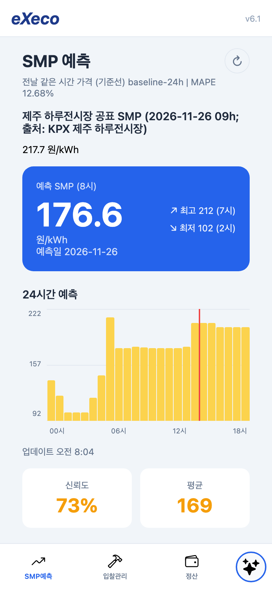

# 모바일 웹앱(`/mobile/`) UI 개편 — 빌드·평가 결과 보고서 (round 3 평가 반영)

- 작성: 2026-11-26 17:47 KST 빌드 마지막 단계 F12에서 처음 쓰고, 19:30 무렵 round 1 평가 결과를, 2026-11-27 09시 무렵 수정 단계 F13a·F13b·F13c·F14와 round 2·3 평가 결과를 더했다(평가 결과를 더한 두 작업은 앱 코드를 바꾸지 않았다) · 범위: `mobile/` (워크트리 `.claude/worktrees/mobile-top1`, 브랜치 `ui/mobile-top1`, 기준 커밋 `f2fbb5a2`)
- 상태: 빌드 단계 F0\~F12, 수정 단계 F13a·F13b·F13c(round 1 결함)와 F14(round 2 결함), 평가 round 1\~3(라운드마다 렌즈 4개)을 마쳤다. **마지막 평가 round 3에서 합격선을 넘었다**: 항목 평균이 모두 8.0 이상(가장 낮은 R1·R8 8.4), 평균 8.81, 네 렌즈 모두 통과(M1\~M9·I1\~I5 포함, 떨어진 관문 0). 다만 결함 41건(높음 3)이 열려 있고, 기준 제품(약 9.1)보다는 낮으며, 실제 기기는 확인하지 않았다(1.1절). 운영 반영(P1)과 푸시·병합(P11)은 하지 않았다. 운영은 개편 전 번들을 그대로 서빙한다
- 개편 전: 기준 커밋 `f2fbb5a2`. 이 커밋의 웹 export는 운영이 서빙하는 번들과 바이트가 같다(`AppEntry-71e4dcb6…`, sha256 `1f73e2ff…`, F0에서 확인). 숫자는 round 0 평가(2026-11-26 새벽, 평균 4.34)와, 같은 측정 도구로 개편 전 앱을 다시 잰 기준선(`baseline-v2`, 08:06\~08:08 KST)에서 옮겼다
- 개편 후: 앱 코드는 커밋 `c08d443b`(F14)다. 번들 `AppEntry-27a7d4b9bfe3d675cef91e8add41e9a2.js` 639,947 B, sha256 `a8ec24512d8cf1630aa6d215d447fccafe9b4223e1b1030dd044afedf65308db`. round 3은 이 커밋을 다시 export한 번들(F14 마지막 `check.sh` export와 `diff -rq` 같음)을 dev preview :10104(운영 `public_server.py` 사본, 같은 `/mobile/` 경로와 API 허용 목록)에 띄워 2026-11-27 06:43\~07:53 KST에 캡처했고, 렌즈 4개가 07:55\~08:59 KST에 판정했다. round 1 평가 대상(앱 코드 F11 `748fb466`, 번들 `AppEntry-2ab8b161…` 624,723 B, sha256 `8c65b3ad…fe79c8`, 캡처 17:52\~18:30 KST · 판정 18:32\~19:14 KST)과 F12의 게이트 측정(round1-pre, 17:07\~17:46 KST)은 1.2\~1.4절의 round 1 행과 3.1\~3.3절에 그대로 두었다
- 설계 명세: `docs/2026-11-26-mobile-ui-top1-design.md`(이하 "명세". round 1 뒤 수정 결정 D1\~D18은 2.4절, round 2 뒤 F14의 수정은 2.5절). 숫자는 모두 저장된 측정 출력에서 옮겼고, 점수·관문·결함은 렌즈별 판정 원문에서 옮겼다(부록 A). 반올림은 한 번만 했다

---

## 0. 먼저 알아 둘 낱말

| 낱말 | 뜻 |
|---|---|
| R1\~R8 | 화면 품질 채점표 8항목(시각, 첫 화면, 차트, 신뢰·출처, 테마, 모바일 사용성, 접근성, 구현), 10점 만점. 기준 제품은 Electricity Maps 앱(약 9.1)이다 |
| 합격선 | R1\~R8 모두 8.0 이상, 평균 8.5 이상, 그리고 게이트 M1\~M9·I1\~I5 **전부** 통과(명세 1.1절, TOP1 기준선). 워크플로는 항목 점수를 R1\~R8을 모두 매긴 두 렌즈(parity·mentor)의 평균으로 셌다(1.2절). 렌즈 판정은 round 1 워크플로가 layout_a11y·integrity 두 렌즈만 봤고, round 2·3 워크플로는 네 렌즈가 모두 자기 관문까지 통과해야 합격으로 셌다 |
| 렌즈 | 평가자 한 명이 보는 관점. parity(경쟁 제품과 견줌, R1\~R8), mentor(비전문가 멘토 겸 모바일 UX, R1\~R8), layout_a11y(배치·접근성 게이트 M1\~M9, R5\~R7만), integrity(정직성 게이트 I1\~I5, R4·R8만). 라운드마다 새로 시작하고 앱 코드는 고치지 않는다 |
| M1\~M9 | 숫자로 재는 배치·접근성 게이트(명세 1.2절): 가로 넘침, 누름 대상 44 px, 글자 12 px, 대비, 의미 구조, 콘솔·요청, 막대 가림, 상태와 복구, 첫 로드 |
| I1\~I5 | 정직성 게이트(명세 1.3절): 지어낸 값, 출처와 시각, 값·단위·표기, 테스트, 정확도 수치 |
| 4상태 칩 | 숫자 옆 표시. ● 실측·확정, ┅ 예측, ▨ 추정, ┆ 예시. 글자·테두리 모양·기호가 함께 같은 뜻을 전한다(색만으로 전하지 않는다) |
| 기준선 예측 | 어제 같은 시각의 제주 가격을 오늘 예측으로 쓰는 방법이다. 지금 SMP 서빙 방식이며, 문서화된 정확도는 MAE 11.97원/kWh · MAPE 11.75% · R² 0.203(walk-forward 2025-07-22\~12-18)이다 |
| round 0 | 개편 전 앱 평가. 평균 4.34(R1 4.75 · R2 5 · R3 3.5 · R4 4.5 · R5 3.5 · R6 5.25 · R7 3.5 · R8 4.75), 평가자 4명 모두 불합격 |
| round1-pre | F12가 round 1 평가 직전에 같은 측정 도구로 돌린 전체 측정이다. **점수가 아니라 게이트 측정**이다 |
| round 1 | F12 뒤 첫 평가(2026-11-26 17:52\~19:14 KST). 같은 번들을 같은 실행기로 다시 잰 캡처와 렌즈 4개의 판정이다 |
| round 2 | F13c 뒤 평가(2026-11-27 01:58\~04:02 KST, 앱 코드 `6fb6bf64`). 점수는 넘었지만 관문 넷이 떨어졌다 |
| round 3 | F14 뒤 평가(2026-11-27 06:42\~08:59 KST, 앱 코드 `c08d443b`). 마지막 평가이며 합격선을 넘었다 |
| F0\~F12 · F13a\~F14 | 빌드 단계와 수정 단계. 단계마다 빌더 1명, 커밋 하나(부록 B). F13a·F13b·F13c는 round 1 결함을, F14는 round 2 결함을 고쳤다 |
| D1\~D18 | round 1 뒤 오케스트레이터가 정한 수정 결정(명세 변경 포함). 원문 `scratchpad/mobile/eval/round1/FIX_PLAN_r1.md`, 명세 2.4절, 이 보고서 5.3절 |
| 있는 그대로 · 데운 서버 · 지연 | M9 냉시작 3회 묶음의 종류. 있는 그대로 = 다른 측정 없이 바로 잼, 데운 서버 = 오늘 화면의 GET 여섯을 한 번씩 부른 직후, 지연 = Playwright가 `/api/v1/smp/day-ahead` 응답을 1,200 ms 붙잡음(서버 하루전 가격 캐시가 빈 첫 방문자 흉내, D3) |
| P1\~P11 | 사용자 승인이 필요한 항목(명세 14절, 이 보고서 5.1절). 승인 전에는 만들지 않았다 |
| content 시각 | M9에서 오늘 화면 가격 카드(`today-hero`)가 "불러오는 중"을 벗어난 시각. 스켈레톤은 content가 아니다 |

---

## 1. 결론과 평가 (round 1\~3)

### 1.1 결론

1. 명세의 빌드 단계 F0\~F12에 이어 수정 단계 넷을 마쳤다: F13a(구조 + 문구)·F13b(배치 + 차트 + 초점)·F13c(첫 로드 + 자료 + 하니스)가 round 1 결함과 오케스트레이터 결정 D1\~D18을, F14가 round 2에서 떨어진 관문 넷과 결함 50건을 다뤘다. 단계마다 로컬 커밋 하나이고 `check.sh`는 매번 fail 0 · 기존 35/35 · tsc 0 · export 0 · scan 0 · locked-diff 0이었다(부록 B). 공개 모바일 웹앱은 탭 4개(오늘·입찰·정산·알아보기)와 화면마다 주소를 갖고, 라이트·다크와 320\~1280 px에서 같은 구조로 보인다. 모든 숫자는 상태 칩·출처·KST 시각을 가진 카드 안에 있고, 지어낸 값은 `src/data/examples.ts`에서만 나와 ┆예시┆로 보인다
2. **마지막 평가 round 3에서 TOP1 합격선(명세 1.1절: 모든 R 8.0 이상 · 평균 8.5 이상 · M1\~M9와 I1\~I5를 포함해 네 렌즈 모두 통과)을 넘었다.** 항목 평균은 R1 8.4 · R2 8.7 · R3 8.65 · R4 9.15 · R5 9.25 · R6 8.85 · R7 9.1 · R8 8.4, 평균 8.81(명세대로 소수 첫째 자리에서 한 번 반올림하면 8.8)이다. 네 렌즈가 모두 자기 관문을 통과했고 떨어진 관문은 0이다(1.2·1.3절)
   - 가장 낮은 항목(R1·R8 8.4)도 선보다 0.4 높다. round 1은 R1이 꼭 8.0이었고 멘토 렌즈가 스스로 불합격이었다
   - M9는 이제 여유가 있다. round 3에서 잰 21회(캡처 9회와 layout_a11y 평가자 12회, 있는 그대로·데운 서버·하루전 가격 +1,200 ms 지연)가 모두 5,024\~5,160 ms로, 가장 느린 회차도 기준 6.0초보다 0.84초 빠르고 D3 수락 기준(있는 그대로 ≤ 5.4초, 지연 ≤ 6.0초)도 채웠다. 첫 화면은 이제 번들 도착(약 4.8초)에 맞춰 정해지고 하루전 가격 응답 시간에 끌려가지 않는다(1.4절)
   - 게이트 측정(캡처)은 1,948기록·axe 972회·보조 점검 286건에서 실패 0이고, 평가자 둘이 따로 훑은 것(layout_a11y: 하나씩 동작 1,743개, integrity: 화면 값과 파생 값 재계산)도 실패 0이다(1.3·3.0절)
3. 넘었다는 말의 범위(과장하지 않으려고 적는다)
   - 합격선은 명세가 정한 TOP1 기준선이다. 기준 제품 Electricity Maps 앱(약 9.1)과 같아졌다는 뜻이 아니다. 평균 8.81은 기준 제품보다 0.3쯤 낮고, parity 렌즈도 R1 근거에 "EM의 시각 완성도(9.5)에는 닿지 않는다"고 적었다
   - 결함 41건이 열려 있다(높음 3 · 중간 11 · 낮음\~중간 2 · 낮음 21 · 기록 4, 5.4절). 높음 셋은 모두 parity 렌즈의 것이다: 390 첫 화면에 그림이 없다(24시간 차트가 위에서 약 770 px 아래), 768\~1023 px 두 칸에서 가격 카드 아래 약 180 px가 빈다, 번들 여유가 53 B(639,947 / 640,000 B)뿐이라 어떤 수정도 한도를 넘긴다. round 3이 합격해 워크플로는 수정 라운드를 더 돌지 않았다
   - 모든 측정은 Chromium(Playwright)이다. 실제 휴대폰(iPhone Safari·VoiceOver·TalkBack)과 200% 글자 크기는 확인하지 않았다(parity R7 근거에도 같은 말이 있다)
   - 항목 점수는 R1\~R8을 모두 매긴 두 렌즈(parity·mentor)의 평균이다. 부분 점수를 낸 두 렌즈까지 넣어도 평균 8.86으로 판정은 같다(1.2절)
4. round 2(F13c 뒤)는 점수로는 넘었지만(평균 8.73, 가장 낮은 R8 8.4) 관문 넷이 떨어져 합격선에 못 미쳤다: mentor MEN-COPY(입찰 화면의 "입찰일 11-28"이 같은 줄의 마감 11-27보다 뒤라 입찰하는 날로 읽힘, 정산의 뜻이 세 곳에서 다름 등), layout_a11y M5·FOCUS(설명 글의 [다시 시도]가 성공하면 초점이 `<body>`로 빠짐), integrity NOW-KST(미리 받은 응답의 조회 시각을 꺼낸 순간으로 써서 느린 첫 로드에서 앱 시계가 2분 늦음). F14가 넷을 모두 고쳤고 round 3에서 모두 통과했다(1.3·1.5절)
5. 운영 반영·푸시·병합은 하지 않았다. 다음은 P1(운영 배포) 승인이다(5.1절). 명세 13절의 배포 조건(합격한 round의 export와 그 sha256)을 채웠다: round 3 export `scratchpad/mobile/build/runs/R3-20261127-064235/export`, 번들 `AppEntry-27a7d4b9bfe3d675cef91e8add41e9a2.js` sha256 `a8ec24512d8cf1630aa6d215d447fccafe9b4223e1b1030dd044afedf65308db`. 함께 정할 일: 높음 결함 셋을 배포 전에 고칠지다. 고치려면 번들 자리가 먼저 필요하다(P3 압축, 또는 문구를 `guide.ko.json`으로 더 옮기기, 5.2절 1)

### 1.2 라운드별 점수 (렌즈별 원 점수와 항목 평균)

항목 평균은 워크플로 규칙대로 R1\~R8을 모두 매긴 두 렌즈(parity·mentor)의 평균이다(round 0도 같은 규칙). layout_a11y(R5\~R7)와 integrity(R4·R8)의 부분 점수는 표에 적었지만 평균에 넣지 않았다. 넣어도 판정은 같다: round 1은 R5 9.1 · R6 8.6 · R7 8.67 · R8 8.37, 평균 8.57, round 2는 평균 8.72, round 3은 R4 9.13 · R5 9.33 · R6 9.0 · R7 9.17 · R8 8.47, 평균 8.86이다. 굵은 글씨는 8.0 미만인 값과 불합격 판정이다.

| 렌즈 | 라운드 | R1 시각 | R2 첫 화면 | R3 차트 | R4 신뢰 | R5 테마 | R6 사용성 | R7 접근성 | R8 구현 | 렌즈 평균 | 렌즈 판정 |
|---|---|---|---|---|---|---|---|---|---|---|---|
| parity | 0 | 5 | 5.5 | 4 | 4.5 | 3.5 | 5.5 | 3.5 | 4.5 | 4.5 | 불합격 |
| parity | 1 | 8.1 | 8.8 | 8.3 | 9.3 | 9.2 | 8.6 | 9.0 | 8.6 | 8.74 | 통과 |
| parity | 2 | 8.6 | 8.9 | 8.7 | 9.5 | 9.2 | 8.9 | 9.1 | 8.6 | 8.94 | 통과 |
| parity | 3 | 8.5 | 9.0 | 8.8 | 9.5 | 9.5 | 9.0 | 9.2 | 8.6 | 9.01 | 통과 |
| mentor | 0 | 4.5 | 4.5 | 3 | 4.5 | 3.5 | 5 | 3.5 | 5 | 4.19 | 불합격 |
| mentor | 1 | **7.9** | 8.4 | 8.1 | 8.7 | 8.8 | 8.2 | 8.5 | 8.0 | 8.33 | **불합격**(MEN-COPY) |
| mentor | 2 | 8.3 | 8.7 | 8.2 | 9.0 | 8.7 | 8.5 | 8.6 | 8.2 | 8.53 | **불합격**(MEN-COPY) |
| mentor | 3 | 8.3 | 8.4 | 8.5 | 8.8 | 9.0 | 8.7 | 9.0 | 8.2 | 8.61 | 통과 |
| layout_a11y | 0 | — | — | — | — | 4 | 5.5 | 4 | — | — | 불합격 |
| layout_a11y | 1 | — | — | — | — | 9.3 | 9.0 | 8.5 | — | — | 통과 |
| layout_a11y | 2 | — | — | — | — | 9.3 | 8.9 | 8.6 | — | — | **불합격**(M5·FOCUS) |
| layout_a11y | 3 | — | — | — | — | 9.5 | 9.3 | 9.3 | — | — | 통과 |
| integrity | 0 | — | — | — | 4.5 | — | — | — | 5 | — | 불합격 |
| integrity | 1 | — | — | — | 9.0 | — | — | — | 8.5 | — | 통과 |
| integrity | 2 | — | — | — | 8.7 | — | — | — | 8.4 | — | 통과(관문 NOW-KST는 떨어짐, 1.3절) |
| integrity | 3 | — | — | — | 9.1 | — | — | — | 8.6 | — | 통과 |
| **항목 평균** | 0 | 4.75 | 5 | 3.5 | 4.5 | 3.5 | 5.25 | 3.5 | 4.75 | **4.34** | 4개 모두 불합격 |
| **항목 평균** | 1 | 8.0 | 8.6 | 8.2 | 9.0 | 9.0 | 8.4 | 8.75 | 8.3 | **8.53** | 3개 통과 · 1개 불합격 |
| **항목 평균** | 2 | 8.45 | 8.8 | 8.45 | 9.25 | 8.95 | 8.7 | 8.85 | 8.4 | **8.73** | 2개 통과 · 2개 불합격 |
| **항목 평균** | 3 | 8.4 | 8.7 | 8.65 | 9.15 | 9.25 | 8.85 | 9.1 | 8.4 | **8.81** | 4개 모두 통과 |
| 명세 15절 예상 | 1 | 8.3 | 8.9 | 8.6 | 9.0 | 8.9 | 8.5 | 8.5 | 8.2 | 8.6 | — |

| 라운드 | 평가 대상 | 평균 | 가장 낮은 항목 | 떨어진 관문 | 결함 | 합격선 |
|---|---|---|---|---|---|---|
| 0 | 개편 전 앱(`f2fbb5a2`, 운영 번들과 sha256 같음) | 4.34 | R3·R5·R7 3.5 | parity 5개 전부(PAR-FIRST·NAV·VIZ·STATE·THEME), mentor 3개 전부(MEN-5S·COPY·TRUST), layout_a11y M1\~M6·M8·M9, integrity I1·I2·I3·I5 — 20개 | 82 | 못 넘음 |
| 1 | F12 `794dc4e1`(앱 코드는 F11 `748fb466`) | 8.53 | R1 8.0 | mentor:MEN-COPY 하나 | 54 | 넘음(턱걸이, 그때 규칙) |
| 2 | F13c `6fb6bf64`(F13a·F13b·F13c 뒤) | 8.73 | R8 8.4 | mentor:MEN-COPY · layout_a11y:M5 · layout_a11y:FOCUS · integrity:NOW-KST | 50 | 못 넘음(관문 넷) |
| 3 | F14 `c08d443b` | 8.81 | R1·R8 8.4 | 없음 | 41 | **넘음** |

- round 1의 "넘음"은 그때 워크플로 규칙(게이트는 layout_a11y·integrity 두 렌즈의 판정만 봄)에 따른 것이다. round 2·3 규칙(네 렌즈 모두 자기 관문까지 통과)으로 보면 멘토 렌즈 불합격 때문에 못 넘은 것이다. round 3은 더 엄한 규칙으로 넘었다
- round 2의 integrity 렌즈는 NOW-KST를 떨어뜨렸지만 "명세 2.1절 4번 규칙이지 1.3절 게이트가 아니다"며 렌즈 판정은 통과로 냈다. 워크플로는 이것도 떨어진 관문으로 셌다

R별로 보면 round 1 → round 3에서 가장 많이 오른 것은 R3 차트·R6 사용성(+0.45), R1 시각(+0.4), R7 접근성(+0.35)이다. R8 구현(8.3 → 8.4)은 거의 그대로이고 R1과 함께 가장 낮다. round 3은 명세 15절 예상(평균 8.6)보다 0.2 높고, 예상보다 낮은 항목은 R2(8.7, 예상 8.9) 하나다. round 3 렌즈들이 든 감점 사유는 이렇다(5.4절)
- R1: 768 두 칸에서 가격 카드 아래 빈 자리(parity·mentor), 차트 앞에 쌓인 조작 줄(차트|표·스텝퍼·성향), 카드 폭 전체를 차지하는 예시 띠, 웹 링크처럼 보이는 용어 줄, 모양 없는 스켈레톤, 홀로 남은 '펼치기'(parity)
- R2·R3: 첫 화면에 추세 그림이 없고(parity) 오늘 가격이 높은지 낮은지 말하지 않음(mentor), 차트가 예측과 확정 가격 점 하나뿐, 80% 띠 윤곽이 기준선을 덮음, 360에서 계단 % 라벨이 붙음(parity)
- R8: 번들 여유 53 B가 모든 변경을 막음(parity·mentor·integrity), 측정 하니스가 저장소·CI 밖(세션 스크래치)에 있음(parity·integrity), 레거시 화면이 죽은 코드로 남음(parity)
- round 1 때의 사유(글이 많은 카드, 휴대폰 폭에서 옆으로 미는 표, 막대 덩어리 같은 입찰 계단, 확정 가격 1점이 점수처럼 읽힘, 태블릿의 휴대폰 배치, 레거시 폴더에 기댄 새 코드, Slow 4G 여유)는 F13a\~F14가 대부분 고쳤다. 글 밀도 30% 감소(D17)만 목표에 못 미쳤다(5.3절)

### 1.3 관문 판정

**round 3 (마지막 평가, 떨어진 관문 0)**

| 렌즈 | 관문 | 판정 | 근거 요지 (렌즈 원문 요약) |
|---|---|---|---|
| layout_a11y | M1\~M5 · M7 · M8 | 통과 | 자기 탐침으로 grid 132기록(11상태 × 6폭 × 2테마, 위·중간·끝), 375\~1920 폭 120기록, 시트 딥링크 156, 변형 216, 하나씩 동작 1,743개, 회전에서 넘침·잘림 0. 44 px 미만 대상 0, 글자는 12·13·15·20·28·32 px뿐, axe color-contrast 0과 자기 대비 계산 실패 0(비글자도 3:1 이상), 시트 386번 aria-modal·가둠·Esc·초점 복귀, 접근성 트리에 이름 없는 초점 대상 0, 9×24 격자 가림 0, 안전 영역(세로 위 47·아래 34 px, 가로 좌우 47·아래 21 px) 안쪽, 변형 54개 × 4설정 216기록의 상태와 복구 |
| layout_a11y | M6 | 통과 | 페이지 약 2,400번에서 앱 콘솔 오류·허용 목록 밖·다른 출처·쓰기 요청 0. 브라우저 줄 3개(`/bidding/optimized-segments` 503)는 평가자가 브라우저 4\~8개를 동시에 띄워 서버 코드(`public_server.py` 사본)의 입찰 계산 한 건 제한에 걸린 것이고(672번 중 10번), 앱의 1.5초 뒤 한 번 재시도가 받아 냈다. 브라우저 하나로 잰 M9·요청 수 측정에서는 0 |
| layout_a11y | FOCUS | 통과 | 하나씩 동작 1,743개(390 light 누름 + Enter 514, 1280 light 524, 320 light Enter + Space 458, 768 dark Enter 247) 뒤 초점이 `<body>`에 남은 경우 0. 다시 시도 성공 32경우(카드·계산기·설명 글의 화면·시트·1280 패널)가 모두 제목으로 초점을 옮기고 "다시 불러왔습니다 · HH:MM KST"를 알림 |
| layout_a11y | M9 | 통과 | 자기 preview(:10105)에서 하니스와 자기 스크립트로 있는 그대로 6회 5,024\~5,074 ms, 하루전 가격 +1,200 ms 지연 6회 5,025\~5,058 ms. 모두 5.4초 이하(1.4절) |
| layout_a11y | REQ · BUNDLE · KEYS · REGRESS | 통과 | 첫 로드 GET이 명세 6.3절 목록과 같음(21개 URL, 중복·실패 0). 번들 639,947 B ≤ 640,000 B(여유 53 B, sha256 `a8ec2451…5308db`, 캡처 export와 `diff -rq` 같음). Tab 순회 28번에서 모든 정지에 2 px 링, 순서는 내용 순서(768 두 칸의 카드 순서만, 의도된 것). 글자 간격(WCAG 1.4.12) 52상태 × 4폭 잘림 0. round 1 배치·접근성 결함을 다시 재 보니 모두 고쳐져 있음 |
| integrity | I1\~I5 | 통과 | `check.sh R3-integrity` 238 통과·scan 0. 예시 값은 모두 예시 칩이나 띠가 있는 카드 안(꼬리표 없는 값 0). I2 추가 117기록 384값에서 표지 밖 숫자 0. I3 원값 0 / 12 · 파생 0 / 51 불일치이고, 화면이 받은 응답으로 입찰 10행과 합계 344.5만원, 오늘 최고·최저·평균·띠 폭·경계를 다시 계산해 모두 일치. I5: 카드에는 문서화 수치(MAE 11.97원/kWh · MAPE 11.75%, walk-forward 2025-07-22\~12-18)만, API 수치(12.73% · 72.5%)는 정확도 시트의 'API 표기' 줄에만 |
| integrity | NOW-KST · TZ-INDEPENDENCE · PREFETCH · DIFF-REVIEW · D9-RESERVE-WORDING | 통과 | 번들을 130초 붙잡아도 NowPill이 실제 시각을 따름(08:13:40에 '08:13 KST · 조회 2분 전', 조회 시각은 도착 시각). UTC·로스앤젤레스·서울에서 실시간과 고정 시각 다섯(06:03:57·09:20·09:59:30·10:00:30·23:59:30 KST)의 글자가 같음. `index.html`은 명세 8.1절과 바이트가 같고 29개 URL × 2폭에서 요청이 6.3절 목록과 같으며 중복 0. `f2fbb5a2..HEAD`는 `mobile/`·문서·CHANGELOG·PROJECT_STATUS만 바꿨고 잠근 파일은 같음. 예비율 단계 낱말(정상·보통·낮음·위험, "KPX 공식 경보 단계 아님")은 정직함(10%·5% 경계값을 적지 않은 것은 낮음 결함) |
| parity | PAR-FIRST · PAR-NAV · PAR-VIZ · PAR-STATE · PAR-THEME | 통과 | 390 첫 화면에 h1·NowPill·답 문장·가격 카드·전력 카드가 탭 막대 위에 있고 덮개가 없음. 4탭·레일·패널·시트·회전, 딥링크 12/12. 계단 차트 문법(파선 예측·띠·지금선·확정 점·▲▼ 잘림 표시·판독·표 보기). 변형 54개를 6폭 × 2테마로 봄. 두 테마의 배치·데이터 색이 같고 부트 테마 8/8. 남은 틈: 접는 선 위에 추세 그림 없음, 시트 손잡이·끌어내리기 없음, 예측뿐인 차트, 모양 없는 스켈레톤 |
| mentor | MEN-5S · MEN-COPY · MEN-TRUST | 통과(결함 있음) | 네 탭이 5초 안에 읽힘(320·1280 포함). 시트 제목 8개와 둘러보기 제목 5개가 본문과 맞고, 용어 사전과 쓰임이 같으며, 카드 산수가 맞음(1,316 − 699 = 617, 1,316 / 1.15 = 1,144, 120 MWh × 150원 = 1,800만원). 남은 것: MAE·MAPE 이름, 풀이 없는 '분위수', 가격 근거 줄의 '하루 차이', 출처 화면의 개발자 말투, '확정 가격 11-27 07h' 옆의 '과거 날짜 자료', 이미 정해진 가격을 예측처럼 그린 까닭이 차트에 없음, 맨몸 '시각 확인 필요' |

**round 2에서 떨어진 관문 넷과 F14**

| 렌즈 · 관문 | round 2 근거 요지 | F14가 고친 것 | round 3 |
|---|---|---|---|
| mentor · MEN-COPY | round 1 항목(둘러보기 2/5 제목·관심 경계·KPI 수요·moderate·문장 속 Nh·R²와 walk-forward 풀이)은 고쳐짐. 새 사유: 입찰 첫 화면·레일·입찰 시트·가격 근거·예측 방법·둘러보기 3/5의 "입찰일 11-28(토)"가 같은 줄의 마감 11-27보다 뒤(KPX는 그날을 거래일이라 부름), 정산의 뜻이 세 곳에서 다름, 낙찰 가능성 용어("받는 값은 낮아집니다")가 SMP 한 가지 가격 규칙과 어긋남, 가격 시트의 "아래 두 줄은" | KPX 낱말 "거래일", 정산 뜻 한 문장(화면 = 용어 = 둘러보기 4단계), 낙찰 가능성 "낙찰되면 그 시간 SMP를 받습니다", `source-bans`의 copy-term 규칙이 "입찰일"을 막음(명세 2.5절) | 통과 |
| layout_a11y · M5 · FOCUS | 하나씩 동작 1,497개에서 body 0이었지만, 설명 글(`guide.ko.json`) 404 뒤 [다시 시도]가 성공하면 용어 사전·읽는 법·예측 방법·출처·용어 화면·둘러보기 2단계·용어 시트·산출 방식 시트에서 초점이 `<body>`로 빠지고 알림이 없음(4설정 모두) | `RetryScope`: 누르는 순간 가장 가까운 제목(카드 h2 · 시트 제목 · 화면 h1)으로 초점을 옮기고, 받으면 "다시 불러왔습니다 · HH:MM KST" | 통과(캡처의 설명 글 다시 시도 108/108, 평가자 32경우) |
| integrity · NOW-KST | 번들을 130초 붙잡은 느린 첫 로드에서 실제 03:20:06에 NowPill이 '03:17 KST · 조회 방금 · 서버 시각 기준', 앱 정보는 '기기 시계와 2분 차이'(기기 시계는 맞았음), 카운트다운 6시간 41분(실제 6시간 39분) | `index.html`이 응답이 도착한 기기 시각을 적고, 클라이언트가 그 값을 조회 시각과 서버 시각 짝으로 씀(재현 테스트가 수정 전 코드에서 실패, 수정 뒤 통과) | 통과(130초 붙잡아도 앱 시계 지연 0분) |

**round 1 (기록)**

| 렌즈 | 관문 | 판정 | 근거 요지 (렌즈 원문 요약) |
|---|---|---|---|
| layout_a11y | M1\~M8 | 통과 | 하니스 1,876기록 실패 0에 더해 6폭 × 2테마에서 동작 2,118개를 하나씩 새 세션으로 훑었다. 넘침·잘림 0(200% 확대 640×400, 400% 리플로 320×256 포함), 44 px 미만 대상 0, 가장 작은 글자 12 px, axe 위반 0(직접 12상태), 시트 740번 열어 가둠·Esc·초점 복귀 740/740, 콘솔 오류·실패 요청 0, 안전 영역 아래 34 · 위 47 · 가로 47 px에서 가림 0, 변형 52/52와 카드별 실패 9/9 |
| layout_a11y | M9 | 통과(여유 31 ms) | 자기 dev preview(:10105)에서 냉시작 두 묶음 6회가 모두 6.0초 이하. 같은 라운드 캡처의 첫 회 6,129 ms는 위험으로 적었다(1.4절) |
| layout_a11y | BUNDLE | 통과 | 624,723 B / 640,000 B. HEAD를 다시 export해도 바이트가 같다 |
| integrity | I1\~I5 | 통과 | 18:41 KST에 화면이 받은 응답으로 화면 값과 계산값(예비력·관심 경계·차이·시간대 요약·띠 폭·입찰 10구간·468.6만원)을 다시 계산해 모두 일치(반올림 한 번). 번들 금지 문자열 0, 새 코드 `Math.random` 0, 정산 금액은 모두 ┆예시┆ 아래, `check.sh`를 다시 돌려 같은 요약. 예외 하나(예측 방법 시트의 '검증 MAPE 12.68%')는 결함으로 적었다 |
| integrity | NOW-KST · TZ-INDEPENDENCE · DIFF-REVIEW | 통과 | 지금선·NowPill이 분이 바뀌고 1초 안에 넘어감(90표본 어긋남 0), UTC·로스앤젤레스·서울에서 글자와 지금선 x가 같음, `f2fbb5a2..HEAD`는 `mobile/`과 문서만 바꿨고 잠근 파일은 바이트가 같음 |
| parity | PAR-FIRST · PAR-NAV · PAR-VIZ · PAR-STATE · PAR-THEME | 통과 | 390 첫 화면에 가격·여유 전력·상태·KST·출처가 누르지 않고 보임(Electricity Maps는 눌러야 숫자가 나옴), 주소 상태 13개·뒤로·회전·1024 레일, 계단 차트 문법(지금선·점선 예측·실측 점·띠·판독·키보드·표), 상태 변형 52/52·카드별 9/9, 테마 6조합 |
| mentor | MEN-5S · MEN-TRUST | 통과 | 네 탭 모두 5초 안에 무엇인지 읽힘(320×568에서도 문장과 가격 카드), 실측·예측·추정·예시가 글자와 선 모양으로 늘 갈림, 지연·끊김·기본값을 그렇다고 말함 |
| mentor | **MEN-COPY** | **불합격** | 주 경로 문구는 자연스럽지만 ① 둘러보기 2/5 제목이 본문·용어 사전과 반대 ② 공급능력 풀이 속 'KPI 수요' ③ 입찰 산출 방식 시트의 '성향 moderate'(버튼은 '균형')와 'Quantile-based Probabilistic Clearing Model' ④ 풀이 없는 'walk-forward'·'R² 0.203'·'보류 검증' ⑤ '관심 경계'가 KPX 경보 단계 이름 둘을 겹쳐 씀 ⑥ 문장 속 'Nh · HH–HH시' |

round 1 평가자가 찾은 측정 도구의 빈틈 (판정은 그대로였다. F13c가 D16으로 고쳐 round 3에서는 B5 72/72(본문 안 정확한 이름으로 연 상태와 닫은 상태 각 12/12 포함), B6 가격 근거 줄 있음·없음·확인 전 글자 검사, I3 파생 값 51개 불일치 0이다)

- B5(가격 원리 펼치기): `sweep.py`가 이름 `/^가격/`으로 찾아 헤더의 '가격·전력 정보 새로고침' 버튼을 먼저 눌렀다. 그래서 펼친 가격 원리 카드는 하니스 캡처에 한 장도 없는데 B5는 60/60 통과로 세어졌다(같은 실행기를 쓴 round1-pre도 같다, 3.3절). parity가 따로 펼쳐 320·390·1280 × 두 테마에서 `aria-expanded=true`, 넘침 0을 확인했다(`scratchpad/mobile/eval/round1/parity/cap/merit-*.png`)
- I3: 기계 검사는 `data-pd-raw` 값 13개(오늘 화면)만 비교하고, 계산값과 입찰 화면은 보지 않는다. integrity가 화면이 받은 응답으로 모두 다시 계산해 맞았다(`scratchpad/mobile/eval/round1/integrity/live/results.json`). 그래서 3.1절의 "불일치 0 / 13"은 실제로 검사한 범위보다 넓게 읽힌다
- B6의 '가격 근거 줄 있음·없음' 캡처 두 장은 바이트까지 같다. 입찰 경로로 바로 들어오면 줄이 빠지는 것을 하니스는 보지 못했다(부록 C 6)

### 1.4 M9 첫 로드 (round 1\~3, 390×844, 브라우저 캐시 끔, Slow 4G)

지연 묶음의 `/smp/day-ahead` 응답에는 Playwright가 붙잡은 1,200 ms가 들어 있다. 자기 스크립트는 layout_a11y 평가자가 하니스와 따로 CDP로 쓴 측정기다.

| 라운드 | 묶음 | 잰 시각(KST) · 서버 | content (ms) | `/smp/day-ahead` 응답 (ms) | 3회 모두 ≤ 6,000? |
|---|---|---|---|---|---|
| 1 | 캡처 · 있는 그대로 | 17:53 · :10104 | 6,129 · 5,428 · 5,427 | 1,125 · 567 · 572 | 아니오(1회차, 도구 판정 FAIL) |
| 1 | 캡처 · 데운 서버 | 18:30 · :10104 | 5,513 · 5,512 · 5,429 | 661 · 584 · 567 | 예 |
| 1 | layout_a11y 1묶음 | 18:35 · :10105 | 5,969 · 5,451 · 5,419 | 943 · 576 · 573 | 예(1회차 여유 31 ms) |
| 1 | layout_a11y 2묶음 | 19:12 · :10105 | 5,412 · 5,426 · 5,410 | 568 · 573 · 569 | 예 |
| 참고 | round1-pre 있는 그대로(3.2절) | 17:07 · :10104 | 6,631 · 5,412 · 5,420 | 1,685 · 573 · 571 | 아니오(1회차) |
| 2 | 캡처 · 있는 그대로 | 02:00 · :10104 | 5,103 · 5,047 · 5,032 | 2,278 · 582 · 590 | 예 |
| 2 | 캡처 · 데운 서버 | 02:51 · :10104 | 5,026 · 5,028 · 5,025 | 597 · 587 · 582 | 예 |
| 2 | 캡처 · 지연 +1,200 ms | 02:51 · :10104 | 5,016 · 5,018 · 5,028 | 1,804 · 1,803 · 1,808 | 예 |
| 2 | layout_a11y 하니스 · 있는 그대로 | 02:59 · :10105 | 5,165 · 5,029 · 5,041 | 584 · 1,022 · 583 | 예 |
| 2 | layout_a11y 하니스 · 지연 | 03:00 · :10105 | 5,036 · 5,040 · 5,027 | 1,797 · 1,804 · 1,800 | 예 |
| 2 | layout_a11y 자기 스크립트 · 있는 그대로 | 03:41 · :10105 | 5,040 · 5,049 · 5,050 | 575 · 587 · 584 | 예 |
| 2 | layout_a11y 자기 스크립트 · 지연 | 03:41 · :10105 | 5,041 · 5,045 · 5,049 | 1,852 · 1,786 · 1,786 | 예 |
| 3 | 캡처 · 있는 그대로 | 06:44 · :10104 | 5,160 · 5,058 · 5,059 | 1,138 · 583 · 579 | 예 |
| 3 | 캡처 · 데운 서버 | 07:35 · :10104 | 5,049 · 5,047 · 5,037 | 584 · 582 · 575 | 예 |
| 3 | 캡처 · 지연 +1,200 ms | 07:35 · :10104 | 5,062 · 5,045 · 5,037 | 1,798 · 1,797 · 1,800 | 예 |
| 3 | layout_a11y 하니스 · 있는 그대로 | 07:58 · :10105 | 5,074 · 5,040 · 5,039 | 582 · 572 · 574 | 예 |
| 3 | layout_a11y 하니스 · 지연 | 07:58 · :10105 | 5,048 · 5,054 · 5,025 | 1,807 · 1,798 · 1,829 | 예 |
| 3 | layout_a11y 자기 스크립트 · 있는 그대로 | 07:59 · :10105 | 5,046 · 5,024 · 5,048 | 579 · 581 · 583 | 예 |
| 3 | layout_a11y 자기 스크립트 · 지연 | 07:59 · :10105 | 5,058 · 5,054 · 5,034 | 1,783 · 1,782 · 1,779 | 예 |

- M9 판정은 라운드마다 layout_a11y 렌즈가 자기 측정으로 내렸다(round 1은 위 두 묶음, round 2·3은 하니스와 자기 스크립트). round 1 캡처의 게이트 표(`scratchpad/mobile/eval/round1/GATES.md`)는 같은 번들을 "조건부"로 적었고, round 2·3 캡처의 게이트 표는 통과다
- round 1에서 기준을 넘은 회차는 모두 있는 그대로 잰 묶음의 1회차이고, 그때마다 `/smp/day-ahead`가 1.1초 넘게 걸렸다(서버 하루전 가격 캐시가 빈 경우, 3.2절). 번들 도착은 모든 회차에서 4,624\~4,672 ms다. `/smp/day-ahead`가 567\~661 ms였던 10회의 content는 5,410\~5,513 ms라 여유는 0.5\~0.6초뿐이고, 그 응답이 943 ms면 5,969 ms(여유 31 ms), 1,125 ms면 6,129 ms였다. 그때는 첫 GET 여섯이 번들을 받아 실행한 뒤에야 시작했다
- round 1 뒤 오케스트레이터가 명세를 바꿔(D3) F13c부터 `index.html`이 그 경로의 첫 그림 GET을 번들 내려받기와 겹쳐 미리 받는다. 그래서 round 2·3의 content는 번들 도착(4,784\~4,898 ms) 뒤 약 0.2\~0.3초에 정해지고 하루전 가격 응답 시간에 끌려가지 않는다. round 2 캡처 첫 회는 응답이 2,278 ms(round 1의 1,125 ms보다 느림)였는데도 content 5,103 ms였고, 지연 묶음의 응답(약 1.8초, 끝나는 시각 약 2.4초)도 번들 도착 전에 끝났다. 승인 항목 P3(압축)·P5(서버 캐시)는 쓰지 않았다
- D3 수락 기준(명세 9절: 있는 그대로 3회 모두 ≤ 5,400 ms, 지연 3회 모두 ≤ 6,000 ms)은 round 2·3의 모든 묶음이 채웠다. 가장 느린 회차는 round 2 평가자 하니스 첫 회 5,165 ms, round 3 캡처 첫 회 5,160 ms다
- round 2·3의 모든 회차가 API GET 여섯 개를 한 번씩 보냈다. 하나만 예외다: round 2 평가자 하니스 3회차는 03:00 정시를 넘기며 하루전 가격을 5,031 ms에 한 번 더 받았다(명세 4.1절의 정시 경계 다시 받기, content 5,041 ms에는 영향 없음)

### 1.5 라운드 사이에 고친 것

| 사이 | 고친 것 |
|---|---|
| round 0 → round 1 | 개편 전체다. 설계 명세와 빌드 F0\~F12(2절, 부록 B). round 0에서 떨어진 관문 20개 중 19개가 round 1에서 통과했다(남은 것은 MEN-COPY) |
| round 1 → round 2 | 첫 워크플로는 round 1에서 끝났지만(그때 규칙으로 합격), 오케스트레이터가 턱걸이·MEN-COPY 불합격·M9 여유 31 ms를 보고 배포 전에 고치기로 했다(수정 결정 D1\~D18, 5.3절). F13a 구조 + 문구(D18·D1·D6·D7·D8·D9·D11, 문구 낮음), F13b 배치 + 차트 + 초점(D2·D4·D10·D12·D13·D14·D17, 접근성 낮음), F13c 첫 로드 + 자료 + 하니스(D3·D5·D15·D16, 부트 theme-color, 하위 상태에서 탭 다시 누르기, 번들 자리, 전체 재측정). round 2 멘토는 round 1 문구 항목이 고쳐졌다고 확인했고, M9 가장 느린 회차는 6,129 ms에서 5,165 ms(여유 835 ms)가 됐다. D17(오늘 390의 12\~13 px 글 조각 30% 줄이기)만 블록 −11%·줄 −12%로 목표에 못 미쳤다. 새로 떨어진 관문 넷은 1.3절 |
| round 2 → round 3 | F14: 떨어진 관문 넷(MEN-COPY의 거래일·정산 뜻·낙찰 가능성, M5·FOCUS의 설명 글 [다시 시도] 초점과 알림, NOW-KST의 미리 받은 응답 도착 시각)과 round 2 결함 50건(고침 40 · 일부 4 · 미룸 3 · 기록만 3, 증거 `scratchpad/mobile/eval/steps/F14/evidence.md`). 미룬 셋은 390 첫 화면 24시간 미니 그래프(번들 여유 약 1 KB 필요), 768\~1023 왼쪽 레일, 시트 끌어내리기 손잡이다. round 3에서 관문 넷 모두 통과 |
| round 3 뒤 | 없다. round 3이 합격선을 넘어 워크플로가 끝났다(수정 라운드는 round 3까지로 짜여 있었다). 결함 41건은 그대로다(5.4절) |

---

## 2. 바뀐 것

### 2.1 개편 전후 요약

개편 전 측정값은 같은 측정 도구로 잰 `baseline-v2`(grid 48 = 4경로 × 6폭 × 2테마)와 round 0 렌즈 기록이고, 개편 후는 마지막 평가 round 3의 캡처(F14 `c08d443b`, 3.0절)다. F12 측정(round1-pre, 3.1\~3.3절)과 값이 다른 행은 그 값을 괄호에 함께 적었다.

| 항목 | 개편 전 | 개편 후 | 근거 |
|---|---|---|---|
| 탭과 주소 | SMP예측·입찰관리·정산 3탭 + 앨런 AI 버튼. 화면 주소가 없어 새로고침하면 첫 화면이고, 브라우저 뒤로 가면 앱을 떠난다 | 오늘·입찰·정산·알아보기 4탭. 4경로 + 쿼리 하위 상태 + 시트 주소, 뒤로 가면 시트부터 닫힌다 | round 0 렌즈(R6) · 11.5절 G2\~G5 |
| 테마 | 라이트만(OS 다크 설정을 따르지 않음) | 시스템 설정 따름 + 앱 안 선택(시스템·밝게·어둡게), 테마별 `theme-color`(번들이 뜨기 전에도 저장한 테마, F13c) | round 0 렌즈(R5) · G9 |
| 문서 언어 | `lang="en"` | `lang="ko"` | M5 |
| 제목·랜드마크 | h1 0개, `main`·live region 없음 | 상태마다 h1 1개, `main`·`nav`, polite live region 1개 | round 0 렌즈(R7) · M5 |
| 가장 작은 글자 | 10 px | 12 px | M3 |
| 대비 미달 요소 | 경로마다 3\~23개, 최악 1.00:1(앨런 글자) | 0 | M4 |
| 44 px 미만 누름 대상 | 경로마다 1\~3개 | 0 | M2 |
| axe critical·serious | 입찰 1·1, 나머지 경로 0·1 | 0·0 | M5 |
| 콘솔 오류 | 폭·테마마다 6건 | 0 | M6 |
| 허용 목록 밖·실패 요청 | `/power-plants`·`/settlements/*` 404 | 0 | M6 |
| 번들 금지 문자열 | 14종(AI 최적화, 신뢰도, BiLSTM, 등록되었습니다, 제출 완료 등) | 0 | I1·I5 |
| 카드 밖 숫자 | 98 | 0 | I2 |
| 번들(원시) | 725,177 B | 639,947 B(−85,230 B, 한도 640,000 B까지 53 B. round1-pre 624,723 B) | `check.sh` |
| Slow 4G 첫 페인트(FCP) | 5,412 · 5,396 · 5,404 ms(번들을 다 받은 뒤 처음 그림) | 864 · 624 · 636 ms(있는 그대로, `index.html` 스켈레톤. round1-pre 740 · 620 · 624 ms) | 1.4·3.2절 |
| 첫 그림 GET | 번들을 받아 실행한 뒤 시작 | 번들을 받는 동안 미리 받기(D3). 그 경로의 GET이 번들 도착 전에 모두 끝남, 같은 GET 두 번 0 | 1.4·3.4절 |
| Slow 4G content | 6,004 · 5,995 · 6,012 ms(옛 표지 "예측 SMP (") | 있는 그대로 5,160 · 5,058 · 5,059 ms, 하루전 가격 +1,200 ms 지연 5,062 · 5,045 · 5,037 ms(round1-pre 조건부, round 1 가장 느린 회차 여유 31 ms) | 1.4·3.2절 |
| node 테스트 | 35 | 238(기존 35개는 고치지 않음. round1-pre 213) | `check.sh` |

### 2.2 화면별

**셸(모든 화면 공통)**

- 헤더: 워드마크 `eXeco` + `v6.1`(기존 테스트가 잠근 표기), 오른쪽 새로고침은 네 탭 모두 같은 자리다. 새로 불러올 자료가 없는 정산·알아보기에서는 숨기지 않고 까닭을 붙여 비활성으로 둔다. 하위 화면에서는 왼쪽이 ← 뒤로 버튼이다
- h1 행 오른쪽 NowPill(`06:04 KST · 조회 1분 전`): 조회가 10분 넘으면 지연, 60분 넘으면 끊김으로 바뀌고, 끊기면 판정과 실측 표시를 거둔다
- 아래 탭 4개(오늘·입찰·정산·알아보기). 1024 px부터 왼쪽 레일(240 px), 1280 px부터 오른쪽 "이 화면 읽는 법" 패널(320 px). 본문 열은 최대 640 px. 600\~1023 px에서 탭 칸은 카드 열과 같은 폭이고, 768\~1023 px에서 오늘의 가격·전력 카드는 두 칸이다(D14)
- 주소: 화면마다 경로(`/mobile/`, `/mobile/bidding`, `/mobile/settlement`, `/mobile/guide`)와 하위 상태 쿼리(`?hour=`, `?risk=`, `?tour=`, `?topic=`, `?term=`), 시트 주소(`?sheet=method|sources|term|theme`). 새로고침해도 같은 화면이고, 브라우저 뒤로는 열린 시트부터 닫는다. 화면이 바뀌면 h1으로 초점을 옮기고 "입찰 화면"처럼 알린다. 하위 상태(둘러보기·용어·주제)에서 지금 탭을 다시 누르면 그 탭의 첫 화면으로 간다(F13c)
- 시트: 산출 방식([i]), 출처와 기준 시각([출처 표]), 용어, 화면 테마. 초점 가둠, Esc, 스크림 누름으로 닫히고, 닫으면 연 버튼으로 초점이 돌아간다. 시트가 열린 동안 바깥은 `inert`다(F13b). [다시 시도]가 성공하면 초점은 가장 가까운 제목으로 가고 "다시 불러왔습니다 · HH:MM KST"를 알린다(D4·F14)
- 그 밖: 오프라인 띠, polite live region 하나, 한국어 오류 화면, `index.html`이 JS보다 먼저 그리는 스켈레톤(테마 색 포함). `index.html`은 그 경로의 첫 그림 GET을 번들과 함께 미리 시작하고 응답이 도착한 시각을 적는다(D3·F14)

**오늘** (`/`, 화면은 `SMPForecastScreen.tsx`를 같은 자리에서 다시 쓰고 view model·시트는 `src/features/today/`, D18)

- 답 문장: "지금 시간 제주 전기 도매가격은 1kWh에 115.3원이고, 낼 수 있는 전력이 쓰는 전력보다 527 MW 더 많습니다."(06:03:57 KST 스냅숏 기준 예). 상태별 문장(불러오는 중·지연·끊김·확정 가격 없음·전부 실패)이 따로 있고, 기기 시계로 문장을 고르지 않는다
- 가격 카드: KPX 제주 하루전 확정 가격(● 확정 가격), 메타 줄 `06–07시 · 거래시간 07h · 하루전시장`(문장 속 거래시간은 시각 범위만, D11), 같은 시간 기준선 예측과의 차이와 평소 오차
- 전력 카드: 수요·예비율·공급능력을 식 한 줄(`공급능력 1,191 MW − 수요 664 MW = 예비력 527 MW`)과 범위 막대, 경계 표지 "▲ 수요 N MW · 넘으면 예비율 15% 미만"으로 보인다. 예비율 단계는 정상·보통·낮음·위험이고 KPX 공식 경보 낱말(관심·주의·경계 등)을 쓰지 않는다(D9). 식과 막대는 공급능력과 수요의 짝이 맞을 때만 그린다(F14부터는 `/power-supply`의 `data_source`가 실시간 값으로 맞췄다고 말할 때만). 날씨는 기상청 초단기실황이며, API가 보낸 기본값(5.0 °C · 3.0 m/s · 60 % · 맑음)은 "기본값 · 실측 아님"으로 표시한다. 실측이 아닌 KPI는 흐린 본문 글자다(F14)
- 24시간 카드: 기준선 예측 계단 차트(80% 구간 띠, 확정 가격 점, KST 지금선, 기준선 입력 0.00 시간 빗금)와 표 보기, 시간 스텝퍼, 가장 비싼·싼 시간과 시간대 요약. 차트는 ←/→/Home/End로도 고른다. 칩은 "확정 가격 · 지금 시간만"이고 이번 방문에서 받은 확정 가격은 점으로 쌓인다(D10). 600 px 아래 표 보기는 행 카드 목록이다(D2)
- 정확도 카드: 쉬운 말 "시간마다 평균 11.97원/kWh 빗나갑니다"와 문서화된 MAPE 11.75% 하나(D8). API가 보내는 수치는 정확도 시트의 "API 표기" 회색 줄로만 둔다
- 용어 줄(SMP · 하루전시장 · 예비율 · 공급능력 · 80% 구간), 첫 방문 1분 둘러보기 배너(덮개가 아닌 본문 카드, 차트 카드 뒤, D17)

**입찰** (`/bidding`)

- 답 문장: 하루전시장 마감 규칙과 남은 시간. "시장 일정은 실제, 입찰 가격은 추정, 발전소는 예시입니다."(F14)
- 마감 카드: 서버 시장 상태(`/market-status`)를 기준으로 확인 중·접수 중·마감 임박·마감·불일치·오류·지연 상태를 나누고, 카운트다운은 분 단위 내림이다. 마감 뒤(10:00\~24:00)에도 큰 숫자 "다음 마감까지 15시간 48분"과 제목 옆 «오늘 마감됨», 줄 "다음 마감 … · 거래일 …"을 보인다(D13, F14에서 "입찰일"을 KPX 낱말 "거래일"로). 실시간시장 다음 15분 구간은 KST로 계산한다. 실시간시장 가격 예측은 검증된 제주 모델이 없어 보이지 않는다
- 예시 발전소 계산: 가상 50 MW 풍력발전소의 10구간 입찰 계단(서버 입찰 계산 결과, ▨ 추정. 빗금 외곽선 계단에 그 시간 기준선 점선과 옅은 80% 띠, 고른 구간만 채움, D12). 낙찰 가능성은 글자(%)로 적는다. 기대 수입은 표에만 ┆예시┆·▨ 추정으로 둔다. 가격 근거 줄은 입찰로 바로 들어와도 보이고, 예측을 받지 못하면 "가격 근거 확인 전"이다(D5). 한 번에 한 요청만 보내고 503은 한 번만 자동 재시도하며, 폴링하지 않는다
- 가격이 정해지는 원리(┆예시┆, 단순화한 설명), 내 발전소 제한 카드("공개 데모에서 제공하지 않습니다", 버튼 없음)
- 이 경로의 요청은 `/market-status`·`/smp-forecast`(가격 근거 줄, D5)·`/bidding/optimized-segments` 셋이다. 입찰 제출·발전소 등록은 없다

**정산** (`/settlement`, API 요청 0)

- 첫 문장은 정산의 뜻 한 문장이고 용어·둘러보기 4단계와 같은 글이다(F14)
- 실제 정산 자료 제한 카드(공개하지 않는 자료, 내부 정산 계산도 KPX 정산이 아닌 모의 계산이라는 설명)
- ┆예시 · 실제 값 아님┆ 정산서: ① 하루전시장에서 판 양 120 MWh × 150원/kWh = 1,800만원, ② 실제 발전과의 차이 −6 MWh × 140원/kWh = −84만원, 합계 1,716만원. 금액은 모두 `src/data/examples.ts`에서 만든다. ①+② 식 그림은 모든 폭에서 이 카드 안에 있다(D14)
- 용어 줄(정산 · 하루전시장 · 실시간시장 · kWh와 MW)

**알아보기** (`/guide`, 새 탭)

- 1분 둘러보기 5단계(`?tour=1..5`, 실제 화면과 같은 카드를 쓴다), 용어 사전 13개(`?term=`), 숫자 읽는 법, 예측 방법과 정확도(여기서만 R² 0.203을 더함), 데이터 출처와 응답 상태(`/realtime-status`의 응답 상태 3행, "연결됨"이라는 말을 쓰지 않음. 열면 아직 받지 않은 행 자료와 응답 상태를 받는다, D15), 화면 테마(시스템·밝게·어둡게), 앱 정보(시계 차이 안내, 자료 이용 조건 한 문장, 앱 갱신일)
- 긴 설명 글은 번들 대신 `mobile/public/content/guide.ko.json`에 두고 처음 필요할 때 읽는다(한글이 번들에서 한 글자 6바이트로 늘어나기 때문, 명세 0절 7)

### 2.3 공개 번들에서 뺀 것 (파일은 저장소에 그대로, 삭제는 P2)

| 옛 화면 | 지금 | 이유 |
|---|---|---|
| 앨런 AI 버튼과 고정 답 16개 | 공개 빌드에 없음(P6). `alanApi.ts`의 `getLocalResponse` 지어낸 숫자 답 두 개는 "앨런 서비스에 연결하지 못했습니다."로 바꿨다 | 지어낸 설비·ESS·수익 숫자, 외부 전송 |
| DAM/RTM 시뮬레이션 | 입찰의 가격 원리 카드(┆예시┆) | 상수 77원, 실제 발전소 이름, ×1000 단위 오류 |
| 발전소 등록(POST 405 뒤 "등록되었습니다") | 입찰의 내 발전소 제한 카드 | 거짓 성공 문구 |
| 프로 입찰 UI(Math.random RTM, 가짜 제출, 모의 이중 정산) | 예시 발전소 계산(실제 계산기, 제출 없음) | 지어낸 값이 실제처럼 보임 |
| VPP 자동 입찰 스위치(켜짐) | 없음 | 없는 기능 |
| 정산 화면(`/settlements/*` 404) | 정산 탭(요청 0) | 공개되지 않는 자료 |

### 2.4 코드와 테스트

- 바꾼 기존 파일은 다섯 개다: `App.tsx`(다시 씀, 훅 없는 Header 유지), `app.json`(web 이름·언어, 자동 라이트·다크), `package.json`(scripts만), `src/screens/SMPForecastScreen.tsx`(오늘), `src/services/alan/alanApi.ts`(지어낸 숫자 답 두 개). 새 파일은 118개다(F11까지 114개, F13a\~F14가 `src/features/today/{data.tsx,sheets.tsx,tourSeen.ts}`와 `src/ui/contrastPairs.ts` 넷을 더함). 기준 `f2fbb5a2`에서 F11 `748fb466`까지 `mobile/` 변경은 119개 파일로, 앱 쪽(소스·설정·`public`) 67개 +8,424줄 −959줄(그중 설명 글 JSON 255줄), 테스트 24개 +4,859줄(새 테스트 19개, 도우미 2개, 타입 검사 3개), 픽스처 28개 +1,259줄이다. F14 `c08d443b`까지는 124개 파일로, 앱 쪽 72개 +9,686줄 −1,027줄(F12의 `mobile/README.md` 포함, 설명 글 JSON 288줄), 테스트 24개 +5,563줄, 픽스처 28개 +1,295줄이다(수정 단계 F13a\~F14만 보면 `src`·`App.tsx`·`public`·`tests` 79개 파일 +3,009줄 −1,125줄)
- 새 폴더: `src/app`(경로·라우터·셸·시트·테마), `src/ui`(토큰·글자·아이콘·부품·차트), `src/lib`(KST 시계·유일한 포맷 도우미·출처 판정·자료 저장소), `src/data`(허용 목록 GET 클라이언트·모양 검사·어댑터·예시 값), `src/content`(짧은 문구·JSON 로더), `src/features/{today,bidding,settlement,guide}`(화면 조각 + 순수 view model)
- 새 npm 의존성 0. 색은 `src/ui/tokens.ts` 한 곳(대시보드 개편과 같은 값), `src/theme/colors.ts`는 한 바이트도 바꾸지 않았다
- node 테스트 238개 통과(F12 213 → F13a 216 → F13b 222 → F13c 229 → F14 238, 기존 35개는 한 줄도 고치지 않음), `tsc --noEmit` 0 오류. 새 테스트: 금지 검사·경로·KST(시간대 3개)·포맷·출처 판정·어댑터·자료 저장소·대비(쓰이는 글자·바탕 쌍 전부, 두 테마)·웹 셸·셸·헤더 팔레트·부품·차트·view model 픽스처 재생(오늘·입찰·정산·알아보기)·설명 글
- 잠근 파일(명세 10절 목록)의 기준 대비 변경 0(`check.sh`의 locked-diff 0)

---

## 3. 게이트 수치

### 3.0 round 3 캡처 (마지막 평가, 2026-11-27 06:43\~07:53 KST, dev preview :10104)

- 번들: `AppEntry-27a7d4b9bfe3d675cef91e8add41e9a2.js` 639,947 B(한도 640,000 B, 여유 53 B), gzip -9 188,040 B(참고), 한글 `\uXXXX` 이스케이프 4,779개, sha256 `a8ec24512d8cf1630aa6d215d447fccafe9b4223e1b1030dd044afedf65308db`
- `check.sh R3`: `tests pass=238 fail=0 legacy=35/35 · tsc=0 · export=0 · bundle=639947B · scan=0 · locked-diff=0 · todo=0`(HEAD `c08d443b`. export가 F14 마지막 `check.sh` run `F14-20261127-062355`의 export와 `diff -rq` 같다)
- 측정: 1,948기록(grid 48 · states 1,248 · fixtures 648 · rotate 4), axe 972회(320·390·1280 × 두 테마), 보조 점검 286건, 탐침 둘, 초점 회귀 108, 키보드 8조합 × 4경로, 경로별 요청 14경로 × 2설정, 부트 theme-color 8, 설명 글 다시 시도 108, 레이아웃 이동(CLS) 6폭 × 2테마, 갈림 탐침 288상태. 상태마다 새 브라우저 세션을 열고 동작 하나만 했다. 실행기 `scratchpad/mobile/eval/round3/run_round3.sh`의 모든 단계가 exit 0이다
- 원본: 게이트 표 `scratchpad/mobile/eval/round3/GATES.md`(F12 생성기가 round 3 파일에서 다시 읽은 표), 요약 `summary.md`, 캡처 목록 `INDEX.md`

| 게이트 | round 3 값 | 판정 |
|---|---|---|
| M1 가로 넘침 | 넘침·잘림이 있는 기록 0 / 1,948 · 예외인 카드 안 표 스크롤 0번(round1-pre 28번. 600 px 아래는 행 카드, 600 이상은 표가 카드에 맞음, D2) · 회전 4경로 넘침 0 | 통과 |
| M2 누름 대상 | 44 px 미만이 있는 기록 0 / 1,948 | 통과 |
| M3 글자 크기 | 12 px 미만이 있는 기록 0 / 1,948 · 가장 작은 글자 12 px | 통과 |
| M4 대비 | 대비 실패 기록 0 / 1,948 · axe color-contrast 0 / 972 · 테마 6조합 섬 0 · `tokens-contrast` 통과 | 통과 |
| M5 의미 | lang·h1·이름·랜드마크·탭·라디오·시트·live에서 어긋난 기록 0 / 1,948 · axe critical·serious 0 / 972 · 키보드 8경로·폭 · 초점 회귀(F13b D4) 108/108 · 설명 글 [다시 시도] 초점(F14) 108/108 | 통과 |
| M6 콘솔·요청 | 문제 기록 0 / 1,948(정상 기록 콘솔 오류 0 / 1,312). 고장을 주입한 변형 13종 × 12 = 156기록의 828줄은 주입한 실패의 "Failed to load resource"라 1.2절대로 기록만 · 첫 로드에서 계획 밖 같은 GET 두 번 0 | 통과 |
| M7 막대 가림 | 가림 기록 0 / 1,948 | 통과 |
| M8 상태와 복구 | 변형 54/54 · 카드 하나씩 실패시키고 회복 9/9 · 보조 점검 286/286 | 통과 |
| M9 첫 로드 | 있는 그대로 5,160 · 5,058 · 5,059 ms · 데운 서버 5,049 · 5,047 · 5,037 ms · 하루전 가격 +1,200 ms 지연 5,062 · 5,045 · 5,037 ms(1.4절) | 통과(D3 기준 포함) |
| I1 지어낸 값 | 번들 금지 문자열 0 · 새 코드 `Math.random` 0 · `source-bans` 통과 | 통과 |
| I2 출처와 시각 | 카드 밖 숫자 0 · 카드 없는 값 0(값 12개) · 상태·변형마다 스캔 0 / 1,896 | 통과 |
| I3 값·단위·표기 | 같은 분에 받은 API 값과 대조한 불일치 0 / 12 · 파생 값(오늘 35 · 입찰 16) 불일치 0 / 51. 값을 하나씩 비틀면 그 검사만 떨어짐(6/6) | 통과 |
| I4 테스트 | 238 통과 · 기존 35/35 · tsc 0 · 잠근 파일 변경 0 | 통과 |
| I5 정확도 수치 | 소스 0 · 번들 0 · 화면 0 | 통과 |

- 그 밖: 경로별 요청 14경로가 390 light와 1280 dark에서 명세 6.3절 목록과 같고 중복·실패·콘솔 오류 0(3.4절), 부트 theme-color 8/8(OS 2 × 저장한 선택 4), 갈림 탐침(값·단위·시각이 두 줄로 갈리는지) 0 / 288, 레이아웃 이동(CLS) 최대 0.0023(1280에서 오늘 패널이 24 px 밀림, 320\~430은 0.0003 이하), 번들을 130초 붙잡은 첫 로드에서 앱 시계 지연 0분
- 키보드 순회 32경로 중 한 곳(768 light 오늘)에 Tab이 위로 올라가는 표시가 있다. 768\~1023 두 칸에서 왼쪽 카드를 끝까지 돈 뒤 오른쪽 카드로 가는 순서이고, 평가자 둘(mentor·layout_a11y)이 의도한 순서로 판정했다(5.4절 기록)

F12가 round 1 평가 직전에 잰 round1-pre(아래 3.1\~3.3절)의 조건은 이렇다.

- 번들: `AppEntry-2ab8b161e1b28a0e282a34fe894e384d.js` 624,723 B(한도 640,000 B, 여유 15,277 B), gzip -9 181,131 B(참고), 한글 `\uXXXX` 이스케이프 4,934개
- `check.sh F12`: `tests pass=213 fail=0 legacy=35/35 · tsc=0 · export=0 · bundle=624723B · scan=0 · locked-diff=0 · todo=0`(문서를 모두 고친 뒤 다시 돌려 같은 요약·같은 sha256을 확인했다)
- 측정: 1,876기록(grid 48 · states 1,200 · fixtures 624 · rotate 4), axe 936회(320·390·1280 × 두 테마), 보조 점검 284건, 탐침 둘. 상태마다 새 브라우저 세션을 열고 동작 하나만 했다. 상태·변형마다 I2 DOM 스캔도 했다
- 측정 시각: 2026-11-26 17:07\~17:46 KST, dev preview :10104. 게이트 표 원본(모든 값을 측정 파일에서 다시 읽어 만든 표)은 `scratchpad/mobile/eval/steps/F12/INDEX.md`
- round 1 캡처(17:52\~18:30 KST, `scratchpad/mobile/eval/round1/`)는 같은 번들을 같은 실행기로 다시 쟀다. 하니스 표 집계(넘침·잘림·글자·누름 대상·대비·이름·h1·콘솔·요청·axe·막대 가림)는 이 절과 한 줄도 다르지 않았고(`agg.py`로 두 INDEX를 비교, `round1/agg_round1-pre.txt`·`agg_round1.txt`), M9만 달랐다(1.4절). 렌즈 판정은 1.3절이다

### 3.1 게이트 표 (round1-pre, F12)

| 게이트 | 합격 조건(명세 1.2·1.3절) | round1-pre 값 | 판정 |
|---|---|---|---|
| M1 가로 넘침 | 문서·body·모든 스크롤 컨테이너 넘침 0, 잘린 글자 0(카드 안 표의 가로 스크롤 하나만 예외), 6폭 × 2테마 × 상태 전부, 회전 | 넘침·잘림이 있는 기록 0 / 1,876 · 예외인 카드 안 표 스크롤 상자 28번(넘칠 때 Tab으로 닿음) · 회전 4경로 넘침 0 | 통과 |
| M2 누름 대상 | 모든 상호작용 요소 ≥ 44×44 px | 44 px 미만이 있는 기록 0 / 1,876 | 통과 |
| M3 글자 크기 | 보이는 글자(차트 글자 포함) ≥ 12 px | 12 px 미만이 있는 기록 0 / 1,876 · 가장 작은 글자 12 px | 통과 |
| M4 대비 | 글자 AA(4.5:1, 큰 글자 3:1), 비글자 3:1, 두 테마 | 대비 실패 기록 0 / 1,876 · axe color-contrast 0 / 936 · 테마 6조합(OS 2 × 앱 선택 3)에서 다른 테마 색 섬 0 · `tokens-contrast` 테스트 통과 | 통과 |
| M5 의미 | `lang="ko"`, 상태마다 h1 1개, `main`·`nav`, 한국어 이름, 탭·라디오·시트 의미, polite live 1개, axe critical·serious 0, 키보드 | 위 항목마다 어긋난 기록 0 / 1,876 · axe critical·serious 0 / 936 · 키보드 8경로·폭 포커스 링 없음 0·이름 없음 0·시트 Tab 20회 가둠·Esc·초점 복귀 · 내용 좌표로 본 Tab 순서 거슬러 감 0 | 통과 |
| M6 콘솔·요청 | 정상 스윕 콘솔 오류 0, 실패 요청 0, 허용 목록 밖 0, 다른 출처 0 | 문제 기록 0 / 1,876(고장을 주입한 변형의 콘솔 줄은 1.2절대로 기록만) | 통과 |
| M7 막대 가림 | 9×24 격자 가림 0, 스크롤 끝 내용이 탭 막대 위(시트가 열린 동안 예외) | 가림 기록 0 / 1,876 | 통과 |
| M8 상태와 복구 | 카드마다 불러오는 중·오류·빈 값·지연과 복구 수단, "다시 시도"는 성공할 수 있을 때만 | 변형 52/52 · 카드 하나씩 실패시키고 회복 9/9 | 통과 |
| M9 첫 로드 | 390×844 Slow 4G 냉시작 3회 **모두** content ≤ 6.0 s | 있는 그대로 잰 첫 3회 6,631 · 5,412 · 5,420 ms(1회차 초과) / 서버 캐시를 데운 뒤 3회 5,427 · 5,427 · 5,420 ms | **조건부**(3.2절) |
| I1 지어낸 값 | 지어낸 값은 `examples.ts`에서만, 번들 금지 문자열 0, 제출·저장 조작 0 | 번들 금지 문자열 0(기준선 없이) · 새 코드 `Math.random` 0 · `source-bans` 테스트 통과 | 통과 |
| I2 출처와 시각 | 모든 숫자가 칩·출처·KST 시각을 가진 카드 안 | 카드 밖 숫자 0 · 카드 없는 값 0(값 13개) · 상태·변형마다 스캔 0 / 1,824 | 통과 |
| I3 값·단위·표기 | 화면 값 = API 값(반올림 1회), 단위·표기 규칙 | 같은 분에 받은 API 값과 대조한 불일치 0 / 13 | 통과 |
| I4 테스트 | 기존 35개를 고치지 않고 통과 + 새 테스트 + tsc 0 | 213 통과 · 기존 35/35 · tsc 0 · 잠근 파일 변경 0 | 통과 |
| I5 정확도 수치 | 문서화된 수치만, `R²=0.95`·`BiLSTM`·"신뢰도"·"AI 최적화" 같은 표현 0 | 소스 0 · 번들 0 · 화면 0 | 통과 |

### 3.2 M9 첫 로드 (round1-pre, 390×844, 브라우저 캐시 끔, DevTools Slow 4G: 지연 562.5 ms · 하향 1.44 Mbps · 상향 0.675 Mbps · CPU 4×)

| 묶음 | 잰 시각(KST) | content (ms) | `/smp/day-ahead` 응답 (ms) | 첫 페인트 (ms) | 스켈레톤 (ms) | 번들 도착 (ms) | 3회 모두 ≤ 6,000? |
|---|---|---|---|---|---|---|---|
| **F12 있는 그대로 첫 3회** | 17:07 | 6,631 · 5,412 · 5,420 | 1,685 · 573 · 571 | 740 · 620 · 624 | 637 · 584 · 592 | 4,647 · 4,627 · 4,632 | 아니오(1회차, 도구 판정 FAIL) |
| **F12 데운 서버 3회** | 17:45 | 5,427 · 5,427 · 5,420 | 570 · 579 · 572 | 636 · 628 · 628 | 598 · 594 · 592 | 4,640 · 4,632 · 4,632 | 예(도구 판정 PASS) |
| 참고: F11 같은 번들 첫 3회 | 16:55 | 6,716 · 5,427 · 5,410 | 1,819 · 572 · 567 | 652 · 632 · 632 | 611 · 595 · 596 | 4,642 · 4,641 · 4,632 | 아니오(1회차) |
| 참고: F11 다시 3회 | 16:57 | 5,520 · 5,419 · 5,430 | 579 · 572 · 576 | 700 · 628 · 624 | 646 · 592 · 588 | 4,656 · 4,632 · 4,634 | 예 |
| 참고: 개편 전 앱(옛 표지 "예측 SMP (") | 08:06 | 6,004 · 5,995 · 6,012 | 572 · 571 · 581 | 5,412 · 5,396 · 5,404 | 없음 | 5,184 · 5,174 · 5,185 | 아니오 |

- 모든 회차에서 content는 `/smp/day-ahead` 응답이 끝나고 20\~35 ms 뒤다(가격 카드가 이 응답을 기다린다). 번들 도착(약 4.6초)·첫 페인트·스켈레톤은 묶음과 상관없이 거의 같다
- 서버의 하루전 가격 응답은 KPX 포털 값을 10분 동안, 그리고 지금 거래시간 안에서만 기억한다(`api/day_ahead_routes.py`의 `QUOTE_CACHE_TTL`·`_covers`). 비어 있으면 KPX를 다시 읽느라 응답이 1초 넘게 늦어졌다(F12 첫 묶음 1회차 +1.1초, F11 첫 묶음 1회차 +1.2초). 그 회차에는 다른 다섯 요청도 1.2초쯤 걸렸다(데운 뒤 0.6초쯤)
- "데운 서버" 묶음은 오늘 화면이 처음 부르는 GET 여섯 개(`/smp/day-ahead`·`/smp-forecast`·`/model/info`·`/dashboard/kpis`·`/power-supply`·`/market-status`)를 같은 출처로 한 번씩 부른 직후 쟀다. 방금 다른 방문자가 들어온 서버와 같은 상태다
- 개편 전 앱도 기준 6.0초 언저리였다(6,004 · 5,995 · 6,012 ms, 서버 응답이 빠른 상태). 개편 뒤 첫 페인트는 5.4초에서 0.6\~0.7초로 앞당겨졌다(`index.html` 스켈레톤)

### 3.3 11.5절 상태 목록 (round1-pre. round 3의 ID별 기록 수는 `scratchpad/mobile/eval/round3/GATES.md`, 모두 통과)

| 묶음 | 내용 | 기록 | 결과 |
|---|---|---|---|
| G1 | 4경로 냉시작, 위·중간·끝 스크롤(grid) | 48 | 통과 |
| G2·G3·G4·G5 | 지금 탭 다시 누름 · 뒤로/시트 연 채 뒤로 · 모든 경로·시트 주소 새로고침 · `/mobile/foo`와 `/mobile` | 48 · 24 · 156 · 24 | 통과 |
| G6 | 키보드 순회(8경로·폭) + 알아보기 목록 행으로 연 시트 4 + 내용 좌표 Tab 순서 | 8 + 4 | 통과 |
| G7 | 줄인 움직임(상태 48 + 시트·둘러보기 애니메이션 0, 보통 설정 200 ms 한 번 6) | 48 + 6 | 통과 |
| G8 | 회전 390×844 → 844×390 → 390×844, 네 경로 | 4 | 통과 |
| G9 | 테마(상태 36 + OS 2 × 앱 선택 3 × 390·1280 보조 점검 12) | 36 + 12 | 통과 |
| G10 | 로드 뒤 오프라인(띠·새로고침 비활성·다시 온라인) | 12 + 4 | 통과 |
| G11 | 시간대 UTC · America/Los_Angeles · Asia/Seoul 같은 순간, 오늘·입찰 보이는 글자 같음 | 2경로 × 3 | 통과 |
| T1\~T8 | 오늘: 차트/표, 스텝퍼 양 끝·[지금으로], 차트 누름·키보드, 24시간 전체 보기, [i] 4개, [출처 표] 4개, 용어 5개, 둘러보기 배너 | 264 | 통과 |
| T9 | 오늘 픽스처 27개(불러오는 중 8초, 확정 가격 없음, 정시 경계 유예·지연, KPI 12분·61분, 일부·전부 실패, 수요 출처 ②④⑤⑥, 공급능력 짝 불일치, 기상 file·default·none, 예측 대체값·모르는 모델·예측일 어제, 0.00 입력, 시계 차이 등) | 324 | 통과 |
| B1\~B5 | 입찰: 성향 3개, 스텝퍼 양 끝, 계단 누름·키보드, 차트/표, 가격 원리 펼치기·접기, [i] 3개, [출처 표] | 156 | 통과 |
| B6 | 입찰 픽스처 15개(확인 중, 접수 중, 마감 임박 09:20, 마감 10:01, 불일치 2, 오류, 지연, 계산기 503 1회·2회·500·8초 지연·빈 응답, 가격 근거 줄 있음·없음) | 180 | 통과 |
| S1\~S2 | 정산 냉시작(요청 0), [i], 용어 4개 | 72 | 통과 |
| A1\~A6 | 알아보기 목록 6행, 둘러보기 1→5·이전·건너뛰기·3단계에서 뒤로·`?tour=4`, 용어 13개, 주제 화면, 테마 시트 3개, 응답 상태 변형 8개, 문구 JSON 404 | 480 | 통과 |
| 그 밖 | 첫 화면 상자(390×844 필수 넷: h1 행 72–98 · 답 문장 110–156 · 가격 카드 168–411 · 전력 카드 423–763 ≤ 787), 헤더 새로고침·live 28, 경계 폭 9개(375·360×800·412·599·600·820×1180·1023·1024·1279) × 두 테마 × 9경로 162 | 7 + 28 + 162 | 통과 |

- 상태마다 새 브라우저 세션을 열고 동작 하나만 했다(명세 11.5절). 11.5절 캡처 목록(390 두 테마 + 320 light)보다 넓게 6폭 × 2테마 전부에서 쟀다(F11과 같은 방식)
- 키보드 순회의 "backward jumps" 숫자(오늘 390 3 등)는 초점이 스크롤을 움직인 뒤의 화면 좌표를 비교한 값이라 순서 오류가 아니다. 내용 좌표로 다시 본 Tab 순서 탐침(`probe/focus_order.json`)은 4경로 × 390·1280 모두 거슬러 감 0이다
- B5의 "가격 원리 펼치기"는 하니스가 헤더 새로고침 버튼을 눌러, 펼친 카드가 이 표의 기록에 들어 있지 않다(round 1 parity가 찾음, 따로 펼쳐 넘침 0 확인, 1.3절). B6의 "가격 근거 줄 있음·없음" 두 캡처도 바이트가 같아 직접 진입의 빠진 줄을 보지 못했다(부록 C 6). 둘 다 F13c의 D16이 고쳤다(1.3절)

### 3.4 경로별 API 요청 (round 3 첫 로드, 390 light와 1280 dark의 결과가 같음)

| 경로 | 요청 수 · 요청한 경로 | 명세 6.3절 |
|---|---|---|
| 오늘 `/` · `?hour=8` · 모르는 경로 | 6 · `/smp/day-ahead` · `/smp-forecast` · `/model/info` · `/dashboard/kpis` · `/power-supply` · `/market-status` | 첫 로드 여섯 개 |
| 입찰 `/bidding` · `?risk=aggressive` | 3 · `/market-status` · `/smp-forecast` · `/bidding/optimized-segments` | D5로 `/smp-forecast`를 더함(F12 때는 둘), `/power-plants` 0 |
| 정산 `/settlement` | 0 | 요청 0(F9 합격 조건) |
| 알아보기 첫 화면 · `?topic=method` | 0 | 없음 |
| 알아보기 `?topic=sources` | 6 · `/realtime-status` · `/smp/day-ahead` · `/smp-forecast` · `/dashboard/kpis` · `/power-supply` · `/market-status` | D15(출처 표를 열면 받기). 입찰 계산은 부르지 않는다 |
| 둘러보기 `?tour=1` · `?tour=3` | 6(오늘과 같음) · 2(`/market-status` · `/bidding/optimized-segments`) | 그 단계가 보이는 카드의 GET만 |
| `?sheet=sources`(오늘) | 7 · 오늘 여섯 + `/realtime-status` | D15 |
| `bidding?sheet=sources` | 7 · 입찰 셋 + `/smp/day-ahead` · `/dashboard/kpis` · `/power-supply` · `/realtime-status` | D15 |
| `settlement?sheet=sources` | 6 · `/realtime-status` · `/smp/day-ahead` · `/smp-forecast` · `/dashboard/kpis` · `/power-supply` · `/market-status` | D15 |

모든 요청은 같은 출처 GET이고 허용 목록 밖 요청·다른 출처 요청·실패 요청·같은 GET 두 번은 0이다(M6, `scratchpad/mobile/eval/round3/f13c/requests-*.json`). F12 grid에서는 입찰이 둘, 알아보기 › 출처가 열 때 `/realtime-status` 하나였다. 미리 받기(D3)가 받는 GET은 이 목록의 부분집합이라 요청 수가 늘지 않는다.

---

## 4. 캡처 경로

### 4.1 개편 전후 화면 (저장소 사본)

세션 임시 폴더는 세션이 끝나면 사라지므로 오늘 화면 네 장을 저장소에 복사했다(`docs/2026-11-26-mobile-ui-top1/screenshots/`, 모두 원본과 `cmp`로 같음, 합 646,390 B). 개편 후 세 장은 마지막 평가인 round 3의 캡처(2026-11-27 07:06\~07:07 KST 라이브 값, dev preview :10104)로 바꿨다. round 1 캡처였던 앞 판은 커밋 `ec7854ce`에 남아 있다. 개편 전 한 장은 같은 측정 도구로 개편 전 앱을 잰 `baseline-v2` 캡처(2026-11-26 08:04 KST 무렵)다. 화면의 숫자는 캡처한 때의 API 값(07:06 KST: 150.1원/kWh, 수요 699 MW, 예비율 88.3%)이라 2.2절의 예시 문장(06:03:57 KST 스냅숏)과 다르다.

**개편 전 · 라이트 · 390×844** (개편 전 앱에는 다크가 없다)



**개편 후 · 라이트 · 390×844**


**개편 후 · 다크 · 390×844**


**개편 후 · 라이트 · 1280×800** (왼쪽 레일, 오른쪽 "오늘 화면 읽는 법" 패널)


| 저장소 파일 | 원본(`scratchpad/mobile/eval/` 아래) | 크기 |
|---|---|---|
| `before_light_390_today.png` | `baseline-v2/shots/390x844-light/today-top.png` | 113,376 B |
| `after_light_390_today.png` | `round3/sweep/shots/390x844-light/today-top.png` | 184,576 B |
| `after_dark_390_today.png` | `round3/sweep/shots/390x844-dark/today-top.png` | 188,234 B |
| `after_light_1280_today.png` | `round3/sweep/shots/1280x800-light/today-top.png` | 160,204 B |

### 4.2 세션 캡처 (round 3)

나머지 캡처는 세션 임시 폴더 `scratchpad/mobile/eval/round3/` 아래에 있다(세션이 끝나면 사라진다). round 1·2(`scratchpad/mobile/eval/round1/`, `round2/`)와 같은 하니스·같은 이름 규칙이다. 한 장마다 경로·경로 이름·폭·테마·종류·상태를 적은 목록은 `scratchpad/mobile/eval/round3/SHOTS.tsv`(2,445장)다. 폭 폴더는 `320x568`·`360x780`·`390x844`·`430x932`·`768x1024`·`1280x800`, 테마는 `light`·`dark`다.

| 무엇 | 경로(`scratchpad/mobile/eval/round3/` 아래) | 장 수 |
|---|---|---|
| 경로 냉시작 위·중간·끝(G1) | `sweep/shots/<폭>-<테마>/<경로>-{top,mid,end}.png` (경로 = `today`·`bidding`·`settlement`·`guide`) | 144 |
| 11.5절 상태(새로 열어 동작 하나) | `sweep/shots/<폭>-<테마>/<상태 ID>.png` (예: `T5-info-0.png`, `B3-ladder-tap.png`, `B5-price-rule-open.png`, `A2-tour-1to5.png`, `G2-sub-tour.png`) | 1,344 |
| 픽스처 변형(오류·빈 값·지연·출처·시계·오프라인) | `sweep/shots/<폭>-<테마>/fx-<변형 id>.png` | 648 |
| 회전 390×844 → 844×390 → 390×844 | `sweep/shots/390x844-light/rotate-<경로>-{portrait1,landscape,portrait2}.png` | 12 |
| 시간대 3개 같은 순간 | `sweep/shots/390x844-light/tz-{today,bidding}-{UTC,America_Los_Angeles,Asia_Seoul}.png` | 6 |
| 키보드 순회 | `sweep/shots/{390x844,1280x800}-light/keyboard-<경로>.png` | 8 |
| 초점 회귀(9경우 × 6폭 × 2테마) | `focus/shots/` | 108 |
| 부트 theme-color(OS 2 × 저장한 선택 4, 부트·앱) | `f13c/boot/` | 16 |
| 보조 점검(테마 6조합·줄인 움직임·오프라인·첫 화면·헤더·M8·경계 폭) | `sweep/checks/shots/` | 149 |
| 탐침(Tab 순서·넘치는 스크롤 상자) | `sweep/probe/*.png` | 4 |
| I2 화면 스캔(게이트 묶음) | `gates/shots/` | 6 |

먼저 볼 만한 것 (경로는 `scratchpad/mobile/eval/round3/sweep/` 아래)

- 첫 화면: `shots/390x844-light/today-top.png`, `shots/390x844-dark/today-top.png`, 가장 좁은 폭 `shots/320x568-light/today-top.png`, 레일과 읽는 법 패널 `shots/1280x800-light/today-top.png`, 두 칸(D14)과 그 빈 자리(5.4절 #2) `shots/768x1024-light/today-top.png`
- 다른 탭: `shots/390x844-light/bidding-top.png`, `settlement-top.png`, `guide-top.png`, 차트: `today-mid.png`, `bidding-mid.png`, 360의 계단 % 라벨 `shots/360x780-light/B3-ladder-tap.png`
- 시트: `shots/390x844-light/T5-info-0.png`(산출 방식), `T6-sources-0.png`(출처와 기준 시각), `T7-term-0.png`(용어), `G4-_sheet=theme.png`(화면 테마)
- 상태: `fx-today-loading-8s.png`(불러오는 중), `fx-today-all-error-network.png`(전부 실패), `fx-today-weather-default.png`(기상 기본값), `fx-today-kpi-age-61m.png`(끊김), `fx-bidding-closed-1001.png`(마감 뒤 큰 숫자, D13), `fx-bidding-calc-503-twice.png`(계산기 수동 다시 계산), `fx-bidding-price-basis-forecast-error.png`(가격 근거 확인 전, D5), `fx-guide-rs-partial.png`(응답 상태 일부)
- 둘러보기: `A2-tour-1to5.png`(5단계), `A2-tour-1to5-t2.png`(2/5, D1로 고친 제목), 가격 원리 펼침: `B5-price-rule-open.png`, 회전: `rotate-today-landscape.png`
- 600 px 아래 행 카드(D2): `shots/390x844-light/T4-full-day.png`, `shots/320x568-light/T1-table.png`, `shots/390x844-light/B4-table.png`
- 개편 전 비교: `scratchpad/mobile/eval/baseline-v2/shots/390x844-light/today-top.png`(같은 폭·같은 도구, 4.1절에 사본)

평가자가 따로 남긴 것 (경로는 `scratchpad/mobile/eval/round3/` 아래)

- `parity/sheets/`(77장) — parity가 상태 캡처를 폭·테마별로 모아 본 비교 판, `parity/NOTES.md`
- `layout_a11y/out/shots-act/`(386) · `shots-fx/`(216) · `shots-extra/`(162: 추가 폭·회전·글자 간격·강제 색·200% 확대·테마) · `shots-safe/`(48, 안전 영역) · `shots/`(132, grid). 요약은 `layout_a11y/out/*.txt`·`targeted.json`·`regress.json`
- `integrity/sweep_i2/shots/` — 시트·용어·주제 화면의 I2 추가 스캔, `integrity/skew_device*.json`(기기 시계 ±분·+13시간), `integrity/dots.json`(확정 가격 점이 둘이 되는 정시 넘김), `integrity/tz_probe.json`(시간대 3개 × 고정 시각 5개)
- mentor 렌즈는 round 3 폴더에 따로 남긴 파일이 없다(캡처와 `focus/shots/`를 보고 판정). round 1·2 평가자의 캡처는 `scratchpad/mobile/eval/round1/`·`round2/`의 렌즈 폴더에 있다

---

## 5. 남은 것

### 5.1 승인이 필요한 항목 (명세 14절, round 3 뒤에도 모두 열려 있고 만들지 않음)

| # | 항목 | 이유 | 승인 전 지금 상태 |
|---|---|---|---|
| P1 | 운영 배포(명세 13절: 백업 → 복사 → 확인 → 되돌리기 명령) | 운영 변경은 사용자 승인 뒤 | **round 3이 합격선을 넘었다**(1.1절). 평가한 export는 `scratchpad/mobile/build/runs/R3-20261127-064235/export`다. 파일 다섯: `_expo/static/js/web/AppEntry-27a7d4b9bfe3d675cef91e8add41e9a2.js`(639,947 B, sha256 `a8ec24512d8cf1630aa6d215d447fccafe9b4223e1b1030dd044afedf65308db`), `index.html`(sha256 `80063585…aba739`), `content/guide.ko.json`(sha256 `b886e495…9271bb`), `favicon.ico`, `metadata.json`. F14 마지막 `check.sh` export(`F14-20261127-062355`), layout_a11y·integrity 평가자가 따로 만든 export와 `diff -rq` 같다(네 번 따로 export해 모두 같음). 앱 갱신일 `APP_UPDATED_AT`은 2026-11-27로 번들에 들어 있다(명세 13절: 고치면 sha가 달라져 다시 평가해야 한다). 세션 폴더가 사라지면 `c08d443b`를 명세 11.2절대로 다시 export하고 번들 sha256이 위와 같은지 확인한 뒤 배포한다. 승인을 기다리며 배포하지 않았다. 운영은 개편 전 번들 |
| P2 | 레거시 파일 삭제(`src/screens`의 입찰·KPX·RTM·등록·앨런·Dashboard·Execo·Portfolio·BidDetail, `AppNavigator`, `useApi`, `Ionicon.tsx`, `dist-test/`, `Dockerfile`·`nginx.conf`)와 그 파일을 읽는 기존 테스트 정리 | 죽은 코드(R8). round 1 parity·mentor와 round 3 parity의 R8 감점 사유 | 번들에서만 빠지고 저장소에 남는다. 새 코드는 레거시 폴더를 가져오지 않는다(D18) |
| P3 | `public_server.py`: 번들에 gzip·brotli와 `Cache-Control: immutable`, `index.html`에 `no-cache` + ETag | 이제는 번들 여유가 이유다. M9는 D3 미리 받기로 여유 0.84초가 생겼지만, 번들이 639,947 B라 한도 640,000 B까지 53 B뿐이어서 다음 변경이 막힌다(round 3 높음 결함). gzip -9면 188,040 B | 압축 없이 버틴다. 한도를 M9 여유에 맞춰 다시 정하는 것(명세 9절 배포 조건)도 같은 결정 거리다 |
| P4 | 허용 목록에 "오늘 제주 하루전 확정 가격 24시간" GET 추가 | 차트에 확정 가격 전체와 진짜 오늘 예측 오차. round 3 mentor 중간 결함(이미 정해진 오늘 가격을 예측으로 그린 까닭)과 parity R3 감점(예측뿐인 차트)이 여기서 풀린다 | 방문마다 지금 시간 확정 가격, 이번 방문에서 받은 시간은 점으로 쌓는다(D10) |
| P5 | 백엔드: 입찰 계산기를 D+1 기준선으로, 시각에 ISO 오프셋, KPX 게시 시각, 단위가 이름에 드러나는 필드 | 가격 근거 날짜 차이(round 3 mentor 중간 결함 '하루 차이' 줄)·단위 혼동·"관측 시각 미제공"을 원천에서 | 화면이 줄·포맷 변환·조회 시각으로 메운다 |
| P6 | 앨런 AI(외부 서비스)를 공개 빌드에 | 외부 전송, 검증 안 되는 답 | 넣지 않는다 |
| P7 | 설명 문구 도메인 검토(하루전 10:00 마감, 이중 정산, 가격 원리 문장, 실시간시장 15분) — 문구는 `guide.ko.json` 한 곳 | 시장 규칙의 정직성. round 1·2의 MEN-COPY 사유는 D1·D6·D7·D8과 F14가 고쳤고 round 3 MEN-COPY는 통과했지만, 문구 결함(MAE·MAPE 이름, '분위수', 출처 화면 말투)이 남았다(5.4절) | "단순화한 설명 · 전문가 검토 전" 표시(F14: "도메인"을 쉬운 말로) |
| P8 | 이름·버전 하나로(헤더 `v6.1`은 테스트 잠금, `package.json` 6.2.0, `app.json` 5.0.0, 이름 eXeco·RE-BMS·execo-mobile) | 세 갈래 표기 | 화면은 "eXeco 제주 전력시장 v6.1", 패키지 필드는 그대로 |
| P9 | 브라우저 테스트 2개 다시 쓰기(`chat-short-viewport`, `bidding-compact-layout`, 대체 단언은 명세 14절) | 옛 탭 이름·앨런 버튼·VPP 스위치를 찾음 | 깨진 채 둔다(node 테스트 238개에 들지 않음) |
| P10 | 모바일 node 테스트 + tsc + export CI | R8. round 3 parity·integrity는 측정 하니스와 게이트 스크립트가 저장소·CI 밖(세션 스크래치)에 있다는 것도 감점 사유로 들었다 | 로컬 `check.sh`와 `npm run check`(F14가 더함: 테스트 + 타입 검사)만 |
| P11 | `ui/mobile-top1` 푸시와 `main` 병합 | 커밋·푸시 승인 정책 | 로컬 커밋 19개(F0\~F12 13개, round 1 보고서, F13a·F13b·F13c·F14, 이 round 3 보고서) |

round 1이 드러낸 결정 거리는 오케스트레이터가 수정 결정으로 정했다(5.3절)

- 입찰 경로에서 `/smp-forecast`도 받기 → D5(F13c, 명세 6.3절 변경)
- 알아보기의 데이터 출처 화면을 먼저 열면 GET을 한 번 받기 → D15(F13c, 명세 6.3절 변경)
- `index.html`이 첫 GET을 번들 내려받기와 겹쳐 미리 받기 → D3(F13c, 명세 8.1절·`shell-html` 테스트 변경)
- '관심 경계'와 문장 속 'Nh · HH–HH시' 표기: 운영 대시보드도 같은 낱말을 쓴다(실시간 전력 그래프 `create_realtime_power_chart`의 "관심 경계 (예비율 15%)", 명세 2.3절이 따른 대시보드 H9 거래시간 표기)
  - → 수정 결정 D9·D11(명세 2.3·2.4절)로 **모바일만** 바꿨다(F13a): 단계 정상·보통·낮음·위험, 경계 표지 "수요 N MW · 넘으면 예비율 15% 미만", 문장 속 거래시간은 시각 범위만. round 3 integrity가 이 낱말을 정직하다고 판정했다(D9-RESERVE-WORDING 통과)
  - **대시보드 후속(D9, 고치지 않음)**: `src/dashboard/app_v4.py`는 그대로 "관심 경계 (예비율 15%)"(1946·1998행 그래프 이름과 표지, 4660행 범례 칸, 6520행 산출 방식), 단계 이름 관심·주의(3296–3316행), 거래시간 `07h · 06–07시` 문장 표기를 쓴다. 두 화면의 낱말이 지금은 다르다. 대시보드도 KPX 경보 낱말을 뺄지 따로 정해야 한다

- **F14 후속(round 2, 고치지 않음)**: 대시보드의 예비율 단계 "보통"(대시보드는 관심) 판정 문장 "여유가 줄고 있습니다"는 값 하나로 추세를 말한다. 모바일은 "여유가 15% 아래입니다"로 바꿨다(명세 2.5·7.4절). 대시보드를 같이 고칠지는 정할 일이다.
- **F14가 미룬 것**(명세 2.5절 끝): 390 첫 화면의 24시간 미니 그래프(번들 여유 필요, P3가 풀어 준다), 768–1023 왼쪽 레일, 시트 끌어내리기 손잡이, 측정 하니스의 저장소 이전(지금은 스크래치, `package.json`에 `check` 스크립트만), 1280 알아보기 오른쪽 칸.

round 3이 드러낸 결정 거리(승인이나 제품 판단이 필요한 것)

- **번들 자리**: 높음 결함 셋 중 둘(390 첫 화면 그림, 768 빈 자리)과 중간 결함 대부분은 코드나 문구가 조금씩 늘어난다. 길은 셋이다: P3 압축과 한도 다시 정하기(승인·오케스트레이터 결정), 숫자 없는 한글을 `guide.ko.json`으로 더 옮기기(승인 불필요, 로더·테스트 규칙이 함께 바뀜), export 뒤 문자열 속 `\uXXXX`를 UTF-8로 되돌리는 단계(parity 추정 약 −14 KB, 명세 11.2절 빌드 절차 변경)
- **글 밀도(D17)**: 오늘 390의 12\~13 px 조각 30% 감소는 수급 식을 시트로 옮기거나 출처 줄을 '자세히'로 접어야 닿는다. 출처·KST를 화면에 두는 I 게이트와 부딪히는 제품 판단이다(F13b 증거)
- **동시 입찰 계산**: 서버(`public_server.py`)가 입찰 계산을 한 번에 하나만 받는다. 두 방문자가 동시에 계산하면 한쪽이 1.5초 뒤 재시도에서도 부딪혀 "다른 요청을 처리하는 중입니다"를 볼 수 있다(layout_a11y 기록). 줄 세우기로 바꾸는 것은 `public_server.py` 변경이라 승인 사항(운영 판단)이다

### 5.2 알려진 한계와 위험 (round 3 뒤)

1. **번들 여유가 53 B다(지금 가장 큰 제약).** 639,947 / 640,000 B. round 3 높음 결함의 하나이고 나머지 수정을 모두 막는다. 한글은 번들에서 `\uXXXX`로 한 글자 6바이트다(4,779개, 목표 2,500은 기록만). round 1 때 여유는 15,277 B였고, F13a\~F14가 D3·D5·D15·F14 수정을 넣으며 썼다. 그 사이 Babel interop 도우미를 빼고(F13b·F13c, 약 9.8 KB) 시험용 대비 쌍 목록·1280 패널 문장·내부 Error 문구를 번들 밖으로 옮겨(F14) 자리를 만들었다. 고칠 길과 승인은 5.1절(P3, 번들 자리). 새 앱 코드 279,439 B(F11 소스맵 귀속)는 명세 9절 안내(약 160 KB)보다 컸고, F14 뒤로는 다시 재지 않았다
2. **M9 여유는 이제 0.84초다(round 1의 가장 큰 위험은 풀렸다).** D3 미리 받기로 하루전 가격 응답이 늦어도(round 2 첫 회 2,278 ms, 지연 묶음 약 1.8초) content는 번들 도착 + 0.2\~0.3초다(1.4절). 서버의 하루전 가격 캐시 규칙(`api/day_ahead_routes.py`의 `QUOTE_CACHE_TTL`·`_covers`)은 그대로다. 남은 위험은 번들 크기다. 명세 2.3절 측정으로 1 KB가 약 5.6 ms라 번들이 커지면 content도 그만큼 늦는다(한도 640,000 B 안에서는 여유가 남는다)
3. **실제 기기는 확인하지 않았다.** 모든 측정은 Chromium(Playwright)이다. iPhone Safari(WebKit)의 빗금 무늬 참조·초점 이동, VoiceOver·TalkBack의 차트 요약·시트·live 알림 읽기, 200% 글자 크기는 확인 전이다. round 3 평가자도 Chromium만 썼다(parity R7 근거에 "스크린리더 순회와 200% 글자 크기 증거 없음"). round 1 때 적은 "시트가 열린 동안 배경이 접근성 트리에 남음"은 F13b의 `inert`로 고쳤다(round 3 layout_a11y REGRESS). 차트는 Tab으로 닿는 `img`라 NVDA·JAWS 읽기 모드에서는 화살표 키가 차트에 가지 않는다(낮음 결함. 스텝퍼와 표가 같은 일을 한다)
4. **브라우저 테스트 2개가 깨져 있다**(P9). node 테스트 238개에는 들지 않는다
5. **설명 문구는 도메인 검토 전이다**(P7). 하루전 마감, 이중 정산, 가격 원리, 실시간시장 15분, 둘러보기 다섯 단계, 용어 풀이. 화면에 "단순화한 설명 · 전문가 검토 전"을 표시한다. round 3 MEN-COPY는 통과했지만 문구 결함이 남았다(5.4절)
6. **레거시 파일이 저장소에 남는다**(P2). 셸의 `LegacyFrame`도 쓰이지 않은 채 번들에 남아 있다(`shell.test`가 그 동작을 고정해서 지우려면 테스트를 다시 써야 한다)
7. **입찰의 가격 근거 줄**은 D5로 입찰에 바로 들어와도 보이고, 예측을 받지 못하면 "가격 근거 확인 전"이다(round 3 B6 글자 검사 통과). 남은 것은 문구다: "11-27 기준선(=11-26 확정 가격) · 거래일 11-28과 하루 차이"가 계산 착오처럼 읽힌다(round 3 mentor 중간). 근본 해결은 계산기가 D+1 기준선을 쓰는 것(P5)이다
8. **API 원문 낱말**은 D6로 한국어 이름 뒤 괄호에만 남았다("성향 균형 (API 값 moderate)", "접수 중 (API 값 open)"). round 3 멘토는 괄호 속 API 값도 빼자고 적었다(낮음)
9. **예측 방법 화면을 주소로 바로 열면** 이번 방문의 예측 종류를 모르는 채 기준선 문서화 수치를 보인다(오늘 화면을 거친 방문은 종류를 확인한다). round 1 integrity는 이것이 명세 7.7절(종류가 기준선일 때만 문서화 수치)과 어긋난다고 낮음 결함으로 적었다. F13c·F14는 이 화면에 요청을 더하지 않았고(round 3 `?topic=method` 요청 0), round 2·3 integrity는 이것을 결함으로 적지 않았다. 지금 서빙 모델은 기준선이라 보이는 값은 맞다
10. **390×844 첫 화면에는 그림이 없다.** 필수 항목(h1 행·답 문장·가격 카드·전력 카드)은 모두 안에 들어오지만(round 3 첫 화면 7/7) 24시간 차트는 위에서 약 770 px 아래다(round 3 parity 높음). 미니 그래프는 번들 여유 때문에 미뤘다(F14)
11. **JS를 끄면** noscript 줄이 스켈레톤을 20 px 밀어 탭 자리 스켈레톤 아래가 잘린다(장식 상자, 명세 8.1절 바이트를 지키려고 둠). F12에서 잰 것이고, F13c·F14가 `index.html`에 미리 받기 script를 더한 뒤로는 다시 재지 않았다
12. **`mobile/src/lib/`이 루트 `.gitignore`의 `lib/` 규칙에 걸린다.** 지금 파일 넷은 `git add -f`로 추적하고 있지만, 이 폴더에 새 파일을 만들면 `git status`에 나오지 않아 커밋에서 조용히 빠질 수 있다(`mobile/.gitignore`에 `!src/lib/` 같은 예외를 두는 것은 이번 범위 밖). F13a\~F14는 이 폴더에 새 파일을 만들지 않았다(무시된 파일 0, 2026-11-27 확인)
13. **이름·버전이 세 갈래다**(P8): 화면 `v6.1`, `package.json` 6.2.0, `app.json` 5.0.0
14. **단계 크기**: 명세 12절의 "바뀐 줄 대략 800줄"을 F3\~F8·F10과 F13b(`src` +702/−246, 테스트 +243/−61), F14(앱 코드 +725/−410, 테스트 +301/−93)가 넘었다(단계당 커밋 하나 지시). 단계별 증거에 검토 단위로 나누는 경계를 적어 두었다
15. 스크래치 밖 시스템 임시 폴더에 F4 탐침 사본 하나(`ui-props.orig`, 1,967 B)가 남아 있다(2026-11-27 09:32 KST에도 있음). 삭제는 승인 사항이라 지우지 않았다
16. **출처 화면은 서버 시각과 짝짓지 않는다.** 알아보기 › 데이터 출처와 연결 상태나 정산·알아보기에서 연 출처 시트를 바로 열면 `/market-status`를 받아도 시계 차이를 맞추지 않는다. 기기 시계가 틀리면 NowPill과 "조회 HH:MM"은 기기 시각을, 같은 표의 "서버 시각·응답 시각"은 서버 시각을 보이고 시계 차이 칩도 없다(기기 +3분·−5분·+13시간에서 확인, round 3 integrity 중간). 오늘·입찰 화면은 짝짓는다
17. **동시 입찰 계산**이 부딪히면 503이 난다(5.1절 끝). 평가자가 브라우저 4\~8개를 동시에 띄웠을 때 672번 중 10번이었고 앱의 한 번 재시도가 받아 냈지만, 브라우저 콘솔에는 503 줄이 남는다
18. **측정 하니스와 게이트 스크립트는 세션 스크래치에만 있다.** I1\~I5를 재는 `bundle_scan.py`·`run_gate_checks_v2.sh`·`sweep.py`와 `check.sh`는 절대 경로를 쓰는 스크래치 파일이라 세션이 끝나면 사라지고 CI에서 돌 수 없다(round 3 integrity 낮음, parity R8). F14가 `package.json`에 `check`(테스트 + 타입 검사)만 더했고 저장소 이전은 미뤘다. `lint` 스크립트에는 ESLint 설정이 없다
19. **작은 것**: 오프라인 첫 로드는 GET마다 세 번 시도한다(미리 받기, 바로 다시, 저장소 재시도. 서버 오류는 두 번, F13c 판단). 단일 앱 모드(:10004, 운영 아님)로 `/mobile/…`을 열면 앱이 쓰지 않는 미리 받기가 시작될 수 있다(F13c). 360에서 가격만 먼저 받은 중간 문장이 다 받은 문장으로 바뀌며 레이아웃 이동 0.024가 개발 빌드에서 보였다(F14 최종 측정 0.0002, round 3 320\~430은 0.0003 이하, 명세 2.5절이 미룬 것). 가로 휴대폰(844×390, 노치)에서는 머리와 탭 막대가 높이의 34%를 쓴다(layout_a11y 낮음)

### 5.3 명세와 다르게 한 주요 판단

**round 1 수정 결정 D1\~D18** — round 1 뒤 오케스트레이터가 정한 명세 변경이다(2026-11-26 19:50 KST, 원문 `scratchpad/mobile/eval/round1/FIX_PLAN_r1.md`, 명세 2.4절에 반영). "#"은 round 1 결함 묶음 번호(부록 C)다. 운영·공개 서버·허용 목록·백엔드는 건드리지 않는 결정이었고 실제로 건드리지 않았다(round 3 integrity DIFF-REVIEW).

| 결정 | 무엇을 | 단계 | round 3까지 결과 |
|---|---|---|---|
| D1 (#1, MEN-COPY) | 둘러보기 2/5 제목을 "오늘 값은 어제 같은 시간 값으로 짐작합니다"로, 본문 인과절을 차트 설명·용어 '기준선'과 같은 날짜로. 명세 4.4절도 고치고 `guide-content` 테스트로 묶음 | F13a | round 2 멘토가 고쳐졌다고 확인 |
| D2 (#2) | 600 px 아래 시간별 표·입찰 표는 행 카드(값 모두 보임), 범위·시간은 줄바꿈 없는 묶음, 600 이상은 넘칠 때 가장자리 흐림 + "옆으로 밀어 보기", 열 순서 거래시간 · 확정 · 기준선 · 80% 구간 | F13b | round 3 카드 안 표 스크롤 0번(round1-pre 28번), 320 시간대 요약 표도 맞음(layout_a11y REGRESS) |
| D3 (#3, M9) | `index.html` 인라인 script가 경로마다 첫 그림 GET을 미리 시작하고 클라이언트가 한 번씩 꺼내 씀, 경로별 요청 수 그대로. 수락: 있는 그대로 3회 ≤ 5,400 ms, 하루전 가격 +1,200 ms 3회 ≤ 6,000 ms | F13c(+F14 도착 시각) | F13c 있는 그대로 5,041\~5,096 ms · 지연 5,042\~5,069 ms, round 3 21회 5,024\~5,160 ms, 같은 GET 두 번 0 |
| D4 (#4·#5) | 초점이 `<body>`로 떨어지지 않게: 성향 줄은 모든 상태에서 같은 자리, [지금으로]는 남겨 `aria-disabled`, [다시 시도]·[다시 계산] 성공 뒤 카드 제목 + "다시 불러왔습니다 · HH:MM KST", 둘러보기 배너 [닫기] 뒤 다음 카드 제목. 6폭 × 2테마로 훑기 | F13b(+F14 설명 글 문) | round 2에서 설명 글 [다시 시도]가 남아 떨어짐(FOCUS) → F14 → round 3 동작 1,743개에서 body 0 |
| D5 (#6) | 입찰도 `/api/v1/smp-forecast`를 공유 저장소로 받아 바로 들어와도 가격 근거 줄, 실패하면 "가격 근거 확인 전"(명세 6.3·7.8절) | F13c | round 3 입찰 요청 3개, B6 글자 검사 통과. 줄의 '하루 차이' 문구는 round 3 mentor 중간 |
| D6 (#7) | 한국어 화면에 맨 API 문자열 금지: "성향 균형 (API 값 moderate)", 영어 모델 이름 앞에 한국어 풀이. 보이는 글자에 영어 성향 값이 없는지 테스트 | F13a | round 2 멘토가 확인. 괄호 속 API 값도 빼자는 의견은 round 3 mentor 낮음 |
| D7 (#8) | 설명 글·용어는 뜻이 먼저, 짝·검증 규칙은 흐린 '자세히' 한 줄. "단순화한 설명 · 도메인 검토 전" 표시는 유지(P7) | F13a | round 2 멘토가 'KPI 수요'가 빠졌다고 확인. 출처 화면 글이 아직 개발자 말투라는 것은 round 3 mentor 낮음 |
| D8 (#9) | 정확도는 쉬운 말 먼저("시간마다 평균 11.97원/kWh 빗나갑니다"), 카드에는 문서화 MAPE 11.75% 하나, API 수치(그때 12.68%)는 시트의 회색 'API 표기' 줄로만, walk-forward·보류 검증·R² 한 줄 풀이. 80% 구간 적중 문장은 API나 문서 출처가 있을 때만(지어내지 않음) | F13a | round 2 멘토가 풀이를 확인, round 3 I5 통과. 11.97이 MAE라는 이름이 카드에 없다는 것은 round 3 mentor 중간 |
| D9 (#10) | 모바일만 '관심 경계'를 뺌. 앱이 정한 예비율 단계에 KPX 경보 낱말(준비·관심·주의·경계·심각)을 쓰지 않고, 표지는 "수요 N MW · 넘으면 예비율 15% 미만", "KPX 공식 경보 단계 아님"은 유지. 대시보드의 '관심 경계 (예비율 15%)'는 보고서 후속 | F13a(+F14 '보통' 문장) | round 2 멘토 확인, round 3 integrity D9 관문 통과. 10%·5% 경계값을 적지 않은 것은 낮음. 대시보드 후속은 5.1절 |
| D10 (#11) | 오늘 차트: 칩 "확정 가격 · 지금 시간만"과 서버 제한 문장, 옅은 80% 띠, y축 위쪽은 기준선·확정 가격으로 정하고 잘린 띠 끝 표시, 이번 방문에서 받은 확정 가격은 점으로 쌓음(메모리만, 새 요청 없음) | F13b(+F14 범례) | 점이 둘 이상이어도 칩 글자가 같다는 것은 round 3 integrity 낮음, 띠 윤곽이 기준선을 덮는다는 것은 parity 중간. 전부 해결은 P4 |
| D11 (#12) | 문장·요약·첫 줄은 'HH–HH시'만, 'Nh'는 카드 메타 줄·스텝퍼·표 둘째 줄에만(명세 2.3절) | F13a | round 2 멘토 확인 |
| D12 (#13) | 입찰 계단: 윤곽 계단, 기준선 점선('기준선 205.9원')과 옅은 80% 띠, 고른 구간만 채움, 판독 칩, "막대 위 % = 낙찰 가능성(추정)", ▨ 추정 칩과 같은 빗금 | F13b | 360에서 % 라벨 열 개가 붙음(round 3 parity 중간), 라벨 상자가 띠를 덮음(mentor 낮음) |
| D13 (#14) | 마감 뒤(10:00\~24:00): 서버 시각 기준 큰 숫자 "다음 마감까지 15시간 48분", 제목 옆 '오늘 마감됨', 줄 "다음 마감 11-27(금) 10:00 KST · 입찰일 11-28(토)" | F13b(+F14 '거래일') | round 3 integrity가 10:00:30 고정 시각에서 "오늘 마감됨 · 23시간 59분 · 다음 마감 11-28(토) 10:00 KST · 거래일 11-29(일)"을 확인 |
| D14 (#15) | 600\~1023 탭 폭 = 본문 열, 768\~1023 가격·전력 두 칸과 날씨 한 줄, 1280에서 본문 열 x가 탭마다 같음, 정산 ①+② 그림은 모든 폭에서 예시 정산서 카드 안 | F13b | 768 두 칸에서 가격 카드 아래 약 180 px가 빔(round 3 parity 높음) |
| D15 (#16) | '데이터 출처와 연결 상태'를 아무것도 받지 않은 채 열면 허용 목록 GET을 공유 저장소로 한 번 받고 행마다 조회 시각을 채움, '아직 조회하지 않음'은 실패에만, 머리 칩이 행과 맞게(명세 6.3절) | F13c | round 3 `?topic=sources` 요청 6. 그 화면이 서버 시각과 짝짓지 않는 것은 round 3 integrity 중간(5.2절 16) |
| D16 (#17, 스크래치 하니스) | B5는 본문 안 정확한 이름으로 펼치고 `aria-expanded=true` 확인, I3를 파생 값과 입찰 표로 넓힘, B6 직접 진입 글자 검사, 해당 상태 다시 측정 | F13c | round 3 B5 72/72, I3 파생 불일치 0 / 51, B6 192/192 |
| D17 (R1·R3) | 오늘 390의 12\~13 px 글 조각을 30% 이상 줄임(출처 칩·KST·출처는 그대로, I 게이트 유지) | F13b | **목표 미달**: 블록 47 → 42(−11%), 그려진 줄 58 → 51(−12%), 글자 노드 80 → 85. 더 줄이려면 제품 판단(5.1절) |
| D18 (R8) | 새 화면이 레거시 `src/screens/SMPForecastScreen.tsx`에서 가져오지 않게 view model·시트를 `src/features/today/`로. 레거시 파일은 지우거나 이름 바꾸지 않음(P2) | F13a | `source-bans` 검사가 막음 |

같은 계획이 "값싸면 넣으라"고 한 낮음 항목(값·단위·괄호 한 묶음, 탭 Space, 스크롤할 때 초점 링, 시트가 열린 동안 `inert`, 강제 색, 글자 간격, 부트 theme-color, 지금 탭 다시 누르기, 노치, 문구 다듬기, 앱 정보의 갱신일·자료 이용 조건)은 F13a\~F13c가 넣었고, round 3 layout_a11y REGRESS가 배치·접근성 항목을 다시 재 고쳐졌음을 확인했다. 계획이 계속 막아 둔 것(P1 배포, P2 삭제, P3 압축, P4 허용 목록, P5 백엔드, P6 앨런, P11 푸시·병합, 새 npm 의존성, 운영과 :10000·:10005)은 하지 않았다. round 2 뒤 F14의 수정 결정은 명세 2.5절과 아래 F14 행이다.

**빌더가 정한 판단** — 명세가 비었거나 서로 어긋난 곳에서 빌더가 정한 것이다. 전체 목록은 단계별 증거(`scratchpad/mobile/eval/steps/F*/evidence.md`의 "내린 판단")에 있다. F13b·F13c 행의 "입찰일"은 그때의 문구이고, F14가 KPX 낱말 "거래일"로 바꿨다(F14 행).

| 단계 | 판단 | 까닭 |
|---|---|---|
| F1 | F1\~F9의 `check.sh` 번들 검사는 round 0 기준선 대비 **새** 금지 문자열이 0이면 통과로 봤다 | 옛 화면이 F8\~F10에서야 번들에서 빠진다. 게이트 I1(F11·F12)은 기준선 없이 0을 요구하고, 지금 0이다 |
| F2 | `app.json`에 `web.description`을 넣지 않았다 | Expo CLI가 description meta를 하나 더 붙여 문구가 다른 두 개가 된다 |
| F3·F7 | 시각은 분 아래를 버린다(06:03:57 → 06:03) | 반올림하면 23:59:30이 다음 날 00:00이 되어 거래시간 24h와 어긋난다. 명세 예시의 06:04와 다르다 |
| F5 | 차트 글자는 SVG text가 아니라 RN `Text`(12 px)를 그림 위에 겹친다 | 화면당 5크기·tabular 숫자·12 px 바닥을 그대로 지키려고 |
| F6 | 까닭 있는 비활성 버튼은 `aria-disabled`로 두어 Tab으로 닿게 했다 | react-native-web이 native `disabled`를 붙여 Tab에서 빠지던 결함 |
| F7 | 예비력·관심 경계·차이·평균 같은 계산값은 `data-pd-value`가 아니라 메타(derived)로 둔다 | I3 라이브 검사는 화면 값의 원값이 API 값과 같아야 한다. 계산값은 픽스처 재생 테스트가 고정한다 |
| F7 | [차트 \| 표] 세그먼트를 그림 바로 위에 둔다 | 표를 고르면 세그먼트가 표 아래로 밀려 다시 바꾸기 어렵다 |
| F8 | 입찰의 가격 근거 줄은 같은 방문에서 오늘 화면이 받아 둔 예측이 있을 때만 쓴다 | "입찰 경로 요청은 둘뿐"을 지키려고. 입찰로 바로 들어오면 줄이 없었다. round 1 뒤 D5가 바꿨다(F13c부터 입찰도 예측을 받는다, 5.2절 7) |
| F8 | 기본 거래시간은 19h(와이어프레임 예시를 상수로) | 명세에 고르는 규칙이 없다. 지금 시각과 무관해 화면이 재현된다 |
| F9 | 용어 사전은 13개("kWh와 MW" 추가) | 정산 용어 줄은 "kWh와 MW"를 요구하는데 명세 4.4절 사전(12개)에 없다 |
| F10 | 알아보기에는 1280 px "이 화면 읽는 법" 패널을 두지 않는다 | 화면 자체가 읽는 법이라 같은 범례를 되풀이한다 |
| F11 | M1을 103상태 × 6폭 × 2테마 전부로 쟀다(11.5절 캡처 목록보다 넓게) | 1.2절 M1 문장 그대로. 그래서 600 px 시트·320 시트 본문·표 스크롤 결함을 찾아 고쳤다 |
| F11 | `/model/info`·`/power-supply`가 실패해도 정확도·전력 카드는 값을 지키고 회색 줄로 알린다 | 핵심 값이 다른 응답에서 온다. 나머지 카드는 그 카드만 오류 + [다시 시도] |
| F12 | M9를 두 묶음(있는 그대로 · 서버를 데운 뒤)으로 재고 "조건부"로 적었다 | 첫 묶음 1회차가 서버 캐시 때문에 기준을 넘었다. 데운 묶음만 내세우면 첫 방문자의 실제 경험을 가린다(3.2절) |
| F12 | 그동안 추적하지 않던 명세 파일을 내용 그대로 F12 커밋에 넣었다 | 보고서·CHANGELOG·README가 가리키는 빌드 계약이고, 워크트리를 지우면 추적되지 않는 파일은 사라진다 |
| F13a | (D18) 오늘 자료 입구 `TODAY_ENTRY`는 화면 파일에 두고 App.tsx가 `TodayEntryProvider`로 넘긴다. view model 훅·시트·둘러보기 기억은 `src/features/today/`로 | features가 레거시 `src/screens`에 기대지 않게(R8) 하면서, 잠긴 `smp-truthfulness`의 화면 파일 단언(`getDayAheadSMP()` 등)이 실제 동작을 가리키게 둔다 |
| F13a | (D1) 둘러보기 2/5 "오늘 값은 어제 같은 시간 값으로 짐작합니다" | 옛 제목이 본문·차트 설명·용어 사전과 반대였다(멘토 major). 같은 날짜 표현을 `guide-content` 테스트로 묶었다 |
| F13a | (D6) API 원문 낱말은 한국어 이름 뒤 괄호에만: "성향 균형 (API 값 moderate)", "분위수 기반 확률 낙찰 모델 (API 이름: …)", "접수 중 (API 값 open)" | 한국어 화면에 맨몸 영어 값이 남았다(멘토). 성향 글자는 세그먼트와 같은 표 하나 |
| F13a | (D7) 설명 글·용어는 뜻이 먼저, 짝·검증 규칙은 끝의 흐린 "자세히" 한 줄(JSON `detail`, 로더가 검사) | 구현 메모처럼 읽혔다("KPI 수요", "±1 MW 일치 때만"). "단순화한 설명 · 도메인 검토 전"은 남긴다(P7) |
| F13a | (D8) 정확도 카드에는 문서화 MAPE 하나와 쉬운 말, API 수치(12.68 %·72.6 %)는 정확도 시트의 회색 "API 표기" 줄로. 기간 글자는 `/model/info`의 `data_source`에서 읽고 기준선 버전일 때만. 적중률은 "10번 중 7번꼴". 쓰지 않던 `adaptModelInfo`(기간 글자를 굳혀 둔 사본)를 지웠다 | 카드 하나에 MAPE 둘, 풀이 없는 walk-forward·보류 검증·R²(멘토), 모델 이름 줄의 "검증 MAPE 12.68%"가 회색 줄 밖에 있었다(integrity) |
| F13a | (D9) 예비율 단계 정상·보통·낮음·위험, 경계 표지 "수요 N MW · 넘으면 예비율 15% 미만" | "관심 경계"가 KPX 공식 경보 단계 둘로 읽혔다(멘토). 경계값과 판정 문장은 대시보드와 같고 이름만 모바일이 다르다(5.1절 후속) |
| F13a | (D11) 문장·요약·첫 줄은 시각 범위 `06–07시`만, `07h`는 카드 메타 줄("06–07시 · 거래시간 07h · 하루전시장")·스텝퍼·표 칸·칩에만 | 첫 화면의 "19h · 18–19시"를 두 시각으로 읽었다(멘토) |
| F13a | 줄바꿈 단위를 `keepTogether` 하나로: 값+단위·"06:04 KST"·짧은 괄호·시각 범위·"관측 시각 미제공"을 묶고, 수급 식은 " − "·" = " 앞에서만 바뀐다. 글자 자체는 그대로(줄바꿈 없는 빈칸을 쓰지 않음) | 홀로 떨어지는 "684 MW"·"KST"·"(MAPE"(멘토·parity). 글자를 바꾸면 I3 비교와 테스트 글자가 모두 흔들린다 |
| F13a | 앱 정보에 자료 이용 조건 한 문장과 화면 갱신일(`APP_UPDATED_AT`, 평가할 번들을 만들 때 맞춘다). 연락처는 두지 않는다 | 멘토 낮음. 이용 조건은 "각 제공처를 따릅니다"만 적고 지어낸 허락 범위를 쓰지 않는다 |
| F13b | (D2) 600 px 아래 오늘 시간별·입찰 구간별 표는 같은 열의 행 카드 목록(`DataTable cards`, `role=list`), 조각마다 한 줄, 빈 칸은 뺀다. 600 이상 표는 넘칠 때만 가장자리 흐림 + "옆으로 밀어 보기". 시간대 요약 4칸 표는 늘 카드 폭(360 미만 칸 최소 56) | 표가 카드보다 넓어 끝 칸이 화면 밖이었다(parity high). 행 카드를 표와 같은 열 정의에서 만들어 두 모양의 값·표지가 갈리지 않는다 |
| F13b | (D4) 성향 줄은 모든 상태에서 같은 자리(열쇠 `risk`), [지금으로]는 지금이면 `aria-disabled`("지금 거래시간입니다"), [다시 시도]·[다시 계산]은 누를 때 초점을 카드 제목(h2 `tabIndex=-1`)으로 옮기고 다시 받으면 "다시 불러왔습니다 · HH:MM KST". 전부 실패 안내는 화면 h1로, 둘러보기 안내 [닫기]는 다음 카드 제목으로 | 초점이 body로 떨어지던 네 곳(layout high·medium). 버튼이 스켈레톤으로 바뀌기 전에 옮겨야 떨어지는 순간이 없다 |
| F13b | (D10) 칩 "확정 가격 · 지금 시간만" + 범례 끝 "확정 가격은 지금 시간 값만 받습니다(서버 제한).", 띠 8 % + 1 px 테두리, y 위쪽은 기준선·확정 가격으로(칸 4 이하)·넘친 띠는 ▲, 이번 방문에서 받은 확정 가격은 메모리에 쌓아 점으로 | 띠가 그림을 덮어 기준선이 납작했고 "1점"이 점수처럼 읽혔다. P4(24시간 확정 가격) 전까지 새 요청 없이 할 수 있는 만큼 |
| F13b | (D12) 입찰 계단은 ▨ 추정 칩과 같은 빗금 + 외곽선, 기준선 자홍 점선·옅은 80% 띠, 고른 구간만 primary, 판독 칩은 차트 아래, 단위 줄 오른쪽 "막대 위 % = 낙찰 가능성(추정)", 차트 위 범례에 기준선·띠 값 | 막대 색이 오늘 예측 색(자홍)이었고 기준선이 없어 어느 구간이 낙찰될지 보이지 않았다. 판독 칩을 위에 두면 처음 고를 때 누른 차트가 밀린다 |
| F13b | (D13) 마감 뒤에도 큰 숫자 "다음 마감까지 / 15시간 48분", 제목 옆 «오늘 마감됨», "다음 마감 … · 입찰일 {입찰일 + 1일}", 실시간시장 줄의 "(API 기준)" 뺌, 예시 계산 부제 "마감된 입찰일 … 기준" | 하루 14시간 동안 큰 숫자가 없었다. 숫자와 설명을 두 줄로 나눠 "15시간 48분"이 두 줄로 갈리지 않는다 |
| F13b | (D14) 600–1023 탭 칸 = 카드 열, 768–1023 가격·전력 두 칸, 날씨는 늘 자기 줄, ≥ 1280 패널이 없는 화면도 패널 폭을 비움, 정산 ①+② 그림은 모든 폭에서 카드 안(1280 패널에서는 뺌, ② 칸은 어두운 테마에서 한 단계 짙은 `#F59E0B`) | 태블릿이 휴대폰 배치 그대로였고 1280에서 알아보기로 가면 본문 열이 160 px 뛰었다. ② 칸을 예시 글자색 `#FCD34D`(휘도 0.68)로 채우니 어두운 테마 390 이상에서 밝은 덩어리(theme island)로 잡혔다(F13b 측정) |
| F13b | (D17) 요약·불확실성은 본문 크기 한 문단, 범위 막대 이름표는 이름만, 둘러보기 배너는 제목 한 줄 + 버튼이고 차트 뒤. 출처 칩·KST·출처 줄은 줄이지 않았다 | 12–13 px 조각 30 % 감소 목표는 출처·축·크롬 글자를 빼지 않고는 닿지 않았다(측정과 남은 몫은 F13b 증거). F13a의 줄바꿈 묶음이 같은 글자를 더 많은 글자 노드로 나눠 round 1 노드 수와 바로 비교할 수 없다 |
| F13b | 접근성 낮음: 탭 Space, 스크롤 상자 `scroll-padding`·초점 대상 `scroll-margin` 8 px, 시트가 열린 동안 바깥 `inert`, 강제 색 모드 `Highlight` 외곽선, 차트 라벨 글자는 상자의 그 끝에 flex로 붙임(`alignItems`), 안전 영역 x는 헤더·띠·본문·탭 막대 안쪽 | round 1 접근성 낮음 6건. `aria-hidden`은 쓰지 않았다(초점이 남은 요소를 가리면 Chromium이 콘솔 경고를 낸다). 끝 라벨을 `textAlign: right`로만 두었을 때는 글자 간격을 넓히면 상자보다 길어진 "50 MW"가 여전히 오른쪽으로 4 px 넘쳐 잘렸다(넘치는 줄은 시작 쪽 정렬, F13b 측정) |
| F13b | 번들 한도를 지키려고 바꾼 모듈의 `import React, { … }`를 `import { … }` + `import type React`로, 차트의 `Svg` 기본 가져오기를 이름 가져오기로 바꿨다 | Babel이 기본 + 이름 가져오기마다 모듈 안에 interop 도우미(약 470 B)를 붙인다(앱 모듈 24곳). 바꾼 12곳만 고쳐 약 5.6 KB를 줄였다 |
| F13c | (D3) `index.html` body 끝 인라인 script가 그 경로의 첫 그림 GET만 번들과 함께 미리 시작하고(오늘 6 · 입찰 3 · 알아보기 › 출처 6, 시트가 더하는 GET은 빼고), `client.ts`가 URL마다 한 번 꺼내 쓴다. GET은 `setTimeout 0` 뒤에 시작하고, 앱이 먼저 꺼내 표가 닫혔으면 시작하지 않는다. 받은 응답은 HTTP 상태 그대로(503 포함), 연결 실패면 그 자리에서 보통 요청 하나 | 번들 요청이 먼저 나가야 HTTP/1.1 호스트당 6개 연결에서 번들이 자리를 잃지 않는다. 상태를 그대로 써야 503 재시도 규칙(1.5초 뒤 한 번)이 바뀌지 않는다. 미리 받기가 부분집합이면 요청이 겹치지 않으므로 경로 해석이 애매한 곳(시트, `tour`·`term` 키가 있는 알아보기)은 받지 않는다 |
| F13c | (D5) 입찰이 기준선 예측을 같은 저장소로 받고, 못 받으면 "가격 근거 확인 전 · 서버 기준선 예측 사용 · 입찰일 11-27". 둘러보기 3단계는 받지 않는다. 헤더 새로고침은 예측이 5분 지났거나 실패했을 때만 | 바로 들어오면 가격 근거 줄이 없었다(integrity). 둘러보기 3단계에는 그 줄이 없다 |
| F13c | (D15) 출처 표(알아보기 › 데이터 출처와 연결 상태, 출처 시트)를 열면 아직 없는 행 자료와 응답 상태를 받는다. 입찰 계산은 부르지 않고 "입찰 화면을 열면 계산합니다". 머리 칩은 표의 행을 하나라도 못 받았으면 "일부 자료를 불러오지 못함" | 계산기는 서버가 한 번에 하나만 받아(동시 요청 503) 출처 표가 부르면 입찰 화면과 부딪힌다. 칩은 서버의 자기 진단이라 표와 엇갈릴 수 있어 표가 실패하면 그 사실을 앞세운다 |
| F13c | (D16) 하니스: B5를 열기·닫기 두 상태로 나누고 본문 안 정확한 이름으로 누른다, B6에 "확인 전" 변형(예측 502)과 글자 검사, I3에 파생 값 50개(오늘 35 · 입찰 15, 오늘 값 기준), `throttle --delay`, G2에 하위 상태 다시 누르기 | 변형은 생성기(`build/f0/make_variants.py`)에 더해 `variants.json`을 다시 만들었다(기존 52개는 바이트 그대로). I3 파생 검사는 값을 하나씩 비틀면 그 검사만 떨어지는지(`i3_control.py`) 확인했다 |
| F13c | 부트 theme-color(저장한 밝게·어둡게를 머리 script가 두 메타에), 하위 상태에서 지금 탭을 다시 누르면 그 탭의 첫 화면(새 히스토리 항목, `pushState`) | 하위 상태에서 탭을 누르면 앱 안 첫 화면이 기대다(iOS·Android). 뒤로로 하위 상태에 돌아갈 수 있게 바꾸기(`replaceState`)가 아니라 새 항목으로 둔다 |
| F13c | 전체 재측정 중 만든 갈림 탐침이 찾은, `keepTogether`를 거치지 않던 값·시각·괄호 다섯 곳(실시간시장 줄 "00:30" / "KST", 차트 범례 괄호, 판독 줄 범위, 정확도 기간 줄 괄호, 계통 순위 요약 괄호)과 같은 꼴 여섯 곳을 묶었다 | round 1 수정 계획의 "값·단위·괄호가 홀로 줄바꿈되지 않게"(F13b 몫)가 `data-pd-nowrap` 조각만 쟀기 때문에 묶지 않은 글자를 보지 못했다. 고친 뒤 24상태 × 6폭 갈림 0 |
| F13c | 번들 한도: 남은 10곳의 `import React, { … }`도 `import { … }` + `import type React`로. 긴 문구를 JSON으로 옮기지 않았다 | 계획은 시트 전용 긴 글을 `guide.ko.json`으로 옮기라고 했으나 글을 옮기면 로더·테스트·`guide.ko.json`의 숫자 금지 규칙이 함께 바뀐다. interop 도우미를 빼는 쪽이 동작이 같고 약 4.2 KB를 줄였다 |
| F14 | (round 2 MEN-COPY) 전기를 주고받는 날을 "입찰일" 대신 KPX 낱말 "거래일"로, 정산의 뜻을 예시 정산서의 두 부분으로 한 문장(화면·용어·둘러보기), 낙찰 가능성 용어에 "낙찰되면 그 시간 SMP를 받습니다", 표 머리 "기대 수입(입찰가)" | "입찰일 11-28"이 같은 줄의 마감(11-27)보다 뒤라 입찰하는 날로 읽혔다. 정산은 세 곳에서 세 가지 뜻이었다. 입찰일은 금지 규칙(`source-bans` copy-term)으로 다시 들어오지 못한다 |
| F14 | (round 2 M5·FOCUS) 설명 글의 [다시 시도]는 버튼이 사라지기 전에 초점을 가장 가까운 제목(카드 h2 · 시트 제목 · 화면 h1)으로 옮기고 다시 받으면 알린다. 시트 상자·시트 제목 tabIndex −1, 가장자리에 붙은 조작(탭·레일·시트 닫기·스크롤 영역)의 초점 링은 안쪽 | 카드 밖·시트 안의 [다시 시도]가 사라지며 초점이 body로 떨어지고 알림이 없었다(평가자 재현 36경우 → F14 탐침 9상황 × 6폭 × 2테마 108/108) |
| F14 | (round 2 NOW-KST) 미리 받은 응답의 조회 시각 = 도착한 기기 시각(`index.html`이 `a`에 적는다). 서버 시각과 짝짓는 기기 시각도 같다 | 꺼낸 시각을 쓰면 번들을 오래 받는 방문(느린 망)에서 앱 시계가 그만큼 늦고 나이가 어리게 읽혔다(130초 → 2분). 재현 테스트가 수정 전 코드에서 떨어지고 수정 뒤 통과한다 |
| F14 | 번들 한도 640,000 B는 그대로 두고 자리를 만들었다: 대비 쌍 목록을 번들 밖 파일로, 1280 패널의 숫자 없는 문장을 `guide.ko.json`으로, 내부 Error 문구를 영어로, 쓰지 않던 React 기본 가져오기·네 화면의 NowPill 묶음을 하나로 | 결함 목록은 한도를 M9 여유에 맞춰 다시 정하자고 했으나 한도는 배포 조건(명세 9절)이라 바꾸지 않았다. 390 첫 화면 미니 그래프는 그래서 미뤘다(명세 2.5절) |
| F14 | 예비율 단계 "보통"의 판정 문장을 "여유가 15% 아래입니다"로(모바일만) | 값 하나로 "줄고 있습니다"라는 추세를 말할 수 없다. 대시보드의 같은 문장은 고치지 않고 후속으로 둔다(5.1 아래 후속 목록) |

### 5.4 round 3 뒤 열린 결함 41건 (수정 라운드 없음, 모두 열림)

round 3이 합격선을 넘어 워크플로는 더 고치지 않았다. 아래 41건은 모두 열려 있다. round 1 결함 54건은 F13a\~F13c가, round 2 결함 50건은 F14가 다뤘다(1.5절, 5.3절, 부록 C). 렌즈마다 심각도 낱말이 달라 원문 낱말대로 묶었다(높음 = high, 중간 = medium, 낮음\~중간 = low-medium, 낮음 = low, 기록 = note·info). 같은 문제를 둘 이상의 렌즈가 짚은 것이 있어 서로 다른 문제 수는 41보다 적다. 위치·현상·고칠 길의 원문은 `scratchpad/mobile/eval/round3/LENSES_r3.json`에 있다(부록 A).

| 렌즈 | 높음 | 중간 | 낮음\~중간 | 낮음 | 기록 | 합 |
|---|---|---|---|---|---|---|
| parity | 3 | 4 | 2 | 4 | 0 | 13 |
| mentor | 0 | 6 | 0 | 7 | 2 | 15 |
| layout_a11y | 0 | 0 | 0 | 4 | 2 | 6 |
| integrity | 0 | 1 | 0 | 6 | 0 | 7 |
| 합 | 3 | 11 | 2 | 21 | 4 | 41 |

높음·중간·낮음\~중간 16건을 문제별로 늘어놓았다(겹치는 낮음은 같은 줄에 적음). "선행 조건" 칸은 고치는 데 승인(P 항목)이나 번들 자리(#3)가 먼저 필요한지다. 번들 여유가 53 B라 글이나 코드가 조금이라도 늘어나는 수정은 모두 #3이 먼저다.

| # | 문제 | 렌즈(심각도) | 고칠 길(평가자 제안 요약) | 선행 조건 |
|---|---|---|---|---|
| 1 | 390 첫 화면에 그림이 없다. 첫 화면은 글과 KPI 카드 둘이고 24시간 차트는 위에서 약 770 px 아래(탭 막대 아래)다. 150.1원/kWh가 오늘 범위의 어디쯤인지, 높은지 낮은지 보이지 않는다 | parity(high) · mentor(low) | 가격 카드에 24 px 범위 막대 한 줄(오늘 기준선 최저\~최고 98.9\~219.4원, 확정 가격 표지, 이 시간 기준선 눈금)을 기존 RangeBar로, 비교 문장은 한 줄로. 또는 오늘 최고·최저 줄을 가격 카드로 올림 | 번들 자리(#3) |
| 2 | 768\~1023 두 칸에서 가격·전력 카드를 같은 높이로 늘려 가격 카드 아래 약 170\~180 px가 빈다(두 테마) | parity(high) · mentor(low) | 늘리지 않고 위로 맞추거나(`alignItems: 'flex-start'`), 정확도 카드를 가격 카드 아래 왼쪽 칸으로. 768·820·1023에서 grid·레이아웃 이동을 다시 잼 | 승인 불필요(바이트가 늘면 #3) |
| 3 | 번들 639,947 / 640,000 B, 여유 53 B. 이 표의 수정을 포함해 어떤 문구·배치 수정도 한도를 넘긴다. 한글 4,779자가 `\uXXXX`로 한 글자 6바이트다 | parity(high) · mentor(low) · integrity(low) | 숫자 없는 한글 UI 문구(시트 제목·칩 문구·문장 틀)를 `content/*.json`으로 옮기거나, export 뒤 문자열 속 `\uXXXX`를 UTF-8로 되돌리는 단계(약 −14 KB)를 두거나, 승인을 받아 한도를 M9 여유(840 ms)에 맞춰 다시 정함. 출처 화면의 긴 개발자 문단을 줄이는 것도 바이트를 돌려준다 | P3 또는 한도 결정(명세 9절). JSON 이전은 승인 불필요 |
| 4 | 오늘 차트의 80% 띠가 모든 계단 모서리(세로 포함)에 1 px 점선 윤곽을 두르고, 12\~13시는 0\~300 전체 높이로 ▲▲/▼▼와 함께 그려져 휴대폰 크기에서 띠 무늬가 기준선(예측 자체)을 덮는다 | parity(medium) | q10·q90 윤곽만(세로 없이) 두고 8% 채움 유지, 잘린 시간은 그림 끝 빗금 한 칸 + ▲/▼ 하나, 3:1은 윤곽 색을 짙게 해서 맞춤 | #3 |
| 5 | 차트 앞에 조작이 쌓인다: 입찰 카드는 스텝퍼·성향 세그먼트·빗금 칩·차트\|표가 약 300 px, 오늘 카드는 차트\|표가 88 px 한 줄. 차트가 접는 선 아래로 밀린다 | parity(medium) | 차트\|표를 머리나 범례 줄의 작은 세그먼트로, 계단 가격 칩은 범례 줄로, 390 이상에서 스텝퍼와 성향을 한 줄로(입찰 약 110 px, 오늘 약 60 px) | #3 |
| 6 | 예시 카드의 호박색 점선 띠('┆ 예시 · 가상 발전소', '예시 · 실제 값 아님')가 카드 폭 전체를 차지해 경고 띠처럼 읽히고 제목을 밀어낸다. 다른 카드는 상태 칩이 제목 옆이다 | parity(medium) | 예시를 제목 옆 머리 칩(같은 Chip, 호박색 점선)으로, 예시 카드에는 3 px 호박색 왼쪽 선(I1 유지) | #3 |
| 7 | 360\~389 px 입찰 계단에서 % 라벨 열 개가 모두 그려져 붙는다('77%67%57%46%'). 막대가 같은 회색 빗금이라 확률이 줄어드는 모양이 그림에 없고, 불투명한 라벨 상자가 80% 띠와 그 위 끝 점선을 덮는다 | parity(medium) · mentor(low) | 라벨 솎기 경계를 360 미만에서 400 미만으로(1·4·7·10구간 + 고른 구간, 표는 전부), 확률이 50%를 지나는 곳에 이름 붙은 표지 하나, 라벨은 글자 테두리나 투명 바탕(불투명도로 확률을 나타내지 않음) | #3 |
| 8 | 출처 표 한 판이 서로 어긋난다: '하루전 SMP ● 확정 가격 · 2026-11-27 07h' 아래에 호박색 '응답 상태 · SMP — 응답 정상 · 과거 날짜 자료'. 둘을 맞춰 읽는 문단은 알아보기 화면 위쪽에만 있고 시트에는 없다 | mentor(medium) | 응답 상태 아래에 두 날짜를 한 줄로("서버 점검 자료 날짜 11-26 · 위 가격은 자기 응답(11-27 07h)으로 따로 확인"), 칩은 무엇이 오래됐는지("점검 자료 날짜 지남") | #3, P7 |
| 9 | 오늘 가격은 KPX가 하루 전에 모두 정했다고 말하면서 나머지 시간을 80% 띠가 있는 예측으로 그린다. 까닭(지금 시간 값만 연결됨)은 알아보기에만 있고 차트에는 없다 | mentor(medium) | 칩 아래와 시트에 한 줄: "오늘 가격은 KPX가 어제 모두 정했지만, 이 앱은 아직 지금 시간 값만 받습니다. 나머지 시간은 어제 같은 시간 가격으로 짐작한 값입니다." | 문구는 #3, 전부 해결은 P4 |
| 10 | 정확도 카드가 이름 없는 MAE(원)를 MAPE(%) 옆에 두고, 다음 줄 "가격이 100원인 시간이라면 보통 12원쯤"은 % 읽기를 설명해 두 문장이 다른 말을 한다. 용어 사전은 '평균 오차(MAE·MAPE)'인데 카드는 11.97이 MAE라고 말하지 않는다 | mentor(medium) | "시간마다 평균 11.97원/kWh 빗나갑니다(MAE). 가격에 견주면 평균 11.75%(MAPE)입니다." 100원 문장은 빼거나 MAPE 예로만 | #3, P7 |
| 11 | 입찰 가격 근거 줄 "11-27 기준선(=11-26 확정 가격) · 거래일 11-28과 하루 차이"는 실제 가격 날짜가 거래일보다 이틀 앞서는데 '하루 차이'라 계산 착오처럼 읽힌다 | mentor(medium) | "가격 근거: 11-26 확정 가격(오늘 기준선) · 거래일 11-28보다 이틀 앞선 값입니다"처럼 가격 날짜와 거래일 사이를 말함 | #3, 근본은 P5 |
| 12 | 계산 카드의 거래일이 시장 거래일과 다를 때 맨몸 칩 '시각 확인 필요'만 보인다(초점 탐침 캡처, 07:27\~07:31 KST). 마감 카드는 같은 문제를 문장으로 설명한다. 평가자는 그 계산 응답이 실시간이었는지 확인이 필요하다고 적었다 | mentor(medium) | 마감 카드처럼 문장 하나("계산 자료의 거래일(11-27)이 지금 입찰 거래일(11-28)과 달라 참고용으로만 보여 줍니다")와, 날짜가 맞을 때까지 계단을 흐리게 표시 | #3 |
| 13 | '분위수'가 입찰 화면에 네 번 넘게 나오는데(배지 '추정 · 기준선 분위수', 계단 각주, 용어 낙찰 가능성, 1280 레일) 용어 사전 13개에 없고 쉬운 말 풀이도 없다 | mentor(medium) | 배지 '추정 · 기준선 범위로 계산', 각주 "낙찰 가능성은 기준선 예측 범위로 짐작한 값이며 실제 낙찰 확률이 아닙니다". 낱말을 남기면 용어를 더하고 배지에서 잇기 | #3, P7 |
| 14 | 출처 화면(알아보기 › 출처, 정산·알아보기에서 연 출처 시트)이 서버 시각과 짝짓지 않아, 기기 시계가 틀리면 같은 표에 기기 시각과 서버 시각이 섞이고 시계 차이 칩이 없다(5.2절 16) | integrity(medium) | `market-status`가 저장소에 들어올 때 한 번 짝짓는 훅 하나로 옮기고(오늘·입찰 화면의 효과 둘을 지워 바이트를 갚음), 출처 화면에 +3분·+13시간 변형을 더함 | 승인 불필요(바이트 중립 가능) |
| 15 | 불러오는 중 스켈레톤이 최종 카드 크기는 지키지만 가운데 회색 막대 셋뿐이라 모양을 미리 보여 주지 않는다 | parity(low-medium) | 카드마다 최종 모양(큰 숫자 칸·메타 막대·KPI 칸·막대)으로, `tokens.SKELETON` 높이는 그대로(레이아웃 이동 0 유지) | #3 |
| 16 | 전부 실패하면 작은 카드 하나(서버 응답 없음 + 다시 시도)만 남고 화면 약 60%가 빈다. 마지막 성공 시각도, 어느 출처가 실패했는지도 없다 | parity(low-medium) | 카드 틀 셋과 제목·한 줄 상태를 남기거나, '마지막 성공 조회 없음'과 '데이터 출처와 연결 상태 ›' 줄을 더함 | #3 |

낮음 21건(주제만, 위 표에 함께 적은 것 포함)

- parity 4: 용어 줄이 한 줄짜리 밑줄 웹 링크로 보임(44 px 외곽선 칩 줄로), 접힌 가격 원리 카드의 홀로 남은 '펼치기'(머리 줄 자체를 펼침 단추로), 정산 폭포 그림의 ② −84만원이 7 px 선이라 밑줄처럼 보임, 시트 손잡이·끌어내리기 없음(layout_a11y도 적음)
- mentor 7: '평소 오차 약 12원'에 평가 기간이 없음(오늘 69.4원 빗나감, 72.5% 적중률과 나란히), 출처 화면 등의 개발자 말투와 괄호 속 API 값(open·moderate), 작은 문구 실수 여섯('1,800만원 + −84만원', '영 원인 시간', '(219.4원)' 띄어쓰기, 같은 말 두 번, 남은 쉼표, 공개 사용자가 볼 수 없는 '내부 정산 계산'), 첫 화면이 오늘 가격의 높낮이를 말하지 않음(#1), 정산 제한 카드가 예시 정산서 그림을 접는 선 아래로 밂·둘러보기 5/5 단추 줄이 두 번·모르는 주소에 안내 없음, 768 빈 자리와 계단 라벨 상자(#2·#7), 번들 여유(#3)와 1280 정산의 '용어' 목록 둘이 서로 다름
- layout_a11y 4: [지금으로]가 바뀐 시간을 알리지 않음(live region에 옛 시간 글자), 차트가 키보드 조작 안내 없는 `img`(NVDA·JAWS 읽기 모드에서 화살표가 차트에 가지 않음), 휴대폰 시트 손잡이·끌어내리기 없음, 가로 휴대폰(844×390)에서 머리·탭 막대가 높이의 34%
- integrity 6: API 기본값·파일 평균 날씨가 실측과 같은 굵기(KPI만 흐림), 확정 가격 점이 둘 이상이어도 칩이 '지금 시간만', 출처 화면 첫 문장 "모든 숫자에 상태·출처·KST 시각"이 예시 숫자까지 넘어 말함, 예측 시트가 80% 띠의 실제 비율이 목표보다 낮다는 것을 가리키지 않음(용어는 가리킴), 예비율 10%·5% 경계값이 어디에도 없음, 번들 여유·게이트 스크립트가 스크래치에만 있음·ESLint 설정 없는 `lint` 스크립트(#3, 5.2절 18)

기록 4건(고칠 것 아님): 768 오늘의 Tab 순서는 카드 순서라 의도된 것(mentor note, layout_a11y KEYS도 같은 판단), 평가 과정 메모(mentor가 초점 탐침 자료의 출처를 찾다가 round 1 렌즈 파일 한 줄을 우연히 봤고 점수에는 영향이 없다고 적음), 390 휴대폰에서 200% 확대(195 CSS px, 320 px 리플로 기준 아래)하면 오늘 스텝퍼 값과 입찰 카운트다운이 58\~65 px 잘림(layout_a11y info, 게이트 밖), 서버의 입찰 계산 한 건 제한(layout_a11y info, 앱 결함 아님, 5.1절 끝)

모바일 밖 후속(고치지 않음, 5.1절): 대시보드 `src/dashboard/app_v4.py`의 "관심 경계 (예비율 15%)"·단계 관심·주의·문장 속 `07h · 06–07시`(D9·D11), 대시보드 '보통(관심)' 판정 문장 "여유가 줄고 있습니다"(F14)

---

## 6. 재현 방법

저장소만으로 돌릴 수 있는 것은 node 테스트·타입 검사·웹 export다(`mobile/README.md`, 완전한 `node_modules` 필요).

```zsh
cd mobile
npm test            # node --test, 브라우저 테스트 2개 제외 → 238 통과
npm run typecheck   # tsc --noEmit -p . → 0 오류
npm run check       # 위 둘을 차례로 (F14가 더함)
env -u EXPO_PUBLIC_API_URL npx expo export --platform web --output-dir <저장소 밖 폴더>
```

게이트 측정 도구(`check.sh`, `sweep.py`, `run_gate_checks_v2.sh`, dev preview)는 세션 scratchpad에 있어 세션이 끝나면 사라진다. 이번 세션의 명령은 명세 11.1절 변수(`WT`·`SM`·`PY`) 그대로다. 이 보고서에는 절대 경로를 적지 않는다. 세 변수의 실제 값은 명세 11.1절에 있고, 아래에서는 `REPO`(저장소 루트)와 `SCRATCH`(세션 scratchpad 폴더)로 줄였다.

```zsh
WT=$REPO/.claude/worktrees/mobile-top1
SM=$SCRATCH/mobile                       # 이 보고서의 scratchpad/mobile
PY=$REPO/.venv/bin/python                # Playwright 1.57이 있는 venv

zsh $SM/build/check.sh F12                                    # 1) export·테스트·tsc·번들 검사 → 마지막 줄 요약 (I4)
zsh $SM/devserve/serve.sh $SM/build/runs/F12-20261126-170613/export 10104   # 2) dev preview, 끝나면 kill <pid>
zsh $SM/eval/steps/F12/run_round1_pre.sh $SM/eval/round1-pre  # 3) 11.5절 상태 103개 + 변형 52개 × 6폭 × 2테마, grid·회전·키보드·시간대·보조 점검·탐침
PD_BASE=http://127.0.0.1:10104/mobile/ PD_OUT=$SM/eval/round1-pre/throttle $PY -I $SM/eval/tools_v2/sweep.py throttle   # 4) M9 (다른 측정이 없을 때)
PD_OUT=$SM/eval/round1-pre/gates zsh $SM/eval/tools_v2/run_gate_checks_v2.sh http://127.0.0.1:10104/mobile/ \
  $SM/build/runs/F12-20261126-170613/export $SM/build/runs/F12-20261126-170613                                       # 5) I1–I5
$PY -I $SM/eval/steps/F12/f12_index.py --sweep $SM/eval/round1-pre --throttle $SM/eval/round1-pre/throttle \
  --throttle-warm $SM/eval/round1-pre/throttle-warm --gates $SM/eval/round1-pre/gates \
  --run $SM/build/runs/F12-20261126-170613 --sizes $SM/build/runs/F11-sourcemap-final-161922/sizes.txt \
  --out $SM/eval/steps/F12/INDEX.md                          # 6) 게이트 표 (값은 모두 위 출력에서 다시 읽음)

# round 1 캡처 (17:52–18:30 KST, 앱 코드 변경 없음)
zsh $SM/build/check.sh R1                                     # → build/runs/R1-20261126-175205 (HEAD 794dc4e1, export가 F12와 diff -rq 같음)
zsh $SM/devserve/serve.sh $SM/build/runs/R1-20261126-175205/export 10104   # 끝나면 kill <pid>
zsh $SM/eval/round1/run_round1.sh                             # 있는 그대로 throttle → 전체 sweep(round1/sweep) → 서버를 데운 throttle → I1–I5
$PY -I $SM/eval/round1/agg.py $SM/eval/round1/sweep/INDEX.md  # 하니스 표 집계. round1-pre INDEX의 출력과 diff하면 같다

# round 2 캡처 (2026-11-27 02:00–02:52 KST, HEAD 6fb6bf64)와 round 3 캡처 (06:43–07:53 KST, HEAD c08d443b), 앱 코드 변경 없음
zsh $SM/build/check.sh R3                                     # → build/runs/R3-20261127-064235 (export가 F14-20261127-062355와 diff -rq 같음)
zsh $SM/devserve/serve.sh $SM/build/runs/R3-20261127-064235/export 10104   # 끝나면 kill <pid>
zsh $SM/eval/round3/run_round3.sh                             # 있는 그대로 throttle → 전체 sweep → F13c·F13b 탐침 → 데운 서버 throttle
                                                              #   → 하루전 가격 +1,200 ms throttle → I1–I5 → F14 탐침 → 요약 (round 2는 run_round2.sh)
PD_BASE=http://127.0.0.1:10104/mobile/ PD_OUT=$SM/eval/round3/throttle-delayed \
  $PY -I $SM/eval/tools_v2/sweep.py throttle --delay /api/v1/smp/day-ahead=1200   # 지연 묶음만 다시 (D3 수락 기준)
```

- 라운드마다 점수·관문·결함은 렌즈 4개(평가자 4명)가 각자 판정한 것이라 명령 하나로 다시 만들 수 없다. 판정 원문은 부록 A의 렌즈별 JSON이고(round 2·3은 워크플로 기록의 반환값을 그대로 옮긴 `LENSES_r2.json`·`LENSES_r3.json`), 항목 평균·평균은 `scratchpad/mobile/eval/round1/ROUND1_RESULT.json`의 규칙(R1\~R8을 모두 매긴 렌즈의 평균, 소수 둘째 자리)으로 다시 계산하면 같다
- 평가자들이 쓴 dev preview는 round 1 layout_a11y :10105 · integrity :10107 · mentor :10108 · parity :10109, round 2 layout_a11y :10105 · integrity :10107, round 3 layout_a11y :10105 · integrity :10108이다. round 1 뒤(19:30 KST 무렵)와 round 3 뒤(2026-11-27 09:02 KST) 10104\~10109에 듣는 포트가 없음을 확인했다
- 운영(:10005)과 운영 서빙 폴더는 바꾸지 않았다(F0이 운영 번들과 sha256을 비교한 것뿐이다). 측정은 dev preview(빌드·캡처 :10104, 평가자 :10105·:10107\~:10109)에만 했고, 끝난 뒤 멈췄다
- 측정은 같은 출처 GET·HEAD만 통과시키고 다른 출처·쓰기 요청은 막는다. 입찰 제출·저장·채팅 전송 같은 동작은 누르지 않는다

---

## 부록 A. 근거 파일

세션 임시 폴더(아래 `scratchpad/`)의 파일은 세션이 끝나면 사라진다. 경로는 모두 `scratchpad/mobile/` 아래다.

개편 전 (기준선)
- `eval/round0/LENSES_r0.json` — round 0 점수(평균 4.34)와 렌즈별 근거(라이트만, `lang="en"`, h1·main·live 없음, 대비 최악 1.00:1, 화면 주소 없음)
- `eval/round0/integrity_audit.md` — 데이터 출처·정직성 감사(404 요청, 무작위 모의값, 거짓 성공 문구)
- `eval/baseline-v2/INDEX.md` — 같은 측정 도구로 잰 개편 전 앱: grid 48(`lang` en, 콘솔 오류 폭·테마마다 6, 가장 작은 글자 10 px), Slow 4G, I2, 번들 검사
- `eval/baseline-v2/throttle.json`, `eval/baseline-v2/gates.md`, `eval/baseline-v2/bundle_scan.txt`

F12와 round1-pre (round 1 평가 번들 `8c65b3ad…`)
- `build/runs/F12-20261126-170613/` — `check.sh F12`(`summary.txt`·`size.txt`·`tests.txt`·`tsc.txt`·`scan.txt`·`git.txt`·`export/`). export 폴더가 F11 마지막 run(`build/runs/F11-20261126-161833/export`)과 `diff -rq`로 같다
- `eval/round1-pre/INDEX.md` — 상태·변형·grid 기록마다 넘침·글자·누름 대상·대비·이름·h1·콘솔·요청·axe·막대 가림 한 줄
- `eval/round1-pre/metrics/*.json`, `eval/round1-pre/shots/`, `eval/round1-pre/keyboard.json`, `eval/round1-pre/tz.json`
- `eval/round1-pre/checks/f11_checks-all.{json,md}` — 보조 점검(테마 6조합·줄인 움직임·오프라인·첫 화면·헤더/live·M8·카드별 실패·알아보기 시트 키보드·경계 폭)
- `eval/round1-pre/probe/focus_order.json`, `eval/round1-pre/probe/probe_scroll_focus.json`
- `eval/round1-pre/throttle/throttle.json`(있는 그대로 잰 첫 3회), `eval/round1-pre/throttle-warm/throttle.json`(서버 캐시를 데운 뒤 3회)
- `eval/round1-pre/gates/gates.md`·`gates.json`·`i2.json`·`bundle_scan.json` — I1\~I5
- `eval/steps/F12/INDEX.md`(3절 게이트 표, 생성기 `f12_index.py`), `eval/steps/F12/evidence.md`(단계 증거), `eval/steps/F12/run_round1_pre.sh`(실행기)

round 1 평가 (같은 번들, 2026-11-26 17:52\~19:14 KST, 1절)
- `eval/round1/ROUND1_RESULT.json` — 워크플로 집계(항목 평균·평균·rubricPass·gatesPass·떨어진 관문·결함 수·렌즈별 점수)와 계산 규칙
- `eval/round1/parity/lens_parity_r1.json`, `eval/round1/mentor/LENS_mentor_r1.json`, `eval/round1/layout_a11y/LENS_layout_a11y_r1.json`, `eval/round1/integrity/LENS_integrity_r1.json` — 렌즈별 점수·관문 근거·결함(위치·현상·고칠 길). 뒤의 둘은 렌즈가 파일로 남기지 않아 워크플로 기록의 반환값을 그대로 옮겼다(앞의 둘은 반환값과 같음을 확인했다)
- `eval/round1/INDEX.md`(캡처 요약), `eval/round1/GATES.md`(게이트 표. F12 생성기를 그대로 써서 제목이 "round1-pre"로 찍혔지만 값은 round 1 파일에서 읽었다), `eval/round1/SHOTS.tsv`(PNG 2,245장 목록), `eval/round1/run_round1.sh`·`eval/round1/_runner-round1.log`(실행기와 시각), `eval/round1/agg.py`·`eval/round1/agg_round1-pre.txt`·`eval/round1/agg_round1.txt`(하니스 표 집계 비교)
- `eval/round1/sweep/`(INDEX.md · metrics/ · shots/ · checks/ · probe/ · keyboard.json · tz.json), `eval/round1/gates/`(gates.md · i2.json · bundle_scan.json)
- M9(1.4절): `eval/round1/throttle/throttle.json`, `eval/round1/throttle-warm/throttle.json`(+ `warmup.txt`), `eval/round1/layout_a11y/throttle/throttle.json`, `eval/round1/layout_a11y/throttle2/throttle.json`
- layout_a11y: `eval/round1/layout_a11y/agg-all.md`(동작 2,118개 하나씩 훑기 집계, 초점이 body로 빠진 기록 73건), `eval/round1/layout_a11y/focus_checks.json`·`focus_checks_to_now.json`(초점 결함), `eval/round1/layout_a11y/extras/extras-{zoom,spacing,forced,safe,motion,ax}.json`, `eval/round1/layout_a11y/axe_spot.json`
- integrity: `eval/round1/integrity/live/results.json`(18:41 KST 화면 값 재계산), `eval/round1/integrity/live/tick.json`(지금선 분 넘김), `eval/round1/integrity/live/*.png`, `build/runs/R1-integrity-20261126-183343/`(다시 돌린 `check.sh`)
- parity: `eval/round1/parity/cap/merit-*.png`(펼친 가격 원리 카드) · mentor: `eval/round1/mentor/shots/`, `eval/round1/mentor/zoom_*.png`
- `build/runs/R1-20261126-175205/` — round 1 export와 `check.sh` 요약(`tests pass=213 fail=0 legacy=35/35 · tsc=0 · export=0 · bundle=624723B · scan=0 · locked-diff=0 · todo=0`)

수정 단계 F13a\~F14
- `eval/round1/FIX_PLAN_r1.md` — 수정 결정 D1\~D18과 단계 나누기(5.3절)
- `eval/steps/F13a/evidence.md`, `eval/steps/F13b/evidence.md`, `eval/steps/F13c/evidence.md`, `eval/steps/F14/evidence.md` — 단계마다 바꾼 것·측정·내린 판단·남은 문제. F14에는 round 2 결함 50건의 처리 표(결함 사본 `eval/steps/F14/defects_r2.json`)
- `build/runs/F13a-20261126-203513/`, `build/runs/F13b-20261126-231844/`, `build/runs/F13c-20261127-015622/`, `build/runs/F14-20261127-062355/` — 단계마다 마지막 `check.sh`(요약 줄은 부록 B)

round 2 평가 (앱 코드 `6fb6bf64`, 2026-11-27 01:58\~04:02 KST)
- `eval/round2/LENSES_r2.json` — 렌즈 4개의 점수·관문 근거·결함 50건과 워크플로 집계. 렌즈가 파일로 남기지 않아 워크플로 기록의 반환값을 이 보고서 작업이 그대로 옮겼다
- `eval/round2/INDEX.md`·`GATES.md`·`summary.md`·`SHOTS.tsv`(2,432장)·`run_round2.sh`·`_runner-round2.log`, `eval/round2/sweep/`, `eval/round2/gates/`
- M9: `eval/round2/throttle/`·`throttle-warm/`·`throttle-delayed/`의 `throttle.json`, `eval/round2/layout_a11y/throttle/`·`throttle-delayed/`의 `throttle.json`, `eval/round2/layout_a11y/throttle-own/throttle-{asis,delay}.json`
- 떨어진 관문의 근거: `eval/round2/integrity/skew_check_130s.json`(NOW-KST), `eval/round2/layout_a11y/`(M5·FOCUS, 설명 글 다시 시도), `eval/round2/mentor/`
- `build/runs/R2-20261127-015914/` — round 2 export와 `check.sh` 요약

round 3 평가 (앱 코드 `c08d443b`, 2026-11-27 06:42\~08:59 KST, 1절)
- `eval/round3/LENSES_r3.json` — 렌즈 4개의 점수·관문 근거·결함 41건과 워크플로 집계(round 2와 같은 방식으로 옮김)
- `eval/round3/INDEX.md`(캡처 요약)·`GATES.md`(게이트 표)·`summary.md`·`SHOTS.tsv`(2,445장)·`run_round3.sh`·`_runner-round3.log`
- `eval/round3/sweep/`(INDEX.md · metrics/ · shots/ · checks/ · probe/ · keyboard.json · tz.json), `eval/round3/gates/`(gates.md · i2.json · bundle_scan.json), `eval/round3/f13c/`(경로별 요청·부트 theme-color·I3 대조), `eval/round3/focus/`, `eval/round3/keys/`, `eval/round3/guide_retry.json`·`cls.json`·`skew_check_130s.json`·`split.json`·`dups.json`
- M9(1.4절): `eval/round3/throttle/`·`throttle-warm/`(+ `warmup.txt`)·`throttle-delayed/`의 `throttle.json`, `eval/round3/layout_a11y/throttle/`·`throttle-delayed/`의 `throttle.json`, `eval/round3/layout_a11y/m9-asis.json`·`m9-delayed.json`
- layout_a11y: `eval/round3/layout_a11y/out/`(grid·하나씩 동작·변형·추가 폭·안전 영역 기록과 요약, `regress.json`). integrity: `eval/round3/integrity/`(`skew_device*.json`·`dots.json`·`tz_probe.json`·`merit.json`·`requests_*.json`·`content.json`), `build/runs/R3-integrity-20261127-075624/`(다시 돌린 `check.sh`). parity: `eval/round3/parity/NOTES.md`·`sheets/`
- `build/runs/R3-20261127-064235/` — round 3 export(배포 후보, 5.1절 P1)와 `check.sh` 요약

단계별 증거
- `eval/steps/F0`\~`F12/evidence.md` — 단계마다 게이트, 합격 확인, 내린 판단, 남은 문제
- `eval/steps/F11/INDEX.md` — F11 게이트 표(같은 번들, 1,876기록)
- `build/runs/F11-sourcemap-final-161922/sizes.txt` — 번들 소스맵 귀속(새 앱 코드 279,439 B, React Navigation·chart-kit·webview 미포함)

## 부록 B. 커밋 (`ui/mobile-top1`, 기준 `f2fbb5a2` 위 18개, 이 round 3 보고서 커밋 제외)

| 커밋 | 단계 | 내용 | `check.sh` 테스트 | 번들(원시) |
|---|---|---|---|---|
| `a2317e72` | F0 가드레일 | round 0 픽스처 14개·상태 변형 52개·ts-loader·금지 검사·test 스크립트 | 52 | 725,177 B(운영과 같은 sha256 `1f73e2ff…`) |
| `ed63865e` | F1 측정 하니스 v2 | 스크래치 도구만(빈 커밋) | 52 | 725,177 B |
| `9e60dbd6` | F2 웹 셸 | `public/index.html`·`app.json`·shell-html 테스트 | 60 | 725,177 B |
| `2cdde794` | F3 기반 | 토큰·테마·KST·포맷·출처 판정·클라이언트·어댑터·예시·문구 로더 | 91 | 725,177 B |
| `54ffbd50` | F4 기본 컴포넌트 | 6.2절 부품 + 의미 탐침 47/47 | 103 | 725,177 B |
| `8f72afb5` | F5 차트 | StepChart·LadderChart·RangeBar·chartMath, 탐침 101/101 | 119 | 725,177 B |
| `0d92c1c9` | F6 라우터·셸 | 경로·History 라우터·셸·시트·훅 없는 Header, 앨런·시뮬레이션 제외 | 148 | 558,032 B |
| `ddc3968a` | F7 오늘 | 자료 저장소·view model·카드 넷·시트·설명 글 JSON | 173 | 669,045 B |
| `6b4291ce` | F8 입찰 | 마감 상태 기계·예시 발전소 계산·가격 원리·제한 카드, 레거시 입찰 제외 | 190 | 607,315 B |
| `c0f14362` | F9 정산 | 요청 0 화면·예시 정산서·제한 카드, 레거시 정산 제외 | 200 | 598,527 B |
| `c609c2f6` | F10 알아보기 | 4번째 탭·둘러보기·용어 사전·출처와 응답 상태·시트 완성 | 212 | 623,743 B |
| `748fb466` | F11 전수 점검 | 스크롤 상자 Tab·시트 제목 메타·600 px 시트 폭 | 213 | 624,723 B |
| `794dc4e1` | F12 마무리 | 최종 `check.sh`·round1-pre 전체 측정·이 보고서 첫 판·README·CHANGELOG·PROJECT_STATUS, 명세 추적 시작(문서만) | 213 | 624,723 B |
| `ec7854ce` | round 1 보고서 | 1절(round 1 평가), 결함 54건(지금 부록 C), 개편 전후 스크린샷 4장, CHANGELOG·PROJECT_STATUS(문서만) | 213 | 624,723 B |
| `af62bf56` | F13a 구조 + 문구 | D18·D1·D6·D7·D8·D9·D11, 문구 낮음, 줄바꿈 묶음 `keepTogether` | 216 | 631,562 B |
| `f5034a73` | F13b 배치 + 차트 + 초점 | D2·D4·D10·D12·D13·D14·D17, 접근성 낮음 6건 | 222 | 638,811 B |
| `6fb6bf64` | F13c 첫 로드 + 자료 + 하니스 | D3·D5·D15·D16, 부트 theme-color, 하위 상태에서 탭 다시 누르기, 전체 재측정(round 2 평가 대상) | 229 | 637,228 B |
| `c08d443b` | F14 round 2 결함 | 거래일·정산 뜻(MEN-COPY), 설명 글 다시 시도 초점(M5·FOCUS), 미리 받은 응답의 도착 시각(NOW-KST), 차트 범례·배치·레이아웃 점프(round 3 평가 대상) | 238 | 639,947 B |

F12는 문서만 바꿨다: 이 보고서(첫 판), `mobile/README.md`, `CHANGELOG.md`, `.claude/backups/PROJECT_STATUS.md`, 그리고 그때까지 추적되지 않던 명세 `docs/2026-11-26-mobile-ui-top1-design.md`(내용 그대로). round 1 보고서 커밋도 문서만 바꾼다: 이 보고서, 개편 전후 스크린샷 4장(`docs/2026-11-26-mobile-ui-top1/screenshots/`), `CHANGELOG.md`·`.claude/backups/PROJECT_STATUS.md`의 평가 상태. round 1 평가 대상은 F12 `794dc4e1`이고, 테스트·번들은 F11과 같다. F13a\~F14는 단계마다 앱 코드와 명세(2.4·2.5절)·이 보고서의 해당 행을 함께 고쳤다. round 3 보고서 커밋(이 커밋)은 문서만 바꾼다: 이 보고서, 개편 후 스크린샷 3장(round 3 캡처로 바꿈), `CHANGELOG.md`·`.claude/backups/PROJECT_STATUS.md`의 평가 상태. 마지막 평가 대상은 F14 `c08d443b`이다.

## 부록 C. round 1 결함 54건과 처리 (기록)

수정 단계 F13a(구조 + 문구)가 아래 표의 1·7·8·9·10·12번과 낮음 문구 일부를 고쳤다(5.3절 F13a 행, 증거 `scratchpad/mobile/eval/steps/F13a/evidence.md`). F13b(배치 + 차트 + 초점)가 2·4·5·11(P4 전까지의 몫)·13·14·15번과 낮음 접근성 6건(Space·초점 링·inert·강제 색·글자 간격·노치), 1280 정산 그림, 둘러보기 배너 위치, 전력 카드 밀도의 일부를 고쳤다(5.3절 F13b 행, 증거 `eval/steps/F13b/evidence.md`). F13c(첫 로드 + 자료 + 하니스)가 3·6·16·17번과 낮음 둘(부트 theme-color, 하위 상태에서 탭 다시 누르기)을 고쳤다(5.3절 F13c 행, 증거 `eval/steps/F13c/evidence.md`). round 2·3 평가가 확인한 결과는 5.3절 D1\~D18 표의 마지막 칸이다(목표에 못 미친 것은 D17 글 밀도 하나).

아래 표의 #과 수정 결정: 1 → D1, 2 → D2, 3 → D3, 4·5 → D4, 6 → D5, 7 → D6, 8 → D7, 9 → D8, 10 → D9, 11 → D10, 12 → D11, 13 → D12, 14 → D13, 15 → D14, 16 → D15, 17 → D16. "승인" 칸은 round 1 때의 판단이다. 3·6·16의 명세 변경과 10·12의 결정은 오케스트레이터가 D 결정으로 정했고(P 항목 승인 없이), 8은 P7 검토 없이 문구만 고쳤으며, 11은 P4 전까지의 몫(D10)만 했다. P 항목은 모두 그대로 열려 있다(5.1절).

렌즈마다 심각도 낱말이 달라 높음 = high·major, 중간 = medium·moderate, 낮음 = low·minor·info로 묶었다. 같은 문제를 둘 이상의 렌즈가 짚은 것이 있어 서로 다른 문제 수는 54보다 적다. 위치·현상·고칠 길의 원문은 렌즈별 JSON에 있다(부록 A).

| 렌즈 | 높음 | 중간 | 낮음 | 합 |
|---|---|---|---|---|
| parity | 2 | 6 | 6 | 14 |
| mentor | 1 | 7 | 11 | 19 |
| layout_a11y | 1 | 4 | 9 | 14 |
| integrity | 0 | 1 | 6 | 7 |
| 합 | 4 | 18 | 32 | 54 |

높음과 중간 22건을 문제별로 묶으면 아래 17개다. "승인" 칸은 고치는 데 P 항목 승인이나 명세 변경이 필요한지다.

| # | 문제 | 렌즈(심각도) | 고칠 길(평가자 제안 요약) | 승인 |
|---|---|---|---|---|
| 1 | 둘러보기 2/5 제목 "내일 값은 어제 값으로 짐작합니다"가 본문·차트 설명·용어 사전("어제 같은 시간 가격을 오늘 값으로")과 반대다. 어제 값을 내일에 쓰면 48시간 차이가 된다. 이 제목은 명세 4.4절(둘러보기 2단계)에 그대로 적혀 있고 `guide.ko.json`이 따랐다 | mentor(major) · parity(low) | 제목을 "오늘 값은 어제 같은 시간 값으로 짐작합니다"로, 본문 인과절("학습한 모델이 아닌 단순한 방법이라…")도 고친다. 둘러보기와 용어 사전 '기준선'이 같은 날을 말하는지 `guide-content` 테스트로 묶고 명세 4.4절도 고친다 | 불필요 |
| 2 | 휴대폰 폭의 카드 안 표가 값을 가리고 쪼갠다. 입찰 표는 320·360·390·430 px에서 카드보다 231·207·177·137 px 넓어 기대 수입과 낙찰 가능성 일부가 화면 밖이고, 시간별 표는 320·360·390에서 78·54·24 px 넓어 '확정 가격'(유일한 실측 값)이 '151'로 잘린다. 범위가 '–'에서 줄바꿈된다('15.2–' / '341.6', '13h · 12–' / '13시'). 옆으로 민다는 표시가 없다. M1은 카드 안 표 가로 스크롤을 예외로 두어 게이트는 통과다(하니스도 이 표 상태 20기록의 가려진 글자를 예외로 셌다) | parity(high) · mentor(moderate) · layout_a11y(low) | 600 px 아래는 행 카드로 쌓는다(예: '07h · 06–07시' / '기준선 145.2 · 80% 116.9–174.6 · 확정 115.3'). 범위·시간은 포맷 도우미에서 줄바꿈 없는 묶음으로 내고, 넘칠 때 가장자리 흐림과 '옆으로 밀어 보기'를 둔다. 열 순서는 거래시간 · 확정 · 기준선 · 80% 구간 | 불필요 |
| 3 | M9 여유가 없다(1.4절) | parity(high) · layout_a11y(medium) · mentor(minor) | 첫 GET 여섯 개를 `index.html`에서 미리 받아 번들 내려받기(약 4.6초)와 겹치고 다시 세 번씩 두 묶음 잰다. 또는 P3 압축, 서버 하루전 가격 캐시 미리 데우기 | 필요(명세 8.1절·`shell-html` 테스트, 또는 P3·P5) |
| 4 | 입찰 성향(보수적·균형·공격적)을 누르거나 화살표로 바꾸면 카드가 잠깐 불러오는 중이 되며 세그먼트가 새로 만들어져 초점이 `<body>`로 빠진다. 화살표가 한 칸에서 멈추고 스크린리더 사용자는 자리를 잃는다. 6폭 × 2테마 모두 | layout_a11y(high) | 성향 줄을 모든 상태에서 같은 자리에 두거나 key를 붙인다. 계산이 끝났을 때 초점이 body면 선택된 라디오로 옮긴다 | 불필요 |
| 5 | 초점이 사라지는 곳이 셋 더 있다: [지금으로]를 누르면 그 버튼이 사라짐, [다시 시도]·[다시 계산] 성공 뒤(성공 알림도 없고 live region에 옛 오류 글이 남음), 둘러보기 배너 [닫기] | layout_a11y(medium × 3) | 버튼은 남기고 까닭 있는 비활성으로 바꾼다. 다시 불러오면 카드 제목(h2)으로 초점을 옮기고 "다시 불러왔습니다 · HH:MM KST"를 알린다. 배너를 닫으면 다음 카드 제목으로 옮긴다 | 불필요 |
| 6 | 입찰을 주소로 바로 열면 '가격 근거' 줄이 없다(오늘을 거치면 보인다, 5.2절 7). B6 '있음'·'없음' 캡처 두 장은 바이트까지 같아 하니스가 보지 못했다 | integrity(medium) | 입찰 탭이 공유 저장소로 `/smp-forecast`를 받고, 실패하면 "가격 근거 확인 전" 줄을 보인다. 새 테스트 `bidding-tab`의 해당 단언과 B6 직접 진입 글자 검사를 바꾼다 | 명세 6.3절 변경 |
| 7 | 화면에 API 원문이 남았다: 입찰 산출 방식 시트의 '성향 moderate'(버튼은 '균형'), 'Quantile-based Probabilistic Clearing Model' | mentor(moderate) | 버튼과 같은 라벨 표를 거쳐 '성향 균형 (API 값 moderate)', 영어 이름에는 한국어 풀이. 보이는 글자에 영어 성향 값이 없는지 테스트 | 불필요 |
| 8 | 설명 시트와 용어가 구현 메모처럼 읽힌다. 공급능력 풀이가 뜻 대신 'KPI 수요'와의 짝 규칙을 말하고, 출처 표는 '수요 ±1 MW 일치 때만'이라고 쓴다 | mentor(moderate) | 뜻과 읽는 법을 먼저 쓰고(예: "가동 중이거나 곧 돌릴 수 있는 발전기가 지금 낼 수 있는 최대 전력"), 짝·검증 규칙은 끝의 흐린 '자세히' 한 줄로 | P7과 함께 |
| 9 | 정확도 낱말을 비전문가가 가늠할 수 없다: walk-forward, 카드 하나에 MAPE 두 개(11.75%와 API 표기 12.68%), '보류 검증', 풀이 없는 R² 0.203. 80% 구간이 최근 30일 10번 중 7번꼴로만 맞았다는 말이 쉬운 말로 없다. 예측 방법 시트의 모델 이름에 붙은 '검증 MAPE 12.68%'는 회색 'API 표기' 줄 밖에 있다(I5의 예외 하나) | mentor(moderate) · integrity(low) | 카드에는 "시간마다 평균 11.97원/kWh 빗나갑니다"와 "80% 구간은 최근 30일 10번 중 7번꼴로 맞았습니다"를 두고, 나머지는 시트로 옮겨 한 줄 풀이를 붙인다. 모델 이름 뒤 MAPE는 떼거나 'API 표기' 모양으로 | 불필요 |
| 10 | '관심 경계'가 KPX 공식 경보 단계 이름 둘(관심·경계)을 겹쳐 쓰고, 바로 옆에 'KPX 공식 경보 단계 아님'이 있다. 1,261 MW가 수요 수준이라는 말이 없어 예비력으로 읽힌다 | mentor(moderate) | KPX가 쓰지 않는 단계 낱말을 쓰고, 표지를 "수요가 1,261 MW를 넘으면 예비율 15% 미만"으로 | 결정 필요(대시보드와 같은 낱말, 5.1절) |
| 11 | 확정 가격이 지금 시간 1점뿐이라 지난 시간을 실제 가격과 견줄 수 없고, 80% 띠(09\~14시 15\~342원)가 그림을 차지해 기준선을 납작하게 만든다. '확정 가격 1점'이 점수처럼 읽힌다 | mentor(moderate) · parity(medium) | P4 전까지 칩을 '확정 가격 · 지금 시간만'으로 바꾸고 "확정 가격은 지금 시간 값만 받습니다(서버 제한)"를 붙인다. 띠는 옅게, y축 상한은 기준선·실측으로 정하고 잘린 띠 꼭대기는 표시한다. 이번 방문에서 받은 확정 가격은 점으로 쌓는다 | P4(24시간 확정 가격) |
| 12 | 모든 시간이 문장 속에서도 'Nh · HH–HH시'로 두 번 나온다('08h · 07–08시가 가장 비싸고'). 첫 화면에서 '19h · 18–19시'를 서로 다른 두 시각으로 읽는다 | mentor(moderate) | 문장·요약·첫 줄은 시각 범위('07–08시')만 쓰고, 'Nh'는 카드 메타 줄과 스텝퍼·표의 둘째 줄에만 | 결정 필요(명세 2.3절 표기, 5.1절) |
| 13 | 입찰 계단 차트가 거의 같은 높이의 진한 막대 10개(0\~250 축에 171.7\~244.1)다. 그 시간 기준선(205.9원)과 80% 구간이 없어 어느 구간이 낙찰될지 보이지 않고, 고른 구간 표시는 16 px 눈금뿐이다. 막대 위 %의 뜻이 그림에 없고, '▨ 추정' 칩은 빗금인데 막대는 오늘 예측과 같은 색으로 칠해져 있다 | parity(medium) · mentor(minor) | 윤곽 계단 + 기준선 점선('기준선 205.9원')과 옅은 80% 띠, 고른 구간만 채우고 판독 칩('4구간 · 195.9원 · 65% (추정)'), 축 아래 "막대 위 % = 낙찰 가능성(추정)" | 불필요 |
| 14 | 입찰 마감 뒤(10\~24시, 하루 14시간) 마감 카드에 큰 숫자가 없다. '● 마감' 칩이 '다음 마감' 줄 바로 아래라 다음 마감이 닫혔다고 읽히고, 다음 마감이 어느 입찰일 것인지 적혀 있지 않다 | parity(medium) · mentor(minor) · integrity(low) | 닫힌 상태에도 서버 시각 기준 "다음 마감까지 15시간 48분" 같은 큰 숫자를 두고, 칩은 제목 옆 '오늘 마감됨', 줄은 "다음 마감 11-27(금) 10:00 KST · 입찰일 11-28(토)" | 불필요 |
| 15 | 768·820 px 태블릿이 휴대폰 배치(640 px 한 열 + 전체 폭 탭 막대) 그대로다. 768·1280에서 전력 카드의 날씨가 세 줄로 접히고, 1280에서 알아보기로 가면 본문 열이 약 160 px 옮겨진다. 정산 ①+② 그림은 1280 패널에만 있어 390·768에서는 보이지 않는다 | parity(medium) · mentor(minor) | 600\~1023 px에서 탭을 본문 열 폭에 맞추고, 768\~1023 px는 가격·전력 카드를 두 열로, 날씨는 따로 한 줄, 본문 열 시작점은 탭마다 같게, ①+② 그림은 예시 정산서 카드 안에 모든 폭으로 | 불필요 |
| 16 | 알아보기의 '데이터 출처와 연결 상태'를 먼저 열면 8행 모두 '이번 방문에서 아직 조회하지 않음'인데 머리 칩은 'API 서버: 모두 응답'이다 | parity(medium) · mentor(minor) | 열 때 비어 있으면 허용 목록 GET을 한 번 받아 행마다 조회 시각을 채운다('아직 조회하지 않음'은 실패한 것에만) | 명세 6.3절 변경 |
| 17 | 측정 도구: B5는 펼친 가격 원리 카드를 한 번도 캡처하지 않았는데 60/60으로 셌고, I3 기계 검사는 `data-pd-raw` 13개만 비교한다(1.3절) | parity(medium) · integrity(low) | `sweep.py`의 이름 찾기를 정확한 이름과 `[role=main]` 안으로 좁히고 `aria-expanded`를 확인한다. I3를 계산값과 입찰 표까지 넓힌다 | 불필요(스크래치 도구) |

낮음 32건(위 표에 함께 적은 것 빼고 주제만): 값·단위·괄호·시각이 홀로 줄바꿈되는 곳('… = 예비력' / '684 MW', '(MAPE' / '11.75%)', 320의 시간대 요약 표와 날짜), 전력 카드가 빽빽함(지표 아래 글 8줄), 가격 원리 예시 색이 테마마다 바뀜(데이터 색 고정 규칙 위반), 1280 정산 ①+② 그림이 빈 사각형처럼 보임, 전부 실패 화면의 같은 문장 두 번과 빈 화면, 탭에서 Space가 안 먹음(Enter만), Tab으로 스크롤될 때 초점 링 4 px가 잘림, 시트가 열린 동안 배경이 접근성 트리에 남음(`inert` 없음), 강제 색 모드에서 선택된 세그먼트와 지금 탭 표시가 사라짐, 글자 간격(WCAG 1.4.12)을 늘리면 계단 차트 끝 x축 글자가 4.3 px 잘림, 앱 테마와 OS 테마가 다를 때 부트 중 theme-color, 알아보기 하위 화면에서 탭을 다시 눌러도 첫 화면으로 가지 않음, 가로 화면 노치에서 헤더·탭 막대 바탕이 47 px 모자람, `/power-supply` 공급능력 짝의 잠재 결함(`data_source`를 버림), 정확도 기간 문구 하드코딩(잠재), 범례 숫자(둘러보기 5단계·1280 패널)에 시각이 없음(info), 기본값 예비율이 실측처럼 큰 글자, 범례의 '● 확정 가격'과 카드의 '● 실측'·'151.6 원/kWh' 띄어쓰기, 둘러보기 배너 위치(390에서 차트가 위에서 약 1,100 px 아래), 오프라인·시계 차이 문구, 문구 다듬기 일곱 곳('판정을 거뒀습니다', '낱말 13개' 등), '도메인 검토 전' 표시와 앱 정보에 운영자·연락처·자료 이용 조건·갱신일이 없음, 새 화면이 레거시 `src/screens/SMPForecastScreen.tsx`에서 view model·시트를 가져옴(R8)
